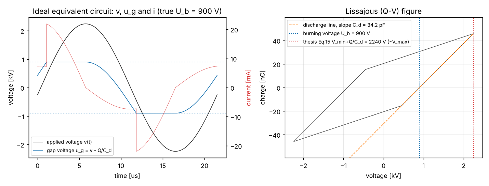

# [석사학위논문] 대기압 DBD 플라즈마의 전기적 진단과 머신러닝 기반 유전체 표면 손상 예측

[English](README.md) | **한국어**

[](https://github.com/MJ-best/ms-thesis-dbd-plasma-diagnostics/actions/workflows/tests.yml)


[](https://colab.research.google.com/github/MJ-best/ms-thesis-dbd-plasma-diagnostics/blob/main/notebooks/tutorial.ipynb)

이 저장소는 아래 석사학위논문의 **계산 방법 전체를 다시 구현해 공개**한 것입니다. 저장소에 들어 있는 것은 다음과 같습니다.

- 학위논문 원문 PDF와 정오표
- 논문을 다시 검증한 보고서
- 설치 없이 실행하는 튜토리얼 노트북(Colab)과 웹 데모 앱
- 2020–2023년에 여러 저장소에 흩어져 있던 MATLAB·Python·노트북 코드를 하나로 정리한 Python 패키지 `dbd_diagnostics`

| 항목 | 내용 |
|---|---|
| 제목 | 저온 대기압 방전 플라즈마의 유전 장벽 표면 손상에 대한 전기적 측정과 머신러닝 분석 기반 손상 예측 |
| 영문 제목 | Electrical measurements and prediction of dielectric barrier surface damage in nonthermal atmospheric pressure dielectric barrier discharge plasma based on machine learning |
| 저자 | 김민준 (Minjun Kim) |
| 학위 | 이학 석사, 광운대학교 대학원 전자바이오물리학과, 2023학년도 (2023년 12월 인준) |
| 지도교수 | 최은하 |
| 심사위원 | 권기청(위원장), 최은하, 홍영준 |
| 원문 | [thesis/Kim_2023_MS_thesis_DBD_surface_damage_ML.pdf](thesis/Kim_2023_MS_thesis_DBD_surface_damage_ML.pdf) · [DBpia](https://www.dbpia.co.kr/journal/detail?nodeId=T16940279) |
| 정오표 | [docs/erratum.ko.md](docs/erratum.ko.md) · [PDF](thesis/Kim_2023_MS_thesis_erratum_ko.pdf) · [English](thesis/Kim_2023_MS_thesis_erratum_en.pdf) |

---

## 목차

1. [연구 개요](#1-연구-개요)
2. [논문 초록](#2-논문-초록-원문)
3. [분석 파이프라인](#3-분석-파이프라인)
4. [주요 결과와 검증 요약](#4-주요-결과와-검증-요약)
5. [설치와 사용법](#5-설치와-사용법)
6. [저장소 구성](#6-저장소-구성)
7. [문서](#7-문서)
8. [출처: 기존 저장소와 초안 위치](#8-출처-기존-저장소와-초안-위치)
9. [데이터](#9-데이터)
10. [인용](#10-인용)
11. [라이선스](#11-라이선스)

---

## 1. 연구 개요

대기압 **마이크로 갭 표면 DBD**(dielectric barrier discharge)는 반도체 세정, 표면처리, 의료, 농업 등 여러 분야에서 쓰이는 저온 플라즈마원입니다. 이 플라즈마원은 다음과 같은 과정을 거쳐 고장 납니다.

1. 전극을 덮은 유전체가 방전으로 깎여 나갑니다.
2. 전극이 노출되면 방전이 불안정해집니다.
3. 결국 방전이 완전히 멈춥니다.

이 연구는 **추가 센서 없이 전압·전류 파형만으로** 이 손상을 진단하고 예측하는 방법을 제시합니다.

- **장치**:
  - 150 µm × 300 µm 크기의 Ag 전극 패드 126쌍이 100 µm 간격으로 마주 보는 동일평면 구조입니다.
  - 전극 두께는 약 10 µm, 스크린 인쇄로 만든 유전체 두께는 약 40 µm입니다.
  - 공기 중에서 약 46.5 kHz, 약 1.5 kV_rms로 구동합니다.
- **측정 장비**:
  - 고전압 프로브: Tektronix P6015A
  - 전류 프로브: Tektronix P6021A
  - 오실로스코프: GW Instek GDS-2102A
  - 설정: 10 ns 간격, 5000점, 8-bit
- **실험**:
  - 장치 2개(m1, m2)를 방전이 멈출 때까지 수십 시간 동안 연속 운전했습니다.
  - 5시간마다 약 20개의 파형을 캡처했습니다.
  - 표면이 손상된 사실은 광학현미경, SEM, EDS로 확인했습니다(Ag 0.57% → 13.86%).
- **분석**:
  - 파형에서 14개 특성을 계산했습니다(V_rms, I_rms, 에너지, 리사주 커패시턴스, 방전 전하, 방전 개시·방전전압, 방전 횟수, 전자밀도, 전자온도 등).
  - 이 특성으로 LR, DT, RF, GB, SVM, kNN 분류기를 학습해 표면 상태를 **정상** 또는 **손상**으로 판별했습니다.

## 2. 논문 초록 (원문)

> 본 연구에서는 유전 장벽 방전 플라즈마의 안정적인 방전에 영향을 주는 요소 중 유전체 표면 손상을 전기적 측정 데이터와 인공지능 알고리즘을 통해 진단하고 손상여부를 예측하였다.
> 유전체 장벽 방전 플라즈마에 대한 전기적 측정을 통해 플라즈마 방전 특성을 계산하였다. 전압 실효값, 전류 실효값, 초당 방전 에너지, 방전개시 전압, 방전전압, 방전횟수, 전자밀도, 전자온도, 커패시턴스, 방전 전하량을 확인하였다.
> 표면 손상의 전과 후 플라즈마 방전특성의 변화를 확인하였다. 표면 손상으로 인해 전압 실효값, 전류 실효값, 방전개시 전압, 방전전압, 전자온도는 감소하였으며 방전 횟수, 전자밀도, 커패시턴스, 방전 전하량은 증가하였다.
> 플라즈마 방전으로 인해 생겨난 전극표면 유전체의 손상을 광학현미경, SEM, EDS 분석을 통해 확인하였으며 유전체의 손상으로 인한 전극의 노출을 실험적으로 확인하였다.
> 표면의 손상으로 인해 달라지는 플라즈마 방전 특성을 머신러닝 모델로 학습하였다. 로지스틱 회귀, 결정 트리, 랜덤 포레스트, 서포트 벡터 머신, k-최근접이웃모델 알고리즘을 통해 플라즈마의 방전 특성 파라미터를 입력하여 표면의 손상 여부를 분류하고 예측했다.
> 본 연구를 통해 대기압 유전 장벽 플라즈마 기기 수명에 영향을 미치는 유전체 표면 손상을 예측하고 진단할 수 있는 하나의 방법을 제시하였다.

※ 초록의 일부 서술은 [검증 보고서](docs/thesis-review.ko.md)에서 정정되었습니다. 해당 서술은 "초당 방전 에너지", 방전전압·전자온도의 값, 그리고 방전 횟수·전자밀도·전류 실효값의 변화입니다. 전압 실효값의 변화도 대조 장치와 비교하면 약 절반으로 줄어듭니다. 자세한 내용은 [4절](#4-주요-결과와-검증-요약)을 참고하세요.

## 3. 분석 파이프라인

```
오실로스코프 CSV (t, v, i)
 │  io.load_csv            GW Instek Format 2.0A 헤더를 해석 (프로브 배율, V/div, 샘플링 간격)
 ▼
주기 분할·오프셋 제거       waveform / electrical: 완전 주기마다 계산한 뒤 평균
 │
 ├─ 전기량                  V_rms, I_rms, 1주기 에너지 E = ∫v·i dt, 평균 전력 P = E·f
 ├─ 리사주(Q–V) 분석         lissajous: C_total, C_dielectric, C_gas, 이동 전하 ΔQ,
 │                            방전 개시점, burning voltage U_b, Manley 에너지
 ├─ 방전 펄스                discharge: 방전 횟수, 방전 개시 전압 (논문 방식 + 잡음 기준 방식)
 └─ 플라즈마 변수            plasma: Paschen, E/N, 이동도, n_e, T_e (D/μ 표)
 ▼
특성표 (features.extract)  논문 14개 특성 + 보정 특성
 ▼
머신러닝 (ml)              Pipeline(StandardScaler, 모델), 장치 단위 교차검증,
                           binary·macro 지표를 구분해 보고, 장치별 기준값 정규화
```

모든 수식은 [docs/methods.ko.md](docs/methods.ko.md)에 정리했습니다.



*내장 시뮬레이터로 만든 이상적인 등가회로 예시입니다. 논문 식 (15) V_min + Q_max/C_d(빨강)를 계산하면 인가전압의 최댓값(2.24 kV)이 나옵니다. 반면 기체에 실제로 걸리는 방전 유지 전압 U_b(파랑)는 0.90 kV입니다.*

## 4. 주요 결과와 검증 요약

논문의 수식, 수치, 통계, 머신러닝 평가, 참고문헌을 모두 다시 확인했습니다. 원본 데이터(장치 m1·m2)도 새 패키지로 다시 분석했습니다. 이어서 원본 아카이브 전체를, 손상 없이 병렬로 운전한 세 번째 장치 m3를 대조군으로 삼아 점검했습니다. 전체 내용은 **[검증 보고서](docs/thesis-review.ko.md)** 와 **[원본 데이터 검증](docs/raw-data-verification.ko.md)** 에 있습니다.

| 항목 | 논문 | 재분석·보정 결과 |
|---|---|---|
| 측정값 재현 | E 0.13 mJ, C_d 34.2 pF, Q_max 59.4 nC | 0.131 mJ, 34.5 pF, 59.5 nC로 **그대로 재현됨** |
| 에너지 | "초당 방전 에너지 0.13 mJ" | **1주기당 0.13 mJ**이며, 평균 전력은 **≈ 6 W** |
| 방전전압 | V_min + Q/C_d = 2.1 kV | 이 식은 등가회로에서 V_max와 같아짐. 실제 burning voltage는 **U_b ≈ 0.81–0.86 kV**로 Paschen 값(0.72–0.87 kV)과 일치 |
| 전자온도 | 13 eV (E/N = 814 Td, 175 Td에서 끝나는 데이터를 OriginLab으로 외삽) | **≈ 6 eV** (E/N ≈ 330 Td, 출처 곡선 끝 300 Td를 조금 넘음) |
| 손상에 따른 변화 | 방전 횟수·전자밀도 증가, I_rms 감소 | 논문 수치로 검정하면 방전 횟수와 전자밀도는 유의하지 않음(p = 0.89, 0.78). 재분석에서도 I_rms는 유의하지 않고(p = 0.27) 오실로스코프 A/div 설정에 따라 달라짐. 손상 없는 대조 장치 m3 대비로 두 손상 장치 모두에서 유지되는 것은 V_rms 감소(≈ −48 V, 단순 하락의 약 절반)뿐임 |
| 손상 분류 | RF 검증 정확도 96.9% | 장치 간 교차 평가(한 장치로 학습, 다른 장치로 시험)에서 DT·RF·GB 95–99%. 무작위 분할은 100%로 낙관적. **V_rms 하나만으로도 AUC ≈ 1.0**. 그러나 손상 없는 m3의 저전압 세션 캡처를 95–100 % "손상"으로 판정하며, m3 기준으로 보정하면 장치 간 정확도는 65–78 %(DT·RF·GB; 6개 모델 전체 64–89 %) |
| 전조증상 (5.7절) | 정상 확률이 10% 이상 감소하면 전조 | 표 7·8에서 확률이 0.886 → 0.909, 0.816 → 0.818로 변해 근거가 없음 |
| EDS (표 3) | Ag 0.57 → 13.86 % | 정확히 재현됨. 값은 단일 10,000배 맵의 **원자 %**이며 정상 열은 Ref 시료. 전체 맵에서 손상부 1.3–13.9 at.%, 온전한 유전체 0.0–0.7 at.% |

**결론**: 표면 손상은 실제로 일어났고 측정 가능한 전기적 흔적을 남깁니다. 다만 그 흔적은 논문이 보고한 것보다 약합니다. V_rms 하락의 약 절반은 손상 없는 장치와 공통인 전원 변동이므로, 경보에는 대조 장치나 같은 세션의 기준값이 필요합니다. 다음 다섯 가지는 수정이 필요합니다.

- 물리량(V_b, T_e, n_e)의 해석
- 전조증상 주장
- 통계 서술
- 평가 방법
- 손상 효과와 세션·오실로스코프 설정 효과의 분리

## 5. 설치와 사용법

```bash
git clone https://github.com/MJ-best/ms-thesis-dbd-plasma-diagnostics.git
cd ms-thesis-dbd-plasma-diagnostics
pip install -e ".[dev]"     # numpy, scipy, pandas, scikit-learn (+ matplotlib, pytest)
pytest                      # 테스트 24개
```

**명령줄 도구 `dbd-diag`**

```bash
dbd-diag simulate -o demo.csv
dbd-diag analyse demo.csv
dbd-diag extract 측정폴더/ -o features.csv
python examples/demo_synthetic.py
```

위 네 명령은 차례로 다음 작업을 합니다.

1. 126셀 합성 DBD 파형을 만듭니다(100 MS/s, 8-bit 오실로스코프를 흉내 냄).
2. 캡처 하나의 모든 물리량을 출력합니다.
3. 폴더 안의 캡처를 하위 폴더까지 일괄 처리해, 캡처마다 한 행씩 특성을 추출합니다.
4. 3절의 그림을 다시 만듭니다.

**Python에서 사용하기**

```python
from dbd_diagnostics import io, features, ml

wf = io.load_csv("ALL0001.CSV")          # GW Instek CSV 또는 t,v,i 형식 CSV
r = features.extract(wf)                  # 완전 주기 평균
print(r["power"], r["c_dielectric"], r["u_b"], r["te_corrected"])

# 장치 단위 교차검증 (df: 특성표, label: 0 정상 / 1 손상, device: 장치 ID)
res = ml.group_holdout(df, ml.THESIS_FEATURES, label="label", group="device")
print(ml.results_table(res))
```

**원본 데이터 재분석**: `python examples/reanalyse_thesis_data.py <m1_data> <m2_data>`를 실행하면 검증 보고서 H절의 결과가 다시 만들어집니다. `python examples/verify_raw_archive.py "<아카이브>/전류전압 측정" "<아카이브>/전압에 따른 QV 변화/I 기준으로 계산"`은 [원본 데이터 검증](docs/raw-data-verification.ko.md)의 대조 장치 분석을 재현합니다.

**모델 학습과 예측**: 직접 라벨을 붙인 데이터로 분류기를 학습하고, 저장한 모델로 새 캡처를 판별합니다.

```bash
dbd-diag extract 측정폴더/ -o features.csv     # 1) 특성 추출
# 2) features.csv에 label(0 정상 / 1 손상)과 device(장치 ID) 열을 추가
dbd-diag train features.csv -o model.joblib   # 3) 장치 단위 교차검증 결과를 출력한 뒤 전체 데이터로 학습
dbd-diag predict model.joblib 새캡처/          # 4) 새 캡처 판별
```

### 튜토리얼 노트북

[`notebooks/tutorial.ipynb`](notebooks/tutorial.ipynb)는 파형 → 리사주 → U_b → 펄스 → E/N·T_e → 장치 간 머신러닝까지 한 단계씩 따라가는 노트북입니다. README 위쪽의 **Open in Colab** 배지를 누르면 설치 없이 브라우저에서 실행할 수 있습니다.

### 웹 데모 앱

```bash
pip install -e ".[app]"
streamlit run app/streamlit_app.py
```

브라우저에서 다음 기능을 쓸 수 있습니다.

- 오실로스코프 CSV를 올리거나 합성 파형을 만들 수 있습니다(등가회로 변수를 슬라이더로 조절).
- 파형, 기체 갭 전압, 리사주 그래프, 전체 물리량 표를 보여 줍니다. 표는 CSV로 내려받을 수 있습니다.
- **상태 점검**: 같은 장치의 초기 정상 상태(기준값) 대비 V_rms, C_dielectric, U_b 변화를 보여 주고, V_rms 감소가 임계값을 넘으면 경고합니다.
- **모델 예측**: `dbd-diag train`으로 만든 모델 파일을 불러와 손상 여부를 판별합니다.

인터넷에 공개하려면 [Streamlit Community Cloud](https://streamlit.io/cloud)에서 이 저장소를 선택하고, main file을 `app/streamlit_app.py`로 지정하면 됩니다. 필요한 패키지는 `app/requirements.txt`에 적혀 있습니다.

## 6. 저장소 구성

```
thesis/                         학위논문 원문 PDF (CC BY-NC-ND 4.0), 정오표 PDF (한/영)
app/                            Streamlit 웹 데모 앱
src/dbd_diagnostics/
  io.py          오실로스코프 CSV 읽기
  waveform.py    주기 검출, 정수 주기 구간
  electrical.py  실효값, 1주기 에너지, 전력, 오프셋을 제거한 전하 적분
  lissajous.py   리사주 분석, 등가회로, burning voltage, Manley 에너지
  discharge.py   펄스 검출(논문 방식 + 잡음 기준), 방전 횟수, 개시 전압
  plasma.py      Townsend/Paschen, E/N, 이동도, n_e, T_e
  features.py    특성 일괄 추출 (논문 특성 + 보정 특성)
  ml.py          분류기, 명시적 지표, 장치 단위 검증, 기준값 정규화
  simulate.py    합성 파형 (이상 Manley 모델, 126셀 확률 모델)
  plots.py       파형·리사주 그림
  cli.py         명령줄 도구 dbd-diag (extract, analyse, simulate, train, predict)
  data/          D/μ 표 (논문 그림 15를 디지타이즈)
docs/            계산 방법·검증 보고서·정오표 (한/영), 기존 코드 대응표, 그림
notebooks/       단계별 튜토리얼 (Colab)
examples/        합성 데모, 원본 데이터 재분석·원본 아카이브 검증 스크립트
tests/           테스트 24개 (정답을 아는 등가회로로 각 식을 검증, CLI·앱 동작 확인)
```

## 7. 문서

| 문서 | 내용 |
|---|---|
| [docs/methods.ko.md](docs/methods.ko.md) · [EN](docs/methods.md) | 단계별 수식, 가정, 논문 식 번호와의 대응 |
| [docs/thesis-review.ko.md](docs/thesis-review.ko.md) · [EN](docs/thesis-review.md) | 학위논문 검증 보고서. 수식 (1)–(32), 수치, 측정 체인, 통계, 머신러닝, 참고문헌, 원본 코드 감사, 재분석 결과 |
| [docs/raw-data-verification.ko.md](docs/raw-data-verification.ko.md) · [EN](docs/raw-data-verification.md) | 원본 아카이브 전체 검증: 대조 장치 m3, 세션 효과, 오실로스코프 설정, 현미경 사진, EDS 출처 |
| [docs/erratum.ko.md](docs/erratum.ko.md) · [EN](docs/erratum.md) | 학위논문 정오표: 쪽·위치·원문·수정. PDF는 `thesis/`에 있음 |
| [notebooks/tutorial.ipynb](notebooks/tutorial.ipynb) | 단계별 튜토리얼 (Colab에서 실행 가능) |
| [docs/legacy-code-map.md](docs/legacy-code-map.md) | 기존 알고리즘과 새 모듈의 대응, 수정한 버그 목록 |

## 8. 출처: 기존 저장소와 초안 위치

이 저장소는 아래 6개 저장소의 작업을 정리한 결과물입니다. 원래 저장소는 모두 **비공개**이며 내용과 이력이 그대로 남아 있으므로, 초안이 필요하면 아래 경로에서 찾을 수 있습니다. 기준 커밋은 2026-11-01에 정리할 당시의 기본 브랜치입니다.

### 8.1 저장소 요약

| 저장소 | 기간 | 커밋 수 | 기준 커밋 | 내용 |
|---|---|---|---|---|
| [`plasma-lab`](https://github.com/MJ-best/plasma-lab) | 2020-09 | 5 | `master` @ `71c968d` | 첫 Python 포팅: CSV 읽기, 리사주 구간별 선형 적합 |
| [`plasma-calc`](https://github.com/MJ-best/plasma-calc) | 2020-09 – 2020-10 | 21 | `master` @ `a42f0df` | MATLAB 계산 코드(초기~모듈화), 오존 데이터 분석, Python 초기 코드 |
| [`Atmospheric_Plasma_Diagnosis`](https://github.com/MJ-best/Atmospheric_Plasma_Diagnosis) | 2020-12 – 2023-02 | 10 | `master` @ `980cc2c` | MATLAB 코드 전체(plasma-calc를 포함), 2021년 Python 자동화 |
| [`Plamsa_diagnosis_with_ML`](https://github.com/MJ-best/Plamsa_diagnosis_with_ML) | 2022-11 – 2023-06 | 44 | `main` @ `3e8a5ef` | 논문 시기의 노트북 32개: 특성 계산, 머신러닝, FFT 연구, 앱 |
| [`Plasma_diagnosis_with_ML`](https://github.com/MJ-best/Plasma_diagnosis_with_ML) | 2023-03 | 1 | `master` @ `3252884` | 원본 측정 데이터(CSV 약 650개, 181 MB) |
| [`oscilloscope-calc`](https://github.com/MJ-best/oscilloscope-calc) | 2025-10 – 2026-11 | 14 | `master` @ `a9b23b2` | 최신 노트북 2종과 Flutter 앱(Dart 포팅). 이후 PR #2에서 계산 코드를 이 저장소 방식으로 정정(`master` @ `9b76a80`) |

이 공개 저장소를 정리하기 직전의 중간본(`legacy/` 폴더 포함)은 `Atmospheric_Plasma_Diagnosis`의 `claude/thesis-automation-review-3wo35l` 브랜치(커밋 `09233c0`)에 있습니다.

### 8.2 주제별 초안 위치

| 주제 | 저장소 | 경로 |
|---|---|---|
| 초기 MATLAB 계산 (`ginput`으로 주기를 수동 선택, 리사주 꼭짓점 교점으로 V_b 계산) | plasma-calc | `MATLAB plasma code/20200718 플라즈마 계산코드/thanksgod1.m`, `thanksgod2.m` |
| MATLAB 모듈화 1차 | plasma-calc | `MATLAB plasma code/20200829 데이터 분석 모듈화/` |
| MATLAB 모듈화 최종본 | plasma-calc (Atmospheric_Plasma_Diagnosis `MATLAB_plasma_code/`에도 같은 파일) | `MATLAB plasma code/20201014 새롬바이오 분석코드/csv_to_MATLAB_ginput.m`, `one_period_data_anlaysis.m`, `IV_QV_graph.m`, `save_data.m` |
| 비정현파 에너지 계산 | plasma-calc | `MATLAB plasma code/20201014 새롬바이오 분석코드/[non-sinusoidal_energy_calc] 비정현파플라즈마계산코드.zip` |
| 오존 데이터 분석 (논문 범위 밖) | plasma-calc | `MATLAB plasma code/20201021 오존데이터분석/` |
| 첫 Python 포팅, 구간별 선형 리사주 적합 | plasma-lab | `plasma_calculation.py`, `csv_to_python.py` |
| 2020 Python 초기 버전, 결과 그래프 | plasma-calc | `Python plasma code/plasma.py`, `modules/`, `result_all/` |
| 2021 Python 자동화 | Atmospheric_Plasma_Diagnosis | `Python_plasma_code/Electrical_Diagnosis_20211007.py` (최종), `Electrical_Diagnosis_20211006_ver14.ipynb` |
| E/N·전자온도 초안 (미완성) | Atmospheric_Plasma_Diagnosis | `Python_plasma_code/Electrical_Data_Analysis_20210913_ver10_(Minjun)_최종.ipynb` |
| 2022년 3분류 머신러닝, LazyPredict | Plamsa_diagnosis_with_ML | `Plasma_Surface_modification_diagnostics_with_ML20221201`–`20221219.ipynb`, `plasma_features*.ipynb` |
| 특성 계산 (Q–V 회귀 방전 전하, Peeters ζ_diel) | Plamsa_diagnosis_with_ML | `[feature_Calc]minjun_plasma_diagnosis_with_ML_20230226.ipynb`, `[full_version]…20230225.ipynb` |
| FFT·변위전류 연구 | Plamsa_diagnosis_with_ML | `[Research]minjun_plasma_diagnosis_with_ML_20230227.ipynb`, `…20230228.ipynb` |
| 머신러닝 모델 비교 (AutoViz, DT 가지치기) | Plamsa_diagnosis_with_ML | `[ML_DL_models]minjun_plasma_diagnosis_with_ML_20230226.ipynb` |
| **물리량 계산 최종 노트북** (F-검정 포함) | oscilloscope-calc | `[Function]minjun_plasma_diagnosis_with_ML_20230613.ipynb` (이전 판: Plamsa의 `[Function]…20230425.ipynb`) |
| **최종 머신러닝 학습 + Gradio 앱** | oscilloscope-calc | `[App]minjun_plasma_diagnosis_with_ML_20230425.ipynb` (셀 3–66 학습·검증, 셀 68 앱; Plamsa의 같은 이름 파일보다 내용이 많음) |
| 원본 측정 데이터 | Plasma_diagnosis_with_ML | `plasma_data/m2_data/` (학습 장치, 5–40 h), `m1_data/` (검증 장치, data05–data25), `m3_data/` (5–60 h, 미사용), `KaptonDBD/`, `uDBD_Air_1.5lpm/`, `uDBD_N60_1.5lpm/` |
| 예전 3분류 특성표 | Plasma_diagnosis_with_ML | `plasma_data/m2_data/20200724 M2 40시간/m2_final_data.csv` |
| Flutter/Dart 앱 | oscilloscope-calc | `lib/domain/usecases/plasma_calculator.dart`, `lib/core/utils/peak_detection.dart`, `lib/data/repositories/csv_parser.dart` |

**어느 저장소에도 없는 파일**: 다음 파일은 작성 당시 로컬 PC나 Google Drive에만 있었던 것으로 보입니다.

- `20230426_m1_total_data.csv`, `20230426_m2_total_data.csv`
- `20230226_m2_system_data.csv`, `20230226_m2_positive_data.csv`, `20230226_m2_negative_data.csv`
- `m1_data_final.csv`, `m2_data_final.csv`
- `rf_clf.pkl`

논문의 전자온도도 코드로 계산하지 않았습니다. Raizer 책 그래프의 D/μ 곡선을 Engauge Digitizer로 175 Td까지 디지타이즈하고, OriginLab에서 맞춰 814 Td까지 외삽했습니다. 디지타이즈한 점은 저자가 보관하고 있으며, Origin 프로젝트는 아직 찾지 못했습니다.

논문 표 6을 그대로 재현하려면 이 파일들이 필요합니다.

**기존 코드에서 고친 버그**: 피크 인덱스 오프셋, V_min 부호 매핑, Manley 값에서 ×f 누락, 마지막 주기만 사용하던 문제 등입니다. 전체 목록은 [docs/legacy-code-map.md](docs/legacy-code-map.md)와 검증 보고서 G절에 있습니다.

## 9. 데이터

원본 오실로스코프 데이터는 이 저장소에 포함하지 않았습니다. 데이터가 없어도 내장 시뮬레이터(`dbd_diagnostics.simulate`)로 모든 기능을 실행해 볼 수 있습니다. 원본 데이터는 비공개 저장소 `Plasma_diagnosis_with_ML`에 있습니다. 2020년 7월 실험의 원본 아카이브 전체(M1–M3 전 세션, 전압 스윕, 현미경 사진, SEM/EDS 보고서, 2020년 MATLAB 요약표)는 저자가 보관하며, 구성은 [docs/raw-data-verification.ko.md](docs/raw-data-verification.ko.md)에 정리했습니다.

## 10. 인용

이 코드나 계산 방법, 논문 내용을 사용할 때는 아래 논문을 인용해 주세요. GitHub 오른쪽 사이드바의 "Cite this repository" 버튼으로도 같은 정보를 받을 수 있습니다(`CITATION.cff`).

```bibtex
@mastersthesis{kim2023dbd,
  author = {Kim, Minjun},
  title  = {Electrical measurements and prediction of dielectric barrier surface damage in
            nonthermal atmospheric pressure dielectric barrier discharge plasma based on machine learning},
  school = {Kwangwoon University, Department of Electrical and Biological Physics},
  type   = {M.S. thesis},
  year   = {2023},
  url    = {https://www.dbpia.co.kr/journal/detail?nodeId=T16940279}
}
```

> 김민준, 「저온 대기압 방전 플라즈마의 유전 장벽 표면 손상에 대한 전기적 측정과 머신러닝 분석 기반 손상 예측」, 광운대학교 석사학위논문, 2023.

## 11. 라이선스

| 대상 | 라이선스 | 허용 범위 |
|---|---|---|
| 코드 (`src/`, `tests/`, `examples/`, `app/`, `notebooks/`) | [MIT](LICENSE) | 상업적 이용을 포함해 자유롭게 사용·수정·배포할 수 있습니다. 단, 저작권 고지를 유지해야 합니다. |
| 문서·그림 (`README*`, `docs/`) | [CC BY 4.0](LICENSE-docs.md) | 저작자와 출처를 표시하면 자유롭게 공유·변형할 수 있습니다. |
| 학위논문 PDF·정오표 PDF (`thesis/`) | [CC BY-NC-ND 4.0](thesis/README.md) | 저작자를 표시하고, 비영리 목적으로, 내용을 바꾸지 않는 조건에서 공유할 수 있습니다. 논문 안의 제3자 그림(예: 그림 1, 15의 원 데이터)은 각 원저작자의 권리를 따릅니다. |

© 2020–2026 김민준 (Minjun Kim). 광운대학교 전자바이오물리학과, 지도교수 최은하.
