# [석사학위논문] 대기압 DBD 플라즈마의 전기적 진단과 머신러닝 기반 유전체 표면 손상 예측

[English](README.md) | **한국어**

[](https://github.com/MJ-best/ms-thesis-dbd-plasma-diagnostics/actions/workflows/tests.yml)


[](https://colab.research.google.com/github/MJ-best/ms-thesis-dbd-plasma-diagnostics/blob/main/notebooks/tutorial.ipynb)

이 저장소는 아래 석사학위논문의 **계산 방법 전체를 다시 구현해 공개**한 것입니다. 저장소에 들어 있는 것은 다음과 같습니다.

- 학위논문 원문 PDF와 정오표
- 논문을 다시 검증한 보고서
- 설치 없이 실행하는 튜토리얼 노트북(Colab)과 웹 데모 앱
- 2020–2023년에 여러 저장소에 흩어져 있던 MATLAB·Python·노트북 코드를 하나로 정리한 Python 패키지 `dbd_diagnostics`

| 항목 | 내용 |
|---|---|
| 제목 | 저온 대기압 방전 플라즈마의 유전 장벽 표면 손상에 대한 전기적 측정과 머신러닝 분석 기반 손상 예측 |
| 영문 제목 | Electrical measurements and prediction of dielectric barrier surface damage in nonthermal atmospheric pressure dielectric barrier discharge plasma based on machine learning |
| 저자 | 김민준 (Minjun Kim) |
| 학위 | 이학 석사, 광운대학교 대학원 전자바이오물리학과, 2023학년도 (2023년 12월 인준) |
| 지도교수 | 최은하 |
| 심사위원 | 권기청(위원장), 최은하, 홍영준 |
| 원문 | [thesis/Kim_2023_MS_thesis_DBD_surface_damage_ML.pdf](thesis/Kim_2023_MS_thesis_DBD_surface_damage_ML.pdf) · [DBpia](https://www.dbpia.co.kr/journal/detail?nodeId=T16940279) |
| 정오표 | [docs/erratum.ko.md](docs/erratum.ko.md) · [PDF](thesis/Kim_2023_MS_thesis_erratum_ko.pdf) · [English](thesis/Kim_2023_MS_thesis_erratum_en.pdf) |

---

## 목차

**[논문 전문 (수정·보완본)](#논문-전문-수정보완본)**: [국문 초록](#국문-초록) · [Abstract](#abstract) · [1장 서론](#제1장-서론) · [2장 실험 개요](#제2장-실험-개요) · [3장 플라즈마 특성](#제3장-저온-대기압-dbd-플라즈마-특성-연구) · [4장 유전체 손상](#제4장-저온-대기압-dbd-방전-유전체-손상-연구) · [5장 기계학습](#제5장-기계학습을-응용한-dbd-유전체-손상-진단) · [6장 V_rms의 물리적 해석](#제6장-v_rms-저하의-물리적-해석) · [7장 시뮬레이션](#제7장-등가회로-시뮬레이션에-의한-검증) · [8장 결론](#제8장-결론) · [참고문헌](#참고문헌)

**저장소 안내**

1. [연구 개요](#1-연구-개요)
2. [논문 초록](#2-논문-초록-원문)
3. [분석 파이프라인](#3-분석-파이프라인)
4. [주요 결과와 검증 요약](#4-주요-결과와-검증-요약)
5. [설치와 사용법](#5-설치와-사용법)
6. [저장소 구성](#6-저장소-구성)
7. [문서](#7-문서)
8. [출처: 기존 저장소와 초안 위치](#8-출처-기존-저장소와-초안-위치)
9. [데이터](#9-데이터)
10. [인용](#10-인용)
11. [라이선스](#11-라이선스)

---

## 논문 전문 (수정·보완본)

2023년 학위논문을 원본 데이터 검증과 [정오표](docs/erratum.ko.md)에 따라 고치고, 손상 없는 소스 M3를 대조로 한 분석, V_rms 저하의 물리적 해석, 등가회로 시뮬레이션을 더한 전체본입니다. 원문은 [학위논문 PDF](thesis/Kim_2023_MS_thesis_DBD_surface_damage_ML.pdf), 검증의 세부 근거는 [원본 데이터 검증 보고서](docs/raw-data-verification.ko.md)에 있습니다.

### 국문 초록

저온 대기압 마이크로 전극 표면 DBD 플라즈마 소스의 유전체 표면 손상을 전기적 측정과 머신러닝으로 진단했다. 세 소스(M1, M2, M3)를 같은 조건에서 최대 60시간 방전하며 5시간마다 전압·전류 파형을 기록했고(파형 498개, 1,493주기), 전압 실효값, 전류 실효값, 1주기당 방전 에너지, 방전개시전압, 방전 유지 전압, 방전 횟수, 전자밀도, 전자온도, 커패시턴스, 방전 전하량을 계산했다. 리사주 그래프의 두 기울기, 파센 계산값(718–865 V)과 맞는 방전 유지 전압(사분위 773–888 V), αd = 3–5, 전자온도 약 6 eV는 이 방전이 Manley 등가회로로 기술되는 타운젠트형 DBD 방전임을 보여 준다. 두 소스(M1, M2)는 15시간부터 유전체가 침식되어 Ag 전극이 노출되었고(손상부 Ag 1.3–13.9 at.%), M3는 손상이 없었다. 같은 측정 시점의 M3를 대조로 공통 외부 요인을 빼면, 손상 고유의 전기적 변화는 전압 실효값의 약 3 %(≈ 48 V) 저하였다. 전류 실효값, 방전 횟수, 전자밀도는 오실로스코프 설정에 따라 변해 손상 지표로 쓸 수 없었다. 로지스틱 회귀, 결정 트리, 랜덤 포레스트 등 11개 모델로 손상을 분류한 결과, 공통 외부 요인과 측정 설정을 통제하면 어느 모델도 전압 실효값 하나만 쓴 분류기(AUC 0.94 / 0.75)를 넘지 못했고, 무작위 요인을 바꿔도 전압 실효값이 가장 앞에 남았다. 이 저하는 전극 노출로 방전 유지 전압이 낮아져 방전이 일찍 시작되고 방전 전하량이 늘어 구동전원의 출력 전압이 떨어지는 경로로 크기까지 설명되며, 정상 데이터만으로 보정한 등가회로 시뮬레이션이 그 값과 경향을 재현했다. 따라서 같은 구동 조건의 정상 기준과 비교한 전압 실효값은 DBD 소스의 표면 손상을 감시하는 단순한 지표가 될 수 있다.

**주제어:** 유전체 장벽 방전, 저온 대기압 플라즈마, 표면 손상, 전압 실효값, 등가회로, 리사주 그래프, 머신러닝

### Abstract

Surface damage of the dielectric in a micro-electrode surface DBD source at atmospheric pressure was diagnosed from electrical measurements and machine learning. Three sources (M1, M2, M3) were discharged together under the same conditions for up to 60 h, and voltage and current waveforms were recorded every 5 h (498 waveforms, 1,493 periods). The effective voltage and current, energy per cycle, discharge initiation voltage, burning voltage, number of discharges, electron density and temperature, capacitances and discharge charge were computed. Two-slope Lissajous graphs, a burning voltage consistent with Paschen's law (interquartile 773–888 V against 718–865 V), αd = 3–5 and an electron temperature of about 6 eV identify a Townsend-type DBD described by Manley's equivalent circuit. From 15 h, M1 and M2 showed dielectric erosion and exposed Ag electrodes (Ag 1.3–13.9 at.% at damaged sites); M3 stayed undamaged. With M3 measured at the same time points as the control, the damage-specific change was a drop of the effective voltage by about 3 % (≈ 48 V); the effective current, the number of discharges and the electron density depended on the oscilloscope settings. Among 11 classifiers, none beat the effective voltage alone (AUC 0.94 / 0.75) once the shared external effects and the measurement settings were controlled, and the effective voltage stayed first under random variation of labels, samples, period draws and models. The drop is explained in size by electrode exposure lowering the burning voltage, so that discharges start earlier, the discharge charge grows and the output voltage of the driving power supply falls; an equivalent-circuit simulation calibrated on healthy data only reproduces its values and trends. The effective voltage, compared with a healthy reference under the same drive, is therefore a simple indicator for monitoring surface damage of DBD sources.

**Keywords:** dielectric barrier discharge, atmospheric pressure cold plasma, surface damage, effective voltage, equivalent circuit, Lissajous graph, machine learning

### 제1장 서론

#### 1.1 저온 대기압 방전 플라즈마

랭뮤어(Langmuir)의 정의에 따르면 플라즈마는 "집단 행동(collective behavior)을 하는, 전기적으로 준중성(quasi-neutral)인 이온화된 기체"이다 \[1–3\]. 일반 기체의 입자는 서로 거의 영향을 주지 않고 무작위 브라운 운동을 한다. 플라즈마에서는 하전 입자의 운동이 국소적인 양·음전하 밀도를 바꾸고, 이것이 원거리 쿨롱 힘을 만들어 멀리 있는 입자까지 함께 움직이게 한다.

플라즈마의 특성은 전자온도와 전자밀도로 구분된다. 저온 플라즈마(cold plasma)는 전자온도가 수 eV(약 10⁴–10⁵ K)로 높고 입자온도는 약 300 K로 낮아 열적 비평형 상태에 있다 \[1, 5\]. 저압 플라즈마의 전자밀도는 10¹⁰–10¹³ cm⁻³이고, 대기압 DBD의 미세방전 채널에서는 10¹⁴–10¹⁵ cm⁻³에 이른다 \[61\]. 어느 쪽이든 대기압 기체의 수밀도(약 2.5×10¹⁹ cm⁻³)보다 훨씬 작다. 입자온도가 낮아 열 손상 없이 고온에서나 일어나는 화학반응을 유도할 수 있으므로, 저온 플라즈마는 반도체 제조, 표면처리, 농업, 의료, 환경 등 여러 분야에 응용된다 \[4, 5\].

##### 1.1.1 타운젠트 방전 이론

플라즈마 방전은 전기장에서 에너지를 얻어 가속한 전자에서 시작된다. 이 전자가 중성 입자와 충돌하면 중성 입자가 이온화되어 전자를 내놓고, 새로 생긴 전자도 가속되어 다시 이온화를 일으킨다. 이 전자사태(electron avalanche)로 플라즈마가 만들어진다 \[5, 6\].

타운젠트 방전 이론은 이 과정을 두 계수로 설명한다. 전자가 단위 길이를 진행하는 동안 일으키는 이온화 횟수를 1차 타운젠트 방전계수 α라 하며, α는 기체의 종류, 압력, 온도에 따라 정해진다. 전자밀도 n\_e인 전자가 dx만큼 진행하며 dn\_e의 전자를 만든다면 다음과 같다.

```math
\alpha = \frac{1}{n_e}\frac{dn_e}{dx} \tag{1}
```

전극 거리가 d이고 초기 전자밀도가 n\_0이면, 음극에서 양극까지 간 전자밀도와 이온화로 새로 생긴 전자(즉 이온)의 밀도는 다음과 같다.

```math
n_e(d) = n_0\,e^{\alpha d} \tag{2}
```

```math
\Delta n = n_0\left(e^{\alpha d} - 1\right) \tag{3}
```

전기장으로 가속된 이온이 음극에 충돌하거나 자외선 등이 음극 표면을 때려 방출되는 전자를 이차전자(secondary electron)라 한다. 이온 하나당 방출되는 이차전자 수를 이차전자 발생 계수 γ(2차 타운젠트 방전계수)라 하며, γ는 방전 유지에 중요한 역할을 한다. 이온이 음극에서 만드는 이차전자의 밀도는 다음과 같다.

```math
n_\gamma = \gamma\,n_0\left(e^{\alpha d} - 1\right) \tag{4}
```

이차전자가 초기 전자만큼 생기면 외부의 전자 공급 없이 방전이 유지된다. 양변을 n\_0으로 나누면 자립 방전 조건(타운젠트 조건)을 얻는다.

```math
\gamma\,n_0\left(e^{\alpha d} - 1\right) \ge n_0 \quad\Rightarrow\quad \gamma\left(e^{\alpha d} - 1\right) = 1 \tag{5}
```

##### 1.1.2 파센 법칙

Townsend의 반경험식에 따르면 α는 압력 p와 전기장 V/d에 대해 다음과 같다. A와 B는 기체마다 정해진 상수이다 \[49\].

```math
\alpha = A\,p\,\exp\!\left(-\frac{B\,p\,d}{V}\right) \tag{6}
```

식 (6)을 식 (5)에 넣어 방전전압 V\_b에 대해 풀면 파센 법칙(Paschen's law)을 얻는다 \[5, 7\].

```math
V_b = \frac{B\,pd}{\ln\left(A\,pd\right) - \ln\ln\left(1 + 1/\gamma\right)} \tag{7}
```

식 (7)을 pd에 대해 그린 것이 파센 곡선이다(그림 1). 곡선 위쪽 조건에서는 방전에 충분한 전기장이 걸려 플라즈마가 생길 수 있다. 곡선 아래에서는 방전이 일어나지 않는다. pd가 최소점보다 크면 충돌이 잦아 전자가 이온화 에너지를 얻지 못하고, 작으면 충돌 자체가 부족하기 때문이다.

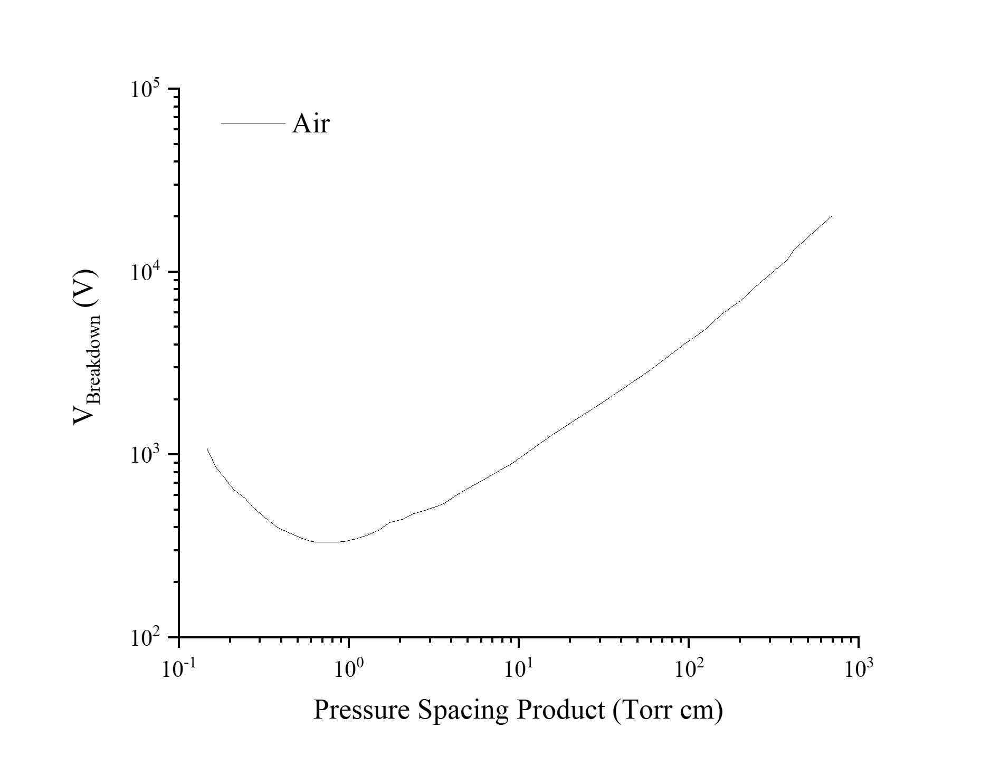

*그림 1. 대기압 공기의 파센 곡선 \[5\]*

##### 1.1.3 대기압 플라즈마의 전극 구조와 방전 형태

대기압 플라즈마는 진공 챔버가 필요 없어 응용 범위가 넓다 \[5, 6, 8\]. 반도체 공정의 세정·표면처리·도핑 \[6, 9, 10\], 의료 분야의 살균·혈액응고 촉진·상처 치료·항암 \[11–16\], 농업의 발아·생장 촉진 \[17\] 등에 쓰인다.

전극 구조는 유전체로 표면 전하를 방전에 이용하는 유전체 장벽 방전(dielectric barrier discharge, DBD)과 유전체 없이 방전하는 직접 방전(direct discharge)으로 나뉜다 \[5, 18–23\].

- **직접 방전(그림 2(a)).** 전극 사이의 고전압으로 방전한다. 전극이 플라즈마에 직접 닿아 자체 스퍼터링(self-sputtering)이 생길 수 있고, 방전 전류가 전극으로 바로 흘러 전극이 가열된다. 방전 시간이 길어지면 열 효과가 방전 특성에 영향을 준다.
- **표면 DBD(그림 2(b))와 플라즈마 제트(그림 2(c)).** 둘 다 DBD 구조이다. 유전체가 방전 전류가 회로로 흐르는 것을 막고 표면에 벽전하를 쌓는다. 1857년 지멘스(Siemens)의 오존 발생기부터 쓰여 왔다 \[5, 6\]. 벽전하가 내부 전계를 만들어, 비교적 낮은 인가전압에서 플라즈마를 만들고 유지할 수 있다.

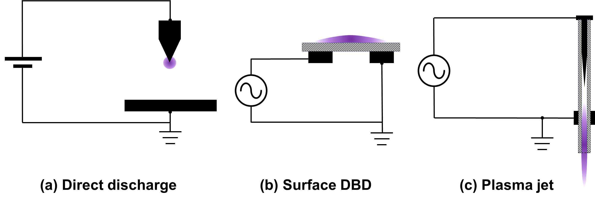

*그림 2. 대기압 방전 플라즈마의 전극 구조. (a) 직접 방전 (b) 표면 DBD (c) 플라즈마 제트*

##### 1.1.4 마이크로 전극 표면 DBD

본 연구의 전극 구조는 그림 2(b)의 표면 DBD이며, 전극 간격은 100 µm이다. 식 (7)에 따른 대기압 공기의 방전전압은 약 0.7–0.9 kV이다. 유전체가 직렬 커패시터로 작용하므로, 방전에 필요한 인가전압은 이보다 높은 약 2 kV(최댓값)이다.

파센 식은 평행 평판 전극의 값이다. 실제 방전은 전기장이 강하게 모이는 전극 모서리에서 먼저 일어나, 불균일한 전기장에서 플라즈마가 형성된다. 이런 방전이 지속되면 전극을 덮은 유전체 중 특정 영역이 자체 스퍼터링, 산화, 열 효과로 손상된다 \[24–28\].

유전체 표면은 벽전하를 유지하고 회로에 방전 전류가 흐르지 않게 막는다. 그래서 유전체 손상은 플라즈마 특성과 회로 안정성을 해친다. 그림 3(b)는 실험 중 유전체 표면이 손상되어 수 초간 불안정한 방전이 이어진 뒤 방전이 완전히 꺼진 모습이다. 따라서 표면 손상을 알아내는 것은 안정적인 방전 유지와 회로 보호에 중요하다.

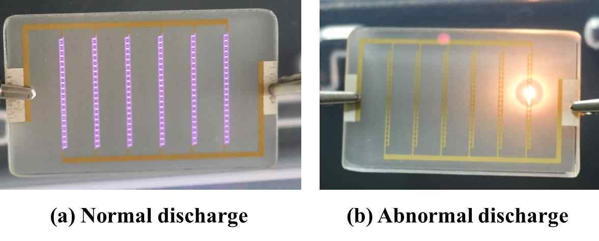

*그림 3. (a) 정상 방전 (b) 유전체 표면 손상으로 인한 비정상 방전*

#### 1.2 플라즈마 연구에서의 인공지능 응용

인공지능은 대량의 다차원 데이터로 복잡한 문제를 푸는 데 특화되어 있다 \[29–32\]. 전기적 진단 데이터에는 방전 에너지, 방전 전하량, 커패시턴스, 전자온도, 전자밀도 등 플라즈마의 물리적 특성이 담겨 있다. 인공지능은 시뮬레이션보다 적은 계산 자원으로 빠르게 결과를 내므로 실시간 진단과 예측에 유용하며 \[33–36\], 플라즈마 진단 \[37\], 전자온도 예측과 조건 최적화 \[38, 39\], 처리 효과의 분류와 최적화 \[40, 41\] 등에 쓰이고 있다.

다만 측정 데이터에는 측정 설정과 실험 환경의 변화도 함께 담긴다. 따라서 모델이 무엇을 배웠는지 물리적으로 확인해야 한다. 본 논문은 이를 위해 교란 요인을 통제한 평가와 물리 모델에 의한 해석을 함께 쓴다.

#### 1.3 연구 목적과 구성

본 연구는 전기적 진단으로 플라즈마 특성을 구하고, 이를 머신러닝의 입력으로 써서 유전체 표면 손상을 진단한다. 손상은 126개 셀 쌍에 고르게 일어나지 않고, 측정된 방전이 손상 셀의 영향을 얼마나 담는지도 알 수 없다. 그래서 어떤 전기적 특성이 손상을 나타내는지는 여러 측정을 통계적으로 비교해야 알 수 있다.

논문의 구성은 다음과 같다.

1. 2장은 소스와 측정 장치, 장시간 방전 실험을 설명한다.
2. 3장은 전기적 특성과 등가회로 모델을 설명하고, 이 소스의 방전이 문헌의 DBD 방전과 일치함을 보인다.
3. 4장은 장시간 방전으로 생긴 표면 손상과, 손상 없는 소스 M3를 대조로 구한 전기적 변화를 다룬다.
4. 5장은 머신러닝으로 손상 지표를 찾고, 전압 실효값 V\_rms가 가장 일관된 지표임을 보인다.
5. 6장은 V\_rms 저하를 물리적으로 해석하고, 7장은 등가회로 시뮬레이션으로 그 해석을 검증한다.
6. 8장에서 결론과 한계를 정리한다.

### 제2장 실험 개요

#### 2.1 저온 대기압 마이크로 전극 표면 DBD 플라즈마 소스

##### 2.1.1 전극 구조

소스는 전극 간격을 100 µm로 설계해, 파센 법칙에 따라 대기압의 저주파 AC 전원에서 안정적으로 방전하도록 만들었다(그림 4).

- 실제로 방전이 일어나는 영역은 150 µm × 300 µm 크기의 전극 패드(셀)이다. 셀 두 개가 100 µm의 공기갭을 두고 마주 보며, 이런 셀 쌍 126개가 전기적으로 병렬 연결되어 각 셀에서 방전이 일어난다.
- 전극(Ag)과 유전체는 스크린 인쇄로 만들었다. SEM으로 잰 두께는 전극 약 10 µm, 유전체 약 30–40 µm이다(그림 5).
- 얇은 유전체로 큰 커패시턴스와 벽전하를 유지하고, 전극을 가는 가지 모양으로 만들어 전극 저항에 의한 열 효과를 줄였다. 그래서 장시간 방전에도 전극 저항에 의한 열 손상이 작다.

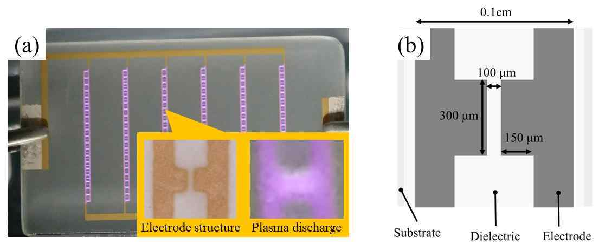

*그림 4. (a) 저온 대기압 마이크로 전극 표면 DBD 플라즈마의 방전 사진과 전극 구조(윗면) (b) 전극 구조도(윗면)*

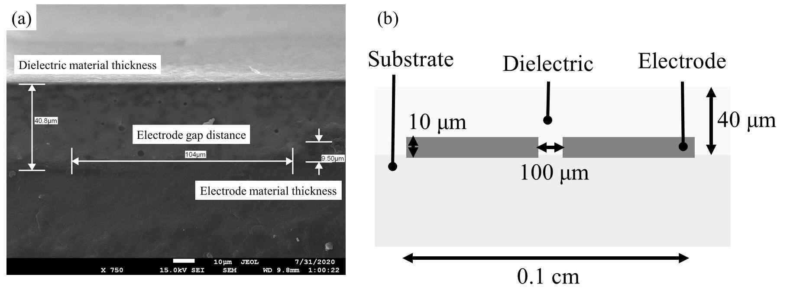

*그림 5. (a) SEM으로 관찰한 전극 구조(옆면) (b) 전극 구조도(옆면)*

##### 2.1.2 실험 장치와 측정 조건

- 전압은 고전압 프로브(Tektronix P6015A, 1000×)를 고전압 전극과 접지 전극 사이에 병렬로 연결해 재고, 접지 전극으로 흐르는 전류는 전류 프로브(Tektronix P6021A)로 재다. 두 프로브를 오실로스코프(GW Instek GDS-2102A)에 연결해 시간에 따른 전압과 전류를 기록했다.
- 샘플링 간격은 10 ns(일부 20 ns), 기록 길이는 5000점(10 ns에서 약 2.3주기), 분해능은 8비트(전압 40 V/LSB, 전류 1.6–8 mA/LSB)이고, 전류 프로브의 대역폭은 60 MHz이다. 수 ns 길이의 미세방전 펄스를 충분히 기록할 수 없으므로, 방전 횟수와 피크 전류는 하한값이다.
- 전류 스케일(0.04–0.4 A/div)과 샘플링 간격(10 / 20 ns)은 측정 시점 사이와 측정 시점 안에서 바뀌었다. 그 영향은 4.4.3절에서 다룬다.

**표 1.** 방전 시작 시의 전기적 측정값 (대기, 공급 입력 8.5 V)

|  | 구동 주파수 | V\_rms | I\_rms |
| --- | --- | --- | --- |
| 학위논문 표 1 | 46.5 kHz | 1.5 kV | 19.8 mA |
| 원본 데이터 재분석, M1 5 h | 46.95 kHz | 1484 V | 20.1 mA |
| 원본 데이터 재분석, M2 5 h | 46.9 kHz | 1481 V | 20.3 mA |

##### 2.1.3 실험 방법

- 2020년 7월, 세 소스(M1, M2, M3)를 같은 조건에서 함께 방전했다. 세 소스는 같은 상용 전원에서 소스별 멀티탭으로 나누고, 소스마다 DC 파워서플라이를 거친 각자의 AC 구동전원(공급 입력 8.5 V)으로 운전했다.
- 5시간마다 측정했다. 측정 구간은 M1 0–25 h, M2 0–40 h, M3 0–60 h이다.
- 누적 방전 시간이 같은 때마다 세 소스를 같은 구동·측정 조건에서 연달아 재어 하나의 데이터셋으로 묶었다. 이를 **측정 시점**이라 한다. 측정 순서는 M1 → M2 → M3이고, 세 소스를 10–33분 안에 모두 쟀다.
- 측정 시점마다 소스별로 상세 파형 20개(10 ns 간격 10개, 20 ns 간격 10개)를 기록하고 광학 현미경 사진을 찍었다.
- M1·M2는 15 h부터 표면 손상이 관찰되었고, 수십 시간 뒤 방전이 완전히 꺼졌다. M3는 60 h까지 표면 손상이 없었다. M3는 M1·M2와 같은 조건에서 함께 방전한 **정상 비교군**이며, 전원·환경 변동에 대한 대조 소스이다.
- 20 h 시점에는 공급 입력전압을 8.5, 9, 10, 14 V로 바꾸어 가며 측정했다(공급전압 스윕).
- 분석에는 5 h 이후 측정 시점의 파형 500개 가운데 주기 검출에 실패한 2개를 뺀 498개를 썼다. 여기에는 완전한 주기가 1,493개 들어 있고, 모든 특성은 주기마다 계산해 파형별로 평균했다.
- 해석 코드와 재현 스크립트는 [공개 저장소](https://github.com/MJ-best/ms-thesis-dbd-plasma-diagnostics)에 있다.

#### 2.2 유전체 손상 문제

유전체 표면의 손상은 안정적인 방전에 큰 영향을 준다. 손상으로 전극이 노출되면 방전 에너지, 방전전압, 커패시턴스 등 방전 특성이 바뀌고, 플라즈마의 발생과 유지에 나쁜 영향을 준다.

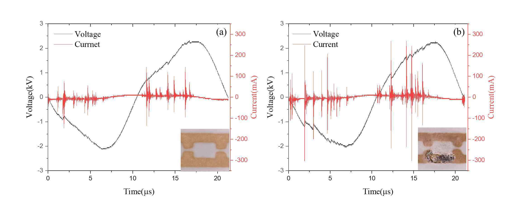

*그림 6. 전류전압 그래프와 방전 셀 사진. (a) 표면 손상 전 (b) 표면 손상 후. 단일 파형의 예시이다.*

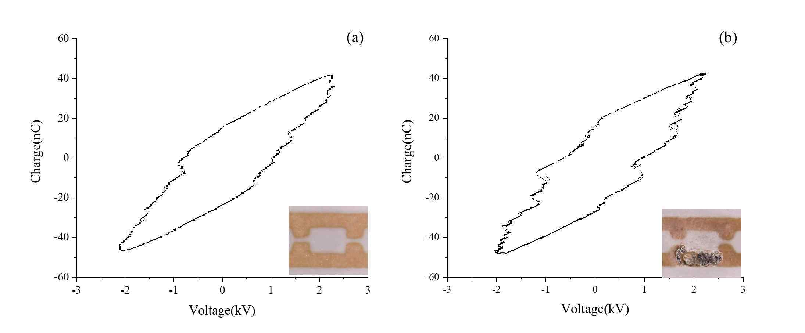

*그림 7. 리사주 그래프와 방전 셀 사진. (a) 표면 손상 전 (b) 표면 손상 후*

- 그림 6의 파형에서는 손상 후 방전 전류가 약 100 mA에서 250 mA로 커지고 방전개시전압이 약 500 V에서 400 V로 낮아진다. 그러나 이는 단일 예시이다.
- 같은 전류 스케일(0.1 A/div)의 파형끼리 비교하면 피크 전류는 M2 251 → 272 mA(p = 0.25), M1 252 → 213 mA로 일관된 증가가 없다. 방전개시전압은 M2 675 → 607 V(p = 0.09), M1 821 → 556 V(p = 4×10⁻⁵)로 낮아졌다.
- 그림 7에서는 손상 후 리사주 그래프 각 변의 기울기가 바뀌고 형태가 일그러진다.

이처럼 손상으로 방전 특성이 바뀐다는 것은 실험적으로 확인된다. 그러나 유전체 표면의 변화는 표면 산화, 기체 상태, 표면 형상에 따른 전기장 변화 등 여러 요인의 영향을 받는다. 또 측정값에는 구동전원과 측정 설정의 변화도 함께 담긴다. 그래서 본 연구는 여러 전기적 특성을 머신러닝으로 학습하되, 같은 측정 시점의 정상 소스 M3를 기준으로 손상과 무관한 변화를 걸러낸 뒤 통계적으로 손상을 진단한다.

### 제3장 저온 대기압 DBD 플라즈마 특성 연구

이 장은 전기적 특성을 구하는 방법과 값을 정리하고(3.1절), 등가회로 모델로 이 소스의 방전이 문헌의 DBD 방전과 일치함을 보인다(3.2절). 값은 따로 적지 않으면 학위논문의 학습 소스(M2)의 정상(5·10 h)과 손상(15–40 h) 구간 값이다.

#### 3.1 전기적 특성

##### 3.1.1 전류전압 그래프와 방전 시점

전류전압 그래프로 방전 시점을 알 수 있다(그림 8) \[5, 42\].

- T₁에서 방전이 시작된다. 이때의 인가전압이 **방전개시전압 V\_min**이며, 크기는 실험적으로 약 300–700 V(평균 504.5 ± 168.8 V)이다. 이 논문에서는 같은 값을 V\_on으로도 쓴다.
- T₂에서 인가전압이 최댓값 V\_max에 이르고 방전이 끝난다.
- T₃에서 인가전압의 극성이 바뀌면, 이전 방전(T₁–T₂) 동안 쌓인 벽전하의 내부 전기장과 외부 전기장이 더해져 다시 방전이 시작된다. T₄에서 V\_max에 이르며 방전이 끝난다.
- 저주파 AC 구동의 DBD는 이처럼 방전하는 1/4 주기와 방전하지 않는 1/4 주기를 반복한다.

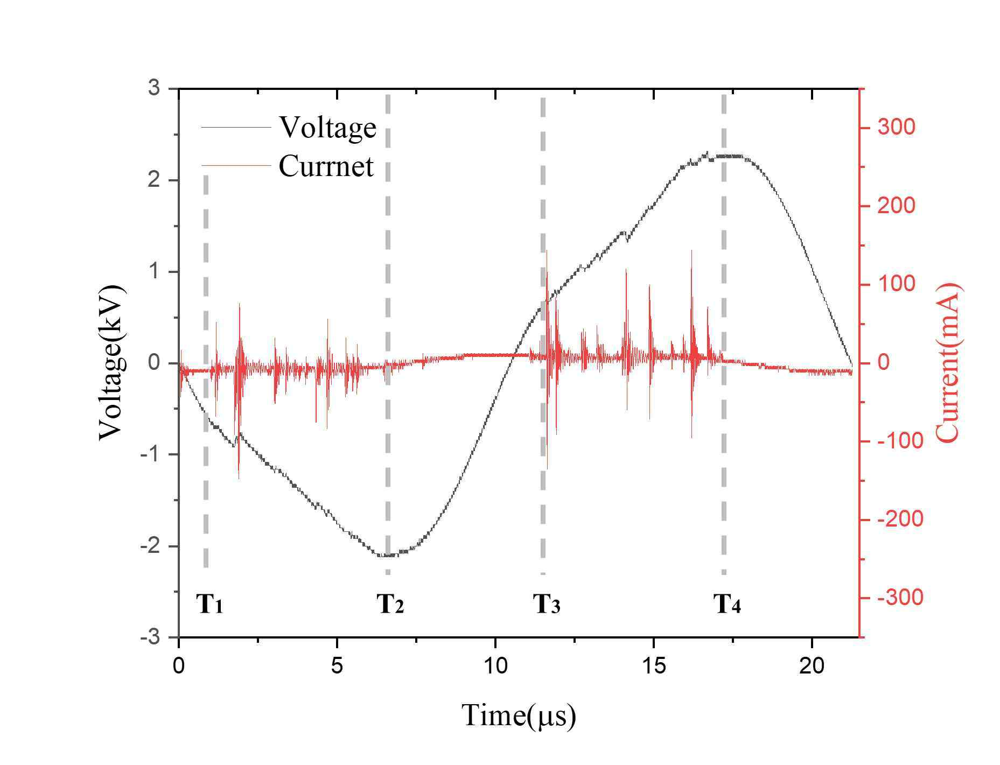

*그림 8. 전류전압 그래프. T₁, T₃: 방전개시 시점, T₂, T₄: 방전 종료 시점*

##### 3.1.2 전압 실효값, 전류 실효값, 주기당 방전 에너지

전압 실효값 V\_rms와 전류 실효값 I\_rms는 시스템 전체의 전기적 특성을 비교하는 데 쓰인다. 주기 T 동안의 제곱평균제곱근(RMS)으로 구한다.

```math
V_{rms} = \sqrt{\frac{1}{T}\int_0^T v(t)^2\,dt}, \qquad I_{rms} = \sqrt{\frac{1}{T}\int_0^T i(t)^2\,dt} \tag{8}
```

방전이 한 주기 동안 소모하는 에너지는 다음과 같다. 평균 전력은 이를 주기로 나눈 값이다.

```math
E = \int_0^T v(t)\,i(t)\,dt \;\;[\mathrm{J/cycle}], \qquad P = \frac{E}{T} \tag{9}
```

- V\_rms는 정상 1.50 ± 0.017 kV, 손상 1.40 ± 0.049 kV이다. 다만 손상 없는 M3도 같은 측정 시점들에서 V\_rms가 낮아졌다(예: 10 h 1502 V → 15 h 1369 V). 손상 고유의 감소는 약 48 V이며 4장에서 다룬다.
- I\_rms는 정상 20.8 ± 4.0 mA, 손상 18.6 ± 6.3 mA이다.
- 주기당 방전 에너지는 정상 0.13 ± 0.022 mJ, 손상 0.13 ± 0.024 mJ이고, 평균 전력(f = 46.5 kHz)은 약 6.0 W이다.

##### 3.1.3 방전 유지 전압

DBD의 유전체는 일종의 커패시터이다. 방전이 일어나면 플라즈마가 전하를 유전체 표면으로 옮겨 인가전압과 반대 극성의 벽전하를 쌓고, 벽전하가 만드는 내부 전기장이 공기갭의 전기장을 약하게 해 방전이 끝난다. 인가전압의 극성이 바뀌면 벽전하의 내부 전기장이 외부 전기장과 같은 방향이 되어 다음 방전이 일찍 시작된다.

공기갭에 걸리는 전압은 다음과 같다. Q는 리사주 그래프의 전하, C\_d는 유전체 커패시턴스이다.

```math
u_g(t) = v(t) - \frac{Q(t)}{C_d} \tag{10}
```

방전이 진행되는 동안 u\_g는 **방전 유지 전압 U\_b**(burning voltage)로 거의 일정하게 유지된다 \[42, 55\]. 방전이 시작되는 순간 유전체에는 이전 반주기에 쌓인 벽전하 Q\_on이 남아 있고, 이에 따른 벽전압은 −Q\_on/C\_d이다. 따라서 방전 유지 전압은 다음과 같다.

```math
U_b = V_{min} - \frac{Q_{on}}{C_d} = \left(1 - \frac{C_{total}}{C_d}\right)\frac{V_{max} + V_{min}}{2} \tag{11}
```

- 표 2의 평균값(C\_d 34.2 pF, C\_total 11.3 pF, V\_min 0.50 kV, V\_max 2.24 kV)을 넣으면 U\_b ≈ 0.92 kV이다. 식 (7)로 구한 100 µm 공기갭의 파센 방전전압(0.72–0.87 kV)과 맞는다.
- 원본 데이터 재분석 값은 정상 860 ± 68 V, 손상 811 ± 75 V이다.
- 학위논문의 초기 식 V\_b = V\_min + Q\_max/C\_d는 방전 동안 이동한 전하 Q\_max = C\_d(V\_max − V\_min)를 벽전하로 썼기 때문에 항등적으로 V\_max가 된다. 학위논문의 방전전압 2.1 / 2.0 kV는 인가전압 최댓값이다.
- 공급전압 스윕이 이를 확인한다. V\_b는 V\_max를 기울기 0.87–1.08로 따라가지만, U\_b는 0.23–0.33으로만 변한다.

##### 3.1.4 방전 횟수

- 126개의 방전 셀은 병렬이고 셀마다 전극 거리와 표면 거칠기가 조금씩 달라, 내부 전기장이 강한 셀부터 방전한다.
- DBD는 커패시터 구조이므로, 변위전류를 뺀 펄스 형태의 전류는 방전에 의한 방전 전류이다. 방전은 수 ns 동안 이어지고 구동 주기는 약 21 µs이므로, 방전 전류는 펄스로 측정된다.
- 펄스는 SciPy의 find\_peaks와 peak\_prominences로 찾았다. 돌출 정도(prominence) 중앙값의 1.5배를 임계값으로 작은 피크를 노이즈로 제외했고, 펄스 폭이 사분위 범위 밖인 피크를 제외했다(그림 9).
- 방전 횟수(1/4 주기)는 정상 50.1 ± 21.9회, 손상 50.5 ± 25.0회로 차이가 없다.
- 검출되는 펄스 수는 샘플링 간격에 크게 좌우된다. 같은 측정 시점에서 10 ns를 20 ns로 바꾸면 6.6개 적게 검출된다(4.4.3절). 그래서 방전 횟수는 손상 지표로 쓰지 않는다.

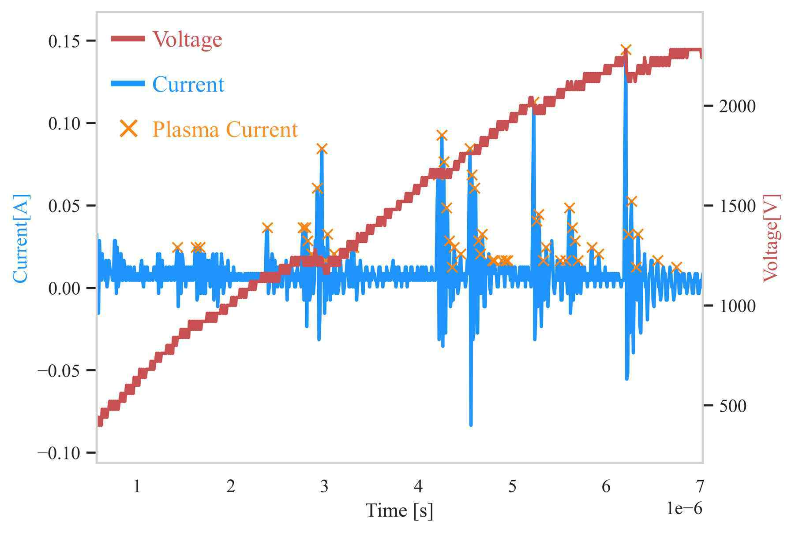

*그림 9. 방전 구간(T₃–T₄)의 전류전압 그래프와 검출한 방전 전류 펄스*

##### 3.1.5 전자밀도

전자밀도는 방전 전류에 옴의 법칙을 적용해 구한다 \[43–48\]. 전류밀도 J는 피크 전류 i\_peak를 방전 면적 A로 나눈 값이고, 전기장은 방전 유지 전압을 전극 거리로 나눈 U\_b/d이다.

```math
J = n_e\,e\,\mu_e\,E \quad\Rightarrow\quad n_e = \frac{i_{peak}\,d}{e\,\mu_e\,A\,U_b} \tag{12}
```

- 전자 이동도는 대기압 상온에서 μ\_e = 592 cm²/Vs를 썼다. 이는 저전계 값이며, 수백 Td에서는 더 작다.
- 방전 면적은 셀의 윗면 면적 4.5×10⁻⁴ cm²를 근사값으로 썼다. 동일평면 표면 방전에서는 전류가 표면과 평행하게 흐르므로, 이 값으로 구한 전자밀도는 셀 평균의 상대 지표이다.
- U\_b를 쓰면 전자밀도는 정상 약 3.9×10¹², 손상 약 4.0×10¹² cm⁻³로 유의한 차이가 없다. 학위논문의 값(1.60×10¹², 1.62×10¹² cm⁻³)은 U\_b 대신 V\_b(= V\_max)를 써서 약 2.4배 작다.
- 피크 전류는 전류 프로브 설정에 따라 변하므로(4.4.3절), 전자밀도도 같은 설정끼리만 비교할 수 있다.

##### 3.1.6 전자온도

전자온도는 아인슈타인 관계식으로 근사적으로 구한다 \[43, 47\]. D\_e/μ\_e는 특성 에너지(characteristic energy)이며, 전자에너지분포가 Maxwell 분포일 때 k\_B·T\_e/e와 같다. D\_e/μ\_e는 규격화 전기장 E/N의 함수로 주어진다(그림 10) \[48, 49\].

```math
\frac{k_B T_e}{e} = \frac{D_e}{\mu_e}\left(\frac{E}{N}\right), \qquad \frac{E}{N} = \frac{U_b}{N\,d}, \qquad N = \frac{p}{k_B T} \tag{13}
```

- 기체 수밀도는 N = 2.50×10¹⁹ cm⁻³(1 atm, 20 °C)이다. U\_b를 쓰면 E/N ≈ 340 Td(1 Td = 10⁻¹⁷ V·cm²)이다.
- 이 값에서 D\_e/μ\_e ≈ 6 V이므로 전자온도는 약 6 eV이다. 재분석 값은 정상 6.2 ± 0.3 eV, 손상 6.0 ± 0.4 eV이다. 340 Td는 Raizer 곡선의 끝(약 300 Td)을 조금 넘는 짧은 외삽이다.
- 학위논문의 13 eV는 V\_b(= V\_max)를 써서 얻은 E/N = 814 Td에서, 175 Td까지 디지타이즈한 곡선을 크게 외삽한 값이다. 같은 점들을 다른 함수로 맞추면 814 Td에서 4.5–20 V가 나오므로 데이터로 제약되지 않는다.
- 전자온도는 U\_b만의 함수이므로 U\_b와 독립된 관측값이 아니다.

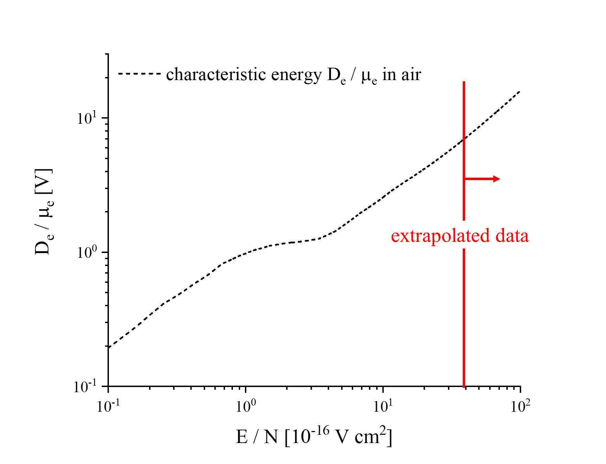

*그림 10. 공기에서 E/N에 따른 특성 에너지 D\_e/μ\_e \[48, 49\]. 빨간 선 이후는 외삽한 값이다.*

#### 3.2 등가회로 모델을 이용한 DBD 플라즈마 모델링

##### 3.2.1 리사주 그래프

Manley는 전하–전압 그래프로 DBD의 방전전압과 방전 에너지를 계산했다 \[5, 42\]. 이를 리사주 그래프(Lissajous graph)라 하며, 닫힌 평행사변형 모양이다. 방전개시전압 V\_min 이후 방전으로 전하가 늘어 기울기가 급격히 커지고, 최대전압 V\_max에서 방전이 끝나며 기울기가 줄어든다(그림 11). 전하는 전류의 오프셋을 뺀 뒤 적분해 구한다.

```math
Q(t) = \int_0^t i(t')\,dt' + Q_0 \tag{14}
```

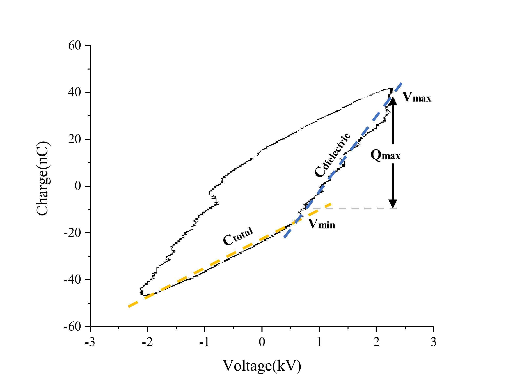

*그림 11. 리사주 그래프와 플라즈마 특성*

##### 3.2.2 커패시턴스

방전 셀을 등가회로로 보면, 전극 사이의 유전체는 유전체 커패시터 C\_d, 전극 사이의 공기는 공기갭 커패시터 C\_g이다 \[50–62\]. 방전 전에는 두 커패시터가 직렬이고, 방전이 일어나면 공기갭이 전류를 흘려 C\_d만 남는다(그림 12). 방전 전 리사주 그래프의 기울기는 전체 커패시턴스 C\_total이고, 방전 중 기울기는 C\_d이다.

```math
C_{total} = \frac{C_d\,C_g}{C_d + C_g} \tag{15}
```

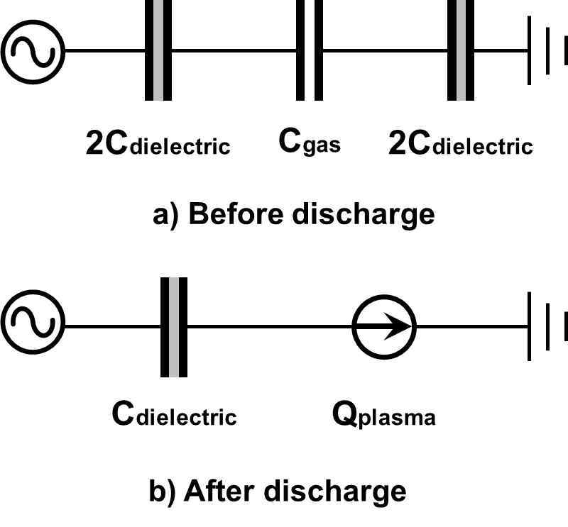

*그림 12. 등가회로. (a) 방전 전 (b) 방전 중*

두 기울기는 SciPy의 curve\_fit으로 리사주 그래프의 각 변에 직선을 맞춰 구했다(그림 13, 표 2).

**표 2.** 리사주 그래프에서 구한 커패시턴스 (예시 파형의 맞춤과 M2의 정상/손상 평균)

| 항목 | 예시 파형 | 학위논문 정상 / 손상 | 원본 데이터 재분석 정상 / 손상 |
| --- | --- | --- | --- |
| C\_d (방전 구간 기울기) | 34.9 pF | 34.2 ± 4.9 / 35.5 pF | 34.5 / 37.2 pF |
| C\_total (비방전 구간 기울기) | 13.1 pF | 11.3 ± 1.2 / 12.1 pF | 12.3 / 13.0 pF |
| C\_g (식 15) | 21.0 pF | 17.3 ± 2.8 / 18.7 pF | 19.4 / 20.3 pF |

- 두 직선 맞춤의 F값은 10⁴ 이상, p < 10⁻¹⁵, 결정계수 R² ≈ 0.98이다. 시계열 점들은 자기상관이 있으므로 F 검정은 근사적인 지표이다.
- 표면 DBD에서 방전이 유전체 전면을 덮지 않으면 방전 구간 기울기는 유전체 고유의 C\_d가 아니라 유효 커패시턴스(≤ C\_d)이다 \[50\]. 공급전압 스윕(8.5 → 14 V)에서 방전 구간 기울기는 M1 37.6 → 48.9, M2 41.4 → 56.7, M3 39.6 → 58.3 pF로 커졌다. 126개 셀 쌍이 모두 방전하지는 않고, 전압이 오를수록 방전 면적이 넓어진다는 뜻이다.
- 따라서 C\_d와 이를 쓰는 값(방전 전하량, 에너지)의 변화는 인가전압이 같은 조건에서 비교해야 한다.

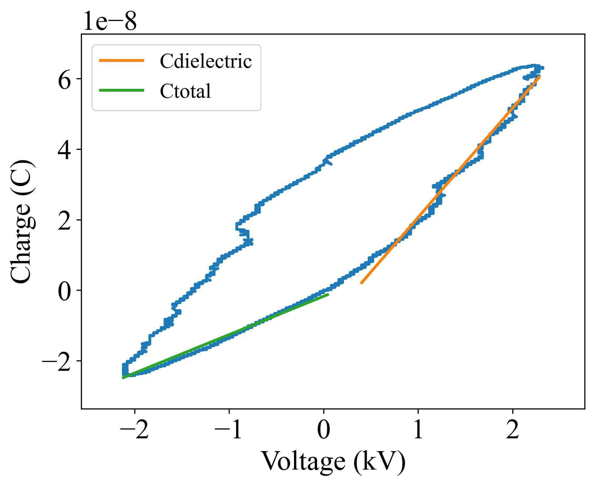

*그림 13. 리사주 그래프의 직선 맞춤으로 구한 C\_total과 C\_d*

##### 3.2.3 방전 전하량

방전 전하량은 방전개시전압 V\_min부터 최대전압 V\_max 사이에 이동한 전하이다(그림 11의 Q\_max).

```math
Q_{max} = C_d\,(V_{max} - V_{min}) \tag{16}
```

방전 전하량은 정상 59.4 ± 9.0 nC, 손상 61.7 nC이다(재분석 59.5 / 62.7 nC, p = 0.07). 이 논문의 뒤 장에서는 같은 값을 ΔQ로도 쓴다.

##### 3.2.4 문헌의 DBD 방전과의 비교

리사주 그래프, 방전 유지 전압, 방전 기구, 전자온도가 모두 문헌의 DBD 방전과 일치한다(표 3, 그림 14). 이 소스의 방전은 Manley 등가회로로 기술되는 타운젠트형 DBD 방전이다.

**표 3.** 등가회로 진단과 문헌의 DBD 방전 비교 (5 h 이후 파형 498개)

| 진단 항목 | 측정 | 문헌의 DBD 방전 | 판정 |
| --- | --- | --- | --- |
| 리사주 그래프 | 498개 파형 모두 기울기가 둘(C\_d > C\_total) | 평행사변형 \[42\] | 일치 |
| 방전 유지 전압 U\_b | 사분위 773–888 V. 독립 추정 두 가지(방전개시점 828–860 V, 기하 관계 842–882 V)가 3 % 안에서 일치 | 파센 법칙, 100 µm 공기 718–865 V (γ = 0.1–0.01) \[49\] | 일치 |
| 주기당 에너지 | Manley 식 값의 1.17배 | Manley 식 \[42\] | 일치 |
| 방전 기구 | U\_b에서 αd = 3.2–5.0. 타운젠트 조건을 맞추는 γ = 0.007–0.045 | 스트리머 조건 αd ≈ 18–20 \[72\]. γ는 유전체 표면의 전형적 범위 | 타운젠트 방전 |
| 전자온도 | E/N ≈ 340 Td, T\_e ≈ 6 eV | 저온 플라즈마 1–10 eV \[5, 49\] | 일치 |
| 전자밀도 | 셀 평균 약 4×10¹² cm⁻³ | 미세방전 채널 10¹⁴–10¹⁵ cm⁻³ \[61\] | 면적·시간 평균이라 낮음, 상대 지표 |
| 부분 면적 방전 | 스윕에서 방전 구간 기울기 증가(3.2.2절) | 표면 DBD의 부분 면적 방전 \[50\] | 일치 |

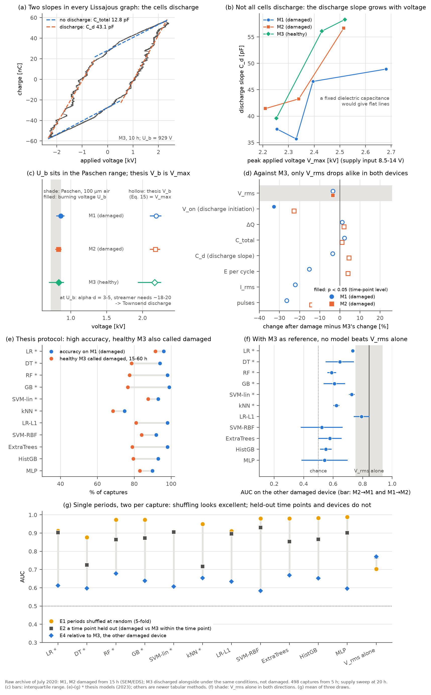

*그림 14. 물리·통계·머신러닝의 일관성. (a) M3 10 h 파형의 리사주 그래프와 두 기울기 (b) 공급전압 스윕에서 방전 구간 기울기 (c) U\_b와 파센 범위, 학위논문의 V\_b (d) M3 대비 손상 효과 (e) 학위논문 방식의 정확도와 M3 오탐 (f) M3 기준 특성의 소스 간 AUC (g) 주기 단위 평가*

### 제4장 저온 대기압 DBD 방전 유전체 손상 연구

M1·M2는 15 h부터 유전체가 침식되어 Ag 전극이 드러났다. 같은 측정 시점의 M3와 비교하면 두 소스 모두 V\_rms가 약 3.5 % 더 떨어졌고, 다른 특성의 변화는 두 소스에서 방향이 엇갈리거나 측정 설정에 묶여 있다.

#### 4.1 표면 DBD의 유전체 손상에 대한 선행연구

- 표면 DBD에서 유전체 표면이 손상되는 문제는 많은 연구에서 다루어졌다 \[24–28\]. 대기압 방전에서는 유전체 표면이 이온화된 산소에 계속 노출되어 산화되고, 벽전하의 화학 작용으로 약한 스퍼터링이 일어난다. 전극이 노출되면 전극 성분이 스퍼터링으로 주변에 퍼진다 \[26\].
- 전극 간격이 좁은 마이크로 전극에서는 강한 전기장 때문에 스퍼터링과 증착이 계속 일어난다 \[24\]. 손상된 부분에는 전기장이 더 모여 손상이 심해진다.
- 표면은 광학 현미경, 주사전자현미경(SEM, JEOL JSM-7001F), 에너지 분산 엑스선 분광법(EDS, Bruker XFlash 6)으로 분석했다. SEM은 표면 약 1 µm의 구조를, EDS는 15.0 kV 전자빔으로 약 1–3 µm 깊이의 원소 조성을 본다. 유전체가 30–40 µm이므로, 유전체가 온전하면 전극 성분(Ag)은 거의 검출되지 않고 전극이 노출되면 검출된다.

#### 4.2 표면 관찰

방전을 수십 시간 진행했고 세 소스 중 M1·M2에서 표면 손상이 관찰되었다. 손상이 생겨도 방전은 계속되므로, 방전이 완전히 꺼질 때까지 진행했다. 손상된 영역에서는 방전 형상도 달라진다(그림 15).

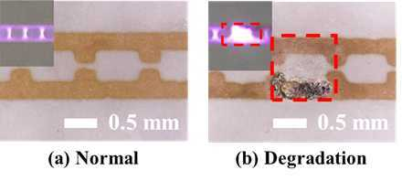

*그림 15. 광학 현미경으로 찍은 전극 표면. (a) 정상 (b) 유전체 표면 손상*

현미경 사진 전부(242장)에서 어두운 소손 영역을 정량화했다(표 4). 휘도 90 미만인 연결 영역의 최대 면적이 150 px 이상이면 "소손 있음"으로 솒다.

**표 4.** 측정 시점별 소손이 있는 현미경 사진의 수 (소손 있음 / 전체)

| 누적 방전 시간 | M1 | M2 | M3 |
| --- | --- | --- | --- |
| 5 h | 4/9 (최대 1521 px) | 0/5 | 0/8 |
| 10 h | 0/5 | 0/5 | 0/4 |
| 15 h | 2/5 | 2/5 | 0/4 |
| 20 h | 3/6 | 2/5 | 0/6 |
| 25 h | 3/9 | 2/6 | 0/4 |
| 30 h | – | 3/9 | 0/11 |
| 35 h | – | 2/10 | 0/15 |
| 40 h | – | 2/13 | 0/16 |
| 45–60 h | – | – | 1/82 (55 h, 159 px) |

- **M2.** 5·10 h에는 소손이 없고, 15 h부터 모든 측정 시점에 검은 침식 흔적이 있다. 손상 라벨의 경계(≤ 10 h 정상, ≥ 15 h 손상)와 일치한다.
- **M1.** 15 h부터 침식 흔적이 보이는 것은 같다. 다만 10 h 측정 전에 찍은 5 h 사진에 전극 끝의 큰 용융·기포 자국이 있어, 정상으로 라벨링한 5·10 h 데이터에 손상된 셀이 포함되었을 수 있다.
- **M3.** 50 h까지 소손이 없고, 55 h에 작은 점 하나만 보인다.

SEM으로 보면 손상된 유전체 표면은 불균일하고 곳곳이 움푸 패여 있다(그림 16).

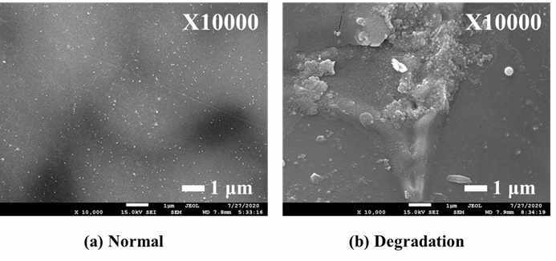

*그림 16. SEM으로 찍은 전극 표면(10,000배). (a) 기준 시료(Ref) (b) 유전체 표면 손상(M2)*

#### 4.3 EDS 분석

기준 시료에서도 유전체 아래 전극의 Ag가 미량 검출된다. 손상된 전극에서는 Ag가 다량 검출되고, 특히 유전체가 깎여 나간 부분에서 많다(그림 17, 18). 반대로 유전체 성분(Si, Na, Al)은 줄었다(표 5).

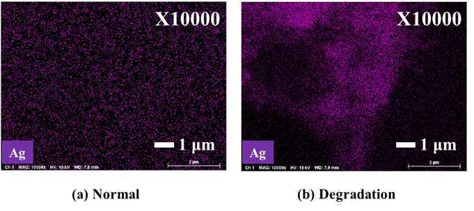

*그림 17. EDS로 잰 전극 표면의 Ag 분포. (a) 기준 시료(Ref) (b) 유전체 표면 손상(M2)*

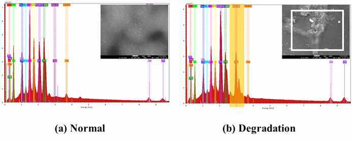

*그림 18. EDS 스펙트럼. (a) 기준 시료(Ref) (b) 유전체 표면 손상(M2). 노란색이 Ag 피크이다.*

**표 5.** EDS로 잰 원소 조성 \[at.%\] (각 열은 10,000배 맵 하나의 값)

| 원소 | 기준 시료(Ref) | 손상부(M2) |
| --- | --- | --- |
| O | 30.27 | 27.69 |
| Ag | 0.57 | 13.86 |
| Si | 13.60 | 9.88 |
| Al | 20.04 | 15.54 |
| Zn | 7.09 | 8.87 |
| Ca | 2.41 | 2.03 |
| Mg | 2.48 | 2.52 |
| Na | 9.19 | 6.49 |
| Pb | 6.65 | 5.90 |
| C | 7.70 | 7.22 |

표 5의 두 값은 각 부위 맵들 중 최댓값이다. 모든 맵의 Ag 분포는 표 6과 같다. 손상 부위(12개 맵, 1.3–13.9 at.%)와 온전한 유전체(41개 맵, 대부분 ≤ 0.7 at.%)가 뚜렷이 나뉘므로, 유전체 손상으로 전극이 노출되었다는 결론은 견고하다.

**표 6.** 부위별 EDS 맵의 Ag 농도

| 부위 | 맵 수 | Ag \[at.%\] |
| --- | --- | --- |
| 기준 시료(Ref) | 6 | 0.00–0.57 |
| M3, 60 h 방전 후 | 13 | 12개 0.00–0.25, 1개 1.44 |
| M2 온전한 부위 | 10 | 0.00–0.56 |
| M1 온전한 유전체 | 12 | 0.01–0.68 |
| M1 노출 전극(탄 부분) | 4 | 5.08–11.94 |
| M1 노출 전극(터진 부분) | 4 | 1.28–3.22 |
| M2 손상부 | 4 | 3.78–13.86 |

#### 4.4 손상 전후의 방전 특성 변화

학위논문은 손상 전후 값을 직접 비교해 V\_rms, I\_rms, 방전개시전압, 방전전압, 전자온도가 줄고 방전 횟수, 전자밀도, 커패시턴스, 방전 전하량이 늘었다고 보고했다. 원본 데이터를 다시 보면, 이 변화에는 손상과 무관한 두 가지가 섞여 있다. 세 소스에 공통인 외부 요인과 측정 설정의 변화이다.

##### 4.4.1 공통 외부 요인

**표 7.** 측정 시점별 평균 V\_rms \[V\]

| 누적 방전 시간 | M1 | M2 | M3 |
| --- | --- | --- | --- |
| 5 h | 1484 | 1481 | 1484 |
| 10 h | 1501 | 1496 | 1502 |
| 15 h | 1273 | 1312 | 1369 |
| 20 h | 1460 | 1432 | 1478 |
| 25 h | 1423 | 1355 | 1454 |
| 30 h | – | 1436 | 1475 |
| 35 h | – | 1399 | 1473 |
| 40 h | – | 1445 | 1443 |
| 45 / 50 / 55 / 60 h | – | – | 1155 / 1156 / 1454 / 1176 |

- 손상 전(5·10 h)에는 세 소스의 V\_rms가 몇 V 안에서 같다.
- 15 h 측정 시점에는 세 소스가 동시에 떨어졌다. 손상이 없는 M3도 10 h 대비 −133 V이다.
- 같은 측정 시점 안에서도 V\_rms가 몇 초 간격으로 이산적인 수준(약 1150, 1270, 1360, 1460 V) 사이를 오갔다. 서서히 진행되는 표면 손상이 아니라 구동전원의 동작 상태가 바뀐 것이다.
- M3는 손상 없이 45·50 h에 1155 V로 떨어졌다가 55 h에 1454 V로 돌아왔다.
- 따라서 손상 효과는 같은 측정 시점 M3의 변화를 뺀 값(이중차분)으로 구해야 한다. M3를 빼지 않으면 V\_rms 하락의 절반가량을 손상으로 잘못 읽는다.

##### 4.4.2 M3 대비 손상 효과

**표 8.** M3 대비 손상 효과 (전 5–10 h → 후 15 h–끝, 측정 시점별 로그 평균의 차이 \[%\], p는 측정 시점별 평균에 대한 Welch 검정)

| 특성 | M1 | M2 | 판정 |
| --- | --- | --- | --- |
| V\_rms | −3.5 (p 0.19) | −3.5 (p 0.017) | 두 소스에서 크기까지 같음 |
| 방전개시전압 V\_min | −33 (p 0.020) | −23 (p 0.38) | 방향 같음 |
| 방전 전하량 ΔQ | +1.2 (p 0.95) | +2.0 (p 0.75) | 방향만 같음 |
| C\_total | +2.3 (p 0.83) | +1.0 (p 0.66) | 방향만 같음 |
| C\_d (방전 구간 기울기) | −3.6 (p 0.87) | +4.6 (p 0.54) | 방향 반대 |
| 주기당 에너지 | −15.2 (p 0.56) | +4.0 (p 0.52) | 방향 반대 |
| I\_rms | −22.2 (p 0.16) | −12.4 (p 0.30) | 측정 설정의 영향 |
| 방전 횟수 | −26.4 (p 0.42) | −14.0 (p 0.37) | 측정 설정의 영향 |

- V\_rms는 두 소스에서 방향과 크기가 같다(약 −48 V). M3 없이 비교한 단순 변화(−107 / −92 V)의 절반가량이다.
- 방전개시전압은 방향은 같지만 측정 시점 내 잡음이 커서 M2에서는 유의하지 않다.
- 방전 횟수와 U\_b는 손상 없는 M3에서도 같은 방향으로 유의하게 변했다(+2.7개, p = 4×10⁻⁶; −38 V, p = 0.05).
- 측정 시점 단위의 검정(전 2개, 후 3–6개)은 검정력이 낮으므로 "유의하지 않음"은 "효과 없음"이 아니다.

##### 4.4.3 측정 설정의 영향

같은 측정 시점·같은 소스에서도 오실로스코프 설정이 값을 바꾼다(표 9, 측정 시점 고정효과 회귀, 파형 500개).

**표 9.** 오실로스코프 설정에 따른 특성값의 변화

| 특성 | 전류 A/div 2배당 | p | 샘플링 20 ns 대 10 ns | p |
| --- | --- | --- | --- | --- |
| I\_rms | +3.5 mA | 10⁻¹⁷ | +4.3 mA | 5×10⁻⁵³ |
| 피크 전류 | +59 mA | 4×10⁻¹⁰ | +37 mA | 9×10⁻¹⁰ |
| 방전 횟수 | +1.1 | 0.11 | −6.6 | 3×10⁻⁴⁵ |
| 전자밀도 | +2.7×10¹² cm⁻³ | 2×10⁻⁸ | +5×10¹¹ cm⁻³ | 0.07 |
| C\_d | +0.3 pF | 0.54 | +3.0 pF | 2×10⁻²⁰ |
| U\_b | +45 V | 3×10⁻⁹ | +35 V | 3×10⁻¹³ |
| V\_rms | +19 V | 5×10⁻⁴ | −5 V | 0.13 |

- 손상 구간에는 저감도 설정(0.04 A/div) 파형이 더 많다(M2 20 → 42 %). 따라서 "I\_rms 감소, 방전 횟수·전자밀도 증가"는 측정 설정과 교란되어 손상 지표로 쓸 수 없다.
- 전압 채널은 거의 모든 측정 시점에서 1000 V/div로 고정되었고, V\_rms의 측정 시점 내 잡음은 0.5 %이다. 손상과 일관되게 연결되는 변화는 M3 대비 V\_rms 저하다.

### 제5장 기계학습을 응용한 DBD 유전체 손상 진단

학위논문 방식의 분류기는 높은 정확도를 보였지만, 그 상당 부분은 공통 외부 요인에서 왔다. 공통 외부 요인과 측정 설정을 통제하면, 11개 모델 가운데 어느 것도 V\_rms 하나만 쓴 분류기를 넘지 못하고, 무작위 요인을 바꿔도 V\_rms가 가장 앞에 남는다.

#### 5.1 학습 특성

3장의 방법으로 계산한 14개 특성을 Pandas 데이터 프레임으로 만들어 입력으로 썼다(표 10).

**표 10.** 학습에 쓴 플라즈마 특성

| 특성 | 단위 | 비고 |
| --- | --- | --- |
| 구동 주파수 | Hz |  |
| 주기당 방전 에너지 | J | 식 (9) |
| V\_rms, I\_rms | V, A | 식 (8) |
| C\_d, C\_g, C\_total | F | 식 (15), C\_g는 C\_d와 C\_total에서 계산 |
| 방전개시전압 V\_min | V |  |
| 방전전압 V\_b | V | V\_max와 같음(3.1.3절) |
| 방전 전하량 Q\_max | C | 식 (16) |
| 방전 횟수 | 회 | 샘플링 간격에 의존 |
| 전자밀도 평균, 표준편차 | cm⁻³ | V\_b와 전류 설정에 의존 |
| 전자온도 | eV | V\_b의 함수 |
| 출력: 표면 손상 | 0 / 1 |  |

입력 특성은 서로 독립적이지 않다. C\_g는 C\_d와 C\_total에서, 전자온도와 전자밀도는 V\_b에서 계산되고, V\_b는 V\_max와 같아 V\_rms와 함께 움직인다.

#### 5.2 데이터 전처리

로지스틱 회귀, SVM, kNN은 특성의 스케일 차이와 이상치에 민감하므로 \[63\], 각 특성을 평균 0, 표준편차 1로 표준화했다. 평균 μ와 표준편차 σ는 학습 데이터에서만 구했다.

```math
z = \frac{x - \mu}{\sigma}, \qquad \mu = \frac{1}{N}\sum_{i=1}^{N} x_i, \qquad \sigma = \sqrt{\frac{1}{N}\sum_{i=1}^{N}\left(x_i - \mu\right)^2} \tag{17}
```

#### 5.3 데이터셋

학위논문은 M2의 데이터로 학습·평가하고, M1의 데이터를 검증에 썼다. 표면 손상 전(≤ 10 h)을 0, 후(≥ 15 h)를 1로 라벨링했다(표 11).

**표 11.** 학위논문의 데이터셋 크기

|  | 학습/평가 (M2) | 검증 (M1) |
| --- | --- | --- |
| 정상(0) | 80 | 80 |
| 손상(1) | 209 | 81 |

- 학습/평가 데이터는 한 소스의 데이터를 무작위로 나눈 것이다. 같은 측정 시점의 파형(그리고 같은 파형의 양·음 반주기)이 학습과 평가에 함께 들어갈 수 있어 평가 성능이 낙관적이다.
- 본 논문은 여기에 M3를 정상 대조로 더하고, 5 h 이후 파형 498개(주기 단위 평가에서는 파형마다 2주기, 996주기)를 썼다.

#### 5.4 분류 모델

- **학위논문의 6개(scikit-learn 1.2.2) \[73\].** 로지스틱 회귀 \[64\], 결정 트리(max\_depth = 3, min\_samples\_split = 4) \[65\], 랜덤 포레스트(트리 1000개) \[66\], 그래디언트 부스팅(학습률 0.01, 트리 1000개) \[67\], 선형 SVM \[68\], kNN(k = 3) \[69\].
- **추가한 5개.** L1 정규화 로지스틱 회귀, RBF-SVM, ExtraTrees, HistGradientBoosting, MLP.
- 랜덤 포레스트는 트리 1000개의 예측을 다수결(확률 평균)로 결합한다.

#### 5.5 평가 지표

표면 손상을 양성으로 두고, TP는 실제 손상을 손상으로, TN은 실제 정상을 정상으로, FP는 실제 정상을 손상으로, FN은 실제 손상을 정상으로 예측한 경우이다 \[70\].

```math
\mathrm{ACC} = \frac{TP + TN}{TP + TN + FP + FN}, \quad \mathrm{PRE} = \frac{TP}{TP + FP}, \quad \mathrm{REC} = \frac{TP}{TP + FN}, \quad F_1 = \frac{2\cdot\mathrm{PRE}\cdot\mathrm{REC}}{\mathrm{PRE} + \mathrm{REC}} \tag{18}
```

AUC는 ROC 곡선 아래 면적이다. 완벽한 분류기는 1.0, 무작위 분류기는 0.5이다 \[71\].

#### 5.6 결과

##### 5.6.1 학위논문 방식의 결과

**표 12.** 학위논문 방식의 분류 성능 (정확도·정밀도·재현도 \[%\]; 정밀도와 재현도는 두 클래스의 macro 평균, F1은 손상 클래스)

| 모델 | 학습/평가 ACC | PRE | REC | F1 | AUC | 검증 ACC | PRE | REC | F1 | AUC |
| --- | --- | --- | --- | --- | --- | --- | --- | --- | --- | --- |
| LR | 94.83 | 92.90 | 94.49 | 0.96 | 0.99 | 76.40 | 84.03 | 76.25 | 0.81 | 0.99 |
| DT | 89.66 | 87.05 | 87.05 | 0.93 | 0.94 | 96.27 | 96.37 | 96.29 | 0.96 | 0.96 |
| RF | 93.10 | 93.02 | 89.43 | 0.95 | 0.98 | 96.89 | 96.95 | 96.91 | 0.97 | 0.99 |
| GB | 94.83 | 94.34 | 92.56 | 0.96 | 1.00 | 96.27 | 96.37 | 96.29 | 0.96 | 0.97 |
| SVM | 94.83 | 92.90 | 94.49 | 0.96 | 0.99 | 76.40 | 84.03 | 76.25 | 0.81 | 0.98 |
| kNN | 86.21 | 83.60 | 80.80 | 0.91 | 0.87 | 75.16 | 82.42 | 75.01 | 0.80 | 0.88 |

- 검증 데이터에서 AUC가 0.9를 넘고 F1이 가장 높은 모델은 랜덤 포레스트이다.
- LR과 SVM은 AUC가 0.99인데 정확도는 76.4 %이다. 클래스의 순서는 유지되지만 소스 간 기준값 차이로 결정 임계값이 이동했기 때문이다.
- V\_rms와 I\_rms 평면에서 보면 V\_rms 하나만으로도 두 상태가 거의 나뉘다(그림 19, 단일 특성 AUC ≈ 1.0).

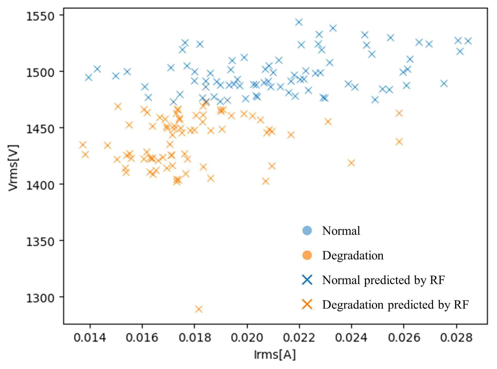

*그림 19. 검증 데이터에서 랜덤 포레스트로 예측한 정상과 손상(V\_rms–I\_rms 평면)*

그러나 같은 분류기를 손상 없는 M3에 적용하면, 15–40 h 파형의 57–86 %(랜덤 포레스트 62.5 %), 45–60 h의 거의 전부를 "손상"으로 판정한다. 오판정은 V\_rms가 낮았던 측정 시점(15, 25, 40, 45–60 h)에 몰려 있다. 분류기는 표면 손상보다 인가전압 수준, 즉 공통 외부 요인에 반응했다(그림 14(e)).

##### 5.6.2 교란 요인을 통제한 평가

손상과 함께 변하는 교란 요인을 단계적으로 막았다(표 13).

- 공통 외부 요인: 같은 측정 시점 M3 값에 대한 상대값을 특성으로 썼다.
- 소스 차이: 한 손상 소스로 학습하고 다른 손상 소스에서 시험했다.
- 같은 측정 시점 정보의 누출: 측정 시점 하나를 통째로 빼고 시험했다.
- 파형마다 다른 영향력: 모든 파형에서 주기를 2개씩 뽑아 주기 하나를 한 행으로 썼고, 무작위 추출을 3번 반복했다.

**표 13.** 평가 방식별 분류 성능 (시험 소스 M1 / M2)

| 평가 방식 | 막는 교란 요인 | 11개 모델 | V\_rms 하나 |
| --- | --- | --- | --- |
| 학위논문 방식: M2로 학습, M1 시험 | 없음 | 정확도 0.90–0.99(kNN 0.75). 정상 M3의 15–60 h 파형 68–92 %를 "손상"으로 판정 | – |
| 주기를 무작위로 섞은 5격 교차검증 | 없음 | AUC 0.88–0.99 | AUC 0.70 |
| 측정 시점 하나를 빼고 시험(주기 단위) | 같은 측정 시점 정보 누출 | 같은 측정 시점 AUC 0.72–0.93 | AUC 0.77 |
| M3 대비 특성, 다른 손상 소스에서 시험(파형 단위) | 공통 외부 요인, 소스 차이 | AUC 0.38–0.84 / 0.59–0.74 | **AUC 0.94 / 0.75** |
| 같은 방식(주기 단위) | 위 + 파형 영향력 균등 | AUC 0.49–0.70 / 0.57–0.72 | **AUC 0.80 / 0.74** |

- **무작위 섞기의 높은 점수는 누출 때문이다.** 같은 파형의 다른 주기와 같은 측정 시점의 주기가 학습에 들어가, 모델이 시험 측정 시점의 상태를 미리 본다(그림 14(g)).
- **측정 시점을 통째로 빼면 모델이 쓰는 것은 V\_rms와 구동 주파수이다.** 순열 중요도 1위는 랜덤 포레스트와 부스팅 모두 V\_rms(0.175, 0.191)이다. 구동 주파수는 소스마다 다른 구동전원의 지문이다.
- **다른 손상 소스로 일반화되는 정보는 V\_rms 하나다.** 복잡한 모델일수록 학습 소스에 과적합되며, V\_rms 하나만 쓴 로지스틱 회귀가 모든 모델과 같거나 낫다(그림 14(f)).

##### 5.6.3 무작위 요인에 대한 강건성

손상 시점의 배치, 파형 표본, 주기 추출, 모델 선택을 바꿔도 V\_rms가 가장 앞에 남는다(표 14). 효과/잡음 비는 다른 모든 특성의 두 배가 넘는다(그림 21(d)).

**표 14.** 무작위 요인별 검증

| 무작위 요인 | 검증 | V\_rms | 비교 |
| --- | --- | --- | --- |
| 어느 측정 시점이 손상 전인가(라벨 배치) | 정확 순열 검정, 두 소스의 배치 280가지 | p = 0.039 | V\_on/V\_max 0.029, ΔQ/V 0.26, C\_total 0.56, 에너지 0.56 |
| 파형 표본 | 부트스트랩 300회 \[74\], M3 대비 단변량 AUC의 순위 | 1위 60 %(AUC 0.84) | I\_rms 26 %(측정 설정 교란), V\_on/V\_max 8 % |
| 측정 시점 내 잡음 | 효과/잡음 비 | 4.3–5.4 | 다음은 구동 주파수 2.0–2.2 |
| 모델 선택(11개) | M3 대비 특성, 다른 손상 소스에서 시험 | AUC 0.94 / 0.75 | 11개 모델 0.38–0.84 |
| 주기 추출(3회) | 주기 단위, 같은 방식 | AUC 0.80 / 0.74 | 11개 모델 평균 0.58–0.68, 표준편차 ≤ 0.09 |
| 모델 안의 중요도 | 순열 중요도 | 랜덤 포레스트(파형), 랜덤 포레스트·부스팅(주기)에서 1위 | HistGradientBoosting(파형)에서는 2위(1위 I\_rms) |

두 소스를 합친 순열 검정은 유의하지만, 소스별로는 가능한 배치가 10가지(M1)와 28가지(M2)뿐이라 따로는 유의하지 않다(p 0.10, 0.18). 결론적으로 V\_rms의 변화가 여러 모델에서 손상 여부를 나타내는 데 가장 유효하므로, 6장과 7장에서는 V\_rms 변화의 물리적 의미를 실험 결과와 시뮬레이션으로 검증한다.

#### 5.7 표면 손상 전의 전조증상

랜덤 포레스트가 내는 예측 확률로, 방전 시작 때와 표면 손상 직전의 데이터를 비교했다(표 15).

**표 15.** 방전 시작과 표면 손상 직전 데이터의 예측 (확률은 정상으로 예측할 확률의 평균 ± 표준편차)

| 데이터셋 | 입력 | 정상 예측 | 손상 예측 | 정상 확률 |
| --- | --- | --- | --- | --- |
| 학습/평가 (M2) | 방전 시작 | 38 | 2 | 0.886 ± 0.18 |
| 학습/평가 (M2) | 손상 직전 | 39 | 1 | 0.909 ± 0.09 |
| 검증 (M1) | 방전 시작 | 40 | 0 | 0.816 ± 0.05 |
| 검증 (M1) | 손상 직전 | 39 | 1 | 0.818 ± 0.11 |

방전 시작과 손상 직전의 정상 확률에는 유의한 차이가 없다. 따라서 이 데이터로는 손상 전의 전조증상을 예측할 근거가 없다. 학위논문이 제안한 "정상 확률이 초기보다 10 % 이상 낮아지면 전조증상"이라는 기준은 이 결과로 뒷받침되지 않는다.

#### 5.8 인공지능 기반 유전체 손상 진단 프로그램

학습한 랜덤 포레스트 모델로 임의의 전류·전압 측정 데이터에서 표면 손상 확률을 예측하는 프로그램을 만들었다(그림 20). 손상된 소스의 데이터를 넣으면 "DBD 유전체 표면이 99.27 %의 확률로 손상되었습니다"(그림 20(a)), 정상 데이터를 넣으면 "96.42 %의 확률로 정상입니다"(그림 20(b))를 출력한다. 다만 5.6.1절처럼 이 모델은 인가전압 수준에 반응하므로, 실제 진단에는 같은 구동 조건의 정상 기준과 V\_rms를 비교하는 방식이 더 견고하다.

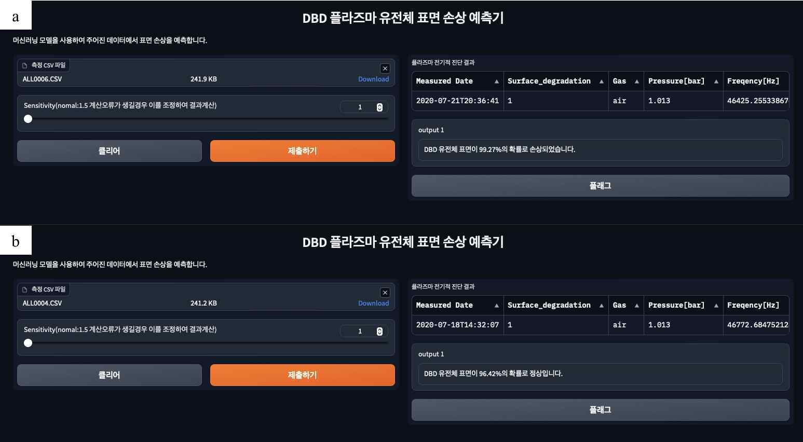

*그림 20. 학습한 모델을 이용한 유전체 손상 예측 프로그램. (a) 손상 소스 데이터 (b) 정상 소스 데이터*

### 제6장 V\_rms 저하의 물리적 해석

전극이 노출되면 손상 셀의 방전 유지 전압이 낮아져 방전이 일찍 시작되고, 주기마다 방전 전하량이 늘어 구동전원의 출력 전압이 떨어진다. 이 경로로 예측한 V\_rms 저하는 관측과 17 % 안에서 맞는다(표 17, 그림 21).

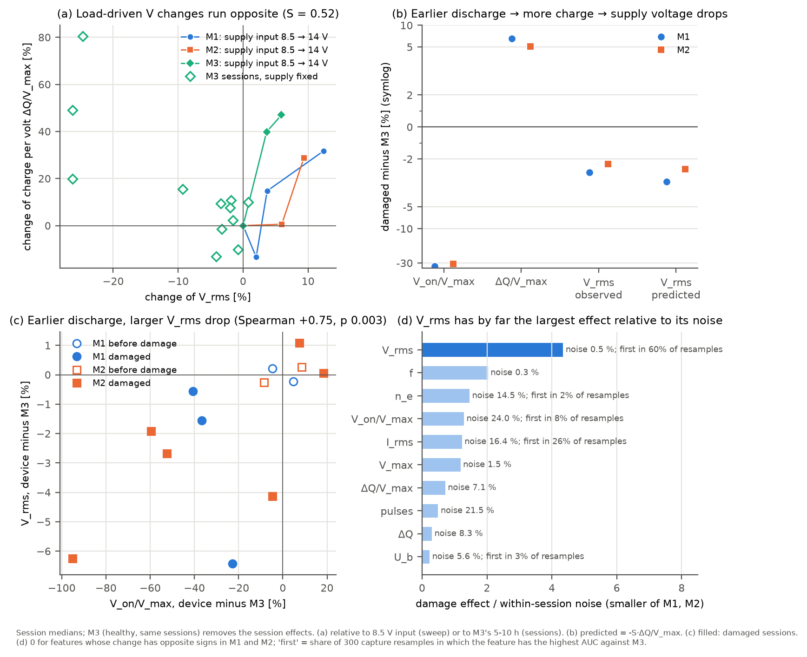

*그림 21. V\_rms 저하의 메커니즘과 강건성. (a) 구동전원이 전압을 바꿀 때(공급전압 스윕)와 부하가 전압을 바꿀 때(M3의 측정 시점 간 변동) 전압당 방전 전하량의 방향 (b) 방전개시 앞당김 → 방전 전하량 증가 → V\_rms 저하, 예측과 관측 (c) 측정 시점별 방전개시전압과 V\_rms (d) 특성별 효과/잡음 비*

#### 6.1 가정

**표 16.** 유도의 가정과 근거

|  | 가정 | 근거 |
| --- | --- | --- |
| A1 | 각 방전 셀은 C\_d,i와 C\_g,i의 직렬이다. 공기갭 전압이 방전 유지 전압 U\_b에 이르면 방전이 시작되고, 방전하는 동안 ±U\_b로 유지된다(Manley) | 3.2절: 리사주 그래프의 두 기울기, 독립된 U\_b 추정의 일치 |
| A2 | U\_b는 100 µm 공기갭이 정한다(타운젠트 방전) | 3.2.4절: 파센 범위, αd = 3–5 |
| A3 | 126개 셀 쌍은 병렬이고 각자 방전을 시작하며, 소스의 값은 셀 값의 합이다. 모든 셀이 방전하지는 않는다 | 2.1.1절, 3.2.2절: 스윕에서 C\_d 증가 |
| A4 | 각 소스는 각자의 구동전원으로 운전된다. 구동 주파수에서 구동전원은 무부하 출력전압 E와 출력 임피던스 Z\_s의 테브난 등가회로이고, 공급 입력이 고정이면 E도 고정이다 | 2.1.3절의 전원 구성 |
| A5 | 손상은 일부 셀의 유전체 두께 t\_i를 줄이거나(침식) 없앤다(전극 노출). 노출된 Ag 표면은 이차전자 발생 계수 γ를 바꾼다. 공기갭은 그대로다 | 4.2–4.3절: 현미경, SEM, EDS |
| A6 | 공통 외부 요인은 같은 측정 시점의 M3로 빠진다. 손상에 의한 변화는 몇 % 수준이라 선형 근사가 성립한다 | 4.4절 |

#### 6.2 방전 셀 하나의 방전개시전압과 방전 전하량 (A1, A2)

- 방전이 없는 동안 리사주 그래프의 기울기는 C\_total이다(식 15). 방전 중에는 식 (10)에서 u\_g = ±U\_b이므로 Q = C\_d(v ∓ U\_b)이고 기울기는 C\_d이다.
- 인가전압이 최댓값일 때 Q\_max = C\_d(V\_max − U\_b)이다. 그 뒤 방전 없이 Q = Q\_max − C\_total(V\_max − v)로 내려오다가, u\_g = −U\_b가 되는 곳에서 다음 방전이 시작된다.
- 이를 풀고 반주기 대칭을 쓰면 방전개시전압 V\_on(= V\_min)과 방전 전하량 ΔQ를 얻는다.

```math
V_{on} = 2U_{min} - V_{max}, \qquad U_{min} = U_b\left(1 + \frac{C_g}{C_d}\right) \tag{19}
```

```math
\Delta Q = C_d\,(V_{max} - V_{on}) = 2C_d\,(V_{max} - U_{min}), \qquad E_{cycle} = 2U_b\,\Delta Q = 4C_dU_b\,(V_{max} - U_{min}) \tag{20}
```

식 (20)은 Manley 식이다 \[42\]. 측정값 U\_min = 1257–1289 V, V\_max ≈ 2.2 kV를 넣으면 V\_on ≈ 0.3 kV로, 리사주 그래프에서 재 방전개시전압 0.37–0.45 kV와 같은 크기다.

#### 6.3 손상된 셀은 방전을 일찍 시작한다 (A3, A5)

손상이 셀의 U\_min,i = U\_b,i(1 + C\_g,i/C\_d,i)를 낮추는 경로는 두 가지이다.

**(가) 유전체가 얇아짐.** C\_d,i = ε₀ε\_r·A\_i/t\_i이므로 침식으로 t\_i가 줄면 C\_d,i가 커진다.

```math
\frac{\partial V_{on,i}}{\partial \ln C_{d,i}} = -2U_b\,\frac{C_{g,i}}{C_{d,i}} < 0, \qquad \frac{\partial\,\Delta Q_i}{\partial \ln C_{d,i}} = 2C_{d,i}\,(V_{max} - U_b) > 0 \tag{21}
```

**(나) 전극 노출.** 노출된 Ag 전극에서는 이차전자 발생 계수 γ가 커진다. 파센 법칙 식 (7)에서 100 µm 공기(pd = 7.6 Torr·cm)의 γ가 0.01에서 0.1로 커지면 U\_b는 865 V에서 718 V, 즉 0.83배가 된다.

```math
\frac{\partial V_{on,i}}{\partial \ln U_{b,i}} = 2U_{min,i} > 0, \qquad \frac{\partial\,\Delta Q_i}{\partial \ln U_{b,i}} = -2C_{d,i}\,U_{min,i} < 0 \tag{22}
```

- 두 경로 모두 손상 셀의 방전개시를 앞당기고 방전 전하량을 늘린다. 소스 전체(A3)에서는 ΔQ = ΣΔQ\_i가 커진다.
- 차이는 측정되는 U\_b이다. (가)에서는 그대로이고 (나)에서는 낮아진다.
- **예측:** 손상 소스는 M3보다 V\_on/V\_max가 작고, ΔQ/V\_max가 크고, U\_b는 같거나(가) 작다(나).

#### 6.4 부하가 커지면 구동전원의 출력 전압이 떨어진다 (A4)

구동 주파수 성분에서 소스에 걸리는 전압은 다음과 같다. Y\_L은 소스의 어드미턴스(전압당 전류)이며, 구동 주파수에서 전압당 방전 전하량에 비례한다.

```math
V = \frac{E}{1 + Z_s Y_L} \tag{23}
```

```math
\delta\ln V = -S\,\delta\ln Y_L, \qquad S = \operatorname{Re}\frac{Z_sY_L}{1 + Z_sY_L} \approx -\frac{d\ln V}{d\ln(\Delta Q/V_{max})} \tag{24}
```

이상적인 전압원은 S = 0(전압이 부하와 무관)이고, 전류원에 가까울수록 S는 1에 가까워진다. S는 정상 소스에서 잰다(A6).

- 공급 입력을 바꾼 스윕에서는 구동전원이 전압을 바꾼다. 이때 d ln(ΔQ/V\_max)/d ln V = +2.7 \~ +8.2로, 부분 면적 방전 때문에 전압과 같은 방향이다.
- 공급 입력이 고정된 M3의 측정 시점 간 변동에서는 부하가 전압을 바꾼다. 이때는 −1.92로 반대 방향이다(그림 21(a)).
- 이 방향 차이가 식 (23)의 부하 경로가 실제로 작동한다는 증거이며, S = 1/1.92 = 0.52를 준다. 이 값은 부분 면적 방전의 되먹임까지 포함한 실측 응답이다.

#### 6.5 예측과 관측

**표 17.** M3 대비 변화의 예측과 관측 (측정 시점별 중앙값)

| 소스 | 방전개시전압 V\_on/V\_max | 방전 전하량 ΔQ/V\_max | V\_rms 예측 (−S·δln(ΔQ/V\_max)) | V\_rms 관측 |
| --- | --- | --- | --- | --- |
| M1 | −33.3 % | +6.6 % | −3.4 % | −2.9 % |
| M2 | −31.0 % | +5.1 % | −2.6 % | −2.3 % |

- 세 단계의 부호가 두 소스에서 모두 예측과 같고, V\_rms의 예측과 관측은 17 % 안에서 맞는다(그림 21(b)).
- U\_b는 M1에서 −13.6 %(p 0.10), M2에서 −1.3 %로 낮아졌다. (나) 전극 노출 경로와 맞는다.
- 측정 시점별로도 이어진다. 방전개시가 M3보다 이른 측정 시점일수록 V\_rms가 더 떨어졌다(13개 측정 시점: M1 5개, M2 8개, Spearman +0.75, p = 0.003; 그림 21(c)). 손상 후 측정 시점 9개 중 7개에서 방전개시가 M3보다 빨랐다.

#### 6.6 V\_rms가 가장 뚜렷한 이유

- **원인은 국소적이고 잡음이 크다.** 방전개시전압과 방전 전하량이 원인이지만, 측정 시점 내 잡음이 각각 24 %(V\_on/V\_max)와 7.1 %(ΔQ/V\_max)이다.
- **결과는 전체적이고 정밀하다.** 구동전원은 126개 셀 쌍 전체의 부하 변화를 하나의 전압으로 모아 보여 주고, 전압 채널의 측정 시점 내 잡음은 0.5 %이다.
- **그래서 효과/잡음 비가 V\_rms에서 4.3–5.4로 가장 크다.** 다음은 구동 주파수(2.0–2.2)이며, 구동 주파수도 두 소스에서 −0.6 %로 같은 방향이다. 커진 용량성 부하가 구동전원의 동작점을 낮춘다는 해석과 맞는다.

#### 6.7 다른 가설의 배제

**표 18.** 대안 가설과 판정

| 가설 | 예측 | 데이터 | 판정 |
| --- | --- | --- | --- |
| 구동전원 쪽의 변화 | 전압과 ΔQ/V가 함께 내려감(스윕과 같은 방향) | 손상 소스는 전압 하강, ΔQ/V 상승 | 기각 |
| 측정 순서·시간차 | 전압 차이가 측정 간격과 상관 | Spearman +0.50(p 0.39), +0.12(p 0.78) | 기각 |
| 방전 전력(가열)의 증가 | 에너지·전력 증가 | 두 소스에서 방향 반대 | 지지 안 됨 |
| 유전체만 얇아짐 (가) | 방전개시 앞당김, U\_b 그대로 | 7장 시뮬레이션: V\_rms와 ΔQ/V는 맞지만 방전개시점이 움직이지 않음 | 단독으로는 부족 |
| 전극 노출에 의한 방전 유지 전압 하강 (나) | 방전개시 앞당김, U\_b 하강 | U\_b M1 −13.6 %, M2 −1.3 %. 7장 시뮬레이션이 네 지표를 함께 재현 | 지지 |

### 제7장 등가회로 시뮬레이션에 의한 검증

정상 데이터만으로 보정한 모델에서 셀의 약 1/3에 전극 노출을 넣으면, V\_rms −2.4 %, ΔQ/V\_max +7.9 %, V\_on/V\_max −36.5 %, U\_b −8.5 %가 되어 데이터와 부호와 크기가 맞는다. 유전체가 얇아지는 것만으로는 방전개시점이 움직이지 않는다.

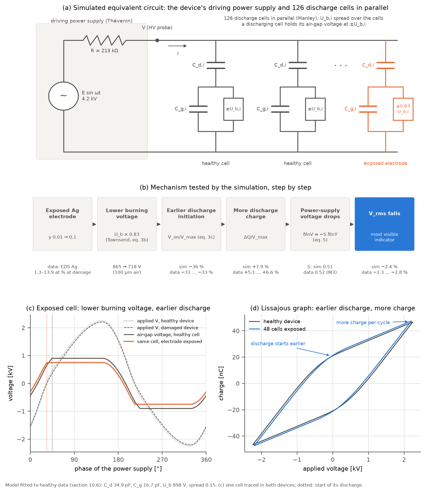

*그림 22. 시뮬레이션 등가회로와 메커니즘. (a) 소스의 구동전원과 병렬로 연결된 126개 방전 셀 (b) 시뮬레이션이 검증하는 인과 사슬 (c) 같은 셀의 공기갭 전압, 정상일 때와 전극이 노출됐을 때 (d) 정상 소스와 손상 소스의 리사주 그래프*

#### 7.1 모델

- 6.1절의 가정 A1–A4를 그대로 구현했다.
- 126개 방전 셀은 각각 Manley 등가회로이다. 방전하는 동안 공기갭 전압은 그 셀의 방전 유지 전압 U\_b,i로 유지되고, U\_b,i는 셀마다 로그정규 분포로 퍼져 있다.
- 구동전원은 무부하 출력전압 E sin ωt가 출력 임피던스 R을 거쳐 걸리는 테브난 등가회로이다. 방전 순간에는 소스 단자의 전하가 보존되므로, 방전이 소스 전압을 끌어내린다.
- 시간 영역에서 2 ns 간격으로 풀었다. 시뮬레이션 파형은 측정과 같은 경로(프로브 대역 60 MHz, 10 ns 샘플링, 8비트 ADC)를 거쳐 같은 코드로 특성을 계산했다.

**도식 읽는 법(그림 22).**

- (a) 왼쪽은 소스 하나에 딸린 구동전원(≈ 4.2 kV, R ≈ 213 kΩ)이고, 측정점은 소스 단자의 전압 V와 전류 I이다. 오른쪽은 병렬로 연결된 방전 셀이며, 주황색 셀은 전극이 노출되어 방전 유지 전압이 0.83배로 낮아진 셀이다.
- (b) 칸마다 아래에 근거와 시뮬레이션·데이터 값을 적었다.
- (c) 공기갭 전압이 오르다가 방전 유지 전압에 닿는 순간(점선)부터 방전하며 그 값에 머문다. 전극이 노출된 셀(주황)은 더 낮은 전압에서 머물고 방전개시가 더 이르다.
- (d) 그래프가 꺾이는 곳이 방전개시점이다. 손상 소스(파랑)는 그 지점이 앞당겨지고 꼭짓점의 전하가 커진다.

#### 7.2 정상 데이터만으로 보정

- 맞춘 값은 정상 파형(5–10 h)의 중앙값 8개(V\_rms, V\_max, C\_total, C\_d, ΔQ/V\_max, V\_on/V\_max, U\_b, 주기당 에너지)와 M3에서 잴 S = 0.52이다. 손상 데이터는 쓰지 않았다.
- 보정된 값은 C\_d 34.9 pF, C\_g 16.7 pF, U\_b 898 V, U\_b 분포폭 0.15, R 213 kΩ, E 4.19 kV이다. 표 2의 평균값에서 구한 등가회로(C\_d 34.2 pF, C\_g 16.9 pF, U\_b ≈ 0.92 kV)와 거의 같다.
- 에너지를 뺀 목표는 6 % 안에서 맞고, 에너지는 11 % 낮다. 모델의 S는 0.51이다(그림 23(a)).
- V\_rms/V\_max는 데이터 0.655, 모델 0.70이다(사인파 0.707). 방전이 인가전압 파형을 일그러뜨리는 효과는 일부만 재현된다.

#### 7.3 손상 예측

**표 19.** 손상 경로별 예측과 데이터 (모델은 정상 모델 대비, 데이터는 M3 대비 변화 \[%\])

| 경우 | V\_rms | ΔQ/V\_max | V\_on/V\_max | U\_b | C\_total | C\_d | 에너지 |
| --- | --- | --- | --- | --- | --- | --- | --- |
| 유전체 얇아짐, 8셀을 절반 두께로 | −3.0 | +5.8 | −1.0 | −1.9 | +2.3 | +5.5 | +1.5 |
| 유전체 얇아짐, 모든 셀 −5 % | −2.3 | +4.3 | +1.8 | −0.2 | +1.7 | +5.2 | +1.4 |
| 전극 노출(U\_b × 0.83), 16셀 | −0.7 | +2.0 | −13.4 | −3.6 | +0.9 | −0.2 | −0.6 |
| 전극 노출, 32셀 | −1.6 | +4.9 | −24.0 | −6.4 | +1.3 | −0.5 | −1.4 |
| **전극 노출, 48셀(38 %)** | **−2.4** | **+7.9** | **−36.5** | **−8.5** | **+1.3** | **+0.2** | **−1.8** |
| 전극 노출, 64셀 | −3.2 | +10.1 | −50.8 | −9.4 | +1.0 | +1.2 | −1.7 |
| 데이터 M1 | −2.8 | +6.6 | −33.3 | −13.6 | +2.4 | −4.0 | −15.6 |
| 데이터 M2 | −2.3 | +5.1 | −31.0 | −1.3 | −1.4 | +2.6 | +7.4 |

- **유전체가 얇아지는 것만으로는 부족하다.** V\_rms와 ΔQ/V는 맞지만 리사주 그래프의 방전개시점(V\_on/V\_max)이 거의 움직이지 않는다. 몇 개 셀의 변화로는 대다수 셀이 정하는 방전개시점이 바뀌지 않기 때문이다.
- **전극 노출이 네 지표를 함께 재현한다.** 방전 유지 전압을 파센 법칙(식 7)의 0.83배(γ 0.01 → 0.1)로 낮춘 셀이 약 1/3(48셀)일 때, V\_rms, ΔQ/V\_max, V\_on/V\_max, U\_b가 데이터(M1·M2)와 부호와 크기에서 맞는다.
- 두 소스에서 방향이 엇갈린 C\_total, C\_d, 에너지는 모델에서도 거의 0이다.
- 노출 셀이 32–64개(25–51 %)이면 V\_rms는 −1.6 \~ −3.2 %이고, 데이터가 이 범위 안에 있다(그림 23(c)).

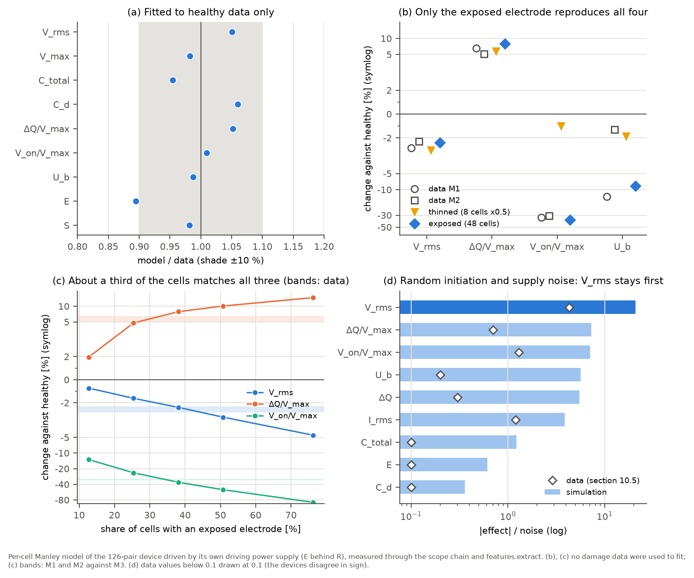

*그림 23. 시뮬레이션 결과. (a) 정상 데이터에 맞춘 모델(모델/데이터) (b) 손상 경로별 예측과 데이터 (c) 전극이 노출된 셀의 비율에 따른 변화, 색 띠는 데이터 범위 (d) 무작위 방전개시와 구동전원 요동에서의 효과/잡음 비*

#### 7.4 무작위 요인을 넣은 순위

- 방전마다 방전 유지 전압을 5 % 흔들고(무작위 방전개시), 실행마다 구동전원의 출력전압을 0.5 % 흔들었다.
- 효과/잡음 비는 V\_rms 20.8, ΔQ/V\_max 7.3, V\_on/V\_max 7.1, U\_b 5.6, ΔQ 5.5, I\_rms 3.9 순이다(그림 23(d)).
- 데이터에서도 V\_rms가 1위(4.3)다. 데이터의 값이 작은 것은 실제 측정의 잡음(측정 설정, 프로브)과 구동전원 요동이 더 크기 때문이다.

#### 7.5 공급전압 스윕

- 전압을 올리면 ΔQ/V가 함께 오르는 방향(d ln(ΔQ/V)/d ln V = +1.48, 데이터 +2.7 \~ +8.2)과 V\_on/V\_max가 줄어드는 방향(0.201 → 0.039, 데이터 0.165 → 0.130)은 맞다.
- 방전 구간 기울기 C\_d가 전압과 함께 커지는 현상(데이터 +2.5)은 재현되지 않는다(−0.10). 셀 안에서 방전 면적이 넓어지는 효과가 모델에 없기 때문이다.

### 제8장 결론

본 연구는 유전체 장벽 방전 플라즈마의 안정적인 방전에 영향을 주는 유전체 표면 손상을 전기적 측정과 머신러닝으로 진단했다. 원본 데이터를 다시 분석하고 손상 없는 소스 M3를 대조로 쓰면, 표면이 손상되었을 때 가장 뚜렷하게 나타나는 전기적 지표는 전압 실효값 V\_rms의 저하다.

1. **방전의 종류.** 리사주 그래프의 두 기울기, 파센 계산값(718–865 V)과 맞는 방전 유지 전압(사분위 773–888 V), αd = 3–5, T\_e ≈ 6 eV는 이 소스의 방전이 Manley 등가회로로 기술되는 타운젠트형 DBD 방전임을 보여 준다.
2. **손상.** 현미경, SEM, EDS로 M1·M2의 유전체 침식과 전극 노출을 확인했다(손상부 Ag 1.3–13.9 at.%, 온전한 유전체 ≤ 0.7 at.%).
3. **전기적 변화.** 같은 측정 시점의 M3 대비 V\_rms는 두 손상 소스 모두 약 3.5 %(≈ 48 V) 더 떨어졌고, 방전개시전압도 같은 방향으로 낮아졌다. 학위논문에서 보고한 방전전압·전자온도의 감소는 V\_max와 U\_b의 변화를 다시 쓴 것이고, I\_rms·방전 횟수·전자밀도의 변화는 측정 설정과 교란되어 있다.
4. **머신러닝.** 학위논문 방식의 높은 정확도는 상당 부분 공통 외부 요인에서 왔다. 공통 외부 요인과 측정 설정을 통제하면 V\_rms 하나가 11개 모델과 같거나 낫고(AUC 0.94 / 0.75), 라벨 배치·표본·주기 추출·모델 선택을 바꿔도 V\_rms가 가장 앞에 남는다(순열 검정 p = 0.039, 효과/잡음 비 4.3–5.4).
5. **물리적 해석.** 전극 노출로 방전 유지 전압이 낮아지면 방전이 일찍 시작되고 방전 전하량이 늘어 구동전원의 출력 전압이 떨어진다. 예측(−3.4 / −2.6 %)과 관측(−2.9 / −2.3 %)은 17 % 안에서 맞는다.
6. **시뮬레이션.** 정상 데이터만으로 보정한 등가회로 모델에서 셀의 약 1/3에 전극 노출을 넣으면 V\_rms, 방전 전하량, 방전개시전압, 방전 유지 전압의 변화가 함께 재현된다.
7. **전조증상.** 방전 시작과 손상 직전의 예측 확률에는 차이가 없어, 이 데이터로는 손상 전 전조증상을 예측할 수 없다.

V\_rms가 가장 뚜렷한 것은 구동전원이 126개 셀 쌍 전체의 부하 변화를 하나의 전압으로 모으고, 전압 측정의 잡음이 0.5 %로 작기 때문이다. 따라서 같은 구동 조건의 정상 기준과 비교한 V\_rms는 운전 중 표면 손상을 감시하는 단순한 지표가 될 수 있다.

#### 8.1 한계

- **소스 수.** 손상 소스 2대와 정상 소스 1대의 결과이므로, 일반화된 진단 기준이 아니다. 소스별 순열 검정은 단독으로 유의하지 않고(M1 p 0.10, M2 p 0.18), 정상 소스끼리 같은 측정 시점에서 얼마나 달라지는지 알 수 없다.
- **라벨.** M1은 5 h 사진에 이미 용융된 전극 끝이 있어, 손상 전 구간의 라벨이 불완전할 수 있다.
- **측정 순서.** 세 소스는 동시에 측정하지 않고 M1 → M2 → M3 순서로 10–33분 안에 측정했다. 측정 간격과 전압 차이의 상관은 없었다(표 18).
- **감도 S.** 구동전원의 부하 감도 S는 M3 한 대의 측정 시점 간 변동으로 정했다.
- **노출 비율과 γ.** 시뮬레이션의 노출 셀 비율(약 1/3)과 γ 값은 모델 안의 해석이며 직접 잰 값이 아니다. M1과 M2의 U\_b 변화(−13.6 %, −1.3 %)가 다르므로 노출 정도는 소스마다 다를 수 있다.
- **모델 단순화.** 구동전원의 출력 임피던스를 저항 하나로 두었고, 구동 주파수의 변화(−0.6 %)와 셀 안 방전 면적의 증가는 모델에 없다.

**반증 조건.** 다음 중 하나가 관측되면 이 메커니즘은 틀린 것이다.

1. 손상 후 측정 시점에서 전압과 ΔQ/V가 함께 떨어진다(구동전원 쪽의 원인).
2. 방전개시전압(V\_on/V\_max) 변화 없이 전압만 떨어진다(방전개시 앞당김 경로의 기각).
3. 정상 소스 둘 사이에서도 같은 크기의 차이가 난다(손상 신호가 아님).

#### 8.2 활용과 후속 연구

- 학습한 모델은 같은 구조의 소스 2대에서 얻은 것이므로, 다른 전극 구조나 유전체를 가진 DBD에는 같은 방법으로 다시 학습해야 한다.
- 운전 중 진단에는 같은 구동 조건의 정상 기준(대조 소스나 초기 시점)과 V\_rms를 비교하는 것이 가장 단순하고 견고하다.
- 후속 실험에서는 오실로스코프 설정을 고정하고, 구동전원의 입력 전압·전류와 실내 온습도를 함께 기록하고, 대조 소스를 같은 시각에 측정하며 측정 순서를 무작위로 바꿔야 한다.
- DBD 표면 손상 진단은 플라즈마 발생 기기의 이상 현상을 미리 알고 안정성을 높이는 데 도움이 될 것이다.

### 참고문헌

학위논문의 번호를 그대로 두고 정오표의 수정을 반영했다. \[72\]–\[74\]는 추가한 문헌이다.

1. F. F. Chen, *Introduction to Plasma Physics*, pp. 1–3 (판과 출판사 확인 필요: Plenum 2판 1984 또는 Springer 3판 2016).
2. O. Auciello, D. L. Flamm, *Plasma Diagnostics: Discharge Parameters and Chemistry*, Vol. 1, Academic Press (2013).
3. D. C. Schram, "Is plasma unique? The presence of electrons and the importance of charge," *Plasma Sources Sci. Technol.* 18, 014003 (2009).
4. K.-D. Weltmann et al., "The future for plasma science and technology," *Plasma Process. Polym.* 16, 1800118 (2019).
5. K. H. Becker, U. Kogelschatz, K. H. Schoenbach, R. J. Barker, *Non-Equilibrium Air Plasmas at Atmospheric Pressure*, CRC Press (2004).
6. J. R. Roth, *Industrial Plasma Engineering, Vol. 2: Applications to Nonthermal Plasma Processing*, Taylor & Francis (2001).
7. A. von Keudell, V. Schulz-von der Gathen, "Foundations of low-temperature plasma physics—an introduction," *Plasma Sources Sci. Technol.* 26, 113001 (2017).
8. V. Nehra, A. Kumar, H. K. Dwivedi, "Atmospheric non-thermal plasma sources," *Int. J. Eng.* 2, 53–68 (2008).
9. M.-S. Yun et al., "The selective emitter doping of p-type solar cells using atmospheric pressure plasma jet," *J. Nanosci. Nanotechnol.* 16, 10711 (2016).
10. B. Michel et al., "Effects of dielectric barrier discharges on silicon surfaces: surface roughness, cleaning, and oxidation," *J. Appl. Phys.* 105, 073302 (2009).
11. N. K. Kaushik et al., "Cytotoxic macrophage-released tumour necrosis factor-alpha (TNF-α) as a killing mechanism for cancer cell death after cold plasma activation," *J. Phys. D: Appl. Phys.* 49, 084001 (2016).
12. J.-H. Lee et al., "Selective killing effects of cold atmospheric pressure plasma with NO induced dysfunction of epidermal growth factor receptor in oral squamous cell carcinoma," *PLoS ONE* 11, e0150279 (2016).
13. A. Ali, Z. Ashraf, N. Kumar, M. Rafiq, F. Jabeen, J.-H. Park, K.-H. Choi, S. Lee, S.-Y. Seo, E. H. Choi, P. Attri, "Influence of plasma-activated compounds on melanogenesis and tyrosinase activity," *Sci. Rep.* 6, 21779 (2016). 학위논문에서는 이 문헌의 저자 목록이 \[13\]과 \[14\]로 나뉘어 있다.
14. &#91;13\]과 같은 문헌.
15. N. Kumar et al., "The action of microsecond-pulsed plasma-activated media on the inactivation of human lung cancer cells," *J. Phys. D: Appl. Phys.* 49, 115401 (2016).
16. J.-H. Lee et al., "Effect of non-thermal air atmospheric pressure plasma jet treatment on gingival wound healing," *J. Phys. D: Appl. Phys.* 49, 249501 (2016).
17. S.-H. Ji et al., "Effects of high voltage nanosecond pulsed plasma and micro DBD plasma on seed germination, growth development and physiological activities in spinach," *Arch. Biochem. Biophys.* 605, 117–128 (2016).
18. G. Fridman et al., "Applied plasma medicine," *Plasma Process. Polym.* 5, 503 (2008).
19. E. H. Choi, "Plasma bioscience and medicines," *Vac. Mag.* 2, 9–15 (2015).
20. D. B. Graves, "The emerging role of reactive oxygen and nitrogen species in redox biology and some implications for plasma applications to medicine and biology," *J. Phys. D: Appl. Phys.* 45, 263001 (2012).
21. S. Kumar, D. K. Yadav, E. H. Choi, M. H. Kim, "Insight from molecular dynamic simulation of reactive oxygen species in oxidized skin membrane," *Sci. Rep.* 8, 1–10 (2018).
22. N. K. Kaushik et al., "Biological and medical applications of plasma activated media, water and solutions," *Biol. Chem.* 400, 39–62 (2018).
23. P. Shaw et al., "Bacterial inactivation by plasma treated water enhanced by reactive nitrogen species," *Sci. Rep.* 8, 1–10 (2018).
24. T. Ono, D. Y. Sim, M. Esashi, "Micro-discharge and electric breakdown in a micro-gap," *J. Micromech. Microeng.* 10, 445–451 (2000).
25. &#91;10\]과 같은 문헌(인용은 \[10\]으로 통합).
26. N. M. Houser, L. Gimeno, R. E. Hanson, T. Goldhawk, T. Simpson, P. Lavoie, "Microfabrication of dielectric barrier discharge plasma actuators for flow control," *Sens. Actuators A* 201, 101–104 (2013).
27. R. E. Hanson, N. M. Houser, P. Lavoie, "Dielectric material degradation monitoring of dielectric barrier discharge plasma actuators," *J. Appl. Phys.* 115, 043301 (2014).
28. D. Bian, Y. Wu, C. Long, B. Lin, "Effects of material degradation on electrical and optical characteristics of surface dielectric barrier discharge," *J. Appl. Phys.* 124, 183301 (2018).
29. C. Bishop, "Neural networks and their diagnostic applications," *Rev. Sci. Instrum.* 63, 4772 (1992).
30. U. K. Ercan, G. D. Özdemir, M. A. Özdemir, O. Güren, "Plasma medicine: The era of artificial intelligence," *Plasma Process. Polym.* e2300066 (2023).
31. A. Mesbah, D. B. Graves, "Machine learning for modeling, diagnostics, and control of non-equilibrium plasmas," *J. Phys. D: Appl. Phys.* 52, 30LT02 (2019).
32. D. Gidon, X. Pei, A. D. Bonzanini, D. B. Graves, A. Mesbah, "Machine learning for real-time diagnostics of cold atmospheric plasma sources," *IEEE Trans. Radiat. Plasma Med. Sci.* 3, 597–605 (2019).
33. T. A. Choudhury, N. Hosseinzadeh, C. C. Berndt, "Artificial neural network application for predicting in-flight particle characteristics of an atmospheric plasma spray process," *Surf. Coat. Technol.* 205, 4886–4895 (2011).
34. S. Guessasma, G. Montavon, C. Coddet, "Modeling of the APS plasma spray process using artificial neural networks: basis, requirements and an example," *Comput. Mater. Sci.* 29, 315–333 (2004).
35. Y.-T. Zhang, S.-H. Gao, F. Ai, "Efficient numerical simulation of atmospheric pulsed discharges by introducing deep learning," *Front. Phys.* 11, 1125548 (2023).
36. B. Yin, Y. Zhu, Y. Wu, "Modulating sparks in a pulse train for repetitive and energy efficient plasma generation," *High Voltage*, 1–12 (2023).
37. K. Rath, D. Rügamer, B. Bischl, U. von Toussaint, C. G. Albert, "Dependent state space Student-t processes for imputation and data augmentation in plasma diagnostics," *Contrib. Plasma Phys.* 63, e202200175 (2023).
38. B. Dave, S. Patel, R. Shivani, S. Purohit, B. Chaudhury, "Synthetic data generation using generative adversarial network for tokamak plasma current quench experiments," *Contrib. Plasma Phys.* e202200051 (2022).
39. C. M. Samuell, A. G. McLean, C. A. Johnson, F. Glass, A. E. Jaervinen, "Measuring the electron temperature and identifying plasma detachment using machine learning and spectroscopy," *Rev. Sci. Instrum.* 92, 043520 (2021).
40. Y. Wang, Z. Liao, S. Mathieu, F. Bin, X. Tu, "Prediction and evaluation of plasma arc reforming of naphthalene using a hybrid machine learning model," *J. Hazard. Mater.* 404, 123965 (2021).
41. M. A. Özdemir, G. D. Özdemir, M. Gül, O. Güren, U. K. Ercan, "Machine learning to predict the antimicrobial activity of cold atmospheric plasma-activated liquids," *Mach. Learn.: Sci. Technol.* 4, 015030 (2023).
42. T. C. Manley, "The electric characteristics of the ozonator discharge," *Trans. Electrochem. Soc.* 84, 83–96 (1943).
43. Y.-C. Hong, H.-S. Uhm, "Air plasma jet with hollow electrodes at atmospheric pressure," *Phys. Plasmas* 14, 053503 (2007).
44. R. H. Stark, K. H. Schoenbach, "Direct current glow discharges in atmospheric air," *Appl. Phys. Lett.* 74, 3770 (1999).
45. Y. Yang, "Alternating-current glow and pseudoglow discharges in atmospheric pressure," *IEEE Trans. Plasma Sci.* 31, 174 (2003).
46. A.-A. H. Mohamed, R. Block, K. H. Schoenbach, "Direct current glow discharges in atmospheric air," *IEEE Trans. Plasma Sci.* 30, 182 (2002).
47. K. Takaki, H. Kirihara, C. Noda, S. Mukaigawa, T. Fujiwara, "Production of pulse glow discharge in atmospheric pressure nitrogen using needle-array electrode," *Jpn. J. Appl. Phys.* 45, 8241 (2006).
48. C. Raja Rao, G. R. Govinda Raju, "The ratio of diffusion coefficient to mobility for slow electrons in dry air," *J. Phys. D: Appl. Phys.* 4, 769 (1971).
49. Yu. P. Raizer, *Gas Discharge Physics*, Springer (1999).
50. F. J. J. Peeters, M. C. M. van de Sanden, "The influence of partial surface discharging on the electrical characterization of DBDs," *Plasma Sources Sci. Technol.* 24, 015016 (2015).
51. R. Valdivia-Barrientos, J. Pacheco-Sotelo, M. Pacheco-Pacheco, J. S. Benítez-Read, R. López-Callejas, "Analysis and electrical modelling of a cylindrical DBD configuration at different operating frequencies," *Plasma Sources Sci. Technol.* 15, 237–245 (2006).
52. A. V. Pipa, T. Hoder, R. Brandenburg, "On the role of capacitance determination accuracy for the electrical characterization of pulsed driven dielectric barrier discharges," *Contrib. Plasma Phys.* 53, 469–480 (2013).
53. A. V. Pipa, T. Hoder, J. Koskulics, M. Schmidt, R. Brandenburg, "Experimental determination of dielectric barrier discharge capacitance," *Rev. Sci. Instrum.* 83, 075111 (2012).
54. E.-H. Choi et al., "Influence of driving frequency on the system parameters in surface discharge of AC plasma display panels," *Jpn. J. Appl. Phys.* 38, 6073–6076 (1999).
55. A. V. Pipa, R. Brandenburg, "The equivalent circuit approach for the electrical diagnostics of dielectric barrier discharges: the classical theory and recent developments," *Atoms* 7, 14 (2019).
56. S. Liu, M. Neiger, "Excitation of dielectric barrier discharges by unipolar submicrosecond square pulses," *J. Phys. D: Appl. Phys.* 34, 1632–1638 (2001).
57. X. Tu, H. J. Gallon, M. V. Twigg, P. A. Gorry, J. C. Whitehead, "Dry reforming of methane over a Ni/Al₂O₃ catalyst in a coaxial dielectric barrier discharge reactor," *J. Phys. D: Appl. Phys.* 44, 274007 (2011).
58. T. Shao, K. Long, C. Zhang, P. Yan, S. Zhang, R. Pan, "Experimental study on repetitive unipolar nanosecond-pulse dielectric barrier discharge in air at atmospheric pressure," *J. Phys. D: Appl. Phys.* 41, 215203 (2008).
59. H. Jiang, T. Shao, C. Zhang, W. Li, P. Yan, "Experimental study of Q-V Lissajous figures in nanosecond-pulse surface discharges," *IEEE Trans. Dielectr. Electr. Insul.* 20 (2013).
60. Q. Wang, F. Liu, C. Miao, B. Yan, Z. Fang, "Investigation on discharge characteristics of a coaxial dielectric barrier discharge reactor driven by AC and ns power sources," *Plasma Sci. Technol.* 20, 035404 (2018).
61. U. Kogelschatz, "Dielectric-barrier discharges: their history, discharge physics, and industrial applications," *Plasma Chem. Plasma Process.* 23, 1–46 (2003).
62. R. Brandenburg, "Dielectric barrier discharges: progress on plasma sources and on the understanding of regimes and single filaments," *Plasma Sources Sci. Technol.* 26, 053001 (2017).
63. M. M. Ahsan et al., "Effect of data scaling methods on machine learning algorithms and model performance," *Technologies* 9, 52 (2021).
64. D. R. Cox, E. J. Snell, *Analysis of Binary Data*, CRC Press (1989).
65. L. Breiman et al., *Classification and Regression Trees*, Routledge (1984).
66. L. Breiman, "Random forests," *Mach. Learn.* 45, 5–32 (2001).
67. J. H. Friedman, "Greedy function approximation: a gradient boosting machine," *Ann. Stat.* 29, 1189–1232 (2001).
68. B. E. Boser, I. M. Guyon, V. N. Vapnik, "A training algorithm for optimal margin classifiers," *Proc. 5th Annu. Workshop Comput. Learn. Theory*, 144–152 (1992).
69. E. Fix, J. L. Hodges, "Discriminatory analysis. Nonparametric discrimination: consistency properties," *Int. Stat. Rev.* 57, 238–247 (1989).
70. C. Elkan, "The foundations of cost-sensitive learning," *Proc. Int. Joint Conf. Artif. Intell.* 17, 973–978 (2001).
71. T. Fawcett, "An introduction to ROC analysis," *Pattern Recognit. Lett.* 27, 861–874 (2006).
72. J. M. Meek, "A theory of spark discharge," *Phys. Rev.* 57, 722–728 (1940).
73. F. Pedregosa et al., "Scikit-learn: Machine learning in Python," *J. Mach. Learn. Res.* 12, 2825–2830 (2011).
74. B. Efron, "Bootstrap methods: another look at the jackknife," *Ann. Stat.* 7, 1–26 (1979).

&#91;1\], \[59\]의 서지 사항과 \[72\]–\[74\]는 원문과 대조하지 않았으므로 제출 전에 확인이 필요하다.

---

## 1. 연구 개요

대기압 **마이크로 갭 표면 DBD**(dielectric barrier discharge)는 반도체 세정, 표면처리, 의료, 농업 등 여러 분야에서 쓰이는 저온 플라즈마원입니다. 이 플라즈마원은 다음과 같은 과정을 거쳐 고장 납니다.

1. 전극을 덮은 유전체가 방전으로 깎여 나갑니다.
2. 전극이 노출되면 방전이 불안정해집니다.
3. 결국 방전이 완전히 멈춥니다.

이 연구는 **추가 센서 없이 전압·전류 파형만으로** 이 손상을 진단하고 예측하는 방법을 제시합니다.

- **장치**:
  - 150 µm × 300 µm 크기의 Ag 전극 패드 126쌍이 100 µm 간격으로 마주 보는 동일평면 구조입니다.
  - 전극 두께는 약 10 µm, 스크린 인쇄로 만든 유전체 두께는 약 40 µm입니다.
  - 공기 중에서 약 46.5 kHz, 약 1.5 kV_rms로 구동합니다.
- **측정 장비**:
  - 고전압 프로브: Tektronix P6015A
  - 전류 프로브: Tektronix P6021A
  - 오실로스코프: GW Instek GDS-2102A
  - 설정: 10 ns 간격, 5000점, 8-bit
- **실험**:
  - 장치 2개(m1, m2)를 방전이 멈출 때까지 수십 시간 동안 연속 운전했습니다.
  - 5시간마다 약 20개의 파형을 캡처했습니다.
  - 표면이 손상된 사실은 광학현미경, SEM, EDS로 확인했습니다(Ag 0.57% → 13.86%).
- **분석**:
  - 파형에서 14개 특성을 계산했습니다(V_rms, I_rms, 에너지, 리사주 커패시턴스, 방전 전하, 방전개시전압·방전전압, 방전 횟수, 전자밀도, 전자온도 등).
  - 이 특성으로 LR, DT, RF, GB, SVM, kNN 분류기를 학습해 표면 상태를 **정상** 또는 **손상**으로 판별했습니다.

## 2. 논문 초록 (원문)

> 본 연구에서는 유전 장벽 방전 플라즈마의 안정적인 방전에 영향을 주는 요소 중 유전체 표면 손상을 전기적 측정 데이터와 인공지능 알고리즘을 통해 진단하고 손상여부를 예측하였다.
> 유전체 장벽 방전 플라즈마에 대한 전기적 측정을 통해 플라즈마 방전 특성을 계산하였다. 전압 실효값, 전류 실효값, 초당 방전 에너지, 방전개시 전압, 방전전압, 방전횟수, 전자밀도, 전자온도, 커패시턴스, 방전 전하량을 확인하였다.
> 표면 손상의 전과 후 플라즈마 방전특성의 변화를 확인하였다. 표면 손상으로 인해 전압 실효값, 전류 실효값, 방전개시 전압, 방전전압, 전자온도는 감소하였으며 방전 횟수, 전자밀도, 커패시턴스, 방전 전하량은 증가하였다.
> 플라즈마 방전으로 인해 생겨난 전극표면 유전체의 손상을 광학현미경, SEM, EDS 분석을 통해 확인하였으며 유전체의 손상으로 인한 전극의 노출을 실험적으로 확인하였다.
> 표면의 손상으로 인해 달라지는 플라즈마 방전 특성을 머신러닝 모델로 학습하였다. 로지스틱 회귀, 결정 트리, 랜덤 포레스트, 서포트 벡터 머신, k-최근접이웃모델 알고리즘을 통해 플라즈마의 방전 특성 파라미터를 입력하여 표면의 손상 여부를 분류하고 예측했다.
> 본 연구를 통해 대기압 유전 장벽 플라즈마 기기 수명에 영향을 미치는 유전체 표면 손상을 예측하고 진단할 수 있는 하나의 방법을 제시하였다.

※ 초록의 일부 서술은 [검증 보고서](docs/thesis-review.ko.md)에서 정정되었습니다. 해당 서술은 "초당 방전 에너지", 방전전압·전자온도의 값, 그리고 방전 횟수·전자밀도·전류 실효값의 변화입니다. 전압 실효값의 변화도 대조 장치와 비교하면 약 절반으로 줄어듭니다. 자세한 내용은 [4절](#4-주요-결과와-검증-요약)을 참고하세요.

## 3. 분석 파이프라인

```
오실로스코프 CSV (t, v, i)
 │  io.load_csv            GW Instek Format 2.0A 헤더를 해석 (프로브 배율, V/div, 샘플링 간격)
 ▼
주기 분할·오프셋 제거       waveform / electrical: 완전 주기마다 계산한 뒤 평균
 │
 ├─ 전기량                  V_rms, I_rms, 1주기 에너지 E = ∫v·i dt, 평균 전력 P = E·f
 ├─ 리사주(Q–V) 분석         lissajous: C_total, C_dielectric, C_gas, 이동 전하 ΔQ,
 │                            방전개시점, 방전 유지 전압 U_b, Manley 에너지
 ├─ 방전 펄스                discharge: 방전 횟수, 방전개시전압 (논문 방식 + 잡음 기준 방식)
 └─ 플라즈마 변수            plasma: Paschen, E/N, 이동도, n_e, T_e (D/μ 표)
 ▼
특성표 (features.extract)  논문 14개 특성 + 보정 특성
 ▼
머신러닝 (ml)              Pipeline(StandardScaler, 모델), 장치 단위 교차검증,
                           binary·macro 지표를 구분해 보고, 장치별 기준값 정규화
```

모든 수식은 [docs/methods.ko.md](docs/methods.ko.md)에 정리했습니다.


*내장 시뮬레이터로 만든 이상적인 등가회로 예시입니다. 논문 식 (15) V_min + Q_max/C_d(빨강)를 계산하면 인가전압의 최댓값(2.24 kV)이 나옵니다. 반면 기체에 실제로 걸리는 방전 유지 전압 U_b(파랑)는 0.90 kV입니다.*

## 4. 주요 결과와 검증 요약

논문의 수식, 수치, 통계, 머신러닝 평가, 참고문헌을 모두 다시 확인했습니다. 원본 데이터(장치 m1·m2)도 새 패키지로 다시 분석했습니다. 이어서 원본 아카이브 전체를, 손상 없이 병렬로 운전한 세 번째 장치 m3를 대조군으로 삼아 점검했습니다. 전체 내용은 **[검증 보고서](docs/thesis-review.ko.md)** 와 **[원본 데이터 검증](docs/raw-data-verification.ko.md)** 에 있습니다.

| 항목 | 논문 | 재분석·보정 결과 |
|---|---|---|
| 측정값 재현 | E 0.13 mJ, C_d 34.2 pF, Q_max 59.4 nC | 0.131 mJ, 34.5 pF, 59.5 nC로 **그대로 재현됨** |
| 에너지 | "초당 방전 에너지 0.13 mJ" | **1주기당 0.13 mJ**이며, 평균 전력은 **≈ 6 W** |
| 방전전압 | V_min + Q/C_d = 2.1 kV | 이 식은 등가회로에서 V_max와 같아짐. 실제 burning voltage는 **U_b ≈ 0.81–0.86 kV**로 Paschen 값(0.72–0.87 kV)과 일치 |
| 전자온도 | 13 eV (E/N = 814 Td, 175 Td에서 끝나는 데이터를 OriginLab으로 외삽) | **≈ 6 eV** (E/N ≈ 330 Td, 출처 곡선 끝 300 Td를 조금 넘음) |
| 손상에 따른 변화 | 방전 횟수·전자밀도 증가, I_rms 감소 | 논문 수치로 검정하면 방전 횟수와 전자밀도는 유의하지 않음(p = 0.89, 0.78). 재분석에서도 I_rms는 유의하지 않고(p = 0.27) 오실로스코프 A/div 설정에 따라 달라짐. 손상 없는 대조 장치 m3 대비로 두 손상 장치 모두에서 유지되는 것은 V_rms 감소(≈ −48 V, 단순 하락의 약 절반)뿐임 |
| 손상 분류 | RF 검증 정확도 96.9% | 장치 간 교차 평가(한 장치로 학습, 다른 장치로 시험)에서 DT·RF·GB 95–99%. 무작위 분할은 100%로 낙관적. **V_rms 하나만으로도 AUC ≈ 1.0**. 그러나 손상 없는 m3의 저전압 측정 시점 캡처를 95–100 % "손상"으로 판정하며, m3 기준으로 보정하면 장치 간 정확도는 65–78 %(DT·RF·GB; 6개 모델 전체 64–89 %) |
| 전조증상 (5.7절) | 정상 확률이 10% 이상 감소하면 전조 | 표 7·8에서 확률이 0.886 → 0.909, 0.816 → 0.818로 변해 근거가 없음 |
| EDS (표 3) | Ag 0.57 → 13.86 % | 정확히 재현됨. 값은 단일 10,000배 맵의 **원자 %**이며 정상 열은 Ref 시료. 전체 맵에서 손상부 1.3–13.9 at.%, 온전한 유전체 0.0–0.7 at.% |

**결론**: 표면 손상은 실제로 일어났고 측정 가능한 전기적 흔적을 남깁니다. 다만 그 흔적은 논문이 보고한 것보다 약합니다. V_rms 하락의 약 절반은 손상 없는 장치와 공통인 전원 변동이므로, 경보에는 대조 장치나 같은 측정 시점의 기준값이 필요합니다. 다음 다섯 가지는 수정이 필요합니다.

- 물리량(V_b, T_e, n_e)의 해석
- 전조증상 주장
- 통계 서술
- 평가 방법
- 손상 효과와 공통 외부 요인·오실로스코프 설정 효과의 분리

## 5. 설치와 사용법

```bash
git clone https://github.com/MJ-best/ms-thesis-dbd-plasma-diagnostics.git
cd ms-thesis-dbd-plasma-diagnostics
pip install -e ".[dev]"     # numpy, scipy, pandas, scikit-learn (+ matplotlib, pytest)
pytest                      # 테스트 25개
```

**명령줄 도구 `dbd-diag`**

```bash
dbd-diag simulate -o demo.csv
dbd-diag analyse demo.csv
dbd-diag extract 측정폴더/ -o features.csv
python examples/demo_synthetic.py
```

위 네 명령은 차례로 다음 작업을 합니다.

1. 126셀 합성 DBD 파형을 만듭니다(100 MS/s, 8-bit 오실로스코프를 흉내 냄).
2. 캡처 하나의 모든 물리량을 출력합니다.
3. 폴더 안의 캡처를 하위 폴더까지 일괄 처리해, 캡처마다 한 행씩 특성을 추출합니다.
4. 3절의 그림을 다시 만듭니다.

**Python에서 사용하기**

```python
from dbd_diagnostics import io, features, ml

wf = io.load_csv("ALL0001.CSV")          # GW Instek CSV 또는 t,v,i 형식 CSV
r = features.extract(wf)                  # 완전 주기 평균
print(r["power"], r["c_dielectric"], r["u_b"], r["te_corrected"])

# 장치 단위 교차검증 (df: 특성표, label: 0 정상 / 1 손상, device: 장치 ID)
res = ml.group_holdout(df, ml.THESIS_FEATURES, label="label", group="device")
print(ml.results_table(res))
```

**원본 데이터 재분석**: `python examples/reanalyse_thesis_data.py <m1_data> <m2_data>`를 실행하면 검증 보고서 H절의 결과가 다시 만들어집니다. `python examples/verify_raw_archive.py "<아카이브>/전류전압 측정" "<아카이브>/전압에 따른 QV 변화/I 기준으로 계산"`은 [원본 데이터 검증](docs/raw-data-verification.ko.md)의 대조 장치 분석을 재현합니다. 같은 두 폴더와 `docs/img`로 `python examples/consistency_check.py`를 실행하면 그 문서의 10절, 즉 물리 가정·통계·ML(논문 모델 6개와 새 모델 5개, 캡처 평균과 주기 단위)이 같은 곳을 가리키는지, 그리고 왜 V_rms 감소가 가장 뚜렷한 손상 지표인지에 대한 검증이 재현됩니다. `python examples/vrms_simulation.py docs/img`는 원본 데이터 없이 그 가설을 회로 시뮬레이션으로 검증합니다(10.6절).

**모델 학습과 예측**: 직접 라벨을 붙인 데이터로 분류기를 학습하고, 저장한 모델로 새 캡처를 판별합니다.

```bash
dbd-diag extract 측정폴더/ -o features.csv     # 1) 특성 추출
# 2) features.csv에 label(0 정상 / 1 손상)과 device(장치 ID) 열을 추가
dbd-diag train features.csv -o model.joblib   # 3) 장치 단위 교차검증 결과를 출력한 뒤 전체 데이터로 학습
dbd-diag predict model.joblib 새캡처/          # 4) 새 캡처 판별
```

### 튜토리얼 노트북

[`notebooks/tutorial.ipynb`](notebooks/tutorial.ipynb)는 파형 → 리사주 → U_b → 펄스 → E/N·T_e → 장치 간 머신러닝까지 한 단계씩 따라가는 노트북입니다. README 위쪽의 **Open in Colab** 배지를 누르면 설치 없이 브라우저에서 실행할 수 있습니다.

### 웹 데모 앱

```bash
pip install -e ".[app]"
streamlit run app/streamlit_app.py
```

브라우저에서 다음 기능을 쓸 수 있습니다.

- 오실로스코프 CSV를 올리거나 합성 파형을 만들 수 있습니다(등가회로 변수를 슬라이더로 조절).
- 파형, 기체 갭 전압, 리사주 그래프, 전체 물리량 표를 보여 줍니다. 표는 CSV로 내려받을 수 있습니다.
- **상태 점검**: 같은 장치의 초기 정상 상태(기준값) 대비 V_rms, C_dielectric, U_b 변화를 보여 주고, V_rms 감소가 임계값을 넘으면 경고합니다.
- **모델 예측**: `dbd-diag train`으로 만든 모델 파일을 불러와 손상 여부를 판별합니다.

인터넷에 공개하려면 [Streamlit Community Cloud](https://streamlit.io/cloud)에서 이 저장소를 선택하고, main file을 `app/streamlit_app.py`로 지정하면 됩니다. 필요한 패키지는 `app/requirements.txt`에 적혀 있습니다.

## 6. 저장소 구성

```
thesis/                         학위논문 원문 PDF (CC BY-NC-ND 4.0), 정오표 PDF (한/영)
app/                            Streamlit 웹 데모 앱
src/dbd_diagnostics/
  io.py          오실로스코프 CSV 읽기
  waveform.py    주기 검출, 정수 주기 구간
  electrical.py  실효값, 1주기 에너지, 전력, 오프셋을 제거한 전하 적분
  lissajous.py   리사주 분석, 등가회로, burning voltage, Manley 에너지
  discharge.py   펄스 검출(논문 방식 + 잡음 기준), 방전 횟수, 방전개시전압
  plasma.py      Townsend/Paschen, E/N, 이동도, n_e, T_e
  features.py    특성 일괄 추출 (논문 특성 + 보정 특성)
  ml.py          분류기, 명시적 지표, 장치 단위 검증, 기준값 정규화
  simulate.py    합성 파형 (이상 Manley 모델, 126셀 확률 모델)
  plots.py       파형·리사주 그림
  cli.py         명령줄 도구 dbd-diag (extract, analyse, simulate, train, predict)
  data/          D/μ 표 (논문 그림 15를 디지타이즈)
docs/            계산 방법·검증 보고서·정오표 (한/영), 기존 코드 대응표, 그림
notebooks/       단계별 튜토리얼 (Colab)
examples/        합성 데모, 원본 데이터 재분석·원본 아카이브 검증·일관성 검증·회로 시뮬레이션 스크립트
tests/           테스트 25개 (정답을 아는 등가회로로 각 식을 검증, CLI·앱 동작 확인)
```

## 7. 문서

| 문서 | 내용 |
|---|---|
| [docs/methods.ko.md](docs/methods.ko.md) · [EN](docs/methods.md) | 단계별 수식, 가정, 논문 식 번호와의 대응 |
| [docs/thesis-review.ko.md](docs/thesis-review.ko.md) · [EN](docs/thesis-review.md) | 학위논문 검증 보고서. 수식 (1)–(32), 수치, 측정 체인, 통계, 머신러닝, 참고문헌, 원본 코드 감사, 재분석 결과 |
| [docs/raw-data-verification.ko.md](docs/raw-data-verification.ko.md) · [EN](docs/raw-data-verification.md) | 원본 아카이브 전체 검증: 대조 장치 m3, 공통 외부 요인, 오실로스코프 설정, 현미경 사진, EDS 출처, 물리·통계·ML의 일관성 |
| [docs/erratum.ko.md](docs/erratum.ko.md) · [EN](docs/erratum.md) | 학위논문 정오표: 쪽·위치·원문·수정. PDF는 `thesis/`에 있음 |
| [notebooks/tutorial.ipynb](notebooks/tutorial.ipynb) | 단계별 튜토리얼 (Colab에서 실행 가능) |
| [docs/legacy-code-map.md](docs/legacy-code-map.md) | 기존 알고리즘과 새 모듈의 대응, 수정한 버그 목록 |

## 8. 출처: 기존 저장소와 초안 위치

이 저장소는 아래 6개 저장소의 작업을 정리한 결과물입니다. 원래 저장소는 모두 **비공개**이며 내용과 이력이 그대로 남아 있으므로, 초안이 필요하면 아래 경로에서 찾을 수 있습니다. 기준 커밋은 2026-11-01에 정리할 당시의 기본 브랜치입니다.

### 8.1 저장소 요약

| 저장소 | 기간 | 커밋 수 | 기준 커밋 | 내용 |
|---|---|---|---|---|
| [`plasma-lab`](https://github.com/MJ-best/plasma-lab) | 2020-09 | 5 | `master` @ `71c968d` | 첫 Python 포팅: CSV 읽기, 리사주 구간별 선형 적합 |
| [`plasma-calc`](https://github.com/MJ-best/plasma-calc) | 2020-09 – 2020-10 | 21 | `master` @ `a42f0df` | MATLAB 계산 코드(초기~모듈화), 오존 데이터 분석, Python 초기 코드 |
| [`Atmospheric_Plasma_Diagnosis`](https://github.com/MJ-best/Atmospheric_Plasma_Diagnosis) | 2020-12 – 2023-02 | 10 | `master` @ `980cc2c` | MATLAB 코드 전체(plasma-calc를 포함), 2021년 Python 자동화 |
| [`Plamsa_diagnosis_with_ML`](https://github.com/MJ-best/Plamsa_diagnosis_with_ML) | 2022-11 – 2023-06 | 44 | `main` @ `3e8a5ef` | 논문 시기의 노트북 32개: 특성 계산, 머신러닝, FFT 연구, 앱 |
| [`Plasma_diagnosis_with_ML`](https://github.com/MJ-best/Plasma_diagnosis_with_ML) | 2023-03 | 1 | `master` @ `3252884` | 원본 측정 데이터(CSV 약 650개, 181 MB) |
| [`oscilloscope-calc`](https://github.com/MJ-best/oscilloscope-calc) | 2025-10 – 2026-11 | 14 | `master` @ `a9b23b2` | 최신 노트북 2종과 Flutter 앱(Dart 포팅). 이후 PR #2에서 계산 코드를 이 저장소 방식으로 정정(`master` @ `9b76a80`) |

이 공개 저장소를 정리하기 직전의 중간본(`legacy/` 폴더 포함)은 `Atmospheric_Plasma_Diagnosis`의 `claude/thesis-automation-review-3wo35l` 브랜치(커밋 `09233c0`)에 있습니다.

### 8.2 주제별 초안 위치

| 주제 | 저장소 | 경로 |
|---|---|---|
| 초기 MATLAB 계산 (`ginput`으로 주기를 수동 선택, 리사주 꼭짓점 교점으로 V_b 계산) | plasma-calc | `MATLAB plasma code/20200718 플라즈마 계산코드/thanksgod1.m`, `thanksgod2.m` |
| MATLAB 모듈화 1차 | plasma-calc | `MATLAB plasma code/20200829 데이터 분석 모듈화/` |
| MATLAB 모듈화 최종본 | plasma-calc (Atmospheric_Plasma_Diagnosis `MATLAB_plasma_code/`에도 같은 파일) | `MATLAB plasma code/20201014 새롬바이오 분석코드/csv_to_MATLAB_ginput.m`, `one_period_data_anlaysis.m`, `IV_QV_graph.m`, `save_data.m` |
| 비정현파 에너지 계산 | plasma-calc | `MATLAB plasma code/20201014 새롬바이오 분석코드/[non-sinusoidal_energy_calc] 비정현파플라즈마계산코드.zip` |
| 오존 데이터 분석 (논문 범위 밖) | plasma-calc | `MATLAB plasma code/20201021 오존데이터분석/` |
| 첫 Python 포팅, 구간별 선형 리사주 적합 | plasma-lab | `plasma_calculation.py`, `csv_to_python.py` |
| 2020 Python 초기 버전, 결과 그래프 | plasma-calc | `Python plasma code/plasma.py`, `modules/`, `result_all/` |
| 2021 Python 자동화 | Atmospheric_Plasma_Diagnosis | `Python_plasma_code/Electrical_Diagnosis_20211007.py` (최종), `Electrical_Diagnosis_20211006_ver14.ipynb` |
| E/N·전자온도 초안 (미완성) | Atmospheric_Plasma_Diagnosis | `Python_plasma_code/Electrical_Data_Analysis_20210913_ver10_(Minjun)_최종.ipynb` |
| 2022년 3분류 머신러닝, LazyPredict | Plamsa_diagnosis_with_ML | `Plasma_Surface_modification_diagnostics_with_ML20221201`–`20221219.ipynb`, `plasma_features*.ipynb` |
| 특성 계산 (Q–V 회귀 방전 전하, Peeters ζ_diel) | Plamsa_diagnosis_with_ML | `[feature_Calc]minjun_plasma_diagnosis_with_ML_20230226.ipynb`, `[full_version]…20230225.ipynb` |
| FFT·변위전류 연구 | Plamsa_diagnosis_with_ML | `[Research]minjun_plasma_diagnosis_with_ML_20230227.ipynb`, `…20230228.ipynb` |
| 머신러닝 모델 비교 (AutoViz, DT 가지치기) | Plamsa_diagnosis_with_ML | `[ML_DL_models]minjun_plasma_diagnosis_with_ML_20230226.ipynb` |
| **물리량 계산 최종 노트북** (F-검정 포함) | oscilloscope-calc | `[Function]minjun_plasma_diagnosis_with_ML_20230613.ipynb` (이전 판: Plamsa의 `[Function]…20230425.ipynb`) |
| **최종 머신러닝 학습 + Gradio 앱** | oscilloscope-calc | `[App]minjun_plasma_diagnosis_with_ML_20230425.ipynb` (셀 3–66 학습·검증, 셀 68 앱; Plamsa의 같은 이름 파일보다 내용이 많음) |
| 원본 측정 데이터 | Plasma_diagnosis_with_ML | `plasma_data/m2_data/` (학습 장치, 5–40 h), `m1_data/` (검증 장치, data05–data25), `m3_data/` (5–60 h, 미사용), `KaptonDBD/`, `uDBD_Air_1.5lpm/`, `uDBD_N60_1.5lpm/` |
| 예전 3분류 특성표 | Plasma_diagnosis_with_ML | `plasma_data/m2_data/20200724 M2 40시간/m2_final_data.csv` |
| Flutter/Dart 앱 | oscilloscope-calc | `lib/domain/usecases/plasma_calculator.dart`, `lib/core/utils/peak_detection.dart`, `lib/data/repositories/csv_parser.dart` |

**어느 저장소에도 없는 파일**: 다음 파일은 작성 당시 로컬 PC나 Google Drive에만 있었던 것으로 보입니다.

- `20230426_m1_total_data.csv`, `20230426_m2_total_data.csv`
- `20230226_m2_system_data.csv`, `20230226_m2_positive_data.csv`, `20230226_m2_negative_data.csv`
- `m1_data_final.csv`, `m2_data_final.csv`
- `rf_clf.pkl`

논문의 전자온도도 코드로 계산하지 않았습니다. Raizer 책 그래프의 D/μ 곡선을 Engauge Digitizer로 175 Td까지 디지타이즈하고, OriginLab에서 맞춰 814 Td까지 외삽했습니다. 디지타이즈한 점은 저자가 보관하고 있으며, Origin 프로젝트는 아직 찾지 못했습니다.

논문 표 6을 그대로 재현하려면 이 파일들이 필요합니다.

**기존 코드에서 고친 버그**: 피크 인덱스 오프셋, V_min 부호 매핑, Manley 값에서 ×f 누락, 마지막 주기만 사용하던 문제 등입니다. 전체 목록은 [docs/legacy-code-map.md](docs/legacy-code-map.md)와 검증 보고서 G절에 있습니다.

## 9. 데이터

원본 오실로스코프 데이터는 이 저장소에 포함하지 않았습니다. 데이터가 없어도 내장 시뮬레이터(`dbd_diagnostics.simulate`)로 모든 기능을 실행해 볼 수 있습니다. 원본 데이터는 비공개 저장소 `Plasma_diagnosis_with_ML`에 있습니다. 2020년 7월 실험의 원본 아카이브 전체(M1–M3 전 측정 시점, 전압 스윕, 현미경 사진, SEM/EDS 보고서, 2020년 MATLAB 요약표)는 저자가 보관하며, 구성은 [docs/raw-data-verification.ko.md](docs/raw-data-verification.ko.md)에 정리했습니다.

## 10. 인용

이 코드나 계산 방법, 논문 내용을 사용할 때는 아래 논문을 인용해 주세요. GitHub 오른쪽 사이드바의 "Cite this repository" 버튼으로도 같은 정보를 받을 수 있습니다(`CITATION.cff`).

```bibtex
@mastersthesis{kim2023dbd,
  author = {Kim, Minjun},
  title  = {Electrical measurements and prediction of dielectric barrier surface damage in
            nonthermal atmospheric pressure dielectric barrier discharge plasma based on machine learning},
  school = {Kwangwoon University, Department of Electrical and Biological Physics},
  type   = {M.S. thesis},
  year   = {2023},
  url    = {https://www.dbpia.co.kr/journal/detail?nodeId=T16940279}
}
```

> 김민준, 「저온 대기압 방전 플라즈마의 유전 장벽 표면 손상에 대한 전기적 측정과 머신러닝 분석 기반 손상 예측」, 광운대학교 석사학위논문, 2023.

## 11. 라이선스

| 대상 | 라이선스 | 허용 범위 |
|---|---|---|
| 코드 (`src/`, `tests/`, `examples/`, `app/`, `notebooks/`) | [MIT](LICENSE) | 상업적 이용을 포함해 자유롭게 사용·수정·배포할 수 있습니다. 단, 저작권 고지를 유지해야 합니다. |
| 문서·그림 (`README*`, `docs/`) | [CC BY 4.0](LICENSE-docs.md) | 저작자와 출처를 표시하면 자유롭게 공유·변형할 수 있습니다. |
| 학위논문 PDF·정오표 PDF (`thesis/`) | [CC BY-NC-ND 4.0](thesis/README.md) | 저작자를 표시하고, 비영리 목적으로, 내용을 바꾸지 않는 조건에서 공유할 수 있습니다. 논문 안의 제3자 그림(예: 그림 1, 15의 원 데이터)은 각 원저작자의 권리를 따릅니다. |

© 2020–2026 김민준 (Minjun Kim). 광운대학교 전자바이오물리학과, 지도교수 최은하.
