# [M.S. Thesis] Electrical diagnostics and ML prediction of dielectric surface damage in atmospheric-pressure DBD plasma

**English** | [한국어](README.ko.md)

[](https://github.com/MJ-best/ms-thesis-dbd-plasma-diagnostics/actions/workflows/tests.yml)


[](https://colab.research.google.com/github/MJ-best/ms-thesis-dbd-plasma-diagnostics/blob/main/notebooks/tutorial.ipynb)

This repository is the **open re-implementation of every computation in the M.S. thesis below**. It contains:

- the full thesis PDF and an erratum;
- a verification report on the thesis;
- a tutorial notebook (runs in Colab) and a web demo app;
- the Python package `dbd_diagnostics`, which consolidates the MATLAB, Python and notebook code written in 2020–2023 and previously spread over several repositories.

| | |
|---|---|
| Title | Electrical measurements and prediction of dielectric barrier surface damage in nonthermal atmospheric pressure dielectric barrier discharge plasma based on machine learning |
| Korean title | 저온 대기압 방전 플라즈마의 유전 장벽 표면 손상에 대한 전기적 측정과 머신러닝 분석 기반 손상 예측 |
| Author | Minjun Kim (김민준) |
| Degree | M.S. (Master of Science), Dept. of Electrical and Biological Physics, Graduate School, Kwangwoon University, Seoul; approved December 2023 |
| Advisor | Prof. Eun Ha Choi |
| Full text | [thesis/Kim_2023_MS_thesis_DBD_surface_damage_ML.pdf](thesis/Kim_2023_MS_thesis_DBD_surface_damage_ML.pdf) (in Korean) · [DBpia](https://www.dbpia.co.kr/journal/detail?nodeId=T16940279) |
| Erratum | [docs/erratum.md](docs/erratum.md) · [PDF (EN)](thesis/Kim_2023_MS_thesis_erratum_en.pdf) · [PDF (KO)](thesis/Kim_2023_MS_thesis_erratum_ko.pdf) |

---

## Contents

**[Full thesis (revised and extended)](#full-thesis-revised-and-extended)**: [Abstract](#abstract) · [1 Introduction](#chapter-1-introduction) · [2 Experiment](#chapter-2-experiment) · [3 Plasma properties](#chapter-3-properties-of-the-cold-atmospheric-pressure-dbd-plasma) · [4 Dielectric damage](#chapter-4-dielectric-damage-in-the-cold-atmospheric-pressure-dbd) · [5 Machine learning](#chapter-5-diagnosing-dbd-dielectric-damage-with-machine-learning) · [6 Physics of the V_rms drop](#chapter-6-physical-interpretation-of-the-v_rms-drop) · [7 Simulation](#chapter-7-verification-by-equivalent-circuit-simulation) · [8 Conclusion](#chapter-8-conclusion) · [References](#references)

**Repository**

1. [Overview](#1-overview)
2. [Abstract](#2-abstract-as-published)
3. [Pipeline](#3-pipeline)
4. [Key results and verification](#4-key-results-and-verification)
5. [Installation and usage](#5-installation-and-usage)
6. [Repository layout](#6-repository-layout)
7. [Documentation](#7-documentation)
8. [Provenance: original repositories and drafts](#8-provenance-original-repositories-and-drafts)
9. [Data](#9-data)
10. [Citation](#10-citation)
11. [License](#11-license)

---

## Full thesis (revised and extended)

The 2023 thesis, corrected by the raw-data verification and the [erratum](docs/erratum.md), and extended with the analysis against the undamaged source M3, the physical interpretation of the V_rms drop and the equivalent-circuit simulation. The original is the [thesis PDF](thesis/Kim_2023_MS_thesis_DBD_surface_damage_ML.pdf) (in Korean); the detailed evidence is in the [raw-data verification report](docs/raw-data-verification.md). A Korean version is in [README.ko.md](README.ko.md).

### Abstract

Surface damage of the dielectric in a micro-electrode surface DBD source at atmospheric pressure was diagnosed from electrical measurements and machine learning. Three sources (M1, M2, M3) were discharged together under the same conditions for up to 60 h, and voltage and current waveforms were recorded every 5 h (498 waveforms, 1,493 periods). The effective voltage and current, energy per cycle, discharge initiation voltage, burning voltage, number of discharges, electron density and temperature, capacitances and discharge charge were computed. Two-slope Lissajous graphs, a burning voltage consistent with Paschen's law (interquartile 773–888 V against 718–865 V), αd = 3–5 and an electron temperature of about 6 eV identify a Townsend-type DBD described by Manley's equivalent circuit. From 15 h, M1 and M2 showed dielectric erosion and exposed Ag electrodes (Ag 1.3–13.9 at.% at damaged sites); M3 stayed undamaged. With M3 measured at the same time points as the control, the damage-specific change was a drop of the effective voltage by about 3 % (≈ 48 V); the effective current, the number of discharges and the electron density depended on the oscilloscope settings. Among 11 classifiers, none beat the effective voltage alone (AUC 0.94 / 0.75) once the shared external effects and the measurement settings were controlled, and the effective voltage stayed first under random variation of labels, samples, period draws and models. The drop is explained in size by electrode exposure lowering the burning voltage, so that discharges start earlier, the discharge charge grows and the output voltage of the driving power supply falls; an equivalent-circuit simulation calibrated on healthy data only reproduces its values and trends. The effective voltage, compared with a healthy reference under the same drive, is therefore a simple indicator for monitoring surface damage of DBD sources.

**Keywords:** dielectric barrier discharge, atmospheric pressure cold plasma, surface damage, effective voltage, equivalent circuit, Lissajous graph, machine learning

### Chapter 1. Introduction

#### 1.1 Cold atmospheric-pressure discharge plasma

By Langmuir's definition, a plasma is "a quasi-neutral ionized gas that exhibits collective behavior" [1–3]. The particles of an ordinary gas hardly interact and move by random Brownian motion. In a plasma, the motion of charged particles changes the local densities of positive and negative charge, and the resulting long-range Coulomb forces make even distant particles move together.

Plasmas are classified by electron temperature and electron density. A cold plasma has a high electron temperature of a few eV (about 10⁴–10⁵ K) and a low particle temperature of about 300 K, so it is far from thermal equilibrium [1, 5]. Low-pressure plasmas have electron densities of 10¹⁰–10¹³ cm⁻³; in the microdischarge channels of an atmospheric-pressure DBD they reach 10¹⁴–10¹⁵ cm⁻³ [61]. Both are far below the number density of atmospheric gas (about 2.5×10¹⁹ cm⁻³). Because the particles stay cold, a cold plasma drives chemistry that otherwise needs high temperature without thermal damage, and it is used in semiconductor manufacturing, surface treatment, agriculture, medicine and the environment [4, 5].

##### 1.1.1 Townsend discharge theory

A discharge starts with electrons accelerated by the electric field. An electron that hits a neutral particle ionizes it, the freed electron is accelerated in turn, and the resulting electron avalanche forms the plasma [5, 6].

Townsend's theory describes this with two coefficients. The number of ionizations per unit length of electron travel is the first Townsend coefficient α, set by the gas, the pressure and the temperature. If electrons of density n_e create dn_e new electrons over dx:

```math
\alpha = \frac{1}{n_e}\frac{dn_e}{dx} \qquad (1)
```

For an electrode distance d and an initial electron density n_0, the electron density at the anode and the density of new electrons (equal to the new ions) are:

```math
n_e(d) = n_0\,e^{\alpha d} \qquad (2)
```

```math
\Delta n = n_0\left(e^{\alpha d} - 1\right) \qquad (3)
```

Electrons released from the cathode by ion impact or by UV light are secondary electrons. The number released per ion is the secondary electron emission coefficient γ (the second Townsend coefficient), which sustains the discharge. The density of secondary electrons produced by the ions is:

```math
n_\gamma = \gamma\,n_0\left(e^{\alpha d} - 1\right) \qquad (4)
```

When the secondary electrons replace the initial ones, the discharge sustains itself without external electrons. Dividing by n_0 gives the self-sustainment (Townsend) condition:

```math
\gamma\,n_0\left(e^{\alpha d} - 1\right) \ge n_0 \quad\Rightarrow\quad \gamma\left(e^{\alpha d} - 1\right) = 1 \qquad (5)
```

##### 1.1.2 Paschen's law

Townsend's semi-empirical formula gives α as a function of the pressure p and the field V/d, with gas constants A and B [49]:

```math
\alpha = A\,p\,\exp\!\left(-\frac{B\,p\,d}{V}\right) \qquad (6)
```

Substituting (6) into (5) and solving for the breakdown voltage V_b gives Paschen's law [5, 7]:

```math
V_b = \frac{B\,pd}{\ln\left(A\,pd\right) - \ln\ln\left(1 + 1/\gamma\right)} \qquad (7)
```

Plotting (7) against pd gives the Paschen curve (Figure 1). Above the curve the field is strong enough for a discharge. Below it no discharge occurs: if pd is above the minimum, collisions are so frequent that electrons cannot gain the ionization energy; if pd is below it, there are too few collisions.

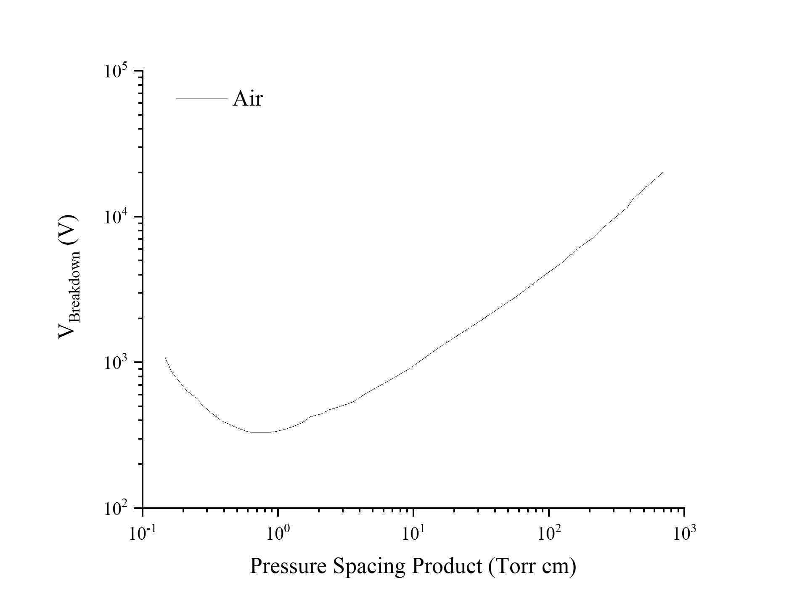

*Figure 1. Paschen curve of air at atmospheric pressure [5]*

##### 1.1.3 Electrode structures and discharge forms of atmospheric plasmas

Atmospheric plasmas need no vacuum chamber, so they are widely applicable [5, 6, 8]: cleaning, surface treatment and doping in semiconductor processing [6, 9, 10]; sterilization, blood coagulation, wound healing and cancer treatment in medicine [11–16]; and germination and growth in agriculture [17].

Electrode structures divide into the dielectric barrier discharge (DBD), which uses surface charge on a dielectric, and the direct discharge without a dielectric [5, 18–23].

- **Direct discharge (Figure 2(a)).** The plasma touches the electrodes, so self-sputtering occurs, and the discharge current flows straight into the electrodes and heats them. In long discharges the heating affects the discharge.
- **Surface DBD (Figure 2(b)) and plasma jet (Figure 2(c)).** Both are DBD structures. The dielectric blocks the discharge current from the circuit and stores wall charge on its surface. DBDs have been used since Siemens's ozone generator of 1857 [5, 6]. The wall charge creates an internal field, so the plasma forms and is sustained at a relatively low applied voltage.

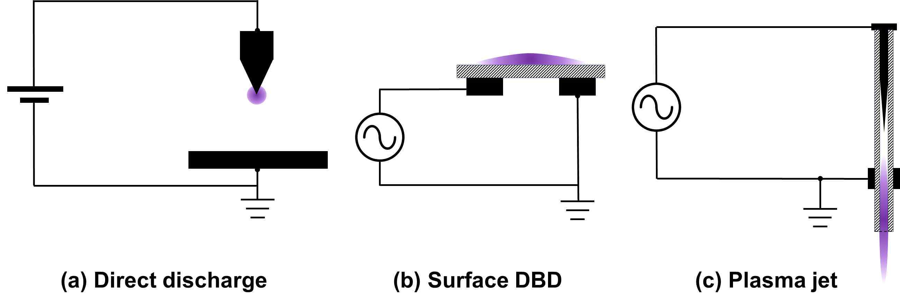

*Figure 2. Electrode structures of atmospheric-pressure discharge plasmas. (a) Direct discharge (b) Surface DBD (c) Plasma jet*

##### 1.1.4 Micro-electrode surface DBD

The source studied here is the surface DBD of Figure 2(b) with a 100 µm electrode gap. By (7) the breakdown voltage of atmospheric air is about 0.7–0.9 kV. Because the dielectric acts as a series capacitor, the applied voltage needed for a discharge is higher, about 2 kV (peak).

Paschen's law holds for parallel plates. In practice the discharge starts at electrode edges where the field concentrates, and the plasma forms in a non-uniform field. Over long operation, parts of the dielectric covering the electrodes are damaged by self-sputtering, oxidation and heating [24–28].

The dielectric surface stores wall charge and keeps the discharge current out of the circuit, so its damage degrades the plasma and the stability of the circuit. Figure 3(b) shows a discharge that became unstable for a few seconds after dielectric damage and then went out. Detecting surface damage is therefore important for keeping the discharge stable and protecting the circuit.

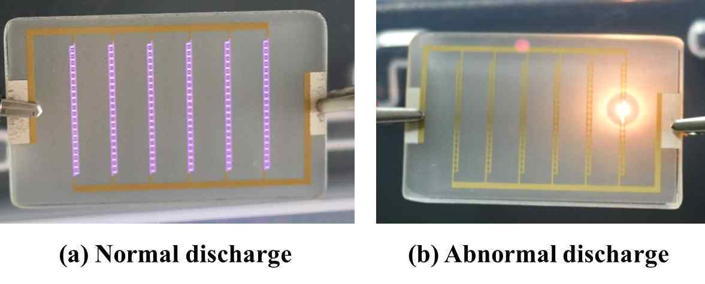

*Figure 3. (a) Normal discharge (b) Abnormal discharge due to dielectric surface damage*

#### 1.2 Artificial intelligence in plasma research

AI is suited to complex problems with large multidimensional data [29–32]. Electrical diagnostics carry physical properties of the plasma: discharge energy, discharge charge, capacitance, electron temperature and density. AI gives results faster and with less computation than simulation, which suits real-time diagnosis and prediction [33–36]; it has been used for plasma diagnostics [37], electron temperature prediction and condition optimization [38, 39], and classification and optimization of treatment effects [40, 41].

Measured data, however, also carry changes in measurement settings and experimental conditions, so what a model has learned must be checked physically. This thesis therefore combines evaluations that control confounders with interpretation by a physical model.

#### 1.3 Aim and outline

This study derives plasma properties from electrical diagnostics and uses them as machine-learning inputs to diagnose dielectric surface damage. Damage does not occur evenly across the 126 cell pairs, and it is unknown how much of the measured discharge reflects damaged cells. Which electrical property indicates damage can therefore only be found by comparing many measurements statistically.

1. Chapter 2 describes the sources, the measurement setup and the long-duration discharge experiment.
2. Chapter 3 describes the electrical properties and the equivalent-circuit model, and shows that the discharge matches DBD discharges in the literature.
3. Chapter 4 covers the surface damage caused by long discharge and the electrical changes found against the undamaged source M3.
4. Chapter 5 searches for damage indicators by machine learning and shows that the effective voltage V_rms is the most consistent one.
5. Chapter 6 interprets the V_rms drop physically, and Chapter 7 tests the interpretation with an equivalent-circuit simulation.
6. Chapter 8 summarizes conclusions and limitations.

### Chapter 2. Experiment

#### 2.1 Cold atmospheric-pressure micro-electrode surface DBD source

##### 2.1.1 Electrode structure

The 100 µm electrode gap was chosen by Paschen's law so that the source discharges stably at atmospheric pressure on a low-frequency AC supply (Figure 4).

- The discharge occurs on electrode pads (cells) of 150 µm × 300 µm. Two cells face each other across a 100 µm air gap, and 126 such cell pairs are connected electrically in parallel.
- The Ag electrodes and the dielectric are screen-printed. SEM gives an electrode thickness of about 10 µm and a dielectric thickness of about 30–40 µm (Figure 5).
- The thin dielectric gives a large capacitance and holds wall charge; the thin, branched electrodes reduce resistive heating, so long discharges cause little thermal damage from electrode resistance.

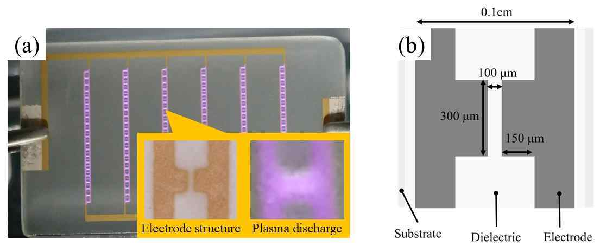

*Figure 4. (a) Discharge photograph and electrode structure of the micro-electrode surface DBD (top view) (b) Electrode layout (top view)*

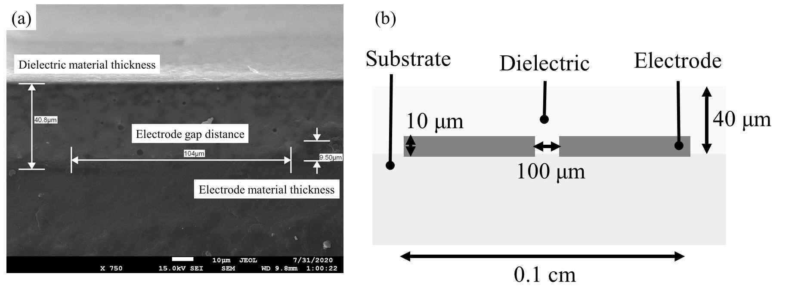

*Figure 5. (a) Electrode structure observed by SEM (side view) (b) Electrode layout (side view)*

##### 2.1.2 Setup and measurement conditions

- The voltage was measured with a high-voltage probe (Tektronix P6015A, 1000×) connected in parallel between the high-voltage and ground electrodes, and the current to ground with a current probe (Tektronix P6021A). Both probes fed an oscilloscope (GW Instek GDS-2102A).
- Sampling interval 10 ns (some 20 ns), record length 5000 points (about 2.3 periods at 10 ns), 8-bit resolution (40 V/LSB for voltage, 1.6–8 mA/LSB for current), current-probe bandwidth 60 MHz. Microdischarge pulses a few ns long are not fully recorded, so the number of discharges and the peak current are lower bounds.
- The current scale (0.04–0.4 A/div) and the sampling interval (10 / 20 ns) changed between and within time points; Section 4.4.3 covers their effect.

**Table 1.** Electrical values at the start of discharge (air, supply input 8.5 V)

|  | Drive frequency | V_rms | I_rms |
| --- | --- | --- | --- |
| Thesis Table 1 | 46.5 kHz | 1.5 kV | 19.8 mA |
| Raw-data reanalysis, M1 5 h | 46.95 kHz | 1484 V | 20.1 mA |
| Raw-data reanalysis, M2 5 h | 46.9 kHz | 1481 V | 20.3 mA |

##### 2.1.3 Procedure

- In July 2020 three sources (M1, M2, M3) were discharged together under the same conditions. They were fed from the same mains through separate power strips, each through its own DC power supply into its own AC driving power supply (supply input 8.5 V).
- Measurements were taken every 5 h: M1 0–25 h, M2 0–40 h, M3 0–60 h.
- At each cumulative discharge time the three sources were measured one after another under the same driving and measurement conditions and grouped into one dataset, called a **time point**. The order was M1 → M2 → M3, all within 10–33 min.
- At each time point, 20 detailed waveforms per source (10 at 10 ns, 10 at 20 ns) and optical micrographs were recorded.
- M1 and M2 showed surface damage from 15 h, and their discharges went out completely tens of hours later. M3 showed no surface damage up to 60 h. M3, discharged alongside M1 and M2 under the same conditions, is the **healthy comparison group** and the control for supply and environment changes.
- At 20 h the supply input was stepped through 8.5, 9, 10 and 14 V (supply sweep).
- Of the 500 waveforms from 5 h on, the two in which period detection failed were removed, leaving 498 waveforms with 1,493 complete periods. Every feature was computed per period and averaged per waveform.
- The analysis code and reproduction scripts are in this repository.

#### 2.2 The dielectric damage problem

Damage to the dielectric surface strongly affects stable discharge. An exposed electrode changes the discharge energy, discharge voltage, capacitance and other discharge properties, and harms plasma generation and sustainment.

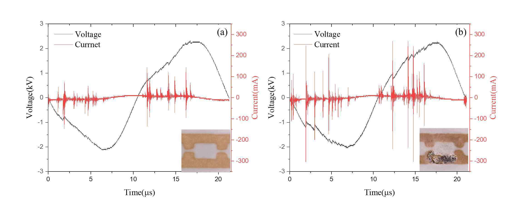

*Figure 6. Current–voltage graphs and discharge-cell photographs. (a) Before surface damage (b) After surface damage. A single-waveform example.*

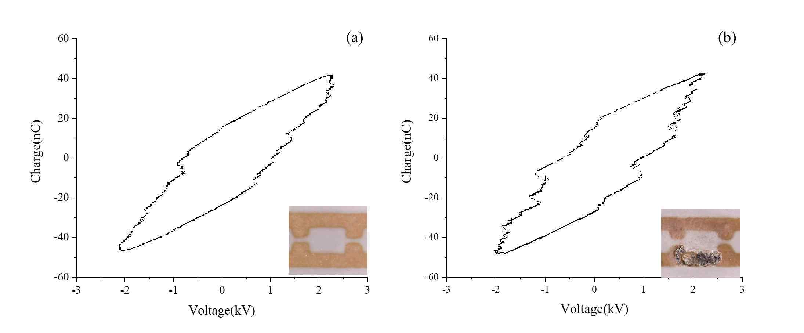

*Figure 7. Lissajous graphs and discharge-cell photographs. (a) Before surface damage (b) After surface damage*

- In the waveform of Figure 6 the discharge current rises from about 100 to 250 mA after damage and the discharge initiation voltage falls from about 500 to 400 V. This is a single example.
- Comparing waveforms at the same current scale (0.1 A/div), the peak current shows no consistent rise: M2 251 → 272 mA (p = 0.25), M1 252 → 213 mA. The discharge initiation voltage fell: M2 675 → 607 V (p = 0.09), M1 821 → 556 V (p = 4×10⁻⁵).
- In Figure 7 the slopes of the Lissajous graph change and its shape distorts after damage.

The experiment confirms that damage changes the discharge. But the dielectric surface is affected by oxidation, the gas state and field changes from the surface shape, and the measurements also carry changes of the driving power supply and the measurement settings. This study therefore learns many electrical properties with machine learning, removes changes unrelated to damage using the healthy source M3 at the same time point, and diagnoses damage statistically.

### Chapter 3. Properties of the cold atmospheric-pressure DBD plasma

This chapter sets out how the electrical properties are computed and their values (3.1), and shows with the equivalent-circuit model that the discharge matches DBD discharges in the literature (3.2). Unless stated otherwise, values are for the thesis training source M2, normal (5–10 h) and damaged (15–40 h).

#### 3.1 Electrical properties

##### 3.1.1 Current–voltage graph and discharge timing

The current–voltage graph shows when the discharge occurs (Figure 8) [5, 42].

- The discharge starts at T₁. The applied voltage at that moment is the **discharge initiation voltage V_min**, about 300–700 V experimentally (mean 504.5 ± 168.8 V). This thesis also writes it V_on.
- At T₂ the applied voltage reaches its maximum V_max and the discharge ends.
- At T₃ the polarity reverses; the field of the wall charge from the previous discharge (T₁–T₂) adds to the external field and the discharge restarts. It ends at V_max at T₄.
- A DBD on a low-frequency AC supply thus alternates a discharging quarter period with a non-discharging one.

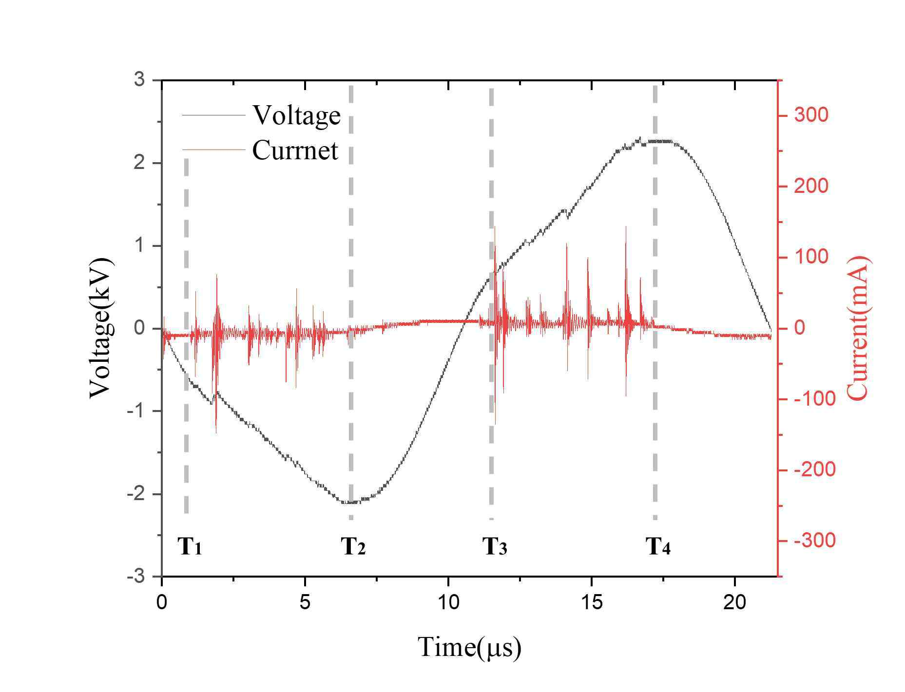

*Figure 8. Current–voltage graph. T₁, T₃: discharge initiation; T₂, T₄: end of discharge*

##### 3.1.2 Effective voltage, effective current and discharge energy per cycle

The effective voltage V_rms and effective current I_rms compare the electrical behavior of the whole system. They are the root mean squares over a period T:

```math
V_{rms} = \sqrt{\frac{1}{T}\int_0^T v(t)^2\,dt}, \qquad I_{rms} = \sqrt{\frac{1}{T}\int_0^T i(t)^2\,dt} \qquad (8)
```

The energy the discharge consumes per period, and the mean power:

```math
E = \int_0^T v(t)\,i(t)\,dt \;\;[\mathrm{J/cycle}], \qquad P = \frac{E}{T} \qquad (9)
```

- V_rms is 1.50 ± 0.017 kV normal and 1.40 ± 0.049 kV damaged. The undamaged M3, however, also lost V_rms at the same time points (e.g. 1502 V at 10 h → 1369 V at 15 h). The damage-specific drop is about 48 V (Chapter 4).
- I_rms is 20.8 ± 4.0 mA normal and 18.6 ± 6.3 mA damaged.
- The discharge energy per cycle is 0.13 ± 0.022 mJ normal and 0.13 ± 0.024 mJ damaged; the mean power (f = 46.5 kHz) is about 6.0 W.

##### 3.1.3 Burning voltage

The DBD dielectric is a capacitor. A discharge carries charge onto the dielectric surface and builds wall charge of opposite polarity to the applied voltage; its internal field weakens the field across the air gap and the discharge ends. When the applied polarity reverses, the wall-charge field points the same way as the external field and the next discharge starts early.

The voltage across the air gap, with Q the charge of the Lissajous graph and C_d the dielectric capacitance:

```math
u_g(t) = v(t) - \frac{Q(t)}{C_d} \qquad (10)
```

While the discharge runs, u_g stays nearly constant at the **burning voltage U_b** [42, 55]. At discharge onset the dielectric still holds the wall charge Q_on from the previous half period, with wall voltage −Q_on/C_d. The burning voltage is therefore:

```math
U_b = V_{min} - \frac{Q_{on}}{C_d} = \left(1 - \frac{C_{total}}{C_d}\right)\frac{V_{max} + V_{min}}{2} \qquad (11)
```

- With the means of Table 2 (C_d 34.2 pF, C_total 11.3 pF, V_min 0.50 kV, V_max 2.24 kV), U_b ≈ 0.92 kV, consistent with the Paschen breakdown voltage of a 100 µm air gap from (7) (0.72–0.87 kV).
- The raw-data reanalysis gives 860 ± 68 V normal and 811 ± 75 V damaged.
- The thesis' original formula V_b = V_min + Q_max/C_d uses the charge moved during the discharge, Q_max = C_d(V_max − V_min), as the wall charge, and is therefore identically V_max. The thesis' discharge voltages of 2.1 / 2.0 kV are the peak applied voltage.
- The supply sweep confirms this: V_b follows V_max with slope 0.87–1.08, while U_b changes with slope only 0.23–0.33.

##### 3.1.4 Number of discharges

- The 126 cells are in parallel and differ slightly in electrode distance and surface roughness, so cells with stronger internal fields discharge first.
- A DBD is a capacitor; the pulsed current left after removing the displacement current is the discharge current. A discharge lasts a few ns while the drive period is about 21 µs, so the discharge current appears as pulses.
- Pulses were found with SciPy's find_peaks and peak_prominences. Peaks below 1.5 × the median prominence were treated as noise, and peaks with outlying widths (outside the interquartile range) were removed (Figure 9).
- The number of discharges (per quarter period) is 50.1 ± 21.9 normal and 50.5 ± 25.0 damaged: no difference.
- The detected count depends strongly on the sampling interval: at the same time point, 20 ns instead of 10 ns detects 6.6 fewer pulses (Section 4.4.3). The number of discharges is therefore not used as a damage indicator.

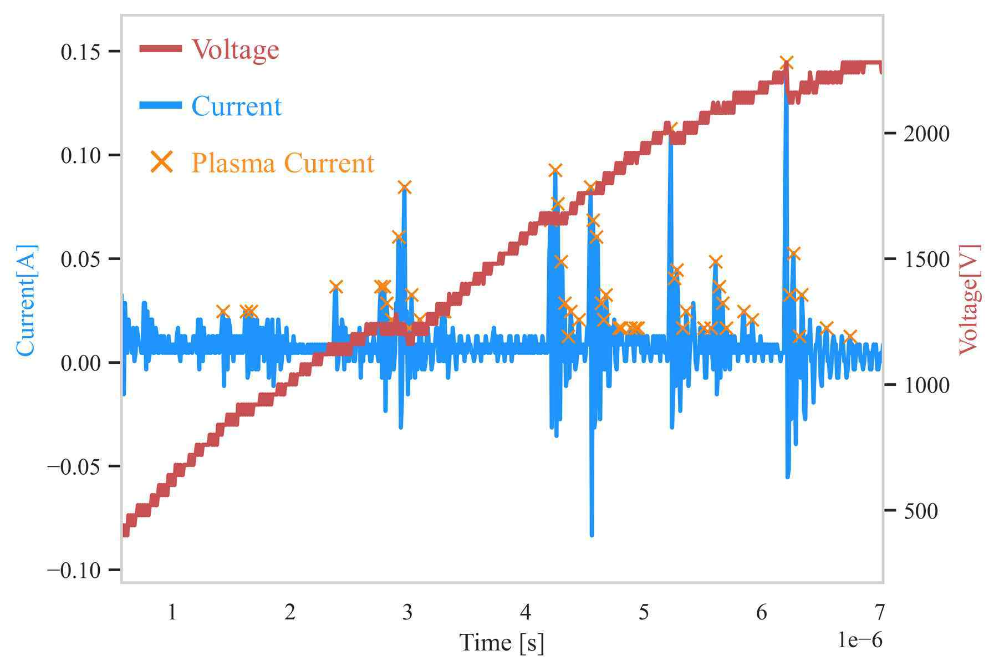

*Figure 9. Current–voltage graph during the discharge (T₃–T₄) and the detected discharge-current pulses*

##### 3.1.5 Electron density

The electron density follows from Ohm's law applied to the discharge current [43–48]. The current density J is the peak current i_peak divided by the discharge area A, and the field is the burning voltage over the electrode distance, U_b/d:

```math
J = n_e\,e\,\mu_e\,E \quad\Rightarrow\quad n_e = \frac{i_{peak}\,d}{e\,\mu_e\,A\,U_b} \qquad (12)
```

- The electron mobility at room temperature and atmospheric pressure was taken as μ_e = 592 cm²/Vs, a low-field value; it is smaller at hundreds of Td.
- The cell's top area 4.5×10⁻⁴ cm² was used as an approximate discharge area. In a coplanar surface discharge the current flows parallel to the surface, so the density obtained this way is a cell-averaged relative indicator.
- With U_b the electron density is about 3.9×10¹² cm⁻³ normal and 4.0×10¹² cm⁻³ damaged, with no significant difference. The thesis values (1.60×10¹², 1.62×10¹² cm⁻³) used V_b (= V_max) instead of U_b and are about 2.4 times smaller.
- The peak current depends on the current-probe settings (Section 4.4.3), so the electron density can only be compared within one setting.

##### 3.1.6 Electron temperature

The electron temperature is obtained approximately from the Einstein relation [43, 47]. D_e/μ_e is the characteristic energy; it equals k_B·T_e/e for a Maxwellian electron energy distribution. D_e/μ_e is a function of the reduced field E/N (Figure 10) [48, 49]:

```math
\frac{k_B T_e}{e} = \frac{D_e}{\mu_e}\left(\frac{E}{N}\right), \qquad \frac{E}{N} = \frac{U_b}{N\,d}, \qquad N = \frac{p}{k_B T} \qquad (13)
```

- The gas number density is N = 2.50×10¹⁹ cm⁻³ (1 atm, 20 °C). With U_b, E/N ≈ 340 Td (1 Td = 10⁻¹⁷ V·cm²).
- There D_e/μ_e ≈ 6 V, so the electron temperature is about 6 eV; the reanalysis gives 6.2 ± 0.3 eV normal and 6.0 ± 0.4 eV damaged. 340 Td is a short extrapolation just beyond the end of Raizer's curve (about 300 Td).
- The thesis' 13 eV came from E/N = 814 Td obtained with V_b (= V_max), a long extrapolation of a curve digitized only up to 175 Td. Fitting the same points with other functions gives 4.5–20 V at 814 Td, so the value is not constrained by data.
- The electron temperature is a function of U_b alone, so it is not an independent observation.

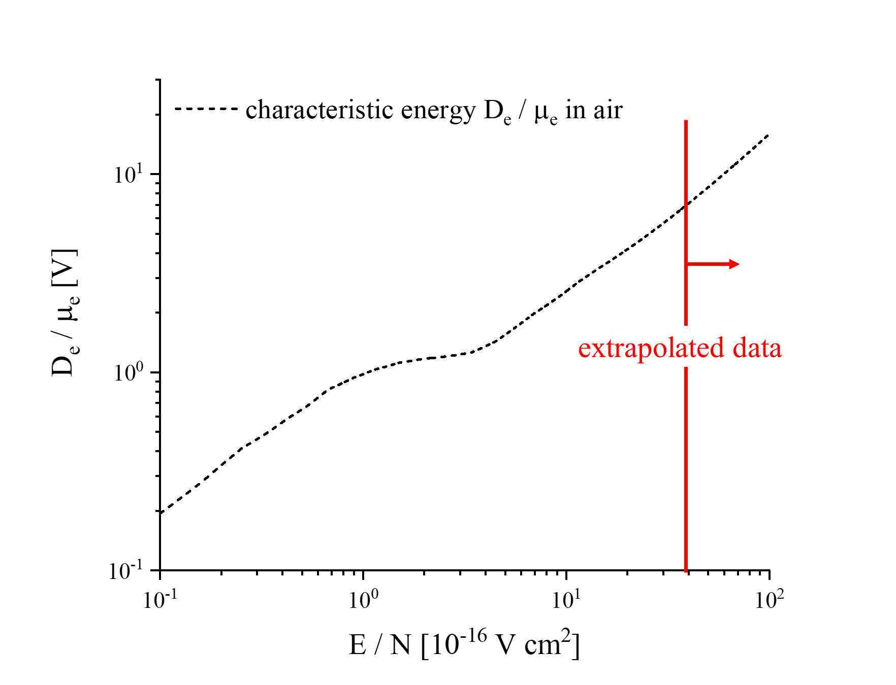

*Figure 10. Characteristic energy D_e/μ_e of air as a function of E/N [48, 49]. Values beyond the red line are extrapolated.*

#### 3.2 Modeling the DBD with an equivalent circuit

##### 3.2.1 Lissajous graph

Manley computed the discharge voltage and energy of a DBD from the charge–voltage graph [5, 42], called the Lissajous graph: a closed parallelogram. After the discharge initiation voltage V_min the charge grows with the discharge and the slope rises sharply; at the peak voltage V_max the discharge ends and the slope drops (Figure 11). The charge is the integral of the current after removing its offset:

```math
Q(t) = \int_0^t i(t')\,dt' + Q_0 \qquad (14)
```

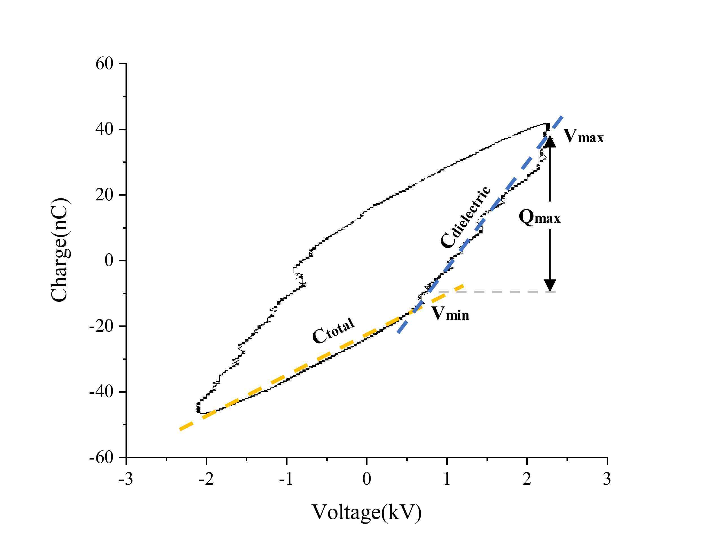

*Figure 11. Lissajous graph and plasma characteristics*

##### 3.2.2 Capacitance

In the equivalent circuit of a discharge cell, the dielectric between the electrodes is the dielectric capacitor C_d and the air between them is the air-gap capacitor C_g [50–62]. Before the discharge the two are in series; during the discharge the air gap conducts and only C_d remains (Figure 12). The slope of the Lissajous graph before the discharge is the total capacitance C_total, and during the discharge it is C_d:

```math
C_{total} = \frac{C_d\,C_g}{C_d + C_g} \qquad (15)
```

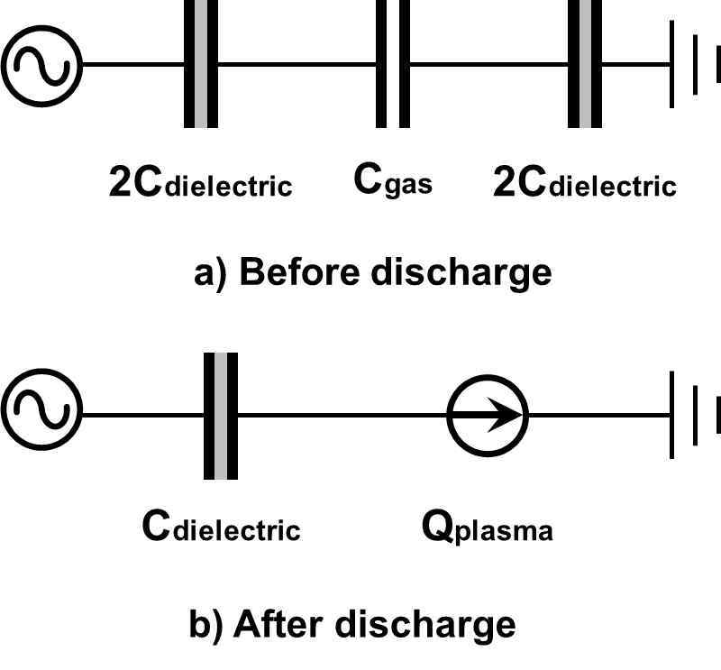

*Figure 12. Equivalent circuit. (a) Before discharge (b) During discharge*

Both slopes were obtained by fitting straight lines to the sides of the Lissajous graph with SciPy's curve_fit (Figure 13, Table 2).

**Table 2.** Capacitances from the Lissajous graph (fit of an example waveform; means of M2 normal / damaged)

| Quantity | Example waveform | Thesis normal / damaged | Raw-data reanalysis normal / damaged |
| --- | --- | --- | --- |
| C_d (discharge-phase slope) | 34.9 pF | 34.2 ± 4.9 / 35.5 pF | 34.5 / 37.2 pF |
| C_total (non-discharge slope) | 13.1 pF | 11.3 ± 1.2 / 12.1 pF | 12.3 / 13.0 pF |
| C_g (Eq. 15) | 21.0 pF | 17.3 ± 2.8 / 18.7 pF | 19.4 / 20.3 pF |

- Both line fits have F above 10⁴, p < 10⁻¹⁵ and R² ≈ 0.98. The time-series points are autocorrelated, so the F test is only an approximate indicator.
- When the discharge does not cover the whole dielectric of a surface DBD, the discharge-phase slope is an effective capacitance (≤ C_d), not the intrinsic C_d [50]. In the supply sweep (8.5 → 14 V) the discharge-phase slope rose: M1 37.6 → 48.9, M2 41.4 → 56.7, M3 39.6 → 58.3 pF. Not all 126 cell pairs discharge, and the discharging area grows with voltage.
- Changes of C_d and of quantities that use it (discharge charge, energy) must therefore be compared at the same applied voltage.

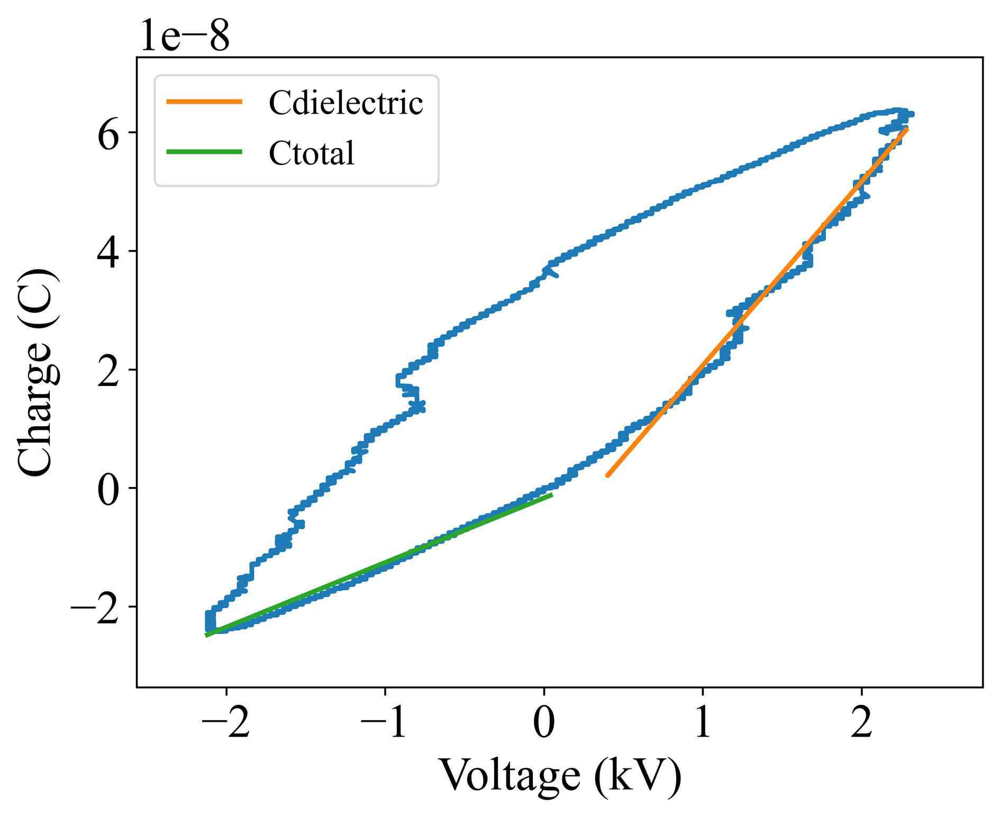

*Figure 13. C_total and C_d from line fits to the Lissajous graph*

##### 3.2.3 Discharge charge

The discharge charge is the charge moved between the discharge initiation voltage V_min and the peak voltage V_max (Q_max in Figure 11):

```math
Q_{max} = C_d\,(V_{max} - V_{min}) \qquad (16)
```

It is 59.4 ± 9.0 nC normal and 61.7 nC damaged (reanalysis 59.5 / 62.7 nC, p = 0.07). Later chapters also write it ΔQ.

##### 3.2.4 Comparison with DBD discharges in the literature

The Lissajous graph, the burning voltage, the discharge mechanism and the electron temperature all match DBD discharges in the literature (Table 3, Figure 14). The discharge of this source is a Townsend-type DBD described by Manley's equivalent circuit.

**Table 3.** Equivalent-circuit diagnosis against DBD discharges in the literature (498 waveforms from 5 h)

| Diagnostic | Measured | DBD discharge in the literature | Verdict |
| --- | --- | --- | --- |
| Lissajous graph | Two slopes in all 498 waveforms (C_d > C_total) | Parallelogram [42] | Agrees |
| Burning voltage U_b | Interquartile 773–888 V. Two independent estimates (discharge initiation point 828–860 V, geometric relation 842–882 V) agree within 3 % | Paschen's law, 100 µm air 718–865 V (γ = 0.1–0.01) [49] | Agrees |
| Energy per cycle | 1.17 × the Manley value | Manley's equation [42] | Agrees |
| Discharge mechanism | αd = 3.2–5.0 at U_b; γ satisfying the Townsend condition 0.007–0.045 | Streamer criterion αd ≈ 18–20 [72]; γ typical of dielectric surfaces | Townsend discharge |
| Electron temperature | E/N ≈ 340 Td, T_e ≈ 6 eV | Cold plasmas 1–10 eV [5, 49] | Agrees |
| Electron density | Cell average about 4×10¹² cm⁻³ | Microdischarge channels 10¹⁴–10¹⁵ cm⁻³ [61] | Lower because averaged over area and time; relative indicator |
| Partial surface discharging | Discharge-phase slope grows in the sweep (3.2.2) | Partial surface discharging of surface DBDs [50] | Agrees |

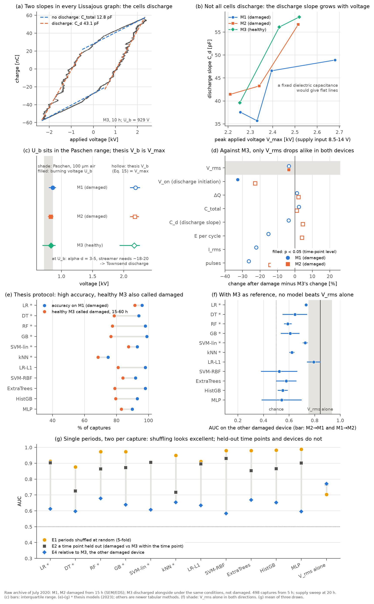

*Figure 14. Consistency of physics, statistics and machine learning. (a) Lissajous graph and its two slopes, M3 at 10 h (b) Discharge-phase slope in the supply sweep (c) U_b against the Paschen range and the thesis' V_b (d) Damage effects against M3 (e) Accuracy of the thesis protocol and false alarms on M3 (f) AUC across devices with M3-referenced features (g) Period-level evaluation*

### Chapter 4. Dielectric damage in the cold atmospheric-pressure DBD

From 15 h the dielectric of M1 and M2 eroded and the Ag electrodes were exposed. Against M3 at the same time point, V_rms of both sources fell about 3.5 % further; the changes of the other features either point in opposite directions in the two sources or are tied to the measurement settings.

#### 4.1 Earlier work on dielectric damage in surface DBDs

- Dielectric damage in surface DBDs is widely reported [24–28]. At atmospheric pressure the dielectric is continuously exposed to ionized oxygen and oxidizes, and the chemistry of the wall charge causes weak sputtering. Once an electrode is exposed, its material is sputtered and spreads around [26].
- In micro-electrodes with narrow gaps, the strong field drives continuous sputtering and deposition [24]. The field concentrates further at damaged spots, which accelerates the damage.
- The surface was analyzed by optical microscopy, scanning electron microscopy (SEM, JEOL JSM-7001F) and energy-dispersive X-ray spectroscopy (EDS, Bruker XFlash 6). SEM sees about the top 1 µm; EDS with a 15.0 kV beam sees the composition to about 1–3 µm. The dielectric is 30–40 µm thick, so electrode Ag is barely detected while the dielectric is intact and is detected once the electrode is exposed.

#### 4.2 Surface observation

The sources were discharged for tens of hours, and surface damage appeared on M1 and M2 of the three. Discharging continues after damage, so the sources were run until the discharge went out completely. The discharge shape also changes on damaged areas (Figure 15).

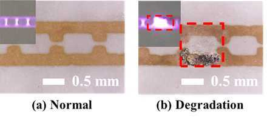

*Figure 15. Electrode surfaces under the optical microscope. (a) Normal (b) Dielectric surface damage*

Dark burned areas were quantified in all 242 micrographs (Table 4). An image counts as burned when its largest connected region with brightness below 90 covers at least 150 px.

**Table 4.** Micrographs with burn marks per time point (burned / total)

| Cumulative discharge time | M1 | M2 | M3 |
| --- | --- | --- | --- |
| 5 h | 4/9 (largest 1521 px) | 0/5 | 0/8 |
| 10 h | 0/5 | 0/5 | 0/4 |
| 15 h | 2/5 | 2/5 | 0/4 |
| 20 h | 3/6 | 2/5 | 0/6 |
| 25 h | 3/9 | 2/6 | 0/4 |
| 30 h | – | 3/9 | 0/11 |
| 35 h | – | 2/10 | 0/15 |
| 40 h | – | 2/13 | 0/16 |
| 45–60 h | – | – | 1/82 (55 h, 159 px) |

- **M2.** No burn marks at 5 and 10 h; dark erosion marks at every time point from 15 h, consistent with the label boundary (≤ 10 h normal, ≥ 15 h damaged).
- **M1.** Erosion marks also appear from 15 h. But the 5 h photographs, taken before the 10 h measurement, show a large melted and bubbled spot at an electrode tip, so the M1 data labelled normal at 5 and 10 h may include damaged cells.
- **M3.** No burn marks up to 50 h; only one small spot at 55 h.

Under SEM the damaged dielectric surface is uneven and pitted (Figure 16).

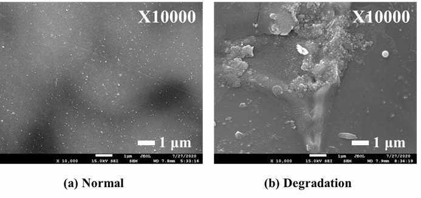

*Figure 16. SEM images of the electrode surface (×10,000). (a) Reference sample (Ref) (b) Dielectric surface damage (M2)*

#### 4.3 EDS analysis

The reference sample shows traces of Ag from the electrode under the dielectric. The damaged electrode shows much Ag, especially where the dielectric was worn away (Figures 17, 18), while dielectric components (Si, Na, Al) decreased (Table 5).

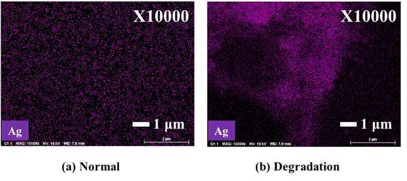

*Figure 17. Ag distribution on the electrode surface by EDS. (a) Reference sample (Ref) (b) Dielectric surface damage (M2)*

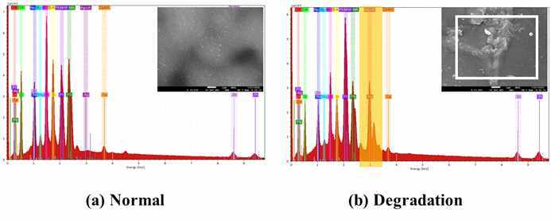

*Figure 18. EDS spectra. (a) Reference sample (Ref) (b) Dielectric surface damage (M2). The yellow peak is Ag.*

**Table 5.** Elemental composition by EDS [at.%] (each column is one ×10,000 map)

| Element | Reference sample (Ref) | Damaged site (M2) |
| --- | --- | --- |
| O | 30.27 | 27.69 |
| Ag | 0.57 | 13.86 |
| Si | 13.60 | 9.88 |
| Al | 20.04 | 15.54 |
| Zn | 7.09 | 8.87 |
| Ca | 2.41 | 2.03 |
| Mg | 2.48 | 2.52 |
| Na | 9.19 | 6.49 |
| Pb | 6.65 | 5.90 |
| C | 7.70 | 7.22 |

The two values in Table 5 are the largest among the maps of each site. Table 6 gives Ag over all maps. Damaged sites (12 maps, 1.3–13.9 at.%) and intact dielectric (41 maps, mostly ≤ 0.7 at.%) separate clearly, so the conclusion that the dielectric damage exposed the electrode is robust.

**Table 6.** Ag in the EDS maps by site

| Site | Maps | Ag [at.%] |
| --- | --- | --- |
| Reference sample (Ref) | 6 | 0.00–0.57 |
| M3, after 60 h of discharge | 13 | 12 maps 0.00–0.25, 1 map 1.44 |
| M2, intact areas | 10 | 0.00–0.56 |
| M1, intact dielectric | 12 | 0.01–0.68 |
| M1, exposed electrode (burned) | 4 | 5.08–11.94 |
| M1, exposed electrode (burst) | 4 | 1.28–3.22 |
| M2, damaged site | 4 | 3.78–13.86 |

#### 4.4 Discharge properties before and after damage

The thesis compared values before and after damage directly and reported that V_rms, I_rms, the discharge initiation voltage, the discharge voltage and the electron temperature fell, while the number of discharges, the electron density, the capacitances and the discharge charge rose. The raw data show that these changes mix in two effects unrelated to damage: external factors common to all three sources, and changes of the measurement settings.

##### 4.4.1 Common external factors

**Table 7.** Mean V_rms per time point [V]

| Cumulative discharge time | M1 | M2 | M3 |
| --- | --- | --- | --- |
| 5 h | 1484 | 1481 | 1484 |
| 10 h | 1501 | 1496 | 1502 |
| 15 h | 1273 | 1312 | 1369 |
| 20 h | 1460 | 1432 | 1478 |
| 25 h | 1423 | 1355 | 1454 |
| 30 h | – | 1436 | 1475 |
| 35 h | – | 1399 | 1473 |
| 40 h | – | 1445 | 1443 |
| 45 / 50 / 55 / 60 h | – | – | 1155 / 1156 / 1454 / 1176 |

- Before damage (5 and 10 h) the three sources agree within a few volts.
- At the 15 h time point all three dropped together; even the undamaged M3 lost 133 V from 10 h.
- Within one time point V_rms jumped between discrete levels (about 1150, 1270, 1360 and 1460 V) every few seconds. This is a change in the operating state of the driving power supply, not slowly progressing surface damage.
- Without damage, M3 dropped to 1155 V at 45 and 50 h and returned to 1454 V at 55 h.
- The damage effect must therefore be obtained by subtracting the change of M3 at the same time point (difference in differences). Without M3, about half of the V_rms drop would be misread as damage.

##### 4.4.2 Damage effects against M3

**Table 8.** Damage effects against M3 (before 5–10 h → after 15 h–end; difference of the log means per time point [%]; p from a Welch test on the time-point means)

| Feature | M1 | M2 | Verdict |
| --- | --- | --- | --- |
| V_rms | −3.5 (p 0.19) | −3.5 (p 0.017) | Same size in both sources |
| Discharge initiation voltage V_min | −33 (p 0.020) | −23 (p 0.38) | Same direction |
| Discharge charge ΔQ | +1.2 (p 0.95) | +2.0 (p 0.75) | Same direction only |
| C_total | +2.3 (p 0.83) | +1.0 (p 0.66) | Same direction only |
| C_d (discharge-phase slope) | −3.6 (p 0.87) | +4.6 (p 0.54) | Opposite directions |
| Energy per cycle | −15.2 (p 0.56) | +4.0 (p 0.52) | Opposite directions |
| I_rms | −22.2 (p 0.16) | −12.4 (p 0.30) | Measurement settings |
| Number of discharges | −26.4 (p 0.42) | −14.0 (p 0.37) | Measurement settings |

- V_rms has the same direction and size in both sources (about −48 V), about half of the simple change without M3 (−107 / −92 V).
- The discharge initiation voltage moves the same way, but the noise within a time point is large and it is not significant for M2.
- The number of discharges and U_b changed significantly in the undamaged M3 as well (+2.7, p = 4×10⁻⁶; −38 V, p = 0.05).
- Tests at the time-point level (2 before, 3–6 after) have low power, so "not significant" does not mean "no effect".

##### 4.4.3 Effect of the measurement settings

Even at the same time point and source, the oscilloscope settings change the values (Table 9; regression with time-point fixed effects, 500 waveforms).

**Table 9.** Change of feature values with the oscilloscope settings

| Feature | Per doubling of current A/div | p | 20 ns vs 10 ns sampling | p |
| --- | --- | --- | --- | --- |
| I_rms | +3.5 mA | 10⁻¹⁷ | +4.3 mA | 5×10⁻⁵³ |
| Peak current | +59 mA | 4×10⁻¹⁰ | +37 mA | 9×10⁻¹⁰ |
| Number of discharges | +1.1 | 0.11 | −6.6 | 3×10⁻⁴⁵ |
| Electron density | +2.7×10¹² cm⁻³ | 2×10⁻⁸ | +5×10¹¹ cm⁻³ | 0.07 |
| C_d | +0.3 pF | 0.54 | +3.0 pF | 2×10⁻²⁰ |
| U_b | +45 V | 3×10⁻⁹ | +35 V | 3×10⁻¹³ |
| V_rms | +19 V | 5×10⁻⁴ | −5 V | 0.13 |

- The damaged period has more waveforms at the low-sensitivity setting (0.04 A/div; M2 20 → 42 %). The reported "lower I_rms, more discharges and higher electron density" are confounded with the settings and cannot serve as damage indicators.
- The voltage channel was fixed at 1000 V/div at nearly all time points, and the noise of V_rms within a time point is 0.5 %. The change consistently tied to damage is the V_rms drop against M3.

### Chapter 5. Diagnosing DBD dielectric damage with machine learning

Classifiers trained as in the thesis reached high accuracy, but much of it came from common external factors. Once those and the measurement settings are controlled, none of 11 models beats a classifier that uses V_rms alone, and V_rms stays first when random factors are varied.

#### 5.1 Features

The 14 features computed by the methods of Chapter 3 were assembled into a pandas data frame as inputs (Table 10).

**Table 10.** Plasma features used for training

| Feature | Unit | Note |
| --- | --- | --- |
| Drive frequency | Hz | |
| Discharge energy per cycle | J | Eq. (9) |
| V_rms, I_rms | V, A | Eq. (8) |
| C_d, C_g, C_total | F | Eq. (15); C_g computed from C_d and C_total |
| Discharge initiation voltage V_min | V | |
| Discharge voltage V_b | V | Equal to V_max (3.1.3) |
| Discharge charge Q_max | C | Eq. (16) |
| Number of discharges | count | Depends on the sampling interval |
| Electron density mean, standard deviation | cm⁻³ | Depends on V_b and the current setting |
| Electron temperature | eV | Function of V_b |
| Output: surface damage | 0 / 1 | |

The inputs are not independent: C_g is computed from C_d and C_total, the electron temperature and density from V_b, and V_b equals V_max, which moves with V_rms.

#### 5.2 Preprocessing

Logistic regression, SVM and kNN are sensitive to feature scales and outliers [63], so every feature was standardized to mean 0 and standard deviation 1, with μ and σ taken from the training data only:

```math
z = \frac{x - \mu}{\sigma}, \qquad \mu = \frac{1}{N}\sum_{i=1}^{N} x_i, \qquad \sigma = \sqrt{\frac{1}{N}\sum_{i=1}^{N}\left(x_i - \mu\right)^2} \qquad (17)
```

#### 5.3 Datasets

The thesis trained and evaluated on M2 and validated on M1, labelling ≤ 10 h as 0 and ≥ 15 h as 1 (Table 11).

**Table 11.** Dataset sizes in the thesis

| | Training/test (M2) | Validation (M1) |
| --- | --- | --- |
| Normal (0) | 80 | 80 |
| Damaged (1) | 209 | 81 |

- The training/test data are a random split of one source's data. Waveforms from the same time point (and the two half periods of one waveform) can land in both training and test, so the test score is optimistic.
- This thesis adds M3 as a healthy control and uses the 498 waveforms from 5 h on (996 periods, 2 per waveform, for period-level evaluation).

#### 5.4 Classifiers

- **The thesis' six (scikit-learn 1.2.2) [73].** Logistic regression [64], decision tree (max_depth = 3, min_samples_split = 4) [65], random forest (1000 trees) [66], gradient boosting (learning rate 0.01, 1000 trees) [67], linear SVM [68], kNN (k = 3) [69].
- **Five added.** L1-regularized logistic regression, RBF-SVM, ExtraTrees, HistGradientBoosting, MLP.
- The random forest combines the predictions of its 1000 trees by majority vote (mean probability).

#### 5.5 Metrics

With surface damage as the positive class, TP is actual damage predicted as damage, TN actual normal predicted as normal, FP actual normal predicted as damage, and FN actual damage predicted as normal [70]:

```math
\mathrm{ACC} = \frac{TP + TN}{TP + TN + FP + FN}, \quad \mathrm{PRE} = \frac{TP}{TP + FP}, \quad \mathrm{REC} = \frac{TP}{TP + FN}, \quad F_1 = \frac{2\cdot\mathrm{PRE}\cdot\mathrm{REC}}{\mathrm{PRE} + \mathrm{REC}} \qquad (18)
```

The AUC is the area under the ROC curve: 1.0 for a perfect classifier, 0.5 for a random one [71].

#### 5.6 Results

##### 5.6.1 Results of the thesis protocol

**Table 12.** Classification performance of the thesis protocol (accuracy, precision, recall in %; precision and recall are macro averages over both classes, F1 is for the damage class)

| Model | Train/test ACC | PRE | REC | F1 | AUC | Validation ACC | PRE | REC | F1 | AUC |
| --- | --- | --- | --- | --- | --- | --- | --- | --- | --- | --- |
| LR | 94.83 | 92.90 | 94.49 | 0.96 | 0.99 | 76.40 | 84.03 | 76.25 | 0.81 | 0.99 |
| DT | 89.66 | 87.05 | 87.05 | 0.93 | 0.94 | 96.27 | 96.37 | 96.29 | 0.96 | 0.96 |
| RF | 93.10 | 93.02 | 89.43 | 0.95 | 0.98 | 96.89 | 96.95 | 96.91 | 0.97 | 0.99 |
| GB | 94.83 | 94.34 | 92.56 | 0.96 | 1.00 | 96.27 | 96.37 | 96.29 | 0.96 | 0.97 |
| SVM | 94.83 | 92.90 | 94.49 | 0.96 | 0.99 | 76.40 | 84.03 | 76.25 | 0.81 | 0.98 |
| kNN | 86.21 | 83.60 | 80.80 | 0.91 | 0.87 | 75.16 | 82.42 | 75.01 | 0.80 | 0.88 |

- On the validation data the random forest has an AUC above 0.9 and the highest F1.
- LR and SVM have an AUC of 0.99 but only 76.4 % accuracy: the classes stay in order, but the decision threshold shifts with the baseline difference between sources.
- In the V_rms–I_rms plane, V_rms alone nearly separates the two states (Figure 19; single-feature AUC ≈ 1.0).

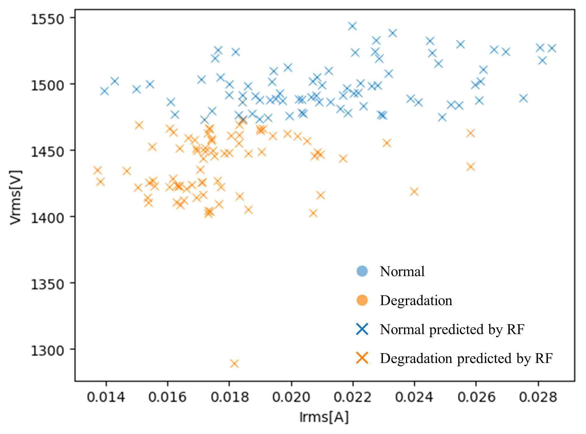

*Figure 19. Normal and damaged predictions of the random forest on the validation data (V_rms–I_rms plane)*

Applied to the undamaged M3, however, the same classifier calls 57–86 % of the 15–40 h waveforms (random forest 62.5 %) and almost all 45–60 h waveforms "damaged". The false alarms cluster at the time points with low V_rms (15, 25, 40 and 45–60 h). The classifier reacted to the applied-voltage level, that is, to common external factors, rather than to surface damage (Figure 14(e)).

##### 5.6.2 Evaluation with confounders controlled

The confounders that change together with damage were blocked step by step (Table 13).

- Common external factors: features were taken relative to M3 at the same time point.
- Source differences: training on one damaged source, testing on the other.
- Leakage within a time point: a whole time point was held out for testing.
- Unequal weight of waveforms: two periods were drawn from every waveform, one period per row, and the draw was repeated three times.

**Table 13.** Classification performance by evaluation (test source M1 / M2)

| Evaluation | Confounder blocked | 11 models | V_rms alone |
| --- | --- | --- | --- |
| Thesis protocol: train M2, test M1 | None | Accuracy 0.90–0.99 (kNN 0.75); 68–92 % of healthy M3 waveforms at 15–60 h called "damaged" | – |
| 5-fold cross-validation on shuffled periods | None | AUC 0.88–0.99 | AUC 0.70 |
| One time point held out (periods) | Leakage within a time point | AUC within the time point 0.72–0.93 | AUC 0.77 |
| Features relative to M3, test on the other damaged source (waveforms) | Common external factors, source differences | AUC 0.38–0.84 / 0.59–0.74 | **AUC 0.94 / 0.75** |
| Same (periods) | As above + equal waveform weight | AUC 0.49–0.70 / 0.57–0.72 | **AUC 0.80 / 0.74** |

- **The high scores of shuffling come from leakage.** Other periods of the same waveform and of the same time point enter training, so the model has already seen the state of the test time point (Figure 14(g)).
- **With whole time points held out, the models use V_rms and the drive frequency.** The top permutation importance is V_rms for both the random forest and boosting (0.175, 0.191). The drive frequency is a fingerprint of each source's own driving power supply.
- **The only information that generalizes to the other damaged source is V_rms.** The more complex the model, the more it overfits the training source; logistic regression on V_rms alone matches or beats every model (Figure 14(f)).

##### 5.6.3 Robustness to random factors

V_rms stays first when the placement of the damage onset, the waveform sample, the period draw and the choice of model are varied (Table 14). Its effect-to-noise ratio is more than twice that of every other feature (Figure 21(d)).

**Table 14.** Checks against random factors

| Random factor | Check | V_rms | For comparison |
| --- | --- | --- | --- |
| Which time points are pre-damage (label placement) | Exact permutation test, 280 placements over both sources | p = 0.039 | V_on/V_max 0.029, ΔQ/V 0.26, C_total 0.56, energy 0.56 |
| Waveform sample | 300 bootstrap resamples [74], rank of the univariate AUC against M3 | First in 60 % (AUC 0.84) | I_rms 26 % (confounded by settings), V_on/V_max 8 % |
| Noise within a time point | Effect-to-noise ratio | 4.3–5.4 | Next: drive frequency 2.0–2.2 |
| Choice of model (11) | Features relative to M3, test on the other damaged source | AUC 0.94 / 0.75 | 11 models 0.38–0.84 |
| Period draw (3 draws) | Periods, same test | AUC 0.80 / 0.74 | 11 models 0.58–0.68 on average; SD ≤ 0.09 |
| Importance inside the models | Permutation importance | First for random forest (waveforms) and random forest and boosting (periods) | Second for HistGradientBoosting (waveforms; I_rms first) |

The permutation test over both sources is significant, but per source there are only 10 (M1) and 28 (M2) possible placements, so neither is significant alone (p 0.10, 0.18). In short, V_rms is the most effective indicator of damage across the models, so Chapters 6 and 7 test the physical meaning of the V_rms change with the measurements and a simulation.

#### 5.7 Precursors of surface damage

The random forest's predicted probabilities for the data at the start of discharge and just before surface damage were compared (Table 15).

**Table 15.** Predictions at the start of discharge and just before damage (probability of "normal", mean ± standard deviation)

| Dataset | Input | Predicted normal | Predicted damaged | Probability of normal |
| --- | --- | --- | --- | --- |
| Training/test (M2) | Start of discharge | 38 | 2 | 0.886 ± 0.18 |
| Training/test (M2) | Just before damage | 39 | 1 | 0.909 ± 0.09 |
| Validation (M1) | Start of discharge | 40 | 0 | 0.816 ± 0.05 |
| Validation (M1) | Just before damage | 39 | 1 | 0.818 ± 0.11 |

The probabilities at the start and just before damage do not differ significantly, so these data give no basis for predicting precursors of damage. The thesis' criterion, "a precursor when the probability of normal falls more than 10 % below its initial value", is not supported.

#### 5.8 AI-based dielectric damage diagnosis program

A program predicts the probability of surface damage from arbitrary current–voltage data with the trained random forest (Figure 20). Data from a damaged source give "the DBD dielectric surface is damaged with 99.27 % probability" (Figure 20(a)); data from a normal source give "normal with 96.42 % probability" (Figure 20(b)). As 5.6.1 showed, however, this model responds to the applied-voltage level, so comparing V_rms with a healthy reference under the same drive is more robust for real diagnosis.

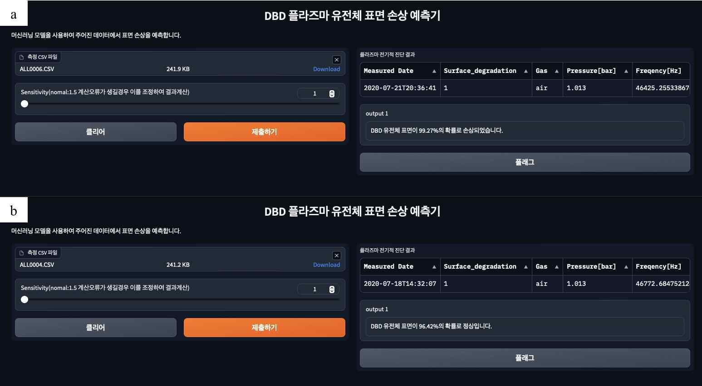

*Figure 20. Damage prediction program using the trained model. (a) Data from a damaged source (b) Data from a normal source*

### Chapter 6. Physical interpretation of the V_rms drop

When the electrode is exposed, the burning voltage of the damaged cells falls, the discharge starts earlier, the discharge charge per cycle grows, and the output voltage of the driving power supply falls. The V_rms drop predicted along this path agrees with the observation within 17 % (Table 17, Figure 21).

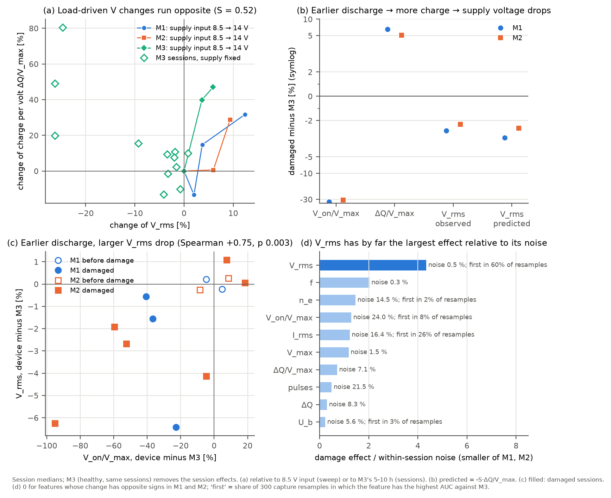

*Figure 21. Mechanism and robustness of the V_rms drop. (a) Direction of the discharge charge per volt when the driving power supply changes the voltage (supply sweep) and when the load changes it (M3 across time points) (b) Earlier discharge initiation → more discharge charge → V_rms drop, predicted and observed (c) Discharge initiation voltage and V_rms per time point (d) Effect-to-noise ratio per feature*

#### 6.1 Assumptions

**Table 16.** Assumptions of the derivation and their basis

| | Assumption | Basis |
| --- | --- | --- |
| A1 | Each discharge cell is C_d,i in series with C_g,i. A discharge starts when the air-gap voltage reaches the burning voltage U_b, and the air-gap voltage stays at ±U_b while the cell discharges (Manley) | 3.2: two slopes of the Lissajous graph, agreement of independent U_b estimates |
| A2 | U_b is set by the 100 µm air gap (Townsend discharge) | 3.2.4: Paschen range, αd = 3–5 |
| A3 | The 126 cell pairs are in parallel and start discharging individually; source values are sums over cells; not all cells discharge | 2.1.1, 3.2.2: C_d grows in the sweep |
| A4 | Each source runs on its own driving power supply. At the drive frequency the supply is a Thévenin equivalent, open-circuit voltage E behind output impedance Z_s; with the supply input fixed, E is fixed | Power layout of 2.1.3 |
| A5 | Damage thins (erosion) or removes (electrode exposure) the dielectric thickness t_i of some cells. An exposed Ag surface changes the secondary electron emission coefficient γ. The air gap is unchanged | 4.2–4.3: microscope, SEM, EDS |
| A6 | Common external factors cancel against M3 at the same time point. Damage changes are a few per cent, so linearization holds | 4.4 |

#### 6.2 Discharge initiation voltage and discharge charge of one cell (A1, A2)

- Without discharge the slope of the Lissajous graph is C_total (Eq. 15). During the discharge u_g = ±U_b in (10), so Q = C_d(v ∓ U_b) and the slope is C_d.
- At the peak applied voltage Q_max = C_d(V_max − U_b). Then Q falls without discharge, Q = Q_max − C_total(V_max − v), until u_g = −U_b, where the next discharge starts.
- Solving this with half-period symmetry gives the discharge initiation voltage V_on (= V_min) and the discharge charge ΔQ:

```math
V_{on} = 2U_{min} - V_{max}, \qquad U_{min} = U_b\left(1 + \frac{C_g}{C_d}\right) \qquad (19)
```

```math
\Delta Q = C_d\,(V_{max} - V_{on}) = 2C_d\,(V_{max} - U_{min}), \qquad E_{cycle} = 2U_b\,\Delta Q = 4C_dU_b\,(V_{max} - U_{min}) \qquad (20)
```

Equation (20) is Manley's equation [42]. With the measured U_min = 1257–1289 V and V_max ≈ 2.2 kV, V_on ≈ 0.3 kV, the same size as the discharge initiation voltage of 0.37–0.45 kV measured on the Lissajous graphs.

#### 6.3 Damaged cells start discharging earlier (A3, A5)

Damage can lower U_min,i = U_b,i(1 + C_g,i/C_d,i) of a cell in two ways.

**(a) Thinner dielectric.** C_d,i = ε₀ε_r·A_i/t_i, so erosion (smaller t_i) raises C_d,i:

```math
\frac{\partial V_{on,i}}{\partial \ln C_{d,i}} = -2U_b\,\frac{C_{g,i}}{C_{d,i}} < 0, \qquad \frac{\partial\,\Delta Q_i}{\partial \ln C_{d,i}} = 2C_{d,i}\,(V_{max} - U_b) > 0 \qquad (21)
```

**(b) Exposed electrode.** An exposed Ag electrode raises the secondary electron emission coefficient γ. By Paschen's law (7), raising γ from 0.01 to 0.1 for 100 µm of air (pd = 7.6 Torr·cm) lowers U_b from 865 to 718 V, a factor of 0.83:

```math
\frac{\partial V_{on,i}}{\partial \ln U_{b,i}} = 2U_{min,i} > 0, \qquad \frac{\partial\,\Delta Q_i}{\partial \ln U_{b,i}} = -2C_{d,i}\,U_{min,i} < 0 \qquad (22)
```

- Both paths make damaged cells start discharging earlier and increase their discharge charge; for the whole source (A3) ΔQ = ΣΔQ_i grows.
- They differ in the measured U_b: unchanged for (a), lower for (b).
- **Prediction:** against M3, a damaged source has a smaller V_on/V_max, a larger ΔQ/V_max, and an equal (a) or lower (b) U_b.

#### 6.4 A heavier load lowers the output voltage of the driving power supply (A4)

At the drive frequency the voltage across the source is as follows, with Y_L the admittance of the source (current per volt), proportional at the drive frequency to the discharge charge per volt:

```math
V = \frac{E}{1 + Z_s Y_L} \qquad (23)
```

```math
\delta\ln V = -S\,\delta\ln Y_L, \qquad S = \mathrm{Re}\frac{Z_sY_L}{1 + Z_sY_L} \approx -\frac{d\ln V}{d\ln(\Delta Q/V_{max})} \qquad (24)
```

An ideal voltage source has S = 0 (the voltage ignores the load); the closer to a current source, the closer S is to 1. S was measured on the healthy source (A6).

- In the supply sweep the driving power supply changes the voltage: d ln(ΔQ/V_max)/d ln V = +2.7 to +8.2, the same direction as the voltage because of partial surface discharging.
- Across the time points of M3, with the supply input fixed, the load changes the voltage: −1.92, the opposite direction (Figure 21(a)).
- This difference in direction is the evidence that the load path of (23) is real, and it gives S = 1/1.92 = 0.52. The value is a measured response that already includes the feedback of partial surface discharging.

#### 6.5 Prediction and observation

**Table 17.** Changes against M3, predicted and observed (medians per time point)

| Source | Discharge initiation voltage V_on/V_max | Discharge charge ΔQ/V_max | V_rms predicted (−S·δln(ΔQ/V_max)) | V_rms observed |
| --- | --- | --- | --- | --- |
| M1 | −33.3 % | +6.6 % | −3.4 % | −2.9 % |
| M2 | −31.0 % | +5.1 % | −2.6 % | −2.3 % |

- All three steps have the predicted sign in both sources, and predicted and observed V_rms agree within 17 % (Figure 21(b)).
- U_b fell by 13.6 % in M1 (p 0.10) and 1.3 % in M2, consistent with path (b), electrode exposure.
- The link also holds per time point: the earlier the discharge started relative to M3, the more V_rms dropped (13 time points: M1 5, M2 8; Spearman +0.75, p = 0.003; Figure 21(c)). In 7 of the 9 time points after damage, the discharge started earlier than in M3.

#### 6.6 Why V_rms is the clearest indicator

- **The cause is local and noisy.** The discharge initiation voltage and the discharge charge are the cause, but their noise within a time point is 24 % (V_on/V_max) and 7.1 % (ΔQ/V_max).
- **The consequence is global and precise.** The driving power supply turns the load change of all 126 cell pairs into one voltage, and the noise of the voltage channel within a time point is 0.5 %.
- **So V_rms has the largest effect-to-noise ratio, 4.3–5.4.** Next is the drive frequency (2.0–2.2), which also fell by 0.6 % in both sources, as expected when a heavier capacitive load lowers the operating point of the driving power supply.

#### 6.7 Excluding other hypotheses

**Table 18.** Alternative hypotheses and verdicts

| Hypothesis | Prediction | Data | Verdict |
| --- | --- | --- | --- |
| Change on the power-supply side | Voltage and ΔQ/V fall together (as in the sweep) | Damaged sources: voltage falls, ΔQ/V rises | Rejected |
| Measurement order and time gap | Voltage difference correlates with the gap | Spearman +0.50 (p 0.39), +0.12 (p 0.78) | Rejected |
| More discharge power (heating) | Energy and power rise | Opposite directions in the two sources | Not supported |
| Thinner dielectric only (a) | Earlier discharge initiation, U_b unchanged | Chapter 7 simulation: V_rms and ΔQ/V match but the discharge initiation point does not move | Not enough on its own |
| Lower burning voltage from electrode exposure (b) | Earlier discharge initiation, lower U_b | U_b M1 −13.6 %, M2 −1.3 %; the Chapter 7 simulation reproduces all four indicators | Supported |

### Chapter 7. Verification by equivalent-circuit simulation

In a model calibrated on healthy data only, exposing the electrodes of about a third of the cells gives V_rms −2.4 %, ΔQ/V_max +7.9 %, V_on/V_max −36.5 % and U_b −8.5 %, matching the data in sign and size. A thinner dielectric alone does not move the discharge initiation point.

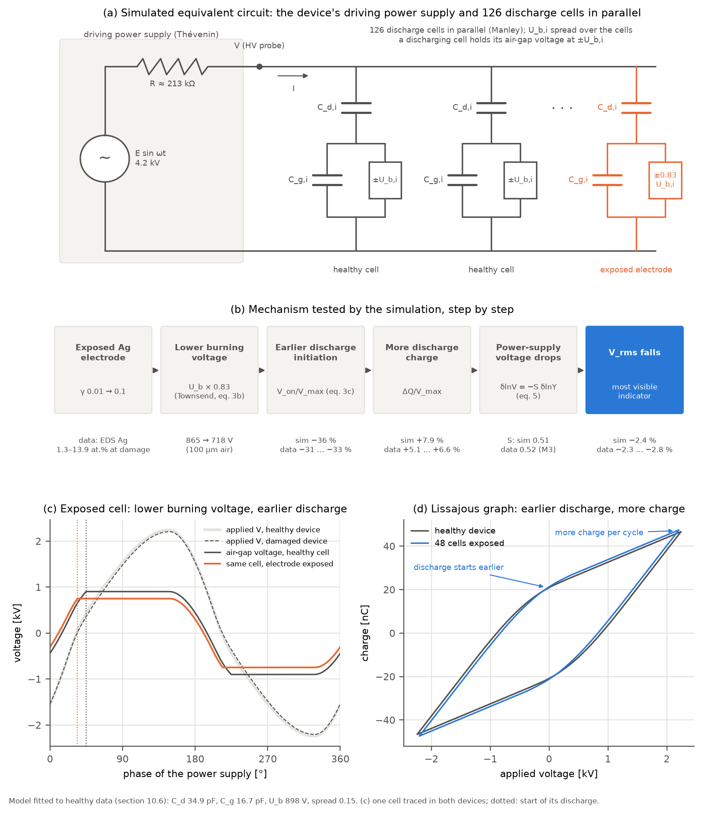

*Figure 22. Simulated equivalent circuit and mechanism. (a) The source's driving power supply and 126 discharge cells in parallel (b) Causal chain tested by the simulation (c) Air-gap voltage of one cell, healthy and with an exposed electrode (d) Lissajous graphs of the healthy and the damaged source*

#### 7.1 Model

- The model implements assumptions A1–A4 of 6.1 as stated.
- Each of the 126 discharge cells is a Manley equivalent circuit. While a cell discharges, its air-gap voltage stays at its burning voltage U_b,i, and U_b,i is spread over the cells log-normally.
- The driving power supply is a Thévenin equivalent: an open-circuit voltage E sin ωt behind an output impedance R. The charge at the source terminals is conserved at each discharge, so discharges pull the source voltage down.
- The model was solved in the time domain with a 2 ns step. The simulated waveforms pass through the same chain as the measurement (60 MHz probe bandwidth, 10 ns sampling, 8-bit ADC), and the features are computed with the same code.

**Reading the schematic (Figure 22).**
- (a) On the left is the source's own driving power supply (≈ 4.2 kV, R ≈ 213 kΩ); the measurement points are the voltage V and the current I at the source terminals. On the right are the discharge cells in parallel; the orange cell has an exposed electrode and a burning voltage lowered by a factor of 0.83.
- (b) Under each step are its basis and the simulated and measured values.
- (c) The air-gap voltage rises until it reaches the burning voltage (dotted line) and stays there while the cell discharges. The cell with the exposed electrode (orange) stays at a lower voltage and starts discharging earlier.
- (d) The corner of the graph is the discharge initiation point. For the damaged source (blue) it comes earlier and the charge at the tip is larger.

#### 7.2 Calibration on healthy data only

- The targets were eight medians of the healthy waveforms (5–10 h; V_rms, V_max, C_total, C_d, ΔQ/V_max, V_on/V_max, U_b, energy per cycle) and S = 0.52 measured on M3. No damage data were used.
- The calibrated values are C_d 34.9 pF, C_g 16.7 pF, U_b 898 V, U_b spread 0.15, R 213 kΩ, E 4.19 kV, close to the equivalent circuit from the means of Table 2 (C_d 34.2 pF, C_g 16.9 pF, U_b ≈ 0.92 kV).
- All targets except the energy match within 6 %; the energy is 11 % low. The model's S is 0.51 (Figure 23(a)).
- V_rms/V_max is 0.655 in the data and 0.70 in the model (0.707 for a sine), so the distortion of the applied voltage by the discharges is only partly reproduced.

#### 7.3 Damage predicted

**Table 19.** Predictions of each damage path against the data (model: change against the healthy model; data: change against M3 [%])

| Case | V_rms | ΔQ/V_max | V_on/V_max | U_b | C_total | C_d | Energy |
| --- | --- | --- | --- | --- | --- | --- | --- |
| Thinner dielectric, 8 cells at half thickness | −3.0 | +5.8 | −1.0 | −1.9 | +2.3 | +5.5 | +1.5 |
| Thinner dielectric, all cells −5 % | −2.3 | +4.3 | +1.8 | −0.2 | +1.7 | +5.2 | +1.4 |
| Exposed electrode (U_b × 0.83), 16 cells | −0.7 | +2.0 | −13.4 | −3.6 | +0.9 | −0.2 | −0.6 |
| Exposed electrode, 32 cells | −1.6 | +4.9 | −24.0 | −6.4 | +1.3 | −0.5 | −1.4 |
| **Exposed electrode, 48 cells (38 %)** | **−2.4** | **+7.9** | **−36.5** | **−8.5** | **+1.3** | **+0.2** | **−1.8** |
| Exposed electrode, 64 cells | −3.2 | +10.1 | −50.8 | −9.4 | +1.0 | +1.2 | −1.7 |
| Data M1 | −2.8 | +6.6 | −33.3 | −13.6 | +2.4 | −4.0 | −15.6 |
| Data M2 | −2.3 | +5.1 | −31.0 | −1.3 | −1.4 | +2.6 | +7.4 |

- **A thinner dielectric alone is not enough.** V_rms and ΔQ/V match, but the discharge initiation point of the Lissajous graph (V_on/V_max) hardly moves: a change in a few cells does not move a point set by the majority of cells.
- **An exposed electrode reproduces the four indicators together.** With about a third of the cells (48) at a burning voltage lowered by the Paschen factor of (7), 0.83 (γ 0.01 → 0.1), V_rms, ΔQ/V_max, V_on/V_max and U_b match the data (M1, M2) in sign and size.
- C_total, C_d and the energy, whose changes have opposite signs in the two sources, are also near zero in the model.
- With 32–64 exposed cells (25–51 %), V_rms falls by 1.6–3.2 %, a range that contains the data (Figure 23(c)).

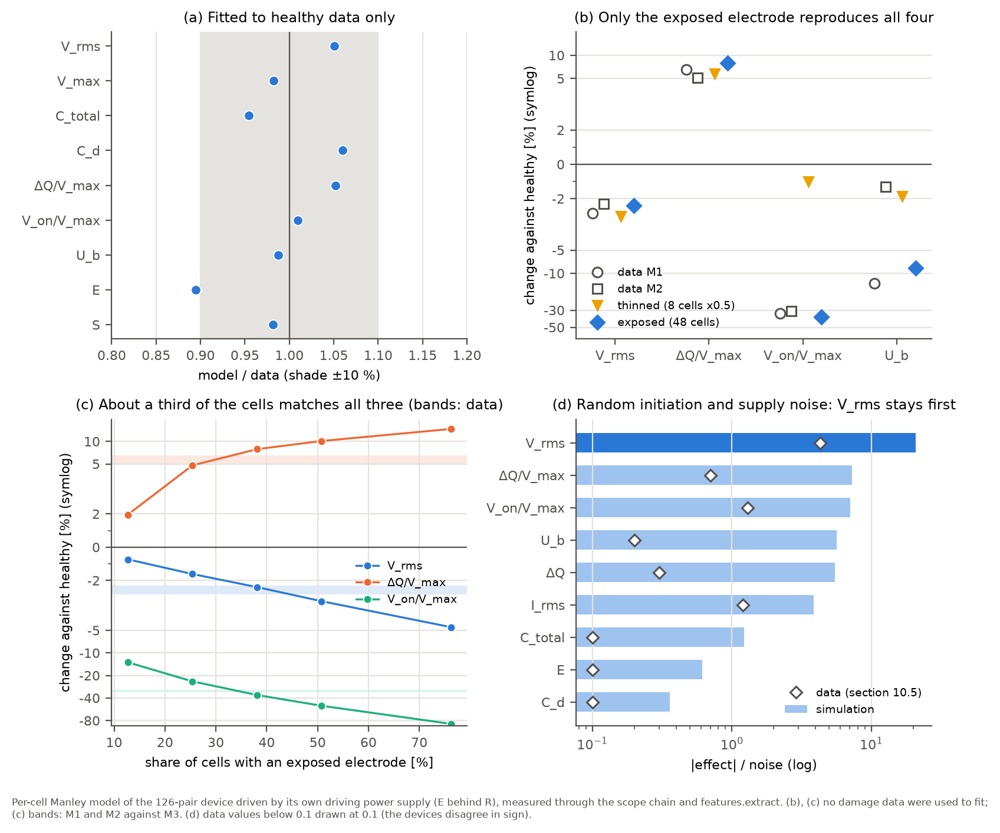

*Figure 23. Simulation results. (a) Model fitted to healthy data (model/data) (b) Predictions of each damage path against the data (c) Changes against the share of cells with an exposed electrode; bands show the data (d) Effect-to-noise ratio under random discharge initiation and supply fluctuation*

#### 7.4 Ranking under random factors

- The burning voltage was jittered by 5 % at every discharge (random discharge initiation) and the output voltage of the driving power supply by 0.5 % per run.
- The effect-to-noise ratios are V_rms 20.8, ΔQ/V_max 7.3, V_on/V_max 7.1, U_b 5.6, ΔQ 5.5 and I_rms 3.9 (Figure 23(d)).
- V_rms is also first in the data (4.3). The data's ratios are smaller because the real measurement noise (settings, probes) and supply fluctuations are larger.

#### 7.5 Supply sweep

- The directions are right: ΔQ/V rises with the voltage (d ln(ΔQ/V)/d ln V = +1.48; data +2.7 to +8.2) and V_on/V_max falls (0.201 → 0.039; data 0.165 → 0.130).
- The rise of the discharge-phase slope C_d with the voltage (data +2.5) is not reproduced (−0.10): the model lacks the growth of the discharging area within a cell.

### Chapter 8. Conclusion

This thesis diagnosed dielectric surface damage, which affects stable discharge of DBD plasmas, from electrical measurements and machine learning. Reanalyzing the raw data with the undamaged source M3 as control, the clearest electrical indicator of surface damage is the drop of the effective voltage V_rms.

1. **Type of discharge.** The two slopes of the Lissajous graph, a burning voltage consistent with Paschen's law (interquartile 773–888 V against 718–865 V), αd = 3–5 and T_e ≈ 6 eV show that the discharge is a Townsend-type DBD described by Manley's equivalent circuit.
2. **Damage.** Microscopy, SEM and EDS confirmed dielectric erosion and electrode exposure on M1 and M2 (Ag 1.3–13.9 at.% at damaged sites, ≤ 0.7 at.% on intact dielectric).
3. **Electrical changes.** Against M3 at the same time points, V_rms of both damaged sources fell about 3.5 % (≈ 48 V) further, and the discharge initiation voltage fell in the same direction. The thesis' decreases of the discharge voltage and electron temperature restate changes of V_max and U_b, and the changes of I_rms, the number of discharges and the electron density are confounded with the measurement settings.
4. **Machine learning.** Much of the high accuracy of the thesis protocol came from common external factors. With those and the measurement settings controlled, V_rms alone matches or beats the 11 models (AUC 0.94 / 0.75), and stays first when label placement, samples, period draws and models are varied (permutation test p = 0.039, effect-to-noise ratio 4.3–5.4).
5. **Physical interpretation.** When electrode exposure lowers the burning voltage, the discharge starts earlier, the discharge charge grows, and the output voltage of the driving power supply falls. Prediction (−3.4 / −2.6 %) and observation (−2.9 / −2.3 %) agree within 17 %.
6. **Simulation.** In an equivalent-circuit model calibrated on healthy data only, exposing the electrodes of about a third of the cells reproduces the changes of V_rms, the discharge charge, the discharge initiation voltage and the burning voltage together.
7. **Precursors.** The predicted probabilities at the start of discharge and just before damage do not differ, so these data cannot predict precursors of damage.

V_rms is the clearest indicator because the driving power supply collects the load change of all 126 cell pairs into one voltage, and the voltage measurement has only 0.5 % noise. V_rms compared with a healthy reference under the same drive can therefore be a simple indicator for monitoring surface damage during operation.

#### 8.1 Limitations

- **Number of sources.** The results come from two damaged sources and one healthy source and are not a general diagnostic threshold. The per-source permutation tests are not significant alone (M1 p 0.10, M2 p 0.18), and how much two healthy sources differ at the same time point is unknown.
- **Labels.** The 5 h photographs of M1 already show a melted electrode tip, so the labels of the pre-damage period may be incomplete.
- **Measurement order.** The three sources were not measured simultaneously but in the order M1 → M2 → M3 within 10–33 min. The time gap did not correlate with the voltage difference (Table 18).
- **Sensitivity S.** The load sensitivity S of the driving power supply was set from the variation of the single source M3 across time points.
- **Exposure fraction and γ.** The fraction of exposed cells in the simulation (about a third) and the value of γ are interpretations within the model, not measurements. The U_b changes of M1 and M2 differ (−13.6 %, −1.3 %), so the degree of exposure may differ between sources.
- **Model simplifications.** The output impedance of the driving power supply is a single resistance; the change of the drive frequency (−0.6 %) and the growth of the discharging area within a cell are not modelled.

**Falsification.** The mechanism is wrong if any of these is observed:

1. Voltage and ΔQ/V fall together at time points after damage (a cause on the power-supply side).
2. The voltage falls without any change of the discharge initiation voltage (V_on/V_max) (rejecting the earlier-initiation path).
3. Two healthy sources differ by the same amount (not a damage signal).

#### 8.2 Use and future work

- The trained models come from two sources of one design; DBDs with other electrode structures or dielectrics must be retrained with the same method.
- For diagnosis during operation, comparing V_rms with a healthy reference under the same drive (a control source or the initial state) is the simplest and most robust approach.
- Future experiments should fix the oscilloscope settings, record the input voltage and current of the driving power supply and the room temperature and humidity, measure a control source at the same moment, and randomize the measurement order.
- Diagnosing DBD surface damage will help anticipate failures of plasma devices and improve their stability.

### References

The numbering follows the thesis, with the corrections of the erratum; [72]–[74] are added.

1. F. F. Chen, *Introduction to Plasma Physics*, pp. 1–3 (edition and publisher to be checked: Plenum 2nd ed. 1984 or Springer 3rd ed. 2016).
2. O. Auciello, D. L. Flamm, *Plasma Diagnostics: Discharge Parameters and Chemistry*, Vol. 1, Academic Press (2013).
3. D. C. Schram, "Is plasma unique? The presence of electrons and the importance of charge," *Plasma Sources Sci. Technol.* 18, 014003 (2009).
4. K.-D. Weltmann et al., "The future for plasma science and technology," *Plasma Process. Polym.* 16, 1800118 (2019).
5. K. H. Becker, U. Kogelschatz, K. H. Schoenbach, R. J. Barker, *Non-Equilibrium Air Plasmas at Atmospheric Pressure*, CRC Press (2004).
6. J. R. Roth, *Industrial Plasma Engineering, Vol. 2: Applications to Nonthermal Plasma Processing*, Taylor & Francis (2001).
7. A. von Keudell, V. Schulz-von der Gathen, "Foundations of low-temperature plasma physics—an introduction," *Plasma Sources Sci. Technol.* 26, 113001 (2017).
8. V. Nehra, A. Kumar, H. K. Dwivedi, "Atmospheric non-thermal plasma sources," *Int. J. Eng.* 2, 53–68 (2008).
9. M.-S. Yun et al., "The selective emitter doping of p-type solar cells using atmospheric pressure plasma jet," *J. Nanosci. Nanotechnol.* 16, 10711 (2016).
10. B. Michel et al., "Effects of dielectric barrier discharges on silicon surfaces: surface roughness, cleaning, and oxidation," *J. Appl. Phys.* 105, 073302 (2009).
11. N. K. Kaushik et al., "Cytotoxic macrophage-released tumour necrosis factor-alpha (TNF-α) as a killing mechanism for cancer cell death after cold plasma activation," *J. Phys. D: Appl. Phys.* 49, 084001 (2016).
12. J.-H. Lee et al., "Selective killing effects of cold atmospheric pressure plasma with NO induced dysfunction of epidermal growth factor receptor in oral squamous cell carcinoma," *PLoS ONE* 11, e0150279 (2016).
13. A. Ali, Z. Ashraf, N. Kumar, M. Rafiq, F. Jabeen, J.-H. Park, K.-H. Choi, S. Lee, S.-Y. Seo, E. H. Choi, P. Attri, "Influence of plasma-activated compounds on melanogenesis and tyrosinase activity," *Sci. Rep.* 6, 21779 (2016). The thesis splits this author list over [13] and [14].
14. Same as [13].
15. N. Kumar et al., "The action of microsecond-pulsed plasma-activated media on the inactivation of human lung cancer cells," *J. Phys. D: Appl. Phys.* 49, 115401 (2016).
16. J.-H. Lee et al., "Effect of non-thermal air atmospheric pressure plasma jet treatment on gingival wound healing," *J. Phys. D: Appl. Phys.* 49, 249501 (2016).
17. S.-H. Ji et al., "Effects of high voltage nanosecond pulsed plasma and micro DBD plasma on seed germination, growth development and physiological activities in spinach," *Arch. Biochem. Biophys.* 605, 117–128 (2016).
18. G. Fridman et al., "Applied plasma medicine," *Plasma Process. Polym.* 5, 503 (2008).
19. E. H. Choi, "Plasma bioscience and medicines," *Vac. Mag.* 2, 9–15 (2015).
20. D. B. Graves, "The emerging role of reactive oxygen and nitrogen species in redox biology and some implications for plasma applications to medicine and biology," *J. Phys. D: Appl. Phys.* 45, 263001 (2012).
21. S. Kumar, D. K. Yadav, E. H. Choi, M. H. Kim, "Insight from molecular dynamic simulation of reactive oxygen species in oxidized skin membrane," *Sci. Rep.* 8, 1–10 (2018).
22. N. K. Kaushik et al., "Biological and medical applications of plasma activated media, water and solutions," *Biol. Chem.* 400, 39–62 (2018).
23. P. Shaw et al., "Bacterial inactivation by plasma treated water enhanced by reactive nitrogen species," *Sci. Rep.* 8, 1–10 (2018).
24. T. Ono, D. Y. Sim, M. Esashi, "Micro-discharge and electric breakdown in a micro-gap," *J. Micromech. Microeng.* 10, 445–451 (2000).
25. Same as [10] (citations merged into [10]).
26. N. M. Houser, L. Gimeno, R. E. Hanson, T. Goldhawk, T. Simpson, P. Lavoie, "Microfabrication of dielectric barrier discharge plasma actuators for flow control," *Sens. Actuators A* 201, 101–104 (2013).
27. R. E. Hanson, N. M. Houser, P. Lavoie, "Dielectric material degradation monitoring of dielectric barrier discharge plasma actuators," *J. Appl. Phys.* 115, 043301 (2014).
28. D. Bian, Y. Wu, C. Long, B. Lin, "Effects of material degradation on electrical and optical characteristics of surface dielectric barrier discharge," *J. Appl. Phys.* 124, 183301 (2018).
29. C. Bishop, "Neural networks and their diagnostic applications," *Rev. Sci. Instrum.* 63, 4772 (1992).
30. U. K. Ercan, G. D. Özdemir, M. A. Özdemir, O. Güren, "Plasma medicine: The era of artificial intelligence," *Plasma Process. Polym.* e2300066 (2023).
31. A. Mesbah, D. B. Graves, "Machine learning for modeling, diagnostics, and control of non-equilibrium plasmas," *J. Phys. D: Appl. Phys.* 52, 30LT02 (2019).
32. D. Gidon, X. Pei, A. D. Bonzanini, D. B. Graves, A. Mesbah, "Machine learning for real-time diagnostics of cold atmospheric plasma sources," *IEEE Trans. Radiat. Plasma Med. Sci.* 3, 597–605 (2019).
33. T. A. Choudhury, N. Hosseinzadeh, C. C. Berndt, "Artificial neural network application for predicting in-flight particle characteristics of an atmospheric plasma spray process," *Surf. Coat. Technol.* 205, 4886–4895 (2011).
34. S. Guessasma, G. Montavon, C. Coddet, "Modeling of the APS plasma spray process using artificial neural networks: basis, requirements and an example," *Comput. Mater. Sci.* 29, 315–333 (2004).
35. Y.-T. Zhang, S.-H. Gao, F. Ai, "Efficient numerical simulation of atmospheric pulsed discharges by introducing deep learning," *Front. Phys.* 11, 1125548 (2023).
36. B. Yin, Y. Zhu, Y. Wu, "Modulating sparks in a pulse train for repetitive and energy efficient plasma generation," *High Voltage*, 1–12 (2023).
37. K. Rath, D. Rügamer, B. Bischl, U. von Toussaint, C. G. Albert, "Dependent state space Student-t processes for imputation and data augmentation in plasma diagnostics," *Contrib. Plasma Phys.* 63, e202200175 (2023).
38. B. Dave, S. Patel, R. Shivani, S. Purohit, B. Chaudhury, "Synthetic data generation using generative adversarial network for tokamak plasma current quench experiments," *Contrib. Plasma Phys.* e202200051 (2022).
39. C. M. Samuell, A. G. McLean, C. A. Johnson, F. Glass, A. E. Jaervinen, "Measuring the electron temperature and identifying plasma detachment using machine learning and spectroscopy," *Rev. Sci. Instrum.* 92, 043520 (2021).
40. Y. Wang, Z. Liao, S. Mathieu, F. Bin, X. Tu, "Prediction and evaluation of plasma arc reforming of naphthalene using a hybrid machine learning model," *J. Hazard. Mater.* 404, 123965 (2021).
41. M. A. Özdemir, G. D. Özdemir, M. Gül, O. Güren, U. K. Ercan, "Machine learning to predict the antimicrobial activity of cold atmospheric plasma-activated liquids," *Mach. Learn.: Sci. Technol.* 4, 015030 (2023).
42. T. C. Manley, "The electric characteristics of the ozonator discharge," *Trans. Electrochem. Soc.* 84, 83–96 (1943).
43. Y.-C. Hong, H.-S. Uhm, "Air plasma jet with hollow electrodes at atmospheric pressure," *Phys. Plasmas* 14, 053503 (2007).
44. R. H. Stark, K. H. Schoenbach, "Direct current glow discharges in atmospheric air," *Appl. Phys. Lett.* 74, 3770 (1999).
45. Y. Yang, "Alternating-current glow and pseudoglow discharges in atmospheric pressure," *IEEE Trans. Plasma Sci.* 31, 174 (2003).
46. A.-A. H. Mohamed, R. Block, K. H. Schoenbach, "Direct current glow discharges in atmospheric air," *IEEE Trans. Plasma Sci.* 30, 182 (2002).
47. K. Takaki, H. Kirihara, C. Noda, S. Mukaigawa, T. Fujiwara, "Production of pulse glow discharge in atmospheric pressure nitrogen using needle-array electrode," *Jpn. J. Appl. Phys.* 45, 8241 (2006).
48. C. Raja Rao, G. R. Govinda Raju, "The ratio of diffusion coefficient to mobility for slow electrons in dry air," *J. Phys. D: Appl. Phys.* 4, 769 (1971).
49. Yu. P. Raizer, *Gas Discharge Physics*, Springer (1999).
50. F. J. J. Peeters, M. C. M. van de Sanden, "The influence of partial surface discharging on the electrical characterization of DBDs," *Plasma Sources Sci. Technol.* 24, 015016 (2015).
51. R. Valdivia-Barrientos, J. Pacheco-Sotelo, M. Pacheco-Pacheco, J. S. Benítez-Read, R. López-Callejas, "Analysis and electrical modelling of a cylindrical DBD configuration at different operating frequencies," *Plasma Sources Sci. Technol.* 15, 237–245 (2006).
52. A. V. Pipa, T. Hoder, R. Brandenburg, "On the role of capacitance determination accuracy for the electrical characterization of pulsed driven dielectric barrier discharges," *Contrib. Plasma Phys.* 53, 469–480 (2013).
53. A. V. Pipa, T. Hoder, J. Koskulics, M. Schmidt, R. Brandenburg, "Experimental determination of dielectric barrier discharge capacitance," *Rev. Sci. Instrum.* 83, 075111 (2012).
54. E.-H. Choi et al., "Influence of driving frequency on the system parameters in surface discharge of AC plasma display panels," *Jpn. J. Appl. Phys.* 38, 6073–6076 (1999).
55. A. V. Pipa, R. Brandenburg, "The equivalent circuit approach for the electrical diagnostics of dielectric barrier discharges: the classical theory and recent developments," *Atoms* 7, 14 (2019).
56. S. Liu, M. Neiger, "Excitation of dielectric barrier discharges by unipolar submicrosecond square pulses," *J. Phys. D: Appl. Phys.* 34, 1632–1638 (2001).
57. X. Tu, H. J. Gallon, M. V. Twigg, P. A. Gorry, J. C. Whitehead, "Dry reforming of methane over a Ni/Al₂O₃ catalyst in a coaxial dielectric barrier discharge reactor," *J. Phys. D: Appl. Phys.* 44, 274007 (2011).
58. T. Shao, K. Long, C. Zhang, P. Yan, S. Zhang, R. Pan, "Experimental study on repetitive unipolar nanosecond-pulse dielectric barrier discharge in air at atmospheric pressure," *J. Phys. D: Appl. Phys.* 41, 215203 (2008).
59. H. Jiang, T. Shao, C. Zhang, W. Li, P. Yan, "Experimental study of Q-V Lissajous figures in nanosecond-pulse surface discharges," *IEEE Trans. Dielectr. Electr. Insul.* 20 (2013).
60. Q. Wang, F. Liu, C. Miao, B. Yan, Z. Fang, "Investigation on discharge characteristics of a coaxial dielectric barrier discharge reactor driven by AC and ns power sources," *Plasma Sci. Technol.* 20, 035404 (2018).
61. U. Kogelschatz, "Dielectric-barrier discharges: their history, discharge physics, and industrial applications," *Plasma Chem. Plasma Process.* 23, 1–46 (2003).
62. R. Brandenburg, "Dielectric barrier discharges: progress on plasma sources and on the understanding of regimes and single filaments," *Plasma Sources Sci. Technol.* 26, 053001 (2017).
63. M. M. Ahsan et al., "Effect of data scaling methods on machine learning algorithms and model performance," *Technologies* 9, 52 (2021).
64. D. R. Cox, E. J. Snell, *Analysis of Binary Data*, CRC Press (1989).
65. L. Breiman et al., *Classification and Regression Trees*, Routledge (1984).
66. L. Breiman, "Random forests," *Mach. Learn.* 45, 5–32 (2001).
67. J. H. Friedman, "Greedy function approximation: a gradient boosting machine," *Ann. Stat.* 29, 1189–1232 (2001).
68. B. E. Boser, I. M. Guyon, V. N. Vapnik, "A training algorithm for optimal margin classifiers," *Proc. 5th Annu. Workshop Comput. Learn. Theory*, 144–152 (1992).
69. E. Fix, J. L. Hodges, "Discriminatory analysis. Nonparametric discrimination: consistency properties," *Int. Stat. Rev.* 57, 238–247 (1989).
70. C. Elkan, "The foundations of cost-sensitive learning," *Proc. Int. Joint Conf. Artif. Intell.* 17, 973–978 (2001).
71. T. Fawcett, "An introduction to ROC analysis," *Pattern Recognit. Lett.* 27, 861–874 (2006).
72. J. M. Meek, "A theory of spark discharge," *Phys. Rev.* 57, 722–728 (1940).
73. F. Pedregosa et al., "Scikit-learn: Machine learning in Python," *J. Mach. Learn. Res.* 12, 2825–2830 (2011).
74. B. Efron, "Bootstrap methods: another look at the jackknife," *Ann. Stat.* 7, 1–26 (1979).

The bibliographic details of [1], [59] and [72]–[74] have not been checked against the originals and should be verified before submission.

---

## 1. Overview

Atmospheric-pressure **micro-gap surface DBDs** are cold-plasma sources for cleaning, surface treatment, medicine and agriculture. They fail in three steps:

1. The dielectric that covers the electrodes erodes.
2. The exposed electrode makes the discharge unstable.
3. The discharge eventually stops.

The thesis proposes to diagnose and predict this damage **from the voltage and current waveforms alone**, without extra sensors.

**Device.**
- Coplanar electrodes: 126 pairs of 150 µm × 300 µm Ag pads facing each other across a 100 µm gap.
- Electrodes about 10 µm thick, under a screen-printed dielectric about 40 µm thick.
- Operated in ambient air at about 46.5 kHz and about 1.5 kV_rms.

**Measurement.**
- Tektronix P6015A HV probe and P6021A current probe.
- GW Instek GDS-2102A oscilloscope: 10 ns sampling, 5000 points per capture, 8-bit.

**Experiment.**
- Two devices (m1, m2) were run continuously until the discharge stopped.
- About 20 captures were recorded every 5 h.
- Damage was confirmed by optical microscopy, SEM and EDS: Ag rose from 0.57 % to 13.86 % at the damaged site.

**Analysis.**
- Fourteen features are computed per capture, including V_rms, I_rms, energy, Lissajous capacitances, discharge charge, discharge initiation voltage and discharge voltage, number of discharges, n_e and T_e.
- LR, DT, RF, GB, SVM and kNN classifiers label each surface as **normal** or **degraded**.

## 2. Abstract (as published)

> This study employed electrical measurements and artificial intelligence algorithms to diagnose and predict dielectric surface damage influencing the stable discharge of atmospheric pressure dielectric barrier discharge (DBD) plasma. Plasma discharge characteristics, including effective voltage, effective current, discharge energy per second, discharge initiation voltage, discharge voltage, number of discharges, electron density, electron temperature, capacitance, and discharge charge were calculated through electrical measurements of DBD plasma. Changes in plasma discharge characteristics before and after surface damage were observed. Surface damage led to a decrease in effective voltage, effective current, discharge initiation voltage, discharge voltage, and electron temperature, while increasing number of discharges, electron density, capacitance, and discharge charge. The damage to the dielectric on the electrode surface was confirmed through optical microscopy, scanning electron microscopy (SEM), and energy-dispersive X-ray spectroscopy (EDS) analysis. Machine learning models were trained to learn the variations in plasma discharge characteristics due to surface damage. Using logistic regression, decision tree, random forest, support vector machine, and k-nearest neighbors algorithms, the study classified and predicted surface damage based on plasma discharge characteristic parameters. This research introduces a method to predict and diagnose dielectric surface damage, referring to damage on the dielectric, which influences the lifespan of atmospheric pressure dielectric barrier discharge plasma devices in physics-related contexts.

Some statements in this abstract are corrected in the [verification report](docs/thesis-review.md): the "energy per second", the values of the discharge voltage and electron temperature, and the claimed changes in the number of discharges, n_e and I_rms. The V_rms change is about half as large once a control device is used. See [section 4](#4-key-results-and-verification).

## 3. Pipeline

```
oscilloscope CSV (t, v, i)
 │  io.load_csv            parses the GW Instek Format 2.0A header (probe ratio, V/div, sampling)
 ▼
period split + offsets      waveform / electrical: every full period, then averaged
 │
 ├─ electrical              V_rms, I_rms, energy per cycle E = ∫v·i dt, mean power P = E·f
 ├─ Lissajous (Q–V)          lissajous: C_total, C_dielectric, C_gas, transferred charge ΔQ,
 │                            discharge initiation point, burning voltage U_b, Manley energy
 ├─ discharge pulses         discharge: number of discharges, discharge initiation voltage (thesis + noise-referenced)
 └─ plasma parameters        plasma: Paschen, E/N, mobility, n_e, T_e (D/μ table)
 ▼
feature table (features.extract)   14 thesis features + corrected features
 ▼
machine learning (ml)      Pipeline(StandardScaler, model), cross-device evaluation,
                           binary vs macro metrics, per-device baseline normalisation
```

All equations are in [docs/methods.md](docs/methods.md).

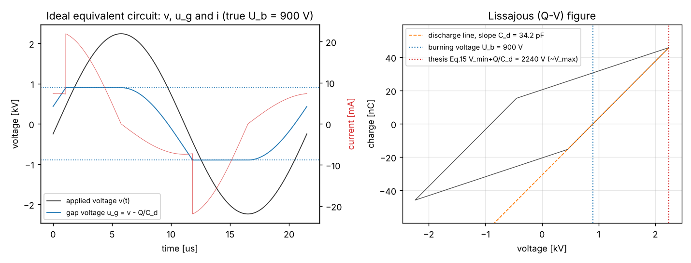

*Ideal equivalent-circuit example from the built-in simulator. Thesis Eq. (15), V_min + Q_max/C_d (red), returns the peak applied voltage (2.24 kV). The burning voltage U_b across the gas (blue) is 0.90 kV.*

## 4. Key results and verification

The equations, numbers, statistics, ML protocol and references of the thesis were re-checked, and the raw captures of devices m1 and m2 were re-analysed with this package. The complete raw-data archive was then checked against a third device, m3, which was discharged alongside them under the same conditions, was not damaged, and serves as the healthy comparison device. Full details are in the **[verification report](docs/thesis-review.md)** and the **[raw-data verification](docs/raw-data-verification.md)**.

| | Thesis | Re-analysis / correction |
|---|---|---|
| Measured quantities | E 0.13 mJ, C_d 34.2 pF, Q_max 59.4 nC | 0.131 mJ, 34.5 pF, 59.5 nC — **reproduced** |
| Energy | "0.13 mJ per second" | **0.13 mJ per cycle**, i.e. a mean power of **≈ 6 W** |
| Breakdown voltage | V_min + Q/C_d = 2.1 kV | That formula equals V_max. The burning voltage is **U_b ≈ 0.81–0.86 kV**, consistent with Paschen (0.72–0.87 kV). |
| Electron temperature | 13 eV, at E/N = 814 Td (OriginLab extrapolation of data that end at 175 Td) | **≈ 6 eV**, at E/N ≈ 330 Td (just beyond the end of the source curve, 300 Td) |
| Changes after damage | Number of discharges ↑, n_e ↑, I_rms ↓ | Number of discharges and n_e are not significant on the thesis' own numbers (p = 0.89, 0.78). I_rms is not significant in the re-analysis (p = 0.27) and depends on the oscilloscope's A/div setting. Against the undamaged control m3, only the V_rms decrease (≈ −48 V, about half of the raw drop) holds for both damaged devices. |
| Classification | RF: 96.9 % on the validation device | Cross-device evaluation: DT/RF/GB 95–99 %. Random splits are optimistic (100 %). **V_rms alone gives AUC ≈ 1.0.** But the models call 95–100 % of the undamaged m3's captures at its low-voltage time points "degraded"; referenced to m3, cross-device accuracy is 65–78 % (DT/RF/GB; 64–89 % over all six models). |
| Precursor (Sec. 5.7) | A ≥ 10 % drop of the normal probability signals impending damage | Not supported: Tables 7–8 show 0.886 → 0.909 and 0.816 → 0.818. |
| EDS (Table 3) | Ag 0.57 → 13.86 % | Reproduced exactly; the values are **at.%** from single 10,000× maps (normal = Ref sample). Over all maps, damaged sites give 1.3–13.9 at.% and intact dielectric 0.0–0.7 at.%. |

**Bottom line.** The damage is real and leaves a measurable electrical trace, but a weaker one than the thesis reports: about half of the V_rms drop is a supply variation shared with an undamaged device, so an alarm needs a control device or a reference from the same time point. Five points need correction:
- the interpretation of V_b, T_e and n_e;
- the precursor claim;
- the statistical wording;
- the evaluation protocol;
- the separation of damage from shared external effects and oscilloscope-setting effects.

## 5. Installation and usage

```bash
git clone https://github.com/MJ-best/ms-thesis-dbd-plasma-diagnostics.git
cd ms-thesis-dbd-plasma-diagnostics
pip install -e ".[dev]"     # numpy, scipy, pandas, scikit-learn (+ matplotlib, pytest)
pytest                      # 27 tests
```

Command-line tool:

```bash
dbd-diag simulate -o demo.csv
dbd-diag analyse demo.csv
dbd-diag extract captures/ -o features.csv
python examples/demo_synthetic.py
```

The four commands do the following, in order:
1. Write a synthetic 126-cell DBD capture through an emulated 100 MS/s, 8-bit scope.
2. Print every quantity for one capture.
3. Extract features from all captures in a folder, recursively, one row per capture.
4. Reproduce the figure above.

Python API:

```python
from dbd_diagnostics import io, features, ml

wf = io.load_csv("ALL0001.CSV")          # GW Instek CSV or a plain t,v,i CSV
r = features.extract(wf)                  # averaged over full periods
print(r["power"], r["c_dielectric"], r["u_b"], r["te_corrected"])

# cross-device evaluation (df: feature table, label 0 normal / 1 degraded, device id)
res = ml.group_holdout(df, ml.THESIS_FEATURES, label="label", group="device")
print(ml.results_table(res))
```

`python examples/reanalyse_thesis_data.py <m1_data> <m2_data>` reproduces section H of the verification report. `python examples/verify_raw_archive.py "<archive>/전류전압 측정" "<archive>/전압에 따른 QV 변화/I 기준으로 계산"` reproduces the control-device analysis of the [raw-data verification](docs/raw-data-verification.md). `python examples/consistency_check.py` with the same two folders and `docs/img` reproduces its section 10: whether the physics assumptions, the statistics and the ML (the six thesis models and five newer ones, on capture means and on single periods) agree, and why the V_rms drop is the clearest damage indicator. `python examples/vrms_simulation.py docs/img` tests that hypothesis with a circuit simulation and needs no raw data (section 10.6).

Training and prediction on your own labelled data:

```bash
dbd-diag extract captures/ -o features.csv      # 1) extract features
# 2) add a `label` column (0 normal / 1 degraded) and a `device` column
dbd-diag train features.csv -o model.joblib     # 3) prints leave-one-device-out results, then fits on all rows
dbd-diag predict model.joblib new_captures/     # 4) classify new captures
```

### Tutorial notebook

[`notebooks/tutorial.ipynb`](notebooks/tutorial.ipynb) walks through the whole chain step by step: waveform, Lissajous figure, U_b, pulses, E/N and T_e, and cross-device ML. Use the **Open in Colab** badge at the top to run it in the browser without installing anything.

### Web demo app

```bash
pip install -e ".[app]"
streamlit run app/streamlit_app.py
```

The app offers:
- Upload of oscilloscope CSVs, or generation of a synthetic capture with sliders for the equivalent-circuit parameters.
- Waveform, gas-gap voltage, Lissajous figure and a table of all quantities, downloadable as CSV.
- A **health check** against the same device's healthy baseline: ΔV_rms, ΔC_dielectric and ΔU_b, with an alarm on a V_rms drop.
- Classification with a model trained by `dbd-diag train`.

To host it, select this repository on [Streamlit Community Cloud](https://streamlit.io/cloud) and set the main file to `app/streamlit_app.py`. The dependencies are listed in `app/requirements.txt`.

### Circuit simulator in the browser

[`app/circuit_simulator.html`](app/circuit_simulator.html) runs the equivalent circuit of section 10.6 of the raw-data verification in the browser: 126 Manley cells driven by E sin ωt behind the output resistance R of the driving power supply. Download the file and open it; nothing needs installing.

- Sliders for the driving power supply, the source, damage (exposed electrode, thinner dielectric) and the number of discharging cells.
- The quantities of the Lissajous analysis, the applied voltage, the air-gap voltage of one cell and the Lissajous graph, each compared with a reference.
- Presets with the measured values beside them: the healthy source and an exposed electrode in 48 cells.
- Korean and English.

The JavaScript port gives the same numbers as `examples/vrms_simulation.py` to within 10⁻⁹; `tests/test_simulator_port.py` checks this when Node.js is installed.

## 6. Repository layout

```
thesis/                         full thesis PDF (CC BY-NC-ND 4.0), erratum PDFs (EN/KO)
app/                            Streamlit web demo, circuit simulator (one HTML file)
src/dbd_diagnostics/
  io.py          oscilloscope CSV reader
  waveform.py    period detection, integer-period windows
  electrical.py  RMS, energy per cycle, power, offset-free charge integration
  lissajous.py   Q-V analysis, equivalent circuit, burning voltage, Manley energy
  discharge.py   pulse detection (thesis + noise-referenced), number of discharges, discharge initiation voltage
  plasma.py      Townsend/Paschen, E/N, mobility, n_e, T_e
  features.py    one-call feature extraction (thesis + corrected features)
  ml.py          classifiers, explicit metrics, group hold-out, baseline normalisation
  simulate.py    synthetic waveforms (ideal Manley model, 126-cell stochastic model)
  plots.py       waveform and Lissajous figures
  cli.py         `dbd-diag` command (extract, analyse, simulate, train, predict)
  data/          D/mu table digitised from thesis Fig. 15
docs/            methods, verification report, erratum (EN/KO), legacy-code map, figures
notebooks/       step-by-step tutorial (Colab)
examples/        synthetic demo, re-analysis, raw-archive verification, consistency check, circuit simulation
tests/           27 tests: known-answer equivalent-circuit tests of every formula, CLI, app and the browser simulator
```

## 7. Documentation

| Document | Content |
|---|---|
| [docs/methods.md](docs/methods.md) · [KO](docs/methods.ko.md) | Every equation, its assumptions and the thesis equation it corresponds to |
| [docs/thesis-review.md](docs/thesis-review.md) · [KO](docs/thesis-review.ko.md) | Verification report: Eqs. (1)–(32), numbers, measurement chain, statistics, ML, references, audit of the original code, re-analysis |
| [docs/raw-data-verification.md](docs/raw-data-verification.md) · [KO](docs/raw-data-verification.ko.md) | Verification against the complete raw-data archive: control device m3, shared external effects, oscilloscope settings, micrographs, EDS sources, and whether physics, statistics and ML agree |
| [docs/erratum.md](docs/erratum.md) · [KO](docs/erratum.ko.md) | Thesis erratum: page, location, correction. PDFs are in `thesis/` |
| [docs/ati-addendum.md](docs/ati-addendum.md) · [KO](docs/ati-addendum.ko.md) | **Addendum, not part of the thesis:** the larger-area ATI sources. Does the V_rms mechanism (load → voltage of the driving power supply) hold there? Not used for any thesis conclusion |
| [notebooks/tutorial.ipynb](notebooks/tutorial.ipynb) | Step-by-step tutorial (runs in Colab) |
| [docs/legacy-code-map.md](docs/legacy-code-map.md) | How the old algorithms map to the new modules, and which bugs were fixed |

## 8. Provenance: original repositories and drafts

This repository consolidates the six repositories below. They are **private** and remain unchanged, with their full history. Reference commits are the default-branch heads at the time of consolidation (2026-11-01).

| Repository | Period | Commits | Reference commit | Content |
|---|---|---|---|---|
| [`plasma-lab`](https://github.com/MJ-best/plasma-lab) | 2020-09 | 5 | `master` @ `71c968d` | First Python port: CSV reader, piecewise-linear Lissajous fit |
| [`plasma-calc`](https://github.com/MJ-best/plasma-calc) | 2020-09 – 10 | 21 | `master` @ `a42f0df` | MATLAB analysis from first version to modular version, ozone scripts, early Python |
| [`Atmospheric_Plasma_Diagnosis`](https://github.com/MJ-best/Atmospheric_Plasma_Diagnosis) | 2020-12 – 2023-02 | 10 | `master` @ `980cc2c` | All MATLAB code (a superset of plasma-calc), 2021 Python automation |
| [`Plamsa_diagnosis_with_ML`](https://github.com/MJ-best/Plamsa_diagnosis_with_ML) | 2022-11 – 2023-06 | 44 | `main` @ `3e8a5ef` | 32 notebooks from the thesis period: features, ML, FFT research, app |
| [`Plasma_diagnosis_with_ML`](https://github.com/MJ-best/Plasma_diagnosis_with_ML) | 2023-03 | 1 | `master` @ `3252884` | Raw captures (about 650 CSVs, 181 MB) |
| [`oscilloscope-calc`](https://github.com/MJ-best/oscilloscope-calc) | 2025-10 – 2026-11 | 14 | `master` @ `a9b23b2` | Newest notebooks and a Flutter app (Dart port). Its calculator was later aligned with this package in PR #2 (`master` @ `9b76a80`) |

The intermediate reorganisation, which still includes a `legacy/` folder, is on branch `claude/thesis-automation-review-3wo35l` of `Atmospheric_Plasma_Diagnosis` (commit `09233c0`).

Where to find each draft:

| Topic | Repository | Path |
|---|---|---|
| First MATLAB analysis (manual `ginput` period, V_b from the intersection of the Lissajous corner lines) | plasma-calc | `MATLAB plasma code/20200718 플라즈마 계산코드/thanksgod1.m`, `thanksgod2.m` |
| MATLAB modularisation, first version | plasma-calc | `MATLAB plasma code/20200829 데이터 분석 모듈화/` |
| MATLAB final modular set (also in `Atmospheric_Plasma_Diagnosis/MATLAB_plasma_code/`) | plasma-calc | `MATLAB plasma code/20201014 새롬바이오 분석코드/csv_to_MATLAB_ginput.m`, `one_period_data_anlaysis.m`, `IV_QV_graph.m`, `save_data.m` |
| Non-sinusoidal energy | plasma-calc | `MATLAB plasma code/20201014 새롬바이오 분석코드/[non-sinusoidal_energy_calc] 비정현파플라즈마계산코드.zip` |
| Ozone analysis (outside the thesis) | plasma-calc | `MATLAB plasma code/20201021 오존데이터분석/` |
| First Python port, piecewise-linear Lissajous fit | plasma-lab | `plasma_calculation.py`, `csv_to_python.py` |
| Early Python (2020) and result plots | plasma-calc | `Python plasma code/plasma.py`, `modules/`, `result_all/` |
| 2021 Python automation | Atmospheric_Plasma_Diagnosis | `Python_plasma_code/Electrical_Diagnosis_20211007.py` (final), `Electrical_Diagnosis_20211006_ver14.ipynb` |
| E/N and T_e draft (unfinished) | Atmospheric_Plasma_Diagnosis | `Python_plasma_code/Electrical_Data_Analysis_20210913_ver10_(Minjun)_최종.ipynb` |
| 2022 three-class ML, LazyPredict | Plamsa_diagnosis_with_ML | `Plasma_Surface_modification_diagnostics_with_ML20221201`–`20221219.ipynb`, `plasma_features*.ipynb` |
| Feature calculation (Q–V regression charge, Peeters ζ_diel) | Plamsa_diagnosis_with_ML | `[feature_Calc]minjun_plasma_diagnosis_with_ML_20230226.ipynb`, `[full_version]…20230225.ipynb` |
| FFT and displacement-current research | Plamsa_diagnosis_with_ML | `[Research]minjun_plasma_diagnosis_with_ML_20230227.ipynb`, `…20230228.ipynb` |
| ML model comparison (AutoViz, DT pruning) | Plamsa_diagnosis_with_ML | `[ML_DL_models]minjun_plasma_diagnosis_with_ML_20230226.ipynb` |
| **Final physics notebook** (with F-tests) | oscilloscope-calc | `[Function]minjun_plasma_diagnosis_with_ML_20230613.ipynb` (earlier: Plamsa's `[Function]…20230425.ipynb`) |
| **Final ML training and Gradio app** | oscilloscope-calc | `[App]minjun_plasma_diagnosis_with_ML_20230425.ipynb`: cells 3–66 train and validate, cell 68 is the app. It is a superset of Plamsa's file of the same name. |
| Raw data | Plasma_diagnosis_with_ML | `plasma_data/m2_data/` (training device, 5–40 h), `m1_data/` (validation device, data05–data25), `m3_data/` (5–60 h, unused), `KaptonDBD/`, `uDBD_Air_1.5lpm/`, `uDBD_N60_1.5lpm/` |
| Old three-class feature table | Plasma_diagnosis_with_ML | `plasma_data/m2_data/20200724 M2 40시간/m2_final_data.csv` |
| Flutter/Dart app | oscilloscope-calc | `lib/domain/usecases/plasma_calculator.dart`, `lib/core/utils/peak_detection.dart`, `lib/data/repositories/csv_parser.dart` |

**Not in any repository.** These files were presumably kept only on the author's machine or Google Drive, and they are needed to reproduce Table 6 exactly:
- `20230426_m1_total_data.csv`, `20230426_m2_total_data.csv`
- `20230226_m2_{system,positive,negative}_data.csv`
- `m1_data_final.csv`, `m2_data_final.csv`
- `rf_clf.pkl`

The electron temperature of the thesis was not computed in code either: the D/μ curve of a figure in Raizer's book was digitised up to 175 Td (Engauge Digitizer) and fitted and extrapolated to 814 Td in OriginLab. The digitised points are kept by the author; the Origin project has not been found.

**Bugs fixed relative to the old code** include the peak-index offset, the V_min polarity mapping, the missing ×f in the Manley value, and using only the last period. The full list is in [docs/legacy-code-map.md](docs/legacy-code-map.md) and in section G of the verification report.

## 9. Data

The raw oscilloscope captures are not included. Every function can be run on synthetic waveforms from `dbd_diagnostics.simulate`. The original data are in the private repository `Plasma_diagnosis_with_ML`. The complete archive of the July 2020 experiment (devices M1–M3 at all time points, voltage sweeps, micrographs, SEM/EDS reports and the 2020 MATLAB summaries) is kept by the author; its layout is described in [docs/raw-data-verification.md](docs/raw-data-verification.md).

## 10. Citation

Please cite the thesis if you use this code, these methods or the thesis content. GitHub's "Cite this repository" button (`CITATION.cff`) provides the same information.

```bibtex
@mastersthesis{kim2023dbd,
  author = {Kim, Minjun},
  title  = {Electrical measurements and prediction of dielectric barrier surface damage in
            nonthermal atmospheric pressure dielectric barrier discharge plasma based on machine learning},
  school = {Kwangwoon University, Department of Electrical and Biological Physics},
  type   = {M.S. thesis},
  year   = {2023},
  url    = {https://www.dbpia.co.kr/journal/detail?nodeId=T16940279}
}
```

## 11. License

| Part | License | You may |
|---|---|---|
| Code (`src/`, `tests/`, `examples/`, `app/`, `notebooks/`) | [MIT](LICENSE) | Use, modify and redistribute it, including commercially, if you keep the copyright notice. |
| Documentation and figures (`README*`, `docs/`) | [CC BY 4.0](LICENSE-docs.md) | Share and adapt them with attribution. |
| Thesis and erratum PDFs (`thesis/`) | [CC BY-NC-ND 4.0](thesis/README.md) | Share it with attribution, for non-commercial purposes, without modification. Third-party figures inside the thesis (e.g. the source data of Figs. 1 and 15) remain under their original rights. |

© 2020–2026 Minjun Kim (김민준). Kwangwoon University, Dept. of Electrical and Biological Physics. Advisor: Prof. Eun Ha Choi.
