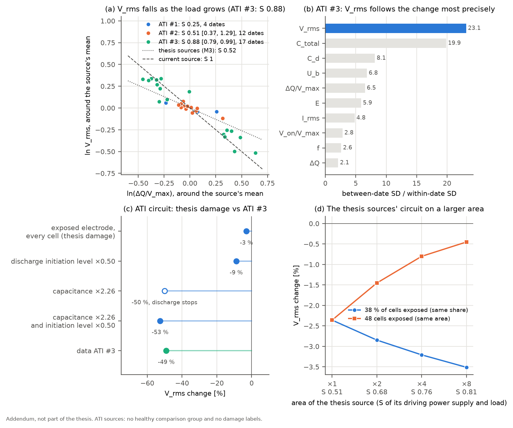
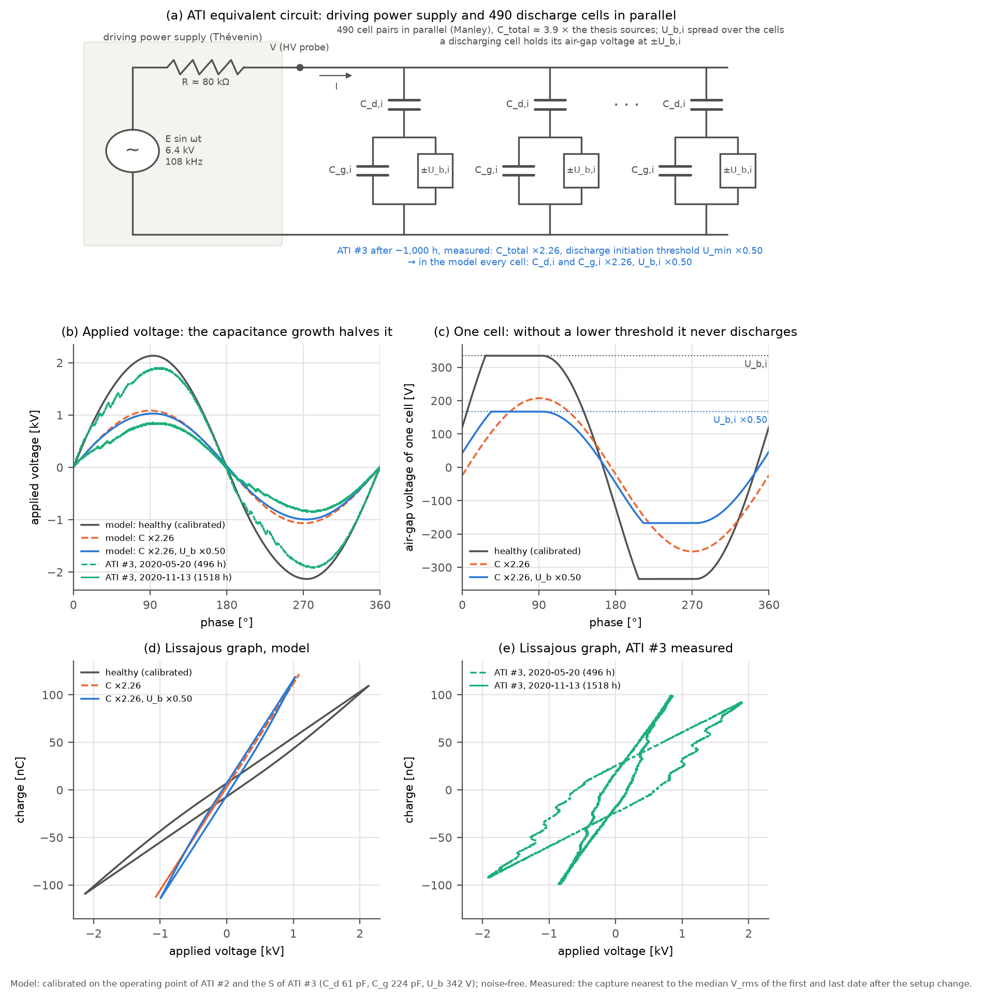

# 논문 외 추가 실험: 면적이 넓은 ATI 소스

[English](ati-addendum.md) | **한국어**

> **학위논문에서 다루지 않은 추가 실험입니다.** 같은 구조에 면적이 더 넓은 소스로도 수명 시험을 했습니다. 이 문서는 그 데이터로 논문의 V_rms 기전을 점검합니다. 이 결과로 논문의 결론이나 M1–M3 검증 결과를 바꾸지 않습니다.

## 요약

> - **방향은 세 소스 모두 같습니다.** 부하(방전 전하량 ΔQ/V_max)가 커지면 V_rms가 떨어집니다. 구동전원이 전압을 바꿀 때와는 반대 방향이고, 식 (5)의 부하 경로와 같은 방향입니다.
> - **크기 S는 ATI #3에서만 정해집니다.** 부하가 약 3배로 커진 ATI #3에서 S = 0.88 [0.79, 0.99]입니다. 논문 소스의 구동전원(M3, S = 0.52)보다 전류원(S = 1)에 가깝습니다. ATI #2는 부하가 거의 바뀌지 않았고 ATI #1은 측정일이 4일뿐이라 S가 정해지지 않습니다.
> - **ML 결론의 점검.** 손상 라벨이 없어 손상 판정 모델은 만들 수 없습니다. 대신 라벨 없이 "어떤 특성이 소스의 변화를 가장 정밀하게 따르는가"를 보면, ATI #3에서 V_rms가 10개 특성 중 1위입니다(측정일 사이 변화 / 측정일 안 잡음 = 23.1, 다음은 C_total 19.9).
> - **등가회로 시뮬레이션.** ATI 조건으로 보정한 회로에서 논문의 손상(전극 노출)을 **모든 셀**에 넣어도 V_rms는 3 %만 떨어집니다. ATI #3의 V_rms 감소(−49 %)는 소스 전체의 커패시턴스 증가(C_total ×2.26)에서 옵니다. 그러면서 방전이 계속되려면 방전개시 문턱도 함께 낮아져야 하고, 측정에서도 ×0.50으로 낮아졌습니다. 두 변화를 함께 넣은 회로는 V_rms −53 %, V_max ×0.48로 측정(−49 %, ×0.52)과 맞습니다. ATI #3의 변화는 논문의 국소 손상과 종류가 다릅니다.
> - **면적의 효과.** 논문 소스의 회로를 구동전원 출력 임피던스는 그대로 두고 넓히면 S가 커집니다(×4에서 0.76). 같은 비율(38 %)의 셀이 손상되면 V_rms 신호가 커지지만(−2.4 → −3.2 %), 손상 면적(48셀)이 같으면 신호가 묽어집니다(−2.4 → −0.8 %).



*(a) 부하와 V_rms, 각 소스의 평균 기준 (b) ATI #3에서 특성별 측정일 사이 변화 / 측정일 안 잡음 (c) ATI 조건 등가회로에서 논문의 손상과 ATI #3의 측정 변화 (d) 논문 소스 회로의 면적을 넓힐 때 S와 손상 신호*

## 1. 소스와 데이터

- **구조.** 셀 구조는 논문 소스 M1–M3와 같고 면적만 넓습니다. 전기적으로는 비방전 구간 커패시턴스 C_total이 약 3.9배(47.5 / 12.15 pF)이고, 셀 쌍으로 환산하면 약 490개(논문 소스 126개)입니다.
- **운전 조건(운전 기록·발표자료).** 일반 질소 1.5 lpm, 방전 공간 100 × 60 × 5 mm, DC 13 V · 3.2 A 입력의 구동전원, 구동 주파수 약 108 kHz. 논문 소스는 대기 중 공기, 약 47 kHz입니다.
- **측정.** 논문과 같은 오실로스코프(GW Instek, 5000점)로 4 ns 간격 상세 캡처를 저장했습니다.

| 소스 | 방전 기간 | 누적 방전시간(운전 기록) | 쓴 측정일 | 캡처 |
|---|---|---|---|---|
| ATI #1 | 2019-06-18 – 2019-12-09 | 868 h | 4 (마지막 1주, 825–868 h) | 64 |
| ATI #2 | 2019-12-12 – 2020-02-24 | 481 h | 12 (0–480 h) | 169 |
| ATI #3 | 2020-02-29 – 2020-11-19 | 1,541 h | 21 (95–1,518 h) | 319 |

**용어.** 이 문서의 단위는 **측정일**입니다. 한 소스를 같은 날 같은 조건으로 측정한 캡처 묶음입니다. 논문 검증의 **측정 시점**(같은 누적 방전시간에 모든 소스를 함께 측정한 데이터셋)은 ATI에는 없습니다. 세 소스를 차례로 방전했기 때문입니다.

| 기호 | 용어 | 논문과의 관계 |
|---|---|---|
| ΔQ/V_max | 전압당 방전 전하량: 부하의 크기 | 논문 Q_max를 V_max로 나눈 값 |
| S | 부하 민감도: 부하가 1 % 커질 때 V_rms가 줄어드는 % | 원본 데이터 검증 10.5절 식 (5) |
| U_min | 방전개시 문턱: 방전이 시작되는 인가전압의 기준값, (V_max + V_on)/2 | 10.5절 식 (1), U_b(1 + C_g/C_d). 방전개시전압 V_on = 2U_min − V_max |

**고른 캡처**

- 구동 주파수(100–115 kHz)의 상세 캡처(샘플 간격 ≤ 50 ns)만 썼습니다.
- ATI #1은 마지막 1주의 폴더만 구동 주파수로 저장돼 있습니다. 그 전 폴더는 46–79 kHz이거나 다른 소스의 복사본입니다.
- ATI #2의 2020-01-08 폴더는 전류 범위가 4 A/div라 전류를 읽을 수 없어 뺐습니다.
- ATI #3에서 실험자가 표시한 폴더는 뺐습니다. 파형 일그러짐, "전류전압이 이상하게 변함", 입력 13.5 V, 구동전원 전압만 측정, 같은 날 재측정, "잘못측정한 데이터"입니다.
- 같은 캡처가 두 폴더에 있으면 한 번만 셌습니다. ATI #2의 첫 측정(2019-12-11, 방전 전)은 ATI #1 폴더에도 복사돼 있어, 방전 기간으로 ATI #2에 넣었습니다.

## 2. 무엇을 검증할 수 있는가

[원본 데이터 검증](raw-data-verification.ko.md) 10.5절의 V_rms 기전은 두 부분입니다.

1. 손상 → 방전개시 앞당김 → 방전 전하량 증가 (소스 쪽)
2. 부하 증가 → 구동전원 전압 강하, 크기는 $\delta\ln V = -S\,\delta\ln(\Delta Q/V_{max})$ (구동전원 쪽, 식 (5))

- **1은 검증할 수 없습니다.** 같은 측정 시점에 함께 측정한 비손상 소스(M3의 역할)가 없고, 손상 라벨도 없습니다. 그래서 소스의 변화와 공통 외부 요인을 나눌 수 없습니다.
- **2는 검증할 수 있습니다.** S는 구동전원과 부하의 짝이 정하는 값이고, 부하가 왜 바뀌었는지와 상관없이 한 소스 안에서 측정할 수 있습니다.

## 3. 부하가 바뀌면 V_rms는 얼마나 바뀌는가

M3와 같은 방법으로 S를 구했습니다. 측정일 중앙값으로 $\ln(\Delta Q/V_{max})$를 $\ln V_{rms}$에 회귀하고 $S = -1/\text{기울기}$로 둡니다. V_rms가 정밀한 쪽(측정일 안 잡음 1.4 %)이라 설명변수로 둡니다. 구간은 측정일 부트스트랩 95 %입니다.

| 소스 | 측정일 | S | 95 % 구간 | R² | ln V_rms 범위 | ln(ΔQ/V_max) 범위 |
|---|---|---|---|---|---|---|
| 논문 소스 M3 (10.5절) | 12 | 0.52 | | | | |
| ATI #1 | 4 | 0.25 | (측정일이 너무 적음) | 0.88 | 0.10 | 0.49 |
| ATI #2 | 12 | 0.51 | 0.37–1.29 | 0.74 | 0.19 | 0.43 |
| **ATI #3 (설정 변경 이후)** | **17** | **0.88** | **0.79–0.99** | **0.93** | 0.85 | 1.09 |
| ATI #3 (전체) | 21 | 0.93 | 0.84–1.05 | 0.91 | 0.97 | 1.09 |

- **방향.** 세 소스 모두 부하가 커질 때 V_rms가 떨어집니다(S > 0). 구동전원이 전압을 바꾸는 경우(논문 스윕)에는 V와 ΔQ/V가 함께 커지므로 반대 방향입니다.
- **ATI #3.** 부하가 약 3배(ln 1.09)로 커지는 동안 V_rms는 2.3배(ln 0.85) 떨어졌습니다. S = 0.88은 0 < S < 1 안에 있고, 전류원에 가깝습니다. 실제로 I_rms는 거의 그대로입니다(dln I_rms / dln(ΔQ/V) = +0.05).
- **ATI #2.** 부하가 거의 바뀌지 않았습니다. S는 방전 전 첫 측정일 하나에 크게 좌우되고(이를 빼면 0.89, 구간 0.43–1.64), 구간이 0.37–1.29로 넓습니다.
- **ATI #1.** 마지막 1주의 4일뿐입니다. 전류 범위가 100–200 mA/div로 다른 소스(40 mA/div)보다 2.5–5배 거칠고, 이 주에는 표면 세척 시험(12-04, 12-09)이 있었습니다.
- **ATI #3의 설정 변경.** 2020-05-02와 05-20 사이에 C_total이 45 %, I_rms가 18 % 줄면서 V_rms는 올랐습니다. 부하만의 변화로는 설명되지 않아 측정 설정이나 장착이 바뀐 것으로 보고, S는 그 이후 17일로 구했습니다. 전체 21일로 구해도 0.93입니다.

## 4. ML 결론의 점검: 어떤 특성이 변화를 가장 정밀하게 따르는가

논문의 ML 결론은 "V_rms가 손상을 가장 잘 가르는 특성"이고, 검증 10.5절은 그 이유를 "원인(방전개시·방전 전하량)은 국소적이고 잡음이 크지만, 결과(V_rms)는 구동전원이 셀 전체를 한 전압으로 모은 값이라 정밀하다"로 설명합니다.

- **손상 판정 모델은 만들 수 없습니다.** 손상 라벨과 비교 소스가 없습니다. 논문 소스로 학습한 모델을 옮겨 쓸 수도 없습니다. 구동 주파수(47 vs 108 kHz)와 C_total(12 vs 48 pF)의 범위가 겹치지 않아 모델이 손상 대신 장비를 구분하게 됩니다.
- **라벨 없이 확인할 수 있는 것.** 소스가 바뀔 때 어떤 특성이 그 변화를 가장 정밀하게 따르는지입니다. 측정일 중앙값의 표준편차를 측정일 안 표준편차로 나눴습니다(로그 값).

| | 1위 | 2위 | 3위 | 이하 |
|---|---|---|---|---|
| ATI #3 (설정 변경 이후 17일) | **V_rms 23.1** (잡음 1.4 %) | C_total 19.9 (1.8 %) | C_d 8.1 (4.1 %) | U_b 6.8, ΔQ/V_max 6.5, E 5.9, I_rms 4.8, V_on/V_max 2.8, f 2.6, ΔQ 2.1 |
| ATI #2 (12일) | C_d 2.3 | I_rms 1.6 | V_rms 1.6 | 모두 ≤ 1.3 |

- 소스가 크게 바뀐 ATI #3에서 V_rms가 1위입니다. 논문 소스에서 본 "결과 쪽 지표가 정밀하다"는 설명과 같은 순서입니다.
- ATI #2는 크게 바뀌지 않아 어떤 특성도 잡음 위로 두드러지지 않습니다.

## 5. 등가회로 시뮬레이션: ATI #3의 변화는 논문의 손상과 같은가

**보정.** 검증 10.6절과 같은 회로를 썼습니다. 셀마다 Manley 등가회로(C_d와 C_g의 직렬, 방전 중 공기갭 전압은 U_b로 유지)를 두고, 셀 전체를 테브난 구동전원(무부하 전압 E, 출력 저항 R)에 병렬로 연결했습니다.

- 셀 쌍은 490개, 구동 주파수는 108 kHz로 두었습니다.
- 맞춘 목표는 ATI #2의 운전점(모든 캡처의 중앙값)과 ATI #3의 S입니다.
- 결과는 C_d 61.0 pF, C_g 224 pF, U_b 342 V, E ≈ 6.4 kV, R ≈ 80 kΩ입니다.
- 목표와의 차이:
  - V_rms +2.5 %, V_max −0.9 %, C_total +1.1 %, C_d −0.1 %
  - ΔQ/V_max +3.7 %, V_on/V_max −2.5 %, U_b +10 %, 1주기 에너지 −11 %
  - S는 0.84로 데이터(0.88)보다 4 % 작습니다.

**예측(맞춤 없음).** 보정한 회로에 소스의 변화를 넣었습니다. ATI #3의 변화량은 설정 변경 이후 처음 3일과 마지막 3일의 중앙값으로 쟀습니다. C_total은 2.26배, 방전개시 문턱 U_min은 1,317 V에서 657 V(×0.50)로 바뀌었고, V_on/V_max는 0.38에서 0.36으로 거의 그대로였습니다.

| 회로에 넣은 변화 | V_rms | V_max | 방전 |
|---|---|---|---|
| 전극 노출, 모든 셀 (논문의 손상, 타운젠트 계수 0.83) | −3.0 % | ×0.97 | 계속 |
| 방전개시 문턱 ×0.50 | −8.9 % | ×0.93 | 계속 |
| 커패시턴스 ×2.26 | −50.1 % | ×0.51 | **멈춤** |
| 커패시턴스 ×2.26, 방전개시 문턱 ×0.50 | −52.6 % | ×0.48 | 계속 |
| **ATI #3 측정** | **−49.1 %** | **×0.52** | 계속 |

- **논문의 손상으로는 설명되지 않습니다.** 전극 노출이 모든 셀에 일어나도 V_rms는 3 %만 떨어집니다.
- **V_rms 감소의 대부분은 커패시턴스 증가에서 옵니다.** 전류원에 가까운 구동전원에서는 커패시턴스가 커진 만큼 전압이 떨어집니다.
- **방전이 계속되려면 방전개시 문턱도 낮아져야 합니다.** 커패시턴스만 커지면 V_max가 방전개시 문턱 아래로 내려가 방전이 멈춥니다. ATI #3은 방전을 계속했고, 측정한 방전개시 문턱도 절반으로 낮아졌습니다. 두 변화를 함께 넣으면 V_rms와 V_max가 측정과 4 %p 안에서 맞습니다.
- 무엇이 소스 전체의 커패시턴스를 키우고 방전개시 문턱을 낮췄는지는 전기 측정만으로 정할 수 없습니다.



*(a) ATI 등가회로: 구동전원(테브난)과 셀 쌍 490개 (b) 한 주기의 인가전압, 모델과 ATI #3 측정 (c) 방전 유지 전압이 중앙값인 셀 하나의 공기갭 전압 (d) 모델의 리사주 그래프 (e) ATI #3의 측정 리사주 그래프(설정 변경 이후 첫 측정일과 마지막 측정일, 각 날 V_rms 중앙값에 가장 가까운 캡처)*

- **(b) 인가전압.** 커패시턴스가 2.26배가 되면 인가전압의 진폭이 절반으로 줄어듭니다. 측정에서도 V_max가 같은 비율(×0.52)로 줄었습니다.
- **(c) 공기갭 전압.** 커패시턴스만 커지면(주황) 셀의 공기갭 전압이 U_b,i에 이르지 못해 방전하지 않습니다. 방전개시 문턱이 함께 낮아지면(파랑) 공기갭 전압이 낮아진 U_b,i에서 멈추고 방전이 이어집니다.
- **(d)(e) 리사주 그래프.** 커패시턴스가 커져 기울기는 가팔라지고, 전압 폭은 좁아집니다. 측정도 같은 방향으로 바뀌었습니다. 측정 리사주 그래프의 평행사변형이 모델보다 넓은 것은 모델을 ATI #2의 운전점에 보정했기 때문입니다. (d)와 (e)의 모양은 정성적으로만 비교합니다.

### 리사주 그래프의 기울기와 면적이 바뀐 이유

> 소스 전체의 커패시턴스가 약 2배가 되어 두 기울기가 가팔라졌습니다. 구동전원이 전류원에 가까워 방전 전하량은 거의 그대로인 채 전압 폭이 절반이 되었습니다. 그 전하가 절반의 방전 유지 전압에서 흘러 면적(1주기 에너지)도 절반이 되었습니다.

ATI #3, 설정 변경 이후 처음 3일과 마지막 3일의 중앙값입니다.

| 리사주 그래프 요소 | 물리량 | 처음 3일 | 마지막 3일 | 배율 |
|---|---|---|---|---|
| 비방전 구간 기울기 | C_total | 36.4 pF | 82.5 pF | ×2.26 |
| 방전 구간 기울기 | C_d | 65.2 pF | 134.9 pF | ×2.07 |
| 세로 폭 | 방전 전하량 ΔQ | 78.4 nC | 86.4 nC | ×1.10 |
| 가로 폭 | V_max | 1,920 V | 994 V | ×0.52 |
| | 방전 유지 전압 U_b | 557 V | 233 V | ×0.42 |
| 면적 | 1주기 에너지 E | 103 µJ | 48 µJ | ×0.46 |
| | Manley 식 4C_dU_b(V_max − U_min) | 88 µJ | 42 µJ | ×0.48 |
| | I_rms | 44.0 mA | 48.7 mA | ×1.11 |

**기울기: 소스 전체의 커패시턴스가 커졌습니다.**

- 리사주 그래프의 두 기울기는 커패시턴스입니다. 방전이 없는 구간은 C_total, 방전 구간은 C_d입니다.
- 둘 다 약 2배가 됐고 비율(C_total/C_d)은 0.56에서 0.61로 거의 그대로입니다. 유전체와 공기갭 커패시턴스가 함께 커졌다는 뜻입니다. 방전에 참여하는 유효 면적이 약 2배로 넓어진 것과 같은 모양입니다.
- 일부 셀의 국소 손상으로는 이만큼 바뀌지 않습니다(위 표: 모든 셀의 전극 노출도 V_rms −3 %).
- 유전체 표면에 생긴 전도성 층(퇴적물, 스퍼터된 전극 금속, 흡습)이 전극을 넓힌 효과가 후보입니다. 전기 측정만으로는 정할 수 없습니다.
- 5월의 설정 변경 때 C_total이 한 번에 약 30 pF 바뀐 것처럼, 장착과 측정 설정도 기울기를 바꿉니다. 그러나 그 이후의 증가는 한 번의 계단이 아니라 몇 달에 걸쳐 이어졌습니다(05-20 36 pF, 07-27 49 pF, 08-10 68 pF, 10-22 82 pF, 11-13 98 pF).

**면적: 같은 전하가 절반의 전압에서 흘렀습니다.** 면적은 1주기 에너지이고, Manley 식으로 $E = 2U_b\,\Delta Q = 4C_dU_b(V_{max} - U_{min})$입니다(검증 10.5절 식 (2)).

- **세로 폭(ΔQ)이 거의 그대로입니다.** 구동전원이 전류원에 가까워(S 0.88) 한 주기에 흐르는 전하는 전류가 정합니다(I_rms ×1.11). C_d가 2배, 방전 구간의 전압 폭이 절반이 되어 ΔQ = C_d(V_max − V_on)은 그대로 남습니다.
- **가로 폭은 절반입니다.** 같은 전하를 2배의 커패시턴스에 실으니 전압이 절반이 됩니다.
- **면적은 절반입니다.** 같은 전하가 절반의 공기갭 전압(U_b ×0.42)에서 흐르므로 1주기 에너지도 절반이 됩니다. Manley 식 값(×0.48)이 측정 면적(×0.46)과 맞습니다.

**U_b가 왜 이렇게 낮아졌는지는 설명되지 않습니다.**

- 논문 소스와 같은 100 µm 공기갭이라면, 질소에서 파센 법칙의 방전 유지 전압은 이차전자 발생 계수 γ 0.01–0.1에서 714–871 V입니다(A = 12, B = 342).
- ATI #3의 U_b는 처음부터 이보다 낮았고(557 V), 마지막에는 233 V였습니다. γ의 변화로는 설명되지 않는 크기입니다.
- 후보는 표면 쪽 과정입니다. 이전 반주기의 표면 전하가 남아 방전을 돕는 메모리 효과, 표면 전도, 퇴적물이 있습니다. 108 kHz의 짧은 반주기는 표면 전하 메모리를 키우는 쪽입니다.
- 확인하려면 ATI의 공기갭 구조와 표면 분석이 필요합니다. SEM 폴더에 ATI의 2020년 8월 자료(`0819a`, `0826`)가 있지만, 어느 소스인지는 확인하지 않았습니다.

## 6. 같은 구조, 더 넓은 면적

검증 10.6절에서 보정한 논문 소스의 회로를 넓혔습니다(126셀, C_d 34.9 pF, C_g 16.7 pF, U_b 898 V, R 213 kΩ).

- 셀 수와 커패시턴스를 a배로 늘렸습니다.
- 구동전원 출력 저항 R은 그대로 두었습니다.
- V_max가 같도록(2,243 V) 무부하 전압 E를 올렸습니다.

| 면적 | 셀 쌍 | S | 48셀 전극 노출 (같은 손상 면적) | 셀 38 % 전극 노출 (같은 손상 비율) |
|---|---|---|---|---|
| ×1 | 126 | 0.51 | −2.4 % | −2.4 % |
| ×2 | 252 | 0.68 | −1.4 % | −2.8 % |
| ×4 | 504 | 0.76 | −0.8 % | −3.2 % |
| ×8 | 1,008 | 0.81 | −0.4 % | −3.5 % |

- **넓은 소스일수록 S가 큽니다.** 부하 어드미턴스 Y_L이 면적에 비례해 커지므로 $S = \mathrm{Re}\,Z_sY_L/(1 + Z_sY_L)$가 1에 가까워집니다. 같은 구동전원도 큰 소스에서는 전류원처럼 보입니다.
- **손상 비율이 같으면** S가 커진 만큼 V_rms 신호가 커집니다.
- **손상 면적이 같으면** 부하가 바뀌는 비율이 면적에 반비례해 줄고, S의 증가가 이를 메우지 못합니다. 넓은 소스에서는 같은 크기의 국소 손상이 V_rms에 덜 드러납니다(×4에서 1/3).
- ATI의 S(0.88)가 M3(0.52)보다 큰 것과 같은 방향입니다. 다만 ATI의 구동전원은 논문 소스와 다른 장치이므로, 그 차이를 면적만으로 설명하지는 않습니다.

## 7. 한계

- **비교 소스가 없습니다.** ATI의 변화가 소스 때문인지 공통 외부 요인 때문인지 나눌 수 없습니다.
  - S는 부하와 V_rms의 관계라 이 구분 없이도 정의됩니다.
  - 그러나 같은 기간에 구동전원 자체가 바뀌었다면(예: E 감소) S 추정에 섞입니다.
  - I_rms가 거의 일정한 것은 전류원에 가까운 구동전원과 맞지만, E의 변화를 완전히 배제하지는 못합니다.
- **S를 정한 소스는 ATI #3 하나입니다.** ATI #2와 #3은 각자의 인버터로 운전했습니다(2020-11-23 인버터 교차 시험).
- **설정 변경의 원인은 기록에 없습니다.** 2020-05-02와 05-20 사이의 일입니다.
- **5절의 예측은 S 자체의 검증이 아닙니다.** 회로 보정에 ATI #3의 S를 썼습니다. 그 S와 측정한 소스 변화로 V_rms와 V_max가 함께 설명되는지를 점검한 것입니다.
- **회로의 S와 변화량은 잡음 없는 파형으로 계산했습니다.** 10.6절과 같은 방식입니다.
- **표면 분석(현미경, SEM)은 이 문서에서 쓰지 않았습니다.**
- **이전 기록과 다른 점.** 2026-11-02에 저장소에서 뺀 ATI 문서(git 기록에 있음)는 ATI #3이 2020-11-13에 987 h로 멈췄다고 적었습니다. 그러나 원본은 다릅니다.
  - 운전 기록에는 2020-11-19까지의 방전(누적 1,541 h)이 있습니다.
  - 2020-11-23 교차 시험에서도 3번 패널은 방전했습니다.

  이 문서의 수치는 모두 원본에서 다시 계산했습니다.

## 재현

원본 데이터는 이 저장소에 없습니다. 아카이브가 있으면 다음 명령으로 이 문서의 표와 그림 두 장이 다시 만들어집니다(약 7분).

```bash
python examples/ati_addendum.py "<아카이브>/μ-DBD (large) Aging 데이터 모음" docs/img
```
