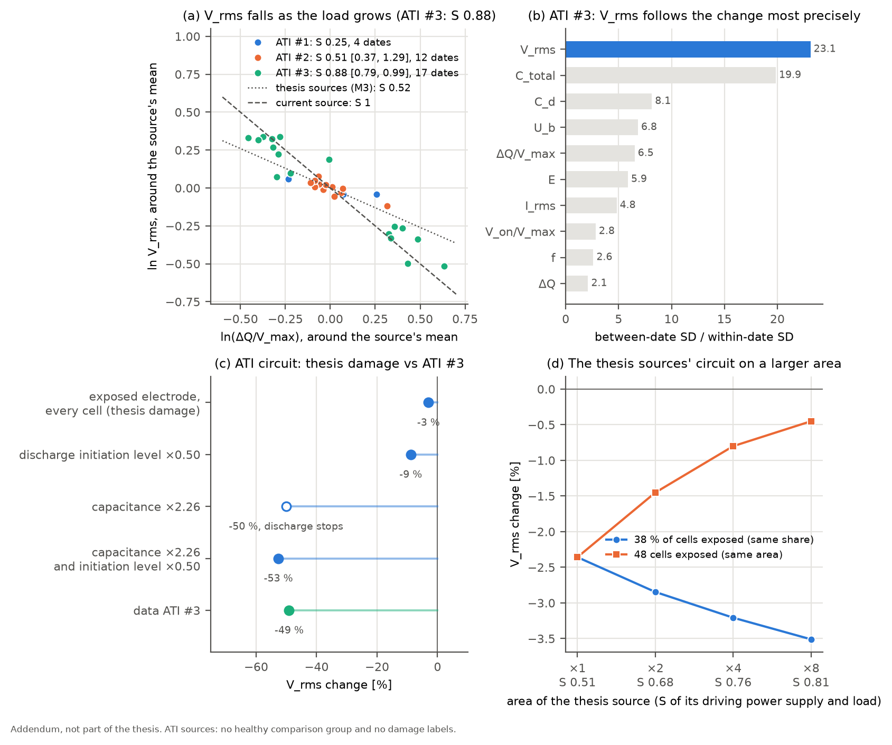
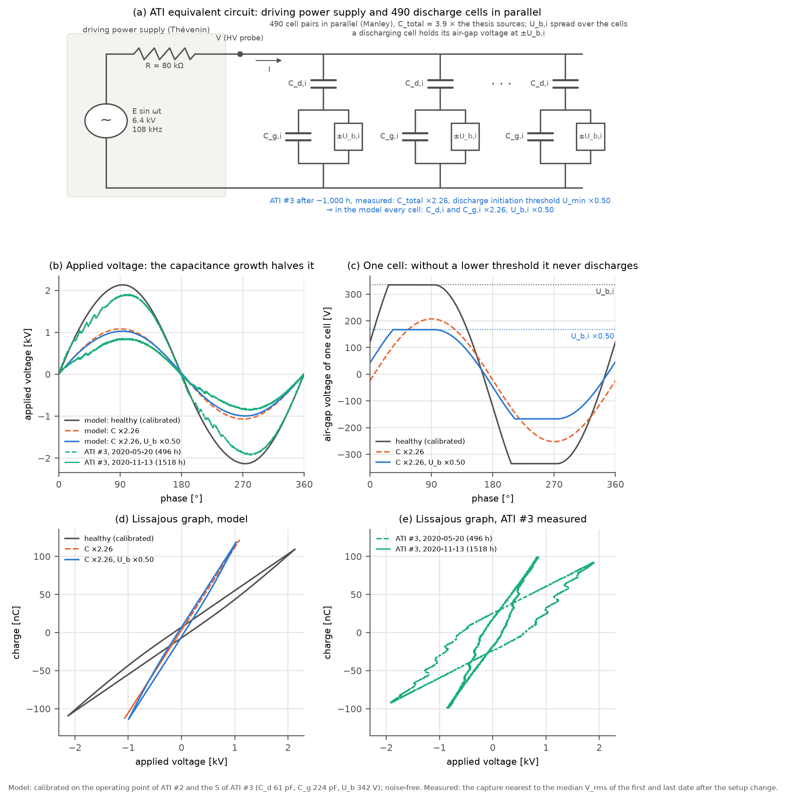

# Addendum, not part of the thesis: the larger-area ATI sources

**English** | [한국어](ati-addendum.ko.md)

> **This experiment is not covered in the thesis.** Life tests were also run on sources with the same structure and a larger area. This document uses those data to check the V_rms mechanism of the thesis. It changes neither the thesis conclusions nor the verification of M1–M3.

## Summary

> - **The direction is the same in all three sources.** When the load (discharge charge per volt, ΔQ/V_max) grows, V_rms falls. This is the opposite of what happens when the driving power supply changes the voltage, and the same direction as the load path of eq. (5).
> - **Only ATI #3 fixes the size S.** On ATI #3, whose load grew about threefold, S = 0.88 [0.79, 0.99]. That is closer to a current source (S = 1) than the driving power supply of the thesis sources (M3, S = 0.52). The load of ATI #2 hardly changed and ATI #1 has only four dates, so their S is not determined.
> - **Check of the ML conclusion.** There are no damage labels, so no damage classifier can be built. Without labels one can still ask which feature follows the change of the source most precisely. On ATI #3, V_rms is first of ten features (change between measurement dates / noise within a date = 23.1; next C_total 19.9).
> - **Equivalent-circuit simulation.** On a circuit calibrated to the ATI conditions, the thesis damage (exposed electrode) in **every** cell lowers V_rms by only 3 %. The V_rms drop of ATI #3 (−49 %) comes from a capacitance increase of the whole source (C_total ×2.26). For the discharge to continue meanwhile, the discharge initiation threshold has to fall with it, and in the measurement it fell to ×0.50. With both changes the circuit gives V_rms −53 % and V_max ×0.48, matching the measurement (−49 %, ×0.52). The change of ATI #3 is of a different kind than the local damage of the thesis.
> - **Effect of area.** Widening the thesis sources' circuit while keeping the output impedance of the driving power supply raises S (0.76 at ×4). When the same share of cells (38 %) is damaged, the V_rms signal grows (−2.4 → −3.2 %); when the same area (48 cells) is damaged, the signal is diluted (−2.4 → −0.8 %).



*(a) Load and V_rms, around each source's mean (b) ATI #3: change between measurement dates / noise within a date, per feature (c) The thesis damage and the measured change of ATI #3 on the ATI-calibrated circuit (d) S and the damage signal when the thesis sources' circuit is widened*

## 1. Sources and data

- **Structure.** The cell structure is that of the thesis sources M1–M3; only the area is larger. Electrically, the no-discharge capacitance C_total is about 3.9 times larger (47.5 / 12.15 pF), equivalent to about 490 cell pairs (thesis sources: 126).
- **Operating conditions (operating logs and slides).** Nitrogen at 1.5 lpm, discharge space 100 × 60 × 5 mm, a driving power supply on a DC 13 V, 3.2 A input, drive frequency about 108 kHz. The thesis sources ran in ambient air at about 47 kHz.
- **Measurement.** The oscilloscope of the thesis (GW Instek, 5000 points) saved detail captures at 4 ns.

| Source | Discharge period | Cumulative discharge time (operating log) | Measurement dates used | Captures |
|---|---|---|---|---|
| ATI #1 | 2019-06-18 – 2019-12-09 | 868 h | 4 (last week, 825–868 h) | 64 |
| ATI #2 | 2019-12-12 – 2020-02-24 | 481 h | 12 (0–480 h) | 169 |
| ATI #3 | 2020-02-29 – 2020-11-19 | 1,541 h | 21 (95–1,518 h) | 319 |

**Terms.** The unit of this document is the **measurement date**: the captures of one source taken on one day under the same conditions. The **time point** of the thesis verification (all sources measured together at the same cumulative discharge time) does not exist for ATI, because the three sources were discharged one after another.

| Symbol | Term | Relation to the thesis |
|---|---|---|
| ΔQ/V_max | Discharge charge per volt: the size of the load | Thesis Q_max divided by V_max |
| S | Load sensitivity: the % drop of V_rms for a 1 % larger load | Raw-data verification, section 10.5, eq. (5) |
| U_min | Discharge initiation threshold: the reference applied voltage at which the discharge starts, (V_max + V_on)/2 | Section 10.5, eq. (1), U_b(1 + C_g/C_d). The discharge initiation voltage is V_on = 2U_min − V_max |

**Captures used**

- Only detail captures (sampling ≤ 50 ns) at the drive frequency (100–115 kHz).
- For ATI #1 only the folders of the last week were saved at the drive frequency. Earlier folders are at 46–79 kHz or are copies of other sources.
- The ATI #2 folder of 2020-01-08 was left out: its current range was 4 A/div, so the current cannot be read.
- ATI #3 folders the experimenter marked were left out: distorted waveform, "current and voltage changed oddly", 13.5 V input, the driving power supply voltage alone, same-day repeat, and "wrongly measured data".
- A capture saved in two folders counts once. The first measurement of ATI #2 (2019-12-11, before discharge) was also copied into an ATI #1 folder; by its date it belongs to ATI #2.

## 2. What can be tested

The V_rms mechanism of section 10.5 of the [raw-data verification](raw-data-verification.md) has two parts.

1. Damage → earlier discharge initiation → more discharge charge (source side)
2. Heavier load → lower voltage of the driving power supply, by $\delta\ln V = -S\,\delta\ln(\Delta Q/V_{max})$ (power-supply side, eq. (5))

- **Part 1 cannot be tested.** No undamaged source was measured at the same time points (the role of M3), and there are no damage labels. A change of the source therefore cannot be separated from shared external effects.
- **Part 2 can be tested.** S is set by the pair of driving power supply and load, and it can be measured within one source whatever the reason the load changed.

## 3. How much does V_rms change when the load changes?

S is obtained as for M3. On the medians of the measurement dates, $\ln(\Delta Q/V_{max})$ is regressed on $\ln V_{rms}$ and $S = -1/\text{slope}$. V_rms is the precise variable (noise within a date 1.4 %), so it is the regressor. Intervals are 95 % bootstraps over measurement dates.

| Source | Dates | S | 95 % interval | R² | Range of ln V_rms | Range of ln(ΔQ/V_max) |
|---|---|---|---|---|---|---|
| Thesis source M3 (section 10.5) | 12 | 0.52 | | | | |
| ATI #1 | 4 | 0.25 | (too few dates) | 0.88 | 0.10 | 0.49 |
| ATI #2 | 12 | 0.51 | 0.37–1.29 | 0.74 | 0.19 | 0.43 |
| **ATI #3 (after the setup change)** | **17** | **0.88** | **0.79–0.99** | **0.93** | 0.85 | 1.09 |
| ATI #3 (all) | 21 | 0.93 | 0.84–1.05 | 0.91 | 0.97 | 1.09 |

- **Direction.** In all three sources V_rms falls when the load grows (S > 0). When the driving power supply changes the voltage (the thesis sweep), V and ΔQ/V grow together, the opposite direction.
- **ATI #3.** While the load grew about threefold (ln 1.09), V_rms fell 2.3-fold (ln 0.85). S = 0.88 lies within 0 < S < 1 and is close to a current source. Indeed I_rms hardly changes (dln I_rms / dln(ΔQ/V) = +0.05).
- **ATI #2.** Its load hardly changed. Its S depends strongly on its single pre-discharge date (0.89 without it, interval 0.43–1.64), and its interval is wide, 0.37–1.29.
- **ATI #1.** Only four days of its last week. Its current range was 100–200 mA/div, 2.5–5 times coarser than for the other sources (40 mA/div), and surface-cleaning tests took place in that week (12-04, 12-09).
- **Setup change on ATI #3.** Between 2020-05-02 and 05-20, C_total fell by 45 % and I_rms by 18 % while V_rms rose. A change of the load alone does not explain this, so it is taken as a change of the measurement setup or of the mounting, and S is taken over the 17 dates after it. All 21 dates give 0.93.

## 4. Check of the ML conclusion: which feature follows the change most precisely?

The ML conclusion of the thesis is that V_rms separates damage best. Section 10.5 of the verification explains why: the cause (discharge initiation, discharge charge) is local and noisy, while the consequence (V_rms) is precise because the driving power supply gathers all cells into one voltage.

- **No damage classifier can be built.** There are neither damage labels nor a comparison source. A model trained on the thesis sources cannot be carried over either: the ranges of drive frequency (47 vs 108 kHz) and C_total (12 vs 48 pF) do not overlap, so the model would separate the equipment instead of damage.
- **What can be checked without labels.** Which feature follows the change of the source most precisely. The SD of the measurement-date medians is divided by the SD within a date (log values).

| | 1st | 2nd | 3rd | Rest |
|---|---|---|---|---|
| ATI #3 (17 dates after the setup change) | **V_rms 23.1** (noise 1.4 %) | C_total 19.9 (1.8 %) | C_d 8.1 (4.1 %) | U_b 6.8, ΔQ/V_max 6.5, E 5.9, I_rms 4.8, V_on/V_max 2.8, f 2.6, ΔQ 2.1 |
| ATI #2 (12 dates) | C_d 2.3 | I_rms 1.6 | V_rms 1.6 | all ≤ 1.3 |

- On ATI #3, whose state changed most, V_rms comes first. This is the order expected from the thesis sources: the consequence-side indicator is the precise one.
- ATI #2 changed little, so no feature stands out above its noise.

## 5. Equivalent-circuit simulation: is the change of ATI #3 the damage of the thesis?

**Calibration.** The circuit is that of section 10.6 of the verification. Each cell is a Manley equivalent circuit (C_d in series with C_g; while the cell discharges, its air-gap voltage stays at U_b), and all cells are in parallel on a Thévenin driving power supply (open-circuit voltage E, output resistance R).

- 490 cell pairs at a drive frequency of 108 kHz.
- The targets are the operating point of ATI #2 (medians of all its captures) and the S of ATI #3.
- Result: C_d 61.0 pF, C_g 224 pF, U_b 342 V, E ≈ 6.4 kV, R ≈ 80 kΩ.
- Difference from the targets:
  - V_rms +2.5 %, V_max −0.9 %, C_total +1.1 %, C_d −0.1 %
  - ΔQ/V_max +3.7 %, V_on/V_max −2.5 %, U_b +10 %, energy per cycle −11 %
  - S is 0.84, 4 % below the data (0.88).

**Prediction (no fit).** Changes of the source were put into the calibrated circuit. The change of ATI #3 is measured between the medians of its first three and last three dates after the setup change. C_total grew 2.26-fold, and the discharge initiation threshold U_min fell from 1,317 V to 657 V (×0.50). V_on/V_max stayed nearly the same, 0.38 → 0.36.

| Change put into the circuit | V_rms | V_max | Discharge |
|---|---|---|---|
| Exposed electrode, every cell (the thesis damage, Townsend factor 0.83) | −3.0 % | ×0.97 | continues |
| Discharge initiation threshold ×0.50 | −8.9 % | ×0.93 | continues |
| Capacitance ×2.26 | −50.1 % | ×0.51 | **stops** |
| Capacitance ×2.26, discharge initiation threshold ×0.50 | −52.6 % | ×0.48 | continues |
| **ATI #3 measured** | **−49.1 %** | **×0.52** | continues |

- **The thesis damage does not explain it.** Even with an exposed electrode in every cell, V_rms falls by only 3 %.
- **Most of the V_rms drop comes from the capacitance increase.** With a driving power supply close to a current source, the voltage falls as much as the capacitance grows.
- **For the discharge to continue, the discharge initiation threshold has to fall too.** With the capacitance increase alone, V_max drops below the discharge initiation threshold and the discharge stops. ATI #3 kept discharging, and its measured discharge initiation threshold halved. With both changes, V_rms and V_max match the measurement within 4 percentage points.
- What increased the capacitance of the whole source and lowered its discharge initiation threshold cannot be decided from electrical measurements alone.



*(a) ATI equivalent circuit: driving power supply (Thévenin) and 490 cell pairs (b) Applied voltage over one period, model and ATI #3 measured (c) Air-gap voltage of one cell with the median burning voltage (d) Lissajous graphs of the model (e) Measured Lissajous graphs of ATI #3 (first and last measurement date after the setup change; on each day the capture nearest to the median V_rms)*

- **(b) Applied voltage.** When the capacitance grows 2.26-fold, the amplitude of the applied voltage halves. In the measurement V_max fell by the same ratio (×0.52).
- **(c) Air-gap voltage.** With the capacitance increase alone (orange), the cell's air-gap voltage never reaches U_b,i, so the cell does not discharge. When the discharge initiation threshold falls with it (blue), the air-gap voltage stops at the lowered U_b,i and the discharge goes on.
- **(d), (e) Lissajous graphs.** The larger capacitance makes the slopes steeper and the voltage span narrower. The measurement changed in the same direction. The measured parallelogram is wider than the model's because the model was calibrated on the operating point of ATI #2. The shapes of (d) and (e) are compared qualitatively only.

### Why the slopes and the area of the Lissajous graph changed

> The capacitance of the whole source roughly doubled, so both slopes became steeper. The driving power supply is close to a current source, so the discharge charge stayed nearly the same while the voltage span halved. That charge flowed at half the burning voltage, so the area (energy per cycle) halved too.

ATI #3, medians of the first three and the last three dates after the setup change.

| Element of the Lissajous graph | Quantity | First 3 dates | Last 3 dates | Ratio |
|---|---|---|---|---|
| Slope without discharge | C_total | 36.4 pF | 82.5 pF | ×2.26 |
| Slope during discharge | C_d | 65.2 pF | 134.9 pF | ×2.07 |
| Height | Discharge charge ΔQ | 78.4 nC | 86.4 nC | ×1.10 |
| Width | V_max | 1,920 V | 994 V | ×0.52 |
| | Burning voltage U_b | 557 V | 233 V | ×0.42 |
| Area | Energy per cycle E | 103 µJ | 48 µJ | ×0.46 |
| | Manley, 4C_dU_b(V_max − U_min) | 88 µJ | 42 µJ | ×0.48 |
| | I_rms | 44.0 mA | 48.7 mA | ×1.11 |

**Slopes: the capacitance of the whole source grew.**

- The two slopes of the Lissajous graph are capacitances: C_total without discharge and C_d during discharge.
- Both roughly doubled, and their ratio (C_total/C_d) stayed nearly the same, 0.56 → 0.61. So the dielectric and air-gap capacitances grew together, as if the effective area taking part in the discharge had doubled.
- Local damage of some cells cannot change them this much (table above: an exposed electrode in every cell changes V_rms by −3 %).
- A candidate is a conductive layer on the dielectric surface (deposits, sputtered electrode metal, moisture) that widens the electrodes. Electrical measurements alone cannot decide it.
- Mounting and the measurement setup also change the slopes, as when C_total changed by about 30 pF at once in the May setup change. The increase after it, however, was not a single step but continued over months (05-20 36 pF, 07-27 49 pF, 08-10 68 pF, 10-22 82 pF, 11-13 98 pF).

**Area: the same charge flowed at half the voltage.** The area is the energy per cycle, by Manley $E = 2U_b\,\Delta Q = 4C_dU_b(V_{max} - U_{min})$ (eq. (2) of section 10.5 of the verification).

- **The height (ΔQ) is nearly the same.** The driving power supply is close to a current source (S 0.88), so the current sets the charge that flows in one period (I_rms ×1.11). C_d doubled and the voltage span of the discharge phase halved, so ΔQ = C_d(V_max − V_on) stays the same.
- **The width halved.** The same charge on twice the capacitance gives half the voltage.
- **The area halved.** The same charge flowed at half the air-gap voltage (U_b ×0.42), so the energy per cycle halved. The Manley value (×0.48) matches the measured area (×0.46).

**Why U_b fell this far is not explained.**

- For a 100 µm gap like that of the thesis sources, Paschen's law in nitrogen gives a burning voltage of 714–871 V for a secondary electron emission coefficient γ of 0.01–0.1 (A = 12, B = 342).
- The U_b of ATI #3 was lower from the start (557 V) and ended at 233 V. A change of γ cannot explain a drop of this size.
- Candidates are surface processes: memory charge left on the surface from the previous half period helping the next discharge, surface conduction, deposits. The short half periods at 108 kHz favour surface-charge memory.
- Checking this needs the gap structure of ATI and surface analyses. The SEM folder has ATI data from August 2020 (`0819a`, `0826`); which source they belong to was not checked.

## 6. Same structure, larger area

The circuit of the thesis sources calibrated in section 10.6 was widened (126 cells, C_d 34.9 pF, C_g 16.7 pF, U_b 898 V, R 213 kΩ).

- The number of cells and the capacitances were multiplied by a.
- The output resistance R of the driving power supply was kept.
- The open-circuit voltage E was raised to keep V_max the same (2,243 V).

| Area | Cell pairs | S | 48 cells exposed (same damaged area) | 38 % of the cells exposed (same damaged share) |
|---|---|---|---|---|
| ×1 | 126 | 0.51 | −2.4 % | −2.4 % |
| ×2 | 252 | 0.68 | −1.4 % | −2.8 % |
| ×4 | 504 | 0.76 | −0.8 % | −3.2 % |
| ×8 | 1,008 | 0.81 | −0.4 % | −3.5 % |

- **The larger the source, the larger S.** The load admittance Y_L grows with the area, so $S = \mathrm{Re}\,Z_sY_L/(1 + Z_sY_L)$ approaches 1. The same driving power supply looks like a current source to a large source.
- **With the same damaged share,** the V_rms signal grows as S grows.
- **With the same damaged area,** the relative change of the load shrinks in inverse proportion to the area, and the rise of S does not make up for it. On a large source, local damage of the same size shows less in V_rms (one third at ×4).
- This is the same direction as the S of ATI (0.88) being larger than that of M3 (0.52). The ATI driving power supply is a different device, however, so the difference is not attributed to area alone.

## 7. Limitations

- **There is no comparison source.** Whether a change of ATI comes from the source or from shared external effects cannot be separated.
  - S, the relation between load and V_rms, is defined without this separation.
  - But if the driving power supply itself changed over the same period (for example, a lower E), that would mix into the S estimate.
  - The nearly constant I_rms fits a driving power supply close to a current source, but does not fully exclude a change of E.
- **Only one source, ATI #3, fixes S.** ATI #2 and #3 ran on their own inverters (inverter swap test, 2020-11-23).
- **The cause of the setup change is not recorded.** It happened between 2020-05-02 and 05-20.
- **The prediction of section 5 is not a test of S itself.** The calibration used the S of ATI #3. The check is whether that S, together with the measured change of the source, explains V_rms and V_max at once.
- **The S and the changes of the circuit come from noise-free waveforms,** as in section 10.6.
- **Surface analyses (microscope, SEM) are not used in this document.**
- **Difference from an earlier record.** The ATI documents removed from the repository on 2026-11-02 (still in the git history) said that ATI #3 stopped on 2020-11-13 after 987 h. The raw data disagree.
  - The operating log records discharge until 2020-11-19 (1,541 h cumulative).
  - Panel 3 still discharged in the inverter swap test of 2020-11-23.

  All numbers of this document were recomputed from the raw data.

## Reproduction

The raw data are not in this repository. With the archive, this command regenerates the tables and both figures of this document (about 7 minutes):

```bash
python examples/ati_addendum.py "<archive>/μ-DBD (large) Aging 데이터 모음" docs/img
```
