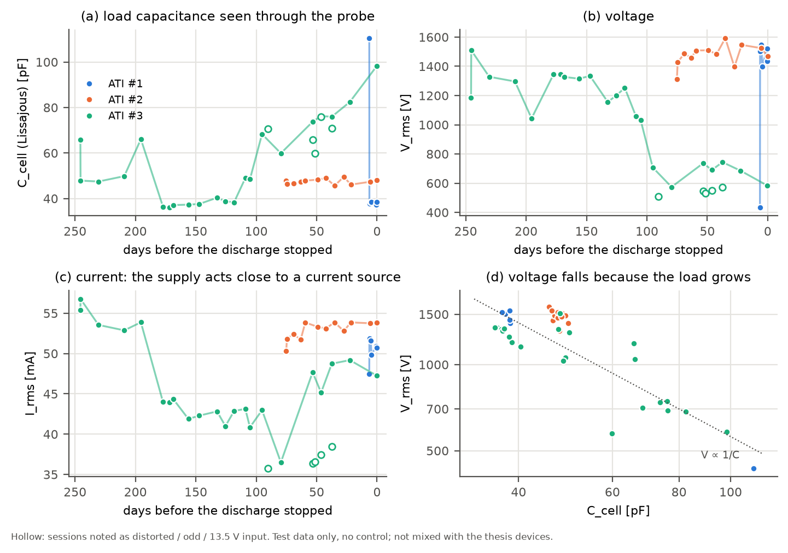

# ATI 노화 시험: 방전이 멈출 때까지 측정한 장치로 가설 시험하기

**한국어**

> **이 문서는 시험 기록입니다.** ATI 시험에는 대조 장치가 없었습니다. 그래서 이 데이터는 학위논문 데이터(M1–M3)와 섞지 않았고, 논문의 결론을 고치는 근거로도 쓰지 않습니다. 목적은 논문 이후에 세운 가설들이 다른 장치에서도 보이는지 확인하는 것입니다.

가설과 계산식의 물리적 배경은 [dbd-physics-primer.ko.md](dbd-physics-primer.ko.md)에 단계별로 정리했습니다.

## 요약

| 가설 | 판정 | 근거 |
|---|---|---|
| **H1** 노화에 따라 전기 특성이 일관되게 변한다 | **부분 지지 (한 장치)** | ATI #3: C_cell 48 → 98 pF, ζ 63 → 139 pF, V_rms 1510 → 583 V (Spearman ρ = +0.67, +0.68, −0.86, 모두 p < 0.001). ATI #2(481 h)에는 경향이 없습니다. 두 장치를 같은 0–490 h 구간으로 맞추면 둘 다 경향이 없습니다 |
| **H2** 변화 방향이 장치 종류와 무관하게 같다 | **지지되지 않음** | 같은 구조의 ATI끼리도 방향이 맞지 않습니다. ATI #2의 ζ는 처음 약 100 h 동안 77 → 57 pF로 줄었고(ρ = −0.50, p = 0.10), ATI #3의 ζ는 97–374 h에 63 → 88 pF로 늘었습니다(유의하지 않음) |
| **H3** 고장 전에 변화가 먼저 나타난다 | **사례 수준 (3대 중 1대)** | ATI #3: 방전이 멈추기 109일 전부터 C_cell이 자기 기준의 1.25배 이상인 상태가 지속됐습니다. ATI #1: 6일 전에 일시적으로 나타났다가 같은 날 사라졌습니다. ATI #2: 아무 전조도 없었습니다 |

**새로 확인한 두 가지**

1. **이 전원은 전류원에 가깝습니다.** 세션 사이에 I_rms는 거의 변하지 않고(변동계수 2–11 %), V_rms ∝ C_cell^−0.87입니다. 따라서 V_rms의 감소는 전원이 약해진 것이 아니라 부하 용량이 커진 결과이고, V_rms와 C_cell은 서로 독립된 정보가 아닙니다.
2. **ATI #3의 C_cell 상승은 소자 전체 규모의 변화입니다.** 셀 하나의 기여(약 0.1 pF)로 환산하면 상승분 +50 pF는 소자 전체 용량에 해당합니다. 논문 장치에서 본 셀 몇 개의 국소 손상과는 종류가 다른 변화입니다.



## 1. 장치와 데이터

**장치**

- ATI #1–3은 같은 의료기기용 μ-DBD 방전원을 수명 시험한 것입니다. 이름이 같으면 구조도 같습니다.
- 전극은 빗살형 Ag 전극입니다. 셀 한 개의 정전용량 구조는 논문 장치 M1, M2와 같고, 전체 면적만 다릅니다.
- 운전 조건은 다음과 같습니다(운전 기록과 발표자료 기준).
  - 기체: 일반 질소 1.5 lpm
  - 입력: DC 13 V, 3.2 A (GW Instek GPE-3323)
  - 방전 공간: 100 mm × 60 mm × 5 mm
  - 인버터: RC 수동소자로 구성하고, 555 타이머로 on-off 듀티를 주어 열과 회로 부담을 줄였습니다. 구동 주파수는 약 107 kHz입니다.

**방전 기간과 누적 방전시간**

| 장치 | 방전 기간 | 누적 방전시간 | 출처 |
|---|---|---|---|
| ATI #1 | 2019-06-18 – 2019-12-09 | 867 h 54 min | 발표자료의 사진 메모 |
| ATI #2 | 2019-12-12 – 2020-02-24 | 481 h | 일일 운전 기록 |
| ATI #3 | 2020-02-29 – 2020-11-13 | 2020-08-10까지 987 h, 이후 기록 없음 | 2020-08-17 정리표 |

**고장의 정의와 개입 기록**

- **고장**: 데이터가 끝나는 날이 방전이 멈춘 날입니다. 그 무렵부터 방전이 정상적으로 일어나지 않았습니다.
- **IPA 세척**: 이소프로필알코올로 세척하고 건조했습니다. 목적은 화학반응으로 생긴 침전물이나 생성물, 유전체의 스퍼터링 흔적을 없애고 **진짜 수명**을 재는 것이었습니다. 따라서 "방전이 멈췄다"는 것은 세척으로도 되돌릴 수 없는 고장을 뜻합니다.
- 아카이브 폴더 이름에 남은 세척 기록은 ATI #1의 두 번뿐입니다.
  - 12/04: 오전에 방전이 일어나지 않음 → 세척 → 저녁에 방전 재개
  - 12/09: 오전 측정 → 세척 → 오후 측정 → 이후 방전이 멈춤
- ATI #2와 ATI #3에는 폴더 이름에 세척 기록이 없습니다. 세척을 했더라도 날짜를 데이터에서 알 수는 없습니다.
- **ATI #3의 다른 개입**: 2020-08-15에 "DBD 소스 전원부 재접착을 위해 실버 페이스트 도포 후 오븐에서 재가열"했다는 기록이 발표자료에 있습니다. 9/21–10/07에는 같은 날 정상 파형과 일그러진 파형이 번갈아 기록됐습니다.

**데이터 정리**

- 상세 캡처(샘플 간격 ≤ 50 ns)만 썼습니다. 같은 캡처가 여러 폴더에 복사된 경우, 타임스탬프와 파일 이름으로 하나만 남겼습니다.
- 전류 프로브가 반대로 연결된 세션(ATI #2 전체, ATI #1 후반)은 부호를 바꿨습니다. 판단 기준은 "용량성 전류는 전압보다 앞선다", 즉 i와 dv/dt의 상관이 양수여야 한다는 것입니다.
- 다음 폴더는 제외했습니다.

  | 폴더 | 제외 이유 |
  |---|---|
  | ATI #1 `A1209` | Line-DBD 0 h 캡처의 복사본입니다(타임스탬프 동일) |
  | ATI #1 `1211` | ATI #2 2019-12-11 측정("NEW ATI")의 복사본입니다 |
  | ATI #1 `1121`, `1125` | 주파수가 79 kHz와 48 kHz이고 리사주 R² < 0.1입니다. 측정 구성이 달랐던 것으로 보입니다 |
  | ATI #1 12/04 오전 "방전X" | 방전이 없었고 주파수가 46 kHz입니다(다른 전원으로 보임). 사건으로만 기록했습니다 |
  | ATI #2 `20200108` | 전류 채널이 4 A/div여서 전류를 쓸 수 없습니다 |

- 결과적으로 ATI #1은 **방전이 멈추기 전 마지막 6일**의 6개 세션만 남았습니다. ATI #2는 12개, ATI #3은 27개 세션입니다(메모가 붙은 세션 포함).

## 2. 측정 체인에서 먼저 확인한 것

**전원은 전류원에 가깝다**

| 장치 | 세션 사이 변동계수: I_rms | V_rms | C_cell |
|---|---|---|---|
| ATI #1 | 3 % | 37 % | 61 % |
| ATI #2 | 2 % | 5 % | 2 % |
| ATI #3 | 11 % | 29 % | 34 % |

- ATI #3에서 $d\ln V_{rms}/d\ln C_{cell}=-0.87$입니다. 이상 전류원이면 −1, 이상 전압원이면 0입니다.
- 그림 (c)와 (d)가 이 관계를 보여 줍니다.

**프로브 쪽 단차** (ATI #3, 5/02와 5/20 사이)

- 직전 세 세션과 직후 세 세션을 비교하면 I_rms는 −9.6 mA, C_cell은 −11.4 pF 변했습니다. V_rms는 +18 V로 거의 그대로입니다.
- 프로브 루프 안에 있던 기생 용량 ΔC가 빠졌다면 전류 변화는 $\omega\,\Delta C\,V=-10.3$ mA여야 합니다. 측정된 −9.6 mA와 맞습니다.
- 반대로 소자의 용량이 줄었다면, 전류원 전원에서는 전류는 그대로이고 전압이 올라야 합니다. 그렇지 않았습니다.
- 따라서 이 단차는 **노화가 아니라 측정 구성(프로브 위치나 배선)의 변화**로 판단했습니다. 2020-03-10 발표자료의 피드백("전류 프로브가 영향을 안 받는 위치를 잘 찾아야 함")과도 맞습니다. 이후 분석에서는 이 날을 기준으로 기준선을 나눴습니다.

**두 가지 C_cell 추정이 일치한다**

리사주 기울기로 구한 C_cell과 다중 셀 등가회로 역적합(`circuit_fit`)으로 구한 C_cell의 차이는 중앙값 0.9 pF입니다.

## 3. H1: 노화에 따른 변화

**장치별 경향** (메모가 없는 세션, 경과 시간에 대한 Spearman ρ)

| 장치 | 세션 수 | C_cell | ζ | V_rms |
|---|---|---|---|---|
| ATI #1 | 5 | ρ = −0.50 (p = 0.39) | −0.30 (0.62) | +0.30 (0.62) |
| ATI #2 | 12 | +0.17 (0.59), 48 → 48 pF | −0.50 (0.10), 77 → 62 pF | +0.47 (0.12), 1311 → 1469 V |
| ATI #3 | 21 | **+0.67 (< 0.001)**, 48 → 98 pF | **+0.68 (< 0.001)**, 63 → 139 pF | **−0.86 (< 0.001)**, 1510 → 583 V |

- ATI #1은 남은 데이터가 마지막 6일뿐이라 경향을 시험할 수 없습니다.
- 공통 구간 0–490 h로 맞추면 ATI #2(세션 12개)와 ATI #3(세션 5개) 모두 경향이 없습니다(모든 |ρ| ≤ 0.49, p ≥ 0.10). 단, 이 구간의 ATI #3에는 2절의 프로브 단차가 들어 있습니다.
- ATI #3의 큰 변화는 약 930 h(7/27)부터 시작됩니다. ATI #1(868 h)과 ATI #2(481 h)는 이 시점 전에 이미 수명이 끝났습니다.

**C_cell 상승이 전압 하락 때문인가?**

같은 날 같은 소자 상태에서 전압만 떨어진 세 쌍을 비교했습니다.

| 비교 | ΔV_rms | ΔC_cell |
|---|---|---|
| 9/21 정상 → 9/23 입력 13.5 V | −205 V | −13.8 pF |
| 9/28 정상 → 9/28 일그러진 파형 | −139 V | −0.4 pF |
| 10/07 정상 → 10/07 일그러진 파형 | −173 V | −5.1 pF |

- 전압이 떨어질 때 C_cell은 그대로이거나 오히려 줄었습니다.
- 따라서 노화 중의 C_cell 상승(+50 pF)은 전압 하락이 만든 겉보기 효과가 아닙니다. 오히려 2절의 전류원 관계로 보면 인과는 반대입니다. C_cell이 커져서 V_rms가 떨어졌습니다.

**판정**

- H1은 ATI #3 한 대에서 강하게 보입니다.
- 그러나 세 대 사이에 재현되지 않았습니다. "모든 장치가 같은 노화 곡선을 따른다"는 지지되지 않습니다.
- 지지되는 것은 "어떤 고장 경로에서는 소자 전체 규모의 전기적 변화가 생긴다"까지입니다.

## 4. H3: 고장 전의 전조

**규칙**

- "부하 상태(loaded state)"를 C_cell이 자기 기준선의 1.25배 이상인 세션으로 정의했습니다.
- 기준선은 메모가 없는 첫 세 세션의 중앙값입니다. ATI #3은 프로브 단차 이후에 기준선을 다시 잡았습니다(36.4 pF).
- "지속"은 연속 두 세션 이상 부하 상태인 경우로 정의했습니다.

**결과**

| 장치 | 부하 상태가 나타난 시점 (방전이 멈추기 전) | 지속 여부 | 함께 일어난 일 |
|---|---|---|---|
| ATI #1 | 6일 전 (12/03 13:34): C_cell 110.5 pF(기준의 2.87배), V_rms 435 V | 아니오. 2.5시간 뒤 재측정은 정상(37.8 pF) | 다음 날 오전 방전 안 됨 → IPA 세척 → 재개. 12/09 세척 직후 측정도 정상이었고, 그 뒤 방전이 멈춤 |
| ATI #2 | 없음 | — | 고장 당일 측정도 정상(48.2 pF, 1470 V) |
| ATI #3 | 246일 전(3/13 오전), 195일 전(5/02) | 아니오. 둘 다 다음 측정에서 정상 | 3/13은 같은 날 오후에 정상 |
| | **109일 전(7/27)부터 마지막 측정까지** | **예** | 7/27–7/31은 1.33배, 8/10부터 1.9–2.7배. 8/15 전원부 재접착 뒤에도 계속됨 |

**IPA 세척 정보로 다시 읽기**

- 세척의 목적이 "진짜 수명"을 재는 것이었으므로, 쓸모 있는 전조는 **세척으로 없어지지 않는 변화**여야 합니다.
- 일시적인 부하 상태(ATI #1 12/03, ATI #3 3/13과 5/02)는 몇 시간에서 몇 주 사이에 사라졌습니다. 세척으로 제거되는 표면 생성물이나 흡착 수분과 같은 성질입니다. 이런 상태는 **경보로 쓰면 오경보가 됩니다**.
- ATI #3의 지속 상태는 전원부를 다시 붙이고 오븐에서 다시 가열한 뒤에도 남았습니다. 세척되지 않는 변화일 가능성이 있습니다. 다만 ATI #3의 세척 날짜는 데이터에 없어서 확인할 수 없습니다.
- ATI #1은 진짜 고장 직전(12/09 세척 직후)의 측정이 정상이었습니다. 즉 **ATI #1의 진짜 고장에는 전기적 전조가 없었습니다.**

**판정**

- 지속 규칙으로 보면, 3대 중 1대(ATI #3)는 109일 앞서 잡히고 2대는 놓칩니다.
- 장치 3대와 대조군 없는 조건에서는 H3를 일반적인 사실로 주장할 수 없습니다. 사례 관찰이자 다음 실험의 가설로 남깁니다.

## 5. 해석: 무엇이 변했는가

- **소자 전체의 변화다.** 셀 구조가 M1, M2와 같다고 보면 ATI는 약 450쌍에 해당합니다. ATI #3의 C_cell 상승(+50 pF)은 약 470쌍 분량입니다([dbd-physics-primer.ko.md](dbd-physics-primer.ko.md) 9단계).
- **되돌아가는 경우가 있다.** 같은 날 몇 시간 사이에 부하 상태가 사라지기도 했고(3/13, 12/03), ATI #1은 세척 뒤 방전이 회복됐습니다.
- **표면에 무언가가 생긴다.** ATI #2 말기의 현미경 사진에는 전극 위에 흰 결정성 침착물이 보입니다(2020-03-10 발표자료).
- 이 세 가지를 함께 설명하는 **작업 가설**은 다음과 같습니다. 유전체 표면에 전도성 막(반응 생성물, 침착물, 흡착 수분)이 생기면 전극의 유효 면적이 넓어져 C_cell이 커집니다. 전류원 전원에서는 그 결과 V_rms가 떨어집니다. 막이 얇거나 제거 가능할 때는 세척이나 운전 중 건조로 되돌아가고, 쌓이거나 유전체 자체가 손상되면 되돌아가지 않습니다.
- 이 가설은 아직 검증하지 않았습니다. 시험 방법은 7절에 적었습니다.

## 6. 이 데이터로 할 수 없는 말

- **대조군이 없습니다.** 세션 효과(전원 출력, 프로브 위치, 온습도)와 노화를 분리할 수 없습니다. 논문 데이터에서는 대조 장치로 세션 효과를 빼자 V_rms 변화가 약 절반으로 줄었습니다([raw-data-verification.ko.md](raw-data-verification.ko.md)).
- **장치가 3대뿐이고 측정 간격이 불규칙합니다.** 마지막 두 측정 사이가 ATI #2는 5일, ATI #3은 22일입니다.
- **개입 기록이 불완전합니다.** 세척 날짜는 ATI #1에만 있고, 프로브 위치 변경은 데이터에서 추론한 것입니다.
- **ATI #3의 누적 시간은 8/10 이후가 없습니다.** 그래서 고장 기준 정렬은 날짜로 했습니다.
- **ATI #1의 고장 원인은 알 수 없습니다.** 868 h 수명 중 마지막 6일만 측정이 남아 있습니다.

## 7. 가설을 주장하려면 필요한 실험

| 필요한 것 | 이유 | 이 데이터에서 문제가 된 부분 |
|---|---|---|
| 프로브 위치와 배선 고정, 사진 기록 | 루프 안의 기생 용량이 C_cell을 바꿉니다 | ATI #3 5/02–5/20 단차(−11 pF) |
| 같은 전원에 더미 커패시터를 연결한 대조 채널 | 전원 변화와 소자 변화를 분리합니다 | V_rms 변화의 원인 판정 |
| 매일 같은 시각(운전 시작 후 일정 시간)에 측정, 습도 기록 | 아침의 되돌아가는 상태를 분리합니다 | 3/13 오전과 오후의 차이 |
| 세척을 포함한 모든 개입의 날짜와 내용 기록 | 세척으로 없어지는 변화와 남는 변화를 나눕니다 | ATI #2·#3의 세척 날짜 없음 |
| 세척 직전과 직후에 모두 측정 | 표면 막 가설을 직접 시험합니다 (막이라면 직후에 C_cell이 떨어져야 함) | 12/09는 직후만 있음 |
| 방전 개시 전압보다 낮은 전압에서 C_cell 측정 | 방전 없이 순수한 커패시턴스만 봅니다 | 부분 방전이 섞인 기울기 |
| 고장까지 시험하는 장치 5대 이상 | 고장 경로별로 전조의 민감도와 특이도를 봅니다 | 3대 중 고장 경로가 최소 둘 |

## 재현

```bash
python examples/ati_aging_test.py "<archive>/μ-DBD (large) Aging 데이터 모음" docs/img
```

- 위의 모든 표와 그림 `docs/img/ati_aging_test.png`를 다시 만듭니다.
- 원본 캡처는 저장소에 포함하지 않았습니다. 아카이브는 저자가 보관합니다.
- 같은 아카이브에 있는 다른 장치(Line-DBD, Kapton-DBD, PCB-DBD)는 구조, 기체, 고장 기록이 달라 이 문서에서 다루지 않았습니다.
