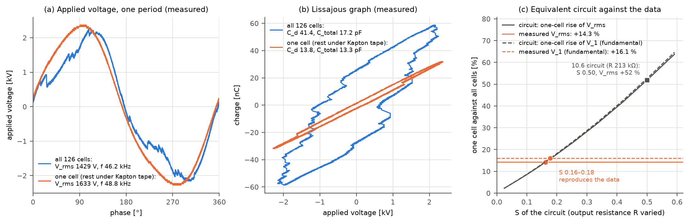

# 논문 외 추가 실험: 방전 셀 수를 줄인 측정 (4번 소스)

[English](cell-count-check.md) | **한국어**

> **학위논문에서 다루지 않은 추가 실험입니다.** 논문 실험 직후인 2020-08-08에, 같은 구조의 별도 소스(4번 소스)에서 방전하는 셀을 일부러 하나로 줄여 측정했습니다. 이 문서는 그 데이터로 [원본 데이터 검증](raw-data-verification.ko.md) 10.5절의 부하 경로(식 4–5)와 10.6절 등가회로를 점검합니다. 논문의 결론은 바꾸지 않습니다. 다만 10.5–10.6절이 쓰는 S = 0.52는 이 실험으로 확인되지 않았습니다(3–4절).

## 요약

> - **방향은 확인됩니다.** Kapton 테이프로 셀 하나만 남기자 방전이 거의 멈췄습니다. 주기당 에너지가 93 % 줄었고, 리사주 그래프의 방전 구간 기울기가 비방전 구간 기울기와 같아졌습니다. 이때 V_rms는 +14.3 %, 인가전압의 기본파 진폭 V_1은 +16.1 %, 구동 주파수는 +5.4 % 올랐습니다. 부하를 일부러 바꾼 실험이라 시간 추세나 공통 외부 요인과 섞이지 않습니다. "부하가 작아지면 구동전원 전압이 오른다"(10.5절 3단계)를 조작 실험으로 처음 확인한 것입니다.
> - **크기는 10.6절 회로 예측의 약 1/3입니다.** 10.6절 회로(R 213 kΩ, S 0.50)는 같은 조작에 V_rms +52 %를 예측합니다. 남은 방전, 커패시턴스, 주파수를 측정에서 가능한 범위로 바꿔도 +45–64 %입니다. 측정을 재현하는 출력 저항은 54–60 kΩ이고, 그 회로의 S는 0.16–0.18입니다.
> - **의미.** 10.5절의 S = 0.52는 M3의 측정 시점 간 변화에서 얻은 값이고, 이 실험은 그 값을 확인하지 못했습니다. 가능한 해석은 두 가지입니다. (가) 구동전원이 이렇게 큰 부하 변화에서는 선형이 아니거나, 4번 소스의 구동전원이 M1–M3의 것과 다릅니다. (나) M3에서 얻은 S에 공통 외부 요인이 섞여 실제보다 크게 나왔습니다. 이 실험 하나로는 둘을 가를 수 없습니다. (나)라면 부하 경로가 설명하는 M1·M2의 V_rms 감소는 −0.8 ~ −1.2 %로, 관측값(−2.3 ~ −2.9 %)의 35–41 %입니다.



*(a) 인가전압 한 주기 (b) 리사주 그래프 (c) 등가회로의 S에 따른 셀 하나 조건의 V_rms·V_1 상승과 측정값. (a)와 (b)는 조건마다 V_rms가 중앙값에 가장 가까운 캡처입니다.*

## 1. 실험과 데이터

- **소스.** 논문 아카이브의 `전류전압 측정/4번소스`입니다. 원본 데이터 검증 1절의 표에 "별도 소스"로 적힌 폴더입니다. 구조는 논문 소스와 같고(126셀) 자체 구동전원으로 운전했습니다. 이 소스의 방전 이력과 손상 여부는 기록에 없습니다.
- **조작.** 같은 날 두 조건을 측정했습니다. 먼저 전체 셀이 방전하는 상태를 쟀습니다. 그다음 표면을 Kapton 테이프로 덮고 셀 하나만 드러낸 상태를 쟀습니다. 덮인 셀도 전극과 유전체는 그대로이므로, 방전만 멈추고 커패시턴스는 남는다고 봅니다. 측정한 C_total의 변화(−24 %)는 3절에서 따로 다룹니다.
- **사진과 2020년 기록.** 같은 날의 사진과 요약 파일은 `[실험데이터]DBD plasma/μ-DBD (small) Aging 데이터 모음/20200808 셀하나만 방전`에 있습니다.
  - 14:22 사진에서는 여섯 줄의 셀이 모두 방전합니다. 폴더 이름은 "120개"지만 2020년 요약 파일은 이 조건을 "cell 126개"로 적었습니다.
  - 15:23–15:29 사진에서는 소스 전체가 Kapton 테이프로 덮여 있고 빛나는 점이 하나입니다.
  - 2020년 요약 파일의 V_rms(126개 1422.6 V, "셀 2개" 1634.7 V)는 아래 재계산과 0.5 % 안에서 같습니다. 폴더 이름은 셀 하나, 요약 파일은 셀 둘이라고 적었지만 회로 예측은 둘 다 같습니다(3절).
- **비교 기준.** 2020-08-13에 같은 소스를 집게를 전극에 직접 물려 다시 측정했습니다(폴더 이름 "오리주둥이 클립으로 전극접촉후 방전"). 이 측정은 4번 소스가 M1–M3와 같은 상태의 소스인지 확인하는 데만 씁니다.

| 조건 | 일시 | 쓴 캡처 | 전류 축 |
|---|---|---|---|
| 전체 셀 방전 | 2020-08-08 13:20–13:25 | 20 | 200 mA/div |
| 셀 하나 (나머지는 Kapton 테이프 아래) | 2020-08-08 14:33–14:36 | 20 | 40 mA/div |
| 집게를 전극에 직접 물림 | 2020-08-13 09:50–09:52 | 10 | 40 mA/div |

- **고른 캡처.** 10 ns 간격 캡처만 썼습니다. 오실로스코프 설정이 특성값을 바꾸기 때문입니다(원본 데이터 검증 5절). 20 ns 캡처(10, 9, 10개)와 개요 캡처 1개는 뺐습니다. 셀 하나 조건에서는 주기 검출이 실패한 캡처 1개(ALL0021, 97.6 kHz)와 2채널이 아닌 파일 1개(ALL0031)도 뺐습니다.

## 2. 측정 결과

조건별 중앙값입니다. 마지막 열은 10.6절 회로를 맞춘 M1–M3의 건강한 캡처(5–10 h) 중앙값입니다.

| 특성 | 전체 셀 | 셀 하나 | 변화 | 08-13 (집게 직접) | M1–M3 건강 (10.6절) |
|---|---|---|---|---|---|
| V_rms | 1428.8 V | 1632.9 V | **+14.3 %** | 1503.8 V | 1494 V |
| V_1 (기본파 진폭) | 1985.0 V | 2304.1 V | **+16.1 %** | 2099.0 V | – |
| V_max | 2210 V | 2320 V | +5.0 % | 2275 V | 2280 V |
| 구동 주파수 f | 46.28 kHz | 48.76 kHz | **+5.4 %** | 46.50 kHz | – |
| 주기당 에너지 | 165.6 µJ | 11.8 µJ | −92.9 % | 134.7 µJ | 126 µJ |
| 비방전 구간 기울기 C_total | 17.3 pF | 13.2 pF | −24.0 % | 11.9 pF | 12.15 pF |
| 방전 구간 기울기 C_d | 42.3 pF | 14.3 pF | −66.2 % | 34.1 pF | 32.4 pF |
| 전압당 방전 전하량 ΔQ/V_max | 27.9 pF | (8.7 pF)† | | 27.4 pF | 25.3 pF |
| V_on/V_max | 0.365 | (0.383)† | | 0.176 | 0.199 |
| 방전 유지 전압 U_b | 900 V | (117 V)† | | 881 V | 855 V |
| I_rms | 34.9 mA | 8.1 mA‡ | | 12.3 mA‡ | – |

† 셀 하나 조건의 리사주 그래프는 거의 직선이라, 두 구간 직선 맞춤으로 얻은 이 값들은 의미가 없습니다.
‡ 전류 축이 달라 전체 셀 조건과 비교하지 않습니다(원본 데이터 검증 5절).

- **방전이 거의 멈췄습니다.** 주기당 에너지가 93 % 줄었고, 방전 구간 기울기 C_d(14.3 pF)가 비방전 구간 기울기 C_total(13.2 pF)과 같아졌습니다. 리사주 그래프가 평행사변형에서 선 하나로 바뀝니다(그림 b). 남은 에너지 7 %는 셀 9개 분량입니다.
- **구동전원 전압이 올랐습니다.** V_rms +14.3 %, V_1 +16.1 %입니다. V_max는 +5.0 %만 올랐습니다. 전체 셀이 방전할 때는 방전이 인가전압을 일그러뜨려 꼭짓점이 기본파보다 높기 때문입니다(그림 a). V_rms/V_max는 0.647에서 사인파 값(0.707)에 가까운 0.704로 바뀝니다. 그래서 진폭은 V_1로 비교합니다.
- **구동 주파수가 올랐습니다(+5.4 %).** 10.5절에서 손상 소스는 부하가 커지면서 주파수가 0.6 % 내려갔습니다. 방향이 같습니다.
- **잡음보다 훨씬 큽니다.** 조건 안 V_rms의 표준편차는 1.0 %(전체 셀)와 0.15 %(셀 하나)입니다.
- **4번 소스는 M1–M3와 같은 상태의 소스입니다.** 08-13 측정의 V_rms, C_total, C_d, ΔQ/V_max, U_b, 에너지는 M1–M3의 건강한 값과 8 % 안에서 같습니다(V_on/V_max는 12 % 낮음). 그래서 10.6절 회로를 이 소스에 쓸 수 있습니다.
  - 08-08 전체 셀 조건은 C_total(17.3 pF)과 V_on/V_max(0.365)가 더 큽니다.
  - 08-08 사진에서는 전극 단자에 구리 테이프를 붙이고 그 위에 집게를 물렸고, 08-13은 폴더 이름으로 보아 집게를 전극에 직접 물렸습니다. 연결 방식의 차이로 보이지만 원인은 기록에 없습니다.
  - 08-08의 두 조건은 같은 연결로 측정했습니다.

## 3. 10.6절 등가회로의 예측

**방법.**
- 10.6절에서 M1–M3의 건강한 데이터에 맞춘 회로를 그대로 씁니다: C_d 34.9 pF, C_g 16.7 pF, U_b 898 V, 퍼짐 0.153, 출력 저항 R 212.6 kΩ.
- 무부하 출력전압 E는 전체 셀 조건의 V_max(2210 V, 46.28 kHz)에 맞췄습니다(E 4083 V).
- 셀 하나 조건은 125개 셀의 방전을 멈추고 커패시턴스는 그대로 둔 회로입니다. 잡음 없는 파형으로 계산했습니다(10.6절, ATI 부록과 같음).

| 회로의 경우 | V_rms | V_1 | V_max |
|---|---|---|---|
| 셀 하나 | +51.8 % | +52.6 % | +50.7 % |
| 셀 둘 | +51.0 % | +51.7 % | +50.0 % |
| 셀 9개 (측정처럼 에너지 7 %가 남음) | +45.2 % | +45.9 % | +45.0 % |
| 셀 하나, 커패시턴스 ×0.76 (C_total 셀 하나 / 전체 셀) | +63.8 % | +64.6 % | +62.6 % |
| 셀 하나, 커패시턴스 ×1.08 (C_total 셀 하나 / M1–M3) | +47.6 % | +48.4 % | +46.6 % |
| 셀 하나, 측정한 셀 하나 조건의 주파수(48.76 kHz) | +49.1 % | +49.9 % | +48.1 % |
| **측정** | **+14.3 %** | **+16.1 %** | +5.0 % |

- **회로는 측정의 3.3–3.6배를 예측합니다.** 남은 방전, 커패시턴스, 주파수를 측정에서 가능한 범위로 바꿔도 V_rms 상승은 +45–64 %입니다.
- **V_max는 비교하지 않습니다.** 10.6절 회로는 방전이 인가전압을 일그러뜨리는 효과를 일부만 재현합니다(10.6절 1). 측정에서는 일그러짐이 사라지면서 꼭짓점이 덜 올랐습니다.

## 4. 측정을 재현하는 구동전원

출력 저항 R만 바꾸고(E는 매번 전체 셀 조건의 V_max에 다시 맞춤), 셀 하나 조건의 상승과 그 회로의 S를 계산했습니다. S는 10.6절과 같이 부하를 3 % 늘렸을 때의 응답입니다.

| 구동전원 | R | S | 셀 하나: V_rms | 셀 하나: V_1 |
|---|---|---|---|---|
| 10.6절 회로 | 212.6 kΩ | 0.50 | +51.8 % | +52.6 % |
| V_rms 상승을 재현 | 54.2 kΩ | 0.16 | +14.1 % | +14.4 % |
| V_1 상승을 재현 | 59.6 kΩ | 0.18 | +15.6 % | +15.9 % |
| 측정 | | | +14.3 % | +16.1 % |

- 10.6절 회로의 S가 여기서 0.52가 아니라 0.50인 것은 E를 4번 소스의 V_max에 다시 맞췄기 때문입니다.
- 측정을 재현하는 회로의 S는 0.16–0.18로, M3에서 얻은 0.52의 약 1/3입니다.

**무엇을 뜻하는가.**
- **(가) 구동전원이 큰 변화에서 선형이 아니거나, 4번 소스의 구동전원이 다릅니다.** 10.6절 회로는 구동전원을 주파수가 고정된 저항 하나로 단순화했습니다. 측정에서는 주파수가 5.4 % 움직였으니 실제 구동전원은 그보다 복잡합니다. 그렇다면 10.6절 회로는 운전점 근처의 작은 변화(손상의 수 %)만 설명하고, 큰 변화에는 쓸 수 없습니다. 이 경우 10.5–10.6절의 결론은 그대로입니다.
- **(나) M3의 S가 공통 외부 요인 때문에 크게 나왔습니다.** 10.5절 4단계의 S는 M3의 측정 시점 간 변화로 얻었습니다. 구동전원 쪽 변화가 함께 섞이면 이 추정은 실제 S보다 커질 수 있습니다. S가 0.16–0.18이라면 부하 경로가 설명하는 V_rms 감소는 M1 −1.1 ~ −1.2 %, M2 −0.8 ~ −0.9 %입니다(10.5절 5단계의 ΔQ/V_max +6.6 %, +5.1 %). 이는 관측값(−2.9 %, −2.3 %)의 35–41 %이고, 나머지는 부하 경로로 설명되지 않습니다.
- **가르는 방법.** 같은 소스와 구동전원에서 셀의 5–10 %만 덮었다 떼기를 번갈아 반복해 재면, 작은 변화의 S를 직접 얻을 수 있습니다. 아카이브에는 이런 측정이 없습니다.

## 5. 한계

- **한 번의 비교입니다.** 두 조건을 같은 날 70분 간격으로 한 번씩만 쟀습니다. 순서를 바꾼 반복이 없어 그 사이의 구동전원 변화를 배제할 수 없습니다. 다만 주파수 상승, 파형 모양의 변화(V_rms/V_max), 방전 구간 기울기의 소멸은 모두 부하 변화의 흔적입니다.
- **구동전원 입력 설정은 기록에 없습니다.** 두 조건 사이에 바뀌지 않았다고 가정했습니다.
- **4번 소스의 구동전원은 M1–M3의 것과 다른 장치입니다**(10.5절 A4: 소스마다 자체 구동전원). 같은 종류로 보이지만 출력 임피던스가 같다는 근거는 없습니다.
- **08-08 전체 셀 조건의 C_total(17.3 pF)은 08-13과 M1–M3보다 큽니다.** 회로에서 커패시턴스를 ×0.76–×1.08로 바꿔 보았고 결론은 같습니다.
- **S를 측정의 ΔQ 비로 직접 계산하지 않았습니다.** 셀 하나 조건의 ΔQ/V_max는 의미가 없기 때문입니다(2절 †). 대신 회로에서 조작을 그대로 재현해 V_rms와 V_1을 비교했습니다.
- **회로 계산은 잡음 없는 파형입니다.** 10.6절, ATI 부록과 같습니다.

## 재현

원본 데이터는 이 저장소에 없습니다. 아카이브가 있으면 다음 명령으로 이 문서의 표와 그림이 다시 만들어집니다(약 1분).

```bash
python examples/cell_count_check.py "<아카이브>/전류전압 측정/4번소스" docs/img
```
