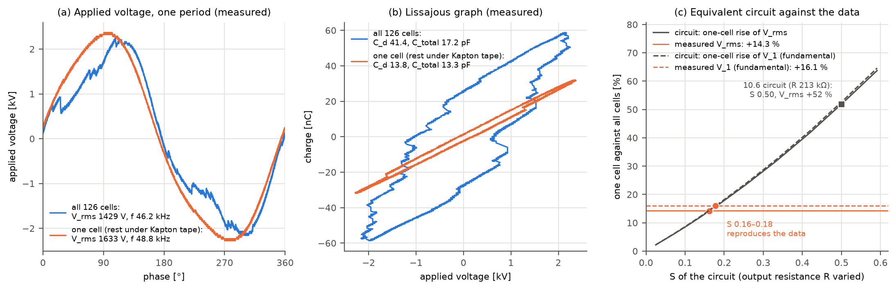

# Addendum, not part of the thesis: fewer discharging cells (source 4)

**English** | [한국어](cell-count-check.ko.md)

> **An experiment the thesis did not cover.** On 2020-08-08, right after the thesis experiment, the number of discharging cells was deliberately cut to one on a separate source of the same structure (source 4). This document uses those data to check the load path (eqs. 4–5) of section 10.5 and the equivalent circuit of section 10.6 of the [raw-data verification](raw-data-verification.md). It does not change the thesis conclusions. It does not, however, confirm the S = 0.52 that sections 10.5–10.6 use (sections 3–4).

## Summary

> - **The direction is confirmed.** With Kapton tape leaving one cell uncovered, the discharge almost stopped. The energy per cycle fell by 93 %, and the discharge-phase slope of the Lissajous graph became equal to the non-discharge slope. V_rms rose by 14.3 %, the fundamental amplitude V_1 of the applied voltage by 16.1 % and the drive frequency by 5.4 %. The load was changed on purpose, so the result is free of time trends and shared external effects. It is the first confirmation by intervention of step 3 of section 10.5: a smaller load raises the voltage of the driving power supply.
> - **The size is about a third of what the 10.6 circuit predicts.** The 10.6 circuit (R 213 kΩ, S 0.50) predicts V_rms +52 % for the same change. Varying the remaining discharge, the capacitance and the frequency within what the data allow gives +45 to +64 %. The output resistance that reproduces the data is 54–60 kΩ, and that circuit has S 0.16–0.18.
> - **Meaning.** The S = 0.52 of section 10.5 comes from the variation of M3 between time points, and this experiment does not confirm it. Two readings remain. (a) The driving power supply is not linear over so large a load change, or source 4's supply differs from those of M1–M3. (b) The S from M3 is inflated by shared external effects. This one experiment cannot tell them apart. Under (b), the load path accounts for −0.8 to −1.2 % of the V_rms drop of M1 and M2, 35–41 % of the observed −2.3 to −2.9 %.



*(a) Applied voltage over one period (b) Lissajous graph (c) Rise of V_rms and V_1 for one cell against the S of the equivalent circuit, and the measured rise. (a) and (b) show, for each condition, the capture whose V_rms is nearest the median.*

## 1. Experiment and data

- **Source.** `전류전압 측정/4번소스` in the thesis archive, listed as "a separate device" in the table of section 1 of the raw-data verification. It has the structure of the thesis sources (126 cells) and its own driving power supply. Its discharge history and damage state are not recorded.
- **Intervention.** Two conditions were measured on the same day. First the source with all cells discharging. Then the surface was covered with Kapton tape, leaving one cell uncovered. The covered cells keep their electrodes and dielectric, so their discharge stops while their capacitance is assumed to remain. The measured change of C_total (−24 %) is treated separately in section 3.
- **Photographs and the 2020 records.** The photographs and the summary workbook of that day are in `[실험데이터]DBD plasma/μ-DBD (small) Aging 데이터 모음/20200808 셀하나만 방전`.
  - The 14:22 photograph shows all six rows of cells discharging. The folder name says "120 cells", but the 2020 workbook calls this condition "cell 126개".
  - The 15:23–15:29 photographs show the whole source under Kapton tape with one bright spot.
  - The 2020 workbook's V_rms (126 cells 1422.6 V, "2 cells" 1634.7 V) agrees with the recomputation below within 0.5 %. The folder name says one cell and the workbook two; the circuit gives the same for both (section 3).
- **Reference.** On 2020-08-13 the same source was measured again with the clip directly on the electrode (folder name "오리주둥이 클립으로 전극접촉후 방전"). This measurement is used only to check that source 4 is in the same state as M1–M3.

| Condition | Date and time | Captures used | Current scale |
|---|---|---|---|
| All cells discharging | 2020-08-08 13:20–13:25 | 20 | 200 mA/div |
| One cell (the rest under Kapton tape) | 2020-08-08 14:33–14:36 | 20 | 40 mA/div |
| Clip directly on the electrode | 2020-08-13 09:50–09:52 | 10 | 40 mA/div |

- **Captures used.** Only the 10 ns captures, because the oscilloscope settings change the feature values (raw-data verification, section 5). The 20 ns captures (10, 9 and 10) and one overview capture were left out. In the one-cell condition, one capture whose period detection failed (ALL0021, 97.6 kHz) and one file that is not a two-channel capture (ALL0031) were also left out.

## 2. Measured results

Medians per condition. The last column is the median of the healthy M1–M3 captures (5–10 h) that the 10.6 circuit was fitted to.

| Feature | All cells | One cell | Change | 08-13 (clip on electrode) | M1–M3 healthy (10.6) |
|---|---|---|---|---|---|
| V_rms | 1428.8 V | 1632.9 V | **+14.3 %** | 1503.8 V | 1494 V |
| V_1 (fundamental amplitude) | 1985.0 V | 2304.1 V | **+16.1 %** | 2099.0 V | – |
| V_max | 2210 V | 2320 V | +5.0 % | 2275 V | 2280 V |
| Drive frequency f | 46.28 kHz | 48.76 kHz | **+5.4 %** | 46.50 kHz | – |
| Energy per cycle | 165.6 µJ | 11.8 µJ | −92.9 % | 134.7 µJ | 126 µJ |
| Non-discharge slope C_total | 17.3 pF | 13.2 pF | −24.0 % | 11.9 pF | 12.15 pF |
| Discharge-phase slope C_d | 42.3 pF | 14.3 pF | −66.2 % | 34.1 pF | 32.4 pF |
| Discharge charge per volt ΔQ/V_max | 27.9 pF | (8.7 pF)† | | 27.4 pF | 25.3 pF |
| V_on/V_max | 0.365 | (0.383)† | | 0.176 | 0.199 |
| Burning voltage U_b | 900 V | (117 V)† | | 881 V | 855 V |
| I_rms | 34.9 mA | 8.1 mA‡ | | 12.3 mA‡ | – |

† With one cell the Lissajous graph is almost a straight line, so these values from a two-segment line fit have no meaning.
‡ Not compared with the all-cells condition because the current scale differs (raw-data verification, section 5).

- **The discharge almost stopped.** The energy per cycle fell by 93 %, and the discharge-phase slope C_d (14.3 pF) became equal to the non-discharge slope C_total (13.2 pF). The Lissajous graph changes from a parallelogram to a single line (Fig. b). The remaining 7 % of the energy corresponds to 9 cells.
- **The voltage of the driving power supply rose.** V_rms rose by 14.3 % and V_1 by 16.1 %. V_max rose by only 5.0 %: with all cells discharging, the discharges distort the applied voltage and its peak lies above the fundamental (Fig. a). V_rms/V_max goes from 0.647 to 0.704, close to the sine value 0.707. The amplitude is therefore compared through V_1.
- **The drive frequency rose (+5.4 %).** In section 10.5 the damaged sources, with a heavier load, ran 0.6 % lower in frequency. The direction is the same.
- **The change is far above the noise.** The SD of V_rms within a condition is 1.0 % (all cells) and 0.15 % (one cell).
- **Source 4 is in the same state as M1–M3.** On 08-13 its V_rms, C_total, C_d, ΔQ/V_max, U_b and energy are within 8 % of the healthy M1–M3 values (V_on/V_max 12 % lower). The 10.6 circuit can therefore be applied to it.
  - On 08-08 the all-cells condition has a larger C_total (17.3 pF) and V_on/V_max (0.365).
  - The 08-08 photographs show copper tape on the electrode terminals with the clips on it; on 08-13, by the folder name, the clip was put directly on the electrode. The connection probably made the difference, but the cause is not recorded.
  - Both conditions of 08-08 used the same connection.

## 3. What the 10.6 equivalent circuit predicts

**Method.**
- The circuit fitted in 10.6 to the healthy M1–M3 data is used unchanged: C_d 34.9 pF, C_g 16.7 pF, U_b 898 V, spread 0.153, output resistance R 212.6 kΩ.
- The open-circuit voltage E is set to the V_max of the all-cells condition (2210 V at 46.28 kHz), giving E 4083 V.
- The one-cell condition is the circuit with the discharge of 125 cells stopped and their capacitance kept. Waveforms are noise-free (as in 10.6 and the ATI addendum).

| Circuit case | V_rms | V_1 | V_max |
|---|---|---|---|
| One cell | +51.8 % | +52.6 % | +50.7 % |
| Two cells | +51.0 % | +51.7 % | +50.0 % |
| Nine cells (7 % of the energy remains, as measured) | +45.2 % | +45.9 % | +45.0 % |
| One cell, capacitance ×0.76 (C_total one cell / all cells) | +63.8 % | +64.6 % | +62.6 % |
| One cell, capacitance ×1.08 (C_total one cell / M1–M3) | +47.6 % | +48.4 % | +46.6 % |
| One cell, at the measured one-cell frequency (48.76 kHz) | +49.1 % | +49.9 % | +48.1 % |
| **Measured** | **+14.3 %** | **+16.1 %** | +5.0 % |

- **The circuit predicts 3.3–3.6 times the measured rise.** Varying the remaining discharge, the capacitance and the frequency within what the data allow still gives a V_rms rise of +45 to +64 %.
- **V_max is not compared.** The 10.6 circuit reproduces only part of the distortion of the applied voltage by the discharges (10.6, item 1). In the data the peak rose less because the distortion disappeared.

## 4. A driving power supply that reproduces the data

Only the output resistance R was varied (E reset each time to the V_max of the all-cells condition), and the one-cell rise and the circuit's S were computed. S is the response to a 3 % heavier load, as in 10.6.

| Driving power supply | R | S | One cell: V_rms | One cell: V_1 |
|---|---|---|---|---|
| 10.6 circuit | 212.6 kΩ | 0.50 | +51.8 % | +52.6 % |
| Reproduces the V_rms rise | 54.2 kΩ | 0.16 | +14.1 % | +14.4 % |
| Reproduces the V_1 rise | 59.6 kΩ | 0.18 | +15.6 % | +15.9 % |
| Measured | | | +14.3 % | +16.1 % |

- The 10.6 circuit has S 0.50 here rather than 0.52 because E was reset to the V_max of source 4.
- The circuit that reproduces the data has S 0.16–0.18, about a third of the 0.52 from M3.

**What it means.**
- **(a) The driving power supply is not linear over large changes, or source 4's supply differs.** The 10.6 circuit reduces the driving power supply to one resistance at a fixed frequency. In the data the frequency moved by 5.4 %, so the real supply is more complex than that. The 10.6 circuit would then describe only small changes near the operating point (the few % of damage) and could not be used for large ones. In this case the conclusions of 10.5–10.6 stand.
- **(b) The S from M3 is inflated by shared external effects.** The S of step 4 of 10.5 was obtained from M3's variation between time points. If changes on the power-supply side are mixed in, that estimate can come out larger than the true S. With S 0.16–0.18, the load path accounts for a V_rms drop of −1.1 to −1.2 % in M1 and −0.8 to −0.9 % in M2 (ΔQ/V_max +6.6 % and +5.1 %, step 5 of 10.5). That is 35–41 % of the observed −2.9 % and −2.3 %; the rest is not explained by the load path.
- **How to tell them apart.** Covering and uncovering only 5–10 % of the cells on the same source and supply, alternately and repeatedly, would give the S of small changes directly. The archive has no such measurement.

## 5. Limitations

- **One comparison.** The two conditions were measured once each, 70 minutes apart on the same day. Without a repeat in reverse order, a change of the driving power supply in between cannot be ruled out. The rise of the frequency, the change of the waveform shape (V_rms/V_max) and the disappearance of the discharge-phase slope are all signs of the load change, however.
- **The input setting of the driving power supply is not recorded.** It is assumed unchanged between the two conditions.
- **Source 4's driving power supply is a different unit from those of M1–M3** (10.5, A4: each source has its own driving power supply). It appears to be the same type, but there is no evidence that its output impedance is the same.
- **The C_total of the all-cells condition on 08-08 (17.3 pF) is larger than on 08-13 and in M1–M3.** The circuit was run with the capacitance ×0.76 to ×1.08, and the conclusion is the same.
- **S is not computed directly from the measured ΔQ ratio**, because the one-cell ΔQ/V_max has no meaning (section 2, †). Instead the intervention was reproduced on the circuit and V_rms and V_1 were compared.
- **The circuit uses noise-free waveforms**, as in 10.6 and the ATI addendum.

## Reproduction

The raw data are not in this repository. With the archive, this command recreates the tables and the figure of this document (about 1 minute).

```bash
python examples/cell_count_check.py "<archive>/전류전압 측정/4번소스" docs/img
```
