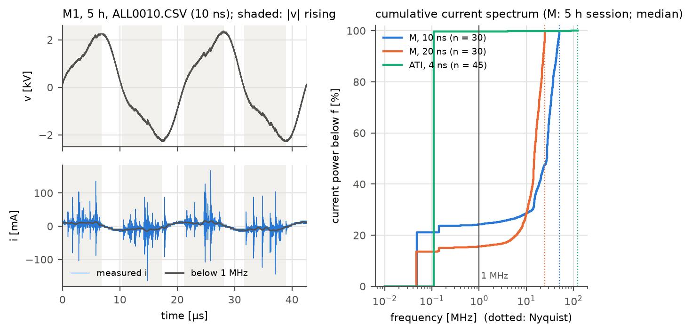

# DBD 플라즈마의 물리: 방전 조건에서 진단 가설까지

**한국어**

이 문서는 유전체 장벽 방전(DBD)을 처음부터 단계별로 설명합니다. 각 단계는 같은 순서로 정리했습니다.

1. **원리**: 무슨 일이 일어나는가
2. **식**: 그것을 어떻게 쓰는가
3. **가정**: 식이 맞으려면 무엇이 성립해야 하는가
4. **계산**: 이 장치의 실제 값으로 숫자를 넣으면
5. **데이터 확인**: 측정값과 맞는가

문서의 숫자는 다음 명령으로 다시 계산됩니다. 원본 데이터는 필요 없습니다.

```bash
python examples/physics_worked_numbers.py
```

3단계의 스펙트럼 숫자(계산 3)만 원시 파형이 필요합니다. 두 번째 경로는 ATI 비교용이며 생략할 수 있습니다.

```bash
python examples/current_spectrum_check.py "<archive>/전류전압 측정" "<노화 아카이브>/μ-DBD (large) Aging 데이터 모음" docs/img
```

수식의 구현과 논문 식 번호의 대응은 [methods.ko.md](methods.ko.md)에 있습니다. 이 문서는 그 식들이 **왜** 그런 모양인지와 **어떤 가정** 위에 서 있는지를 다룹니다.

## 0. 계산에 쓰는 값

| 구분 | 값 | 출처 |
|---|---|---|
| 논문 장치 M1 (공기, 1 atm) | f = 47.08 kHz, V_rms = 1482 V, V_max = 2250 V, I_rms = 19.7 mA | 세션 중앙값 |
| | C_cell = 11.16 pF, C_d(≈ ζ) = 32.39 pF, U_b = 842 V | 리사주 적합 중앙값 |
| | 1주기 에너지 E = 114.1 µJ, 전력 P = 5.41 W | 파형 적분 |
| 셀 구조 | 150 µm × 300 µm 패드 126쌍, 간격 100 µm, Ag 전극, 유전체 약 40 µm | [methods.ko.md](methods.ko.md) 0절 |
| 노화 시험 장치 ATI #2 (질소) | f = 108.17 kHz, V_rms = 1483 V, I_rms = 53.1 mA, C_cell = 49.0 pF | 2020-01-13 세션 |

ATI 값은 대조군 없는 별도 시험의 데이터입니다([ati-aging-test.ko.md](ati-aging-test.ko.md)). 논문 분석에는 섞지 않았고, 여기서는 전원의 성질을 보여 주는 예로만 씁니다.

## 1단계. 플라즈마가 생기는 조건: 전자가 이온화 에너지를 얻어야 한다

**원리**

- 기체는 원래 절연체입니다. 우주선과 자연 방사능이 만드는 씨앗 전자(seed electron)가 조금 있을 뿐입니다.
- 이 전자가 전기장에서 가속되어 분자와 충돌할 때 이온화 에너지보다 큰 에너지를 갖고 있으면, 새 전자-이온 쌍이 생깁니다. 이온화 에너지는 N₂가 15.6 eV, O₂가 12.1 eV입니다.
- 새 전자도 같은 일을 반복하므로 전자 수가 기하급수로 늘어납니다. 이것이 전자 사태(avalanche)입니다.

**식**

$$N=\frac{p}{k_BT},\qquad \lambda=\frac{1}{N\sigma},\qquad \varepsilon_{\text{1 flight}}=eE\lambda,\qquad \frac{\Delta\varepsilon}{\varepsilon}\Big|_{\text{elastic}}\approx\frac{2m_e}{M}$$

- N은 기체 수밀도, λ는 평균자유행로, σ는 충돌 단면적입니다.

**계산** (1 atm, 293 K)

| 양 | 값 |
|---|---|
| N | 2.50×10¹⁹ cm⁻³ |
| σ = 10⁻¹⁵ cm²일 때 λ | 0.40 µm. 한 번의 비행으로 15.6 eV를 얻으려면 E = 391 kV/cm |
| σ = 10⁻¹⁶ cm²일 때 λ | 4.0 µm. 필요한 E = 39 kV/cm |
| 탄성 충돌 한 번에 잃는 에너지 비율 (N₂) | 3.9×10⁻⁵ |

**해석**

- cm 크기 갭에서 공기의 실제 절연파괴 전계는 약 30 kV/cm입니다. 한 번의 비행만 고려한 추정값(최대 391 kV/cm)보다 훨씬 낮습니다.
- 그 이유는 두 가지입니다.
  - 탄성 충돌로는 에너지를 거의 잃지 않으므로(3.9×10⁻⁵), 전자는 여러 번 충돌하는 동안 에너지를 누적합니다.
  - 이온화는 평균 전자가 아니라 에너지 분포의 꼬리에 있는 전자가 일으킵니다.
- 그래서 충돌 하나하나 대신 평균량을 씁니다. 그것이 "전자가 단위 길이를 갈 때 일으키는 이온화 횟수"인 Townsend 계수 α입니다. α를 결정하는 변수는 전계 E 자체가 아니라 환산 전계 **E/N**(또는 E/p)입니다.

**가정**: 이상기체이고 온도가 균일하다고 봅니다. σ는 전자 에너지에 따라 크게 변하므로, 위 숫자는 자릿수를 보는 용도입니다.

## 2단계. 방전 개시 조건: Townsend 사태와 Paschen 법칙

**원리**

- 전자 하나가 음극에서 출발해 갭 d를 건너면 $e^{\alpha d}$개가 됩니다.
- 이때 생긴 양이온이 음극을 때리면, 이온 하나당 γ개의 2차 전자가 나옵니다.
- 2차 전자가 원래의 씨앗 전자를 대체할 만큼 생기면, 외부 씨앗 없이도 방전이 스스로 유지됩니다. 이것이 자속 방전(self-sustaining) 조건입니다.

**식**

$$\alpha=Ap\,e^{-Bp/E},\qquad \gamma\left(e^{\alpha d}-1\right)=1\;\Rightarrow\;\alpha d=\ln\!\left(1+\frac1\gamma\right)$$

이를 $V=Ed$에 대해 풀면 Paschen 식이 나옵니다.

$$V_b=\frac{B\,pd}{\ln(A\,pd)-\ln\ln(1+1/\gamma)}$$

- 공기 상수는 A = 15 cm⁻¹Torr⁻¹, B = 365 V cm⁻¹Torr⁻¹입니다(Raizer). E/p ≈ 100–800 V cm⁻¹Torr⁻¹ 범위에서 맞춘 값입니다.
- pd가 큰 갭에서는 사태 하나의 공간전하가 외부 전계만큼 커져 스트리머가 됩니다. 그 기준이 Meek 조건 $\alpha d\approx18$–20입니다.

**계산** (p = 760 Torr)

| 갭 d | V_b (γ = 0.01) | V_b (γ = 0.1) |
|---|---|---|
| 50 µm | 552 V | 438 V |
| 100 µm | 865 V | 718 V |
| 150 µm | 1152 V | 975 V |
| 200 µm | 1423 V | 1218 V |

- 자속 조건의 문턱은 γ = 0.01이면 αd = 4.62, γ = 0.1이면 2.40입니다.
- d = 100 µm에서 두 기준을 비교하면 다음과 같습니다.
  - Townsend(γ = 0.01): α = 462 cm⁻¹, E = 86.5 kV/cm, V = 865 V. E/p = 114 V cm⁻¹Torr⁻¹로 상수의 유효 범위 안입니다.
  - Meek(αd = 18–20): V = 1503–1594 V
- Townsend 조건이 더 낮은 전압에서 먼저 충족됩니다. 따라서 이 마이크로 갭(pd ≈ 7.6 Torr·cm)의 방전 개시는 Townsend 기구가 지배합니다.
- Paschen 최솟값은 pd = 0.84 Torr·cm에서 305 V입니다. 1 atm에서는 d ≈ 11 µm에 해당합니다.

**데이터 확인**

- M1의 리사주에서 구한 burning voltage는 U_b = 842 V입니다.
- Paschen 곡선에서 V_b = 842 V가 되는 갭은 γ = 0.01이면 96 µm, γ = 0.1이면 124 µm입니다.
- 이 값은 설계 간격 100 µm와 같은 크기입니다. 리사주에서 구한 U_b가 물리적으로 그럴듯한 값이라는 근거가 됩니다.

**가정과 한계**

- 평행판 사이의 균일 전계와 정상 상태를 가정합니다.
- 동일평면 전극은 가장자리 전계가 불균일하고 방전 경로가 휘어 있어, 실제 경로는 100 µm보다 깁니다.
- γ는 표면 상태(오염, 침착물, 산화)에 따라 바뀝니다. **노화가 개시 전압에 영향을 주는 통로가 바로 여기**입니다.

## 3단계. 유전체 장벽의 전자기학: 직렬로 연결된 두 커패시터

**원리**

- 전극 위의 유전체와 그 위의 기체 갭은 전기적으로 직렬입니다.
- 유전체 안에는 전도전류가 흐르지 못합니다. Maxwell–Ampère 법칙

  $$\nabla\times\mathbf H=\mathbf J+\frac{\partial\mathbf D}{\partial t}$$

  에서 유전체를 지나는 전류는 변위전류 $\partial\mathbf D/\partial t$뿐입니다.
- 그래서 직류는 통과하지 못하고 시간에 따라 변하는 전압만 전류를 흘립니다. **DBD를 교류나 펄스로 구동하는 이유**입니다.

**식**

$$C_d=\frac{\varepsilon_0\varepsilon_rA}{t},\qquad \frac1{C_{cell}}=\frac1{C_d}+\frac1{C_g},\qquad C_g=\frac{C_dC_{cell}}{C_d-C_{cell}},\qquad i=\frac{dQ}{dt}=C\frac{dv}{dt}\;\xrightarrow{\text{정현파}}\;I_{rms}=\omega CV_{rms}$$

**계산 1: 커패시턴스** (M1)

- C_g = 17.0 pF
- 쌍당 값은 C_cell = 89 fF, C_d = 257 fF입니다.
- 한 쌍에서 방전은 패드 1 위의 유전체 → 표면 → 패드 2 위의 유전체를 지나므로, 패드 두 개의 유전체 커패시터가 직렬입니다.
- 유전체를 패드 면적의 평행판(두께 40 µm)으로 보면, 측정된 C_d를 설명하는 데 필요한 비유전율은 **ε_r ≈ 52**입니다. 회로모델의 C_d = 39 pF를 쓰면 62입니다.
- 일반적인 유리 프릿 유전체(ε_r = 7–10)라면 평행판 C_d는 4.4–6.3 pF로, 측정값의 1/5–1/7에 그칩니다.
- 가능한 설명은 세 가지입니다.
  1. 유전체가 고유전율 충전재를 넣은 페이스트이다.
  2. 유효 두께가 40 µm보다 얇다.
  3. 측정된 기울기에 패드 밖(버스 라인, 배선)의 용량이 섞여 있다.
- 유전체 페이스트의 ε_r을 확인하면 셋 중 무엇인지 가릴 수 있습니다. **아직 확인하지 않은 질문**입니다.

**계산 2: 변위전류**

| 장치 | ω C_cell V_rms | 측정 I_rms | 해석 |
|---|---|---|---|
| ATI #2 | 49.4 mA | 53.1 mA | 전류의 대부분이 변위전류입니다. 유효 용량 I/(ωV) = 52.7 pF가 C_cell보다 조금 큰 만큼이 방전으로 옮겨진 전하입니다 |
| M1 | 4.9 mA | 19.7 mA | 이 전류의 대부분은 변위전류가 아닙니다 |

**계산 3: 측정 전류는 무엇으로 이루어져 있는가** (원시 파형, `examples/current_spectrum_check.py`)

M1–M3의 원시 파형 스펙트럼을 보면 원인이 드러납니다. 각 세션의 캡처 20개는 샘플링 10 ns(2주기) 10개와 20 ns(4주기) 10개로 이루어져 있으므로, 둘을 나눠 봅니다.

| 5 h 세션, 중앙값 | M1 | M2 | M3 | ATI #2 / #3 (비교) |
|---|---|---|---|---|
| 1 MHz 이상 전류 파워, 10 ns 캡처 | 77.5 % | 75.1 % | 75.7 % | 0.2–0.4 % |
| 같은 값, 20 ns 캡처 | 81.3 % | 84.9 % | 85.6 % | |
| 같은 값, 20개 전체(처음 인용한 "약 80 %") | 80.4 % | 82.4 % | 81.9 % | |
| 전압 THD(2–40차 고조파) | 16.9 % | 16.4 % | 17.4 % | 3.1–5.8 % |
| 1 MHz 미만 전류 rms, 10 ns 캡처 | 9.2 mA | 8.7 mA | 9.4 mA | 47–55 mA |

ATI 열은 [노화 시험](ati-aging-test.ko.md)의 ATI #2 2020-01-13, ATI #3 03/13·11/13 세션입니다(4 ns, 10 ns 캡처).

검증한 내용은 다음과 같습니다.

1. **정의를 바꿔도 거의 같습니다.**
   - Hann 창이나 0.5 MHz 경계를 써도 1 MHz 이상 비율은 ±1.5 %p 안에서 같습니다. 5 MHz 경계에서는 2–7 %p 낮아집니다.
   - THD를 처음처럼 "1.5f 이상의 모든 파워"로 계산해도 고조파만 쓴 값과 0.3 %p 이내입니다(ATI는 1 %p 이내).
   - 전 세션으로 넓히면 THD는 18–19 %이고, 1 MHz 이상 비율은 10 ns 캡처에서 67–79 %입니다.
2. **잡음이 아닙니다.** 8비트 ADC의 양자화 잡음(전류 4 mA 계단)은 전류 파워의 0.2–0.4 %뿐입니다.
3. **방전에서 나옵니다.** 1 MHz 이상 전류 에너지의 96–97 %가 |v|가 커지는 반주기, 곧 방전이 일어나는 구간에 몰려 있습니다. 이 구간은 시간의 65–67 %입니다. 인버터 잡음처럼 방전과 무관한 성분이라면 두 비율이 비슷해야 합니다.
4. **그러나 이 샘플링으로는 분해되지 않습니다.**
   - 파워가 나이퀴스트 주파수 바로 아래에 쌓입니다. 10 ns 캡처는 25–50 MHz에 38–46 %, 20 ns 캡처는 10–25 MHz에 59–63 %가 있습니다(전 세션).
   - 이 성분의 인접 샘플 자기상관도 음수입니다(−0.07 ~ −0.27). 펄스와 링잉의 실제 주파수는 수십 MHz 이상이고, 스코프는 이를 접힌(aliased) 형태로만 기록합니다.
   - 따라서 "약 80 %"는 물리 상수가 아니라 이 측정 설정에서 나온 값입니다.
5. **I_rms가 측정 설정에 민감한 원인이 이 성분입니다.**
   - 한 세션에서 10 ns 묶음과 20 ns 묶음은 약 3분(최대 7분) 사이에 연달아 측정됐습니다.
   - I_rms는 각 묶음 안에서는 평평하다가, 20 ns로 바뀌는 시점에 약 5 mA 뜁니다. 1 MHz 미만 성분은 0.2–1.0 mA만 바뀝니다.
   - 10 ns 기록을 한 샘플씩 건너뛰어 20 ns로 만들면 I_rms가 거의 그대로입니다(M1 18.8 → 19.3 mA). 그래서 원인은 표본 수가 아니라 타임베이스에 따른 스코프의 획득 방식으로 보입니다. 이 부분은 확인하지 못했습니다.
6. **1 MHz 미만 성분은 Manley 모델과 맞습니다.** 방전 전에는 C_cell·dv/dt, 방전 중에는 C_d·dv/dt를 정현파에 적용하면(4단계의 V_on 사용) rms 10.6 mA입니다. 측정값 9.2 mA보다 15 % 큽니다.



- 따라서 논문 장치에서 I_rms는 변위전류가 아니라 주로 **분해되지 않은 방전 펄스와 링잉의 크기**를 재는 값이고, 그 크기는 오실로스코프 설정에 따라 달라집니다. I_rms가 측정 설정에 민감했던 것([raw-data-verification.ko.md](raw-data-verification.ko.md))의 원인이 이것입니다.
- 펄스를 재려면 1 ns 이하 샘플링과 고정된 설정이 필요합니다. 그 전까지 전류 지표로는 1 MHz 미만 성분(또는 리사주의 전하)이 더 안정적입니다.

**가정**: 집중 정수(C_d, C_g가 일정한 값)이고 평행판이며 유전 손실이 없다고 봅니다. C_g는 동일평면 전극의 가장자리 전계로 생기므로 평행판 식이 맞지 않습니다. 그래서 C_g는 측정값에서 역산합니다.

## 4단계. 방전 중: 갭 전압이 U_b에 묶이고 전하가 유전체 표면에 쌓인다 (Manley 모델)

**원리**

1. **방전 전**: 직렬 커패시터가 전압을 나눠 가집니다. 기체 갭에 걸리는 몫은 $u_g=v\,C_d/(C_d+C_g)$입니다.
2. **점화**: $u_g$가 U_b에 도달하면 방전이 시작됩니다.
3. **방전 중**: 기체는 도체처럼 행동해 갭 전압이 거의 ±U_b로 고정됩니다(이상화). 그러면 인가전압이 더 오르는 만큼의 전하가 유전체 표면에 쌓입니다. 이 전하를 벽전하(wall charge)라고 합니다. 이 구간의 기울기는 $dQ/dv=C_d$입니다.
4. **소멸**: 인가전압이 최댓값을 지나 dv/dt의 부호가 바뀌면 방전이 꺼집니다.
5. **메모리 효과**: 쌓인 벽전하는 다음 반주기에 갭 전압을 미리 반대 방향으로 키워 둡니다. 그래서 다음 방전은 더 낮은 인가전압에서 시작됩니다.

**식**

$$u_g=v-\frac{Q}{C_d},\qquad U_{min}=U_b\left(1+\frac{C_g}{C_d}\right),\qquad V_{on}=2U_{min}-V_{max},\qquad \Delta Q=C_d(V_{max}-V_{on})=2C_d(V_{max}-U_{min})$$

V_on의 유도는 다음과 같습니다.

- 앞 반주기가 끝날 때 갭 전압은 $u_g=-U_b$입니다.
- 방전이 없는 동안 갭 전압은 인가전압 변화 Δv의 $C_d/(C_d+C_g)$만큼만 변합니다.
- +U_b까지 2U_b를 올리려면 $\Delta v=2U_b(C_d+C_g)/C_d=2U_{min}$이 필요합니다.
- 따라서 $V_{on}=-V_{max}+2U_{min}$입니다.

**계산** (M1)

| 양 | 값 |
|---|---|
| 방전 전 갭 몫 $u_g/v$ | 0.655 |
| U_min (방전이 생기는 최소 진폭) | 1285 V. V_max = 2250 V보다 작으므로 방전이 일어납니다 |
| V_on (상승 가지에서 방전이 시작되는 인가전압) | 319 V |
| 반주기당 이동 전하 ΔQ | 62.5 nC. 쌍당 0.50 nC, 전자 3.1×10⁹개 |

## 5단계. 에너지와 전력

**식**: 한 주기에 기체가 받는 에너지는 리사주 그래프의 면적입니다.

$$E=\oint v\,dQ\;\xrightarrow{\text{평행사변형}}\;E=4C_dU_b(V_{max}-U_{min})=2U_b\,\Delta Q,\qquad P=fE$$

두 번째 표현은 "방전 중 기체에 걸린 전압 U_b × 한 주기에 옮겨진 전하 2ΔQ"라는 뜻입니다.

**계산과 데이터 확인** (M1)

| | 1주기 에너지 | 전력 |
|---|---|---|
| Manley 모델 | 105.3 µJ (2U_bΔQ도 105.3 µJ) | 4.96 W |
| 측정(파형 적분) | 114.1 µJ | 5.41 W |

- 이상 모델이 약 8 % 작게 계산합니다.
- 모델의 핵심 가정(갭 전압 고정, 모든 셀이 같은 U_b)이 대략은 맞지만 완전하지는 않다는 뜻입니다. 부분 방전(ζ < C_d)과 셀 사이의 U_b 분포가 그 차이의 후보입니다.

## 6단계. 왜 아크가 되지 않는가: 유전체가 전하를 제한한다

**원리**

- 방전 중 전류는 $i_{dis}=C_d\,dv/dt$로, 유전체 용량과 인가전압의 변화율이 정하는 상한을 넘을 수 없습니다. 전압이 최댓값에서 멈추면 방전도 멈춥니다.
- 국소적으로 보면, 마이크로방전(필라멘트) 하나가 ns 안에 자기 위치의 유전체 표면을 충전합니다. 그러면 그 자리의 전계가 사라지고 방전이 꺼집니다.
- 이 자기 제한 덕분에 기체가 뜨거워지는 열평형 아크로 넘어가지 않습니다. 대신 전자만 뜨겁고 기체는 차가운 **비열평형 플라즈마**가 유지됩니다.

**계산** (M1, 정현파 가정)

| 양 | 값 |
|---|---|
| 방전 구간 (V_on → V_max) | 4.83 µs |
| 평균 방전전류 ΔQ/t_on | 13.0 mA |
| 상한 $C_d\,\omega V_{max}\cos(\arcsin(V_{on}/V_{max}))$ | 21.3 mA |

**문헌값과 비교**: Kogelschatz(2003)의 1 mm 공기 갭 기준으로, 필라멘트 하나는 지속시간 1–10 ns, 반지름 약 0.1 mm, 전하 0.1–1 nC, 전자밀도 10¹⁴–10¹⁵ cm⁻³입니다. 쌍당 반주기 전하 0.5 nC는 필라멘트 1–5개 분량입니다.

## 7단계. 전원과 부하: 전압원인가, 전류원인가

**원리**: 전원을 개방전압 V_s와 내부 임피던스 Z_s로 이루어진 등가회로로 보고, 부하를 커패시터 C로 둡니다.

$$V=V_s\frac{Z_L}{Z_s+Z_L},\qquad Z_L=\frac1{j\omega C}$$

| 전원 | 부하 전압 | C가 커지면 |
|---|---|---|
| 이상 전압원 ($Z_s\to0$) | $V=V_s$ | 전압 그대로 |
| 이상 전류원 ($\lvert Z_s\rvert\gg\lvert Z_L\rvert$) | $V=I/(\omega C)$ | 전압이 1/C로 감소 |
| 저항성 내부 임피던스 R_s | $\lvert V\rvert=V_s/\sqrt{1+(\omega CR_s)^2}$ | 그 사이 |

저항성 전원의 탄력도(C가 1 % 늘 때 V가 몇 % 변하는가)는 다음과 같습니다.

$$\frac{d\ln V}{d\ln C}=-\frac{(\omega CR_s)^2}{1+(\omega CR_s)^2}\quad\in(-1,\,0)$$

**데이터 확인** (ATI, [ati-aging-test.ko.md](ati-aging-test.ko.md))

- 세션 사이 변동계수가 ATI #3에서 I_rms 11 %, V_rms 29 %, C_cell 34 %입니다. ATI #2의 I_rms는 2 %입니다.
- ATI #3의 세션 21개에서 $d\ln V/d\ln C=-0.87$입니다.
- 이 전원은 **전류원에 가깝습니다**.

**계산**

- 탄력도 −0.87은 ωC R_s = 2.59에 해당합니다. C = 48 pF, f = 107 kHz이면 R_s ≈ 80 kΩ이고, V = 1500 V에서의 개방전압은 약 4.2 kV_rms입니다.
- ATI #3의 C_cell이 48 → 98 pF로 커질 때 예상 전압 비율은 이상 전류원이면 0.49, 이 모델이면 0.54이고, 측정값은 0.39입니다.

**의미**

- 이 전원에서 V_rms의 감소는 부하 용량 증가의 거울상입니다. **V_rms와 C_cell은 서로 독립된 정보가 아닙니다.**
- 전원 출력이 바뀌었는지 부하가 바뀌었는지는 전류와 함께 보면 구분됩니다.
  - 전류가 그대로이고 C가 늘었다 → 부하(소자)가 바뀌었다.
  - 전류와 C가 함께 줄었다 → 프로브 루프 안의 기생 용량이 바뀌었다(9단계, 10단계 A6).

**가정**: 선형 집중 정수 모델입니다. 실제 인버터는 변압기 누설 인덕턴스와 공진을 갖고, 방전은 비선형 부하입니다. 탄력도는 현상을 요약한 값이고, R_s를 실제 부품값으로 읽으면 안 됩니다.

## 8단계. 플라즈마 변수: E/N, T_e, n_e는 가정에 민감하다

**식**

$$\frac EN=\frac{U_b}{dN}\;[1\,\text{Td}=10^{-17}\,\text{V cm}^2],\qquad \frac{k_BT_e}{e}=\frac{D_e}{\mu_e}\Big(\frac EN\Big),\qquad n_e=\frac{i\,d}{\mu_e\,e\,A\,U}$$

T_e 식은 Einstein 관계로, 전자 에너지 분포가 Maxwell 분포일 때만 성립합니다.

**계산 1: E/N과 T_e** (U_b = 842 V)

| 가정한 방전 경로 d | E/N | T_e (논문 그림 15 표) |
|---|---|---|
| 100 µm | 336 Td | 6.18 eV |
| 150 µm | 224 Td | 4.54 eV |
| 300 µm | 112 Td | 2.79 eV |

- 경로 길이 가정 하나로 T_e가 2.2배 달라집니다.
- 175 Td보다 큰 값은 논문의 OriginLab 외삽 구간에 의존합니다([methods.ko.md](methods.ko.md) 5절).

**계산 2: n_e**

- 입력: 쌍당 평균 방전전류 0.103 mA, 전류 단면 300 µm × 100 µm(두께는 가정), μ_e = 592 cm²/Vs(저전계 값)
- 결과: n_e ≈ 4.3×10¹⁰ cm⁻³
- 이 값은 방전 구간 전체의 시간·공간 평균입니다. 필라멘트 안의 값(10¹⁴–10¹⁵ cm⁻³)보다 네 자릿수 작은데, 실제 전류는 좁은 필라멘트에 ns 동안만 몰려 흐르기 때문입니다.
- 또 336 Td에서 μ_e는 저전계 값보다 작습니다.

**결론**: 이 식들로 구한 T_e와 n_e는 절대값이 아니라 **같은 가정 아래에서만 비교할 수 있는 상대 지표**입니다([erratum.ko.md](erratum.ko.md) 24번). 정량값이 필요하면 BOLSIG+로 계산한 전자 수송 계수를 써야 합니다(Hagelaar & Pitchford 2005).

## 9단계. 가설을 식으로 쓰고 검출 한계를 계산하기

**모델**: 세션 k에서 측정한 특성 θ_k(C_cell, ζ, U_b, V_rms 등)를 세 부분으로 나눕니다.

$$\theta_k=\theta_0+\beta\,t_k+s_k+\varepsilon_k$$

- β: 노화 경향
- s_k: 세션 효과(전원 출력, 프로브 위치, 온습도)
- ε_k: 세션 안의 잡음

**가설**

| 가설 | 식 | 검정에 필요한 것 |
|---|---|---|
| **H1** 노화에 따라 전기 특성이 일관되게 변한다 | β ≠ 0 | s_k와 βt_k를 분리해야 합니다. 대조 장치와의 차분(difference-in-differences)이 가장 깨끗한 방법입니다 |
| **H2** 변화 방향이 장치 종류와 무관하게 같다 | 장치마다 sign(β)가 같다 | 장치 여러 대의 β |
| **H3** 고장 전에 변화가 먼저 나타난다 | 어떤 τ > 0에 대해 $t\in[t_f-\tau,\,t_f)$에서 $\lvert\theta_k-\theta_{base}\rvert>c$가 지속되고, 그 이전에는 드물다 | 고장 시각 t_f, 오경보율(특이도) |

**검출 한계**

- 두 세션 평균의 차이를 95 %로 검출하려면 $\delta C_{min}=1.96\sqrt2\,\sigma_s$가 필요합니다. σ_s는 세션 사이 표준편차입니다.
- 셀 한 쌍의 기여는 $c_{pair}=C_{cell}/126$입니다.

| 장치 | σ_s | δC_min | 쌍이 완전히 사라질 때 필요한 쌍 수 | 쌍마다 20 % 변할 때 필요한 쌍 수 |
|---|---|---|---|---|
| M1 | 1.93 pF | 5.3 pF | 57 | 287 (126보다 크므로, 장치 전체가 변해도 검출 불가) |
| M2 | 0.80 pF | 2.2 pF | 22 | 110 |
| M3 (대조) | 3.59 pF | 10.0 pF | 81 | 407 (검출 불가) |
| ATI #2 | 1.15 pF | 3.2 pF | 30 (쌍 환산) | — |

**의미**

- 논문 장치에서 현미경으로 본 손상은 셀 몇 개의 국소 손상이었습니다. 이 정도는 C_cell 변화로는 **원리적으로 검출 한계 밖**입니다. 이것이 [research-outlook.ko.md](research-outlook.ko.md)에서 말한 "1/126 문제"를 숫자로 표현한 것입니다.
- 셀 구조가 같다고 보면 ATI는 약 451쌍에 해당합니다. ATI #3의 C_cell 상승(+50 pF)은 약 474쌍 분량, 즉 **소자 전체에 해당하는 변화**입니다. 국소 손상이 아니라 소자 전체에서 일어난 변화로 해석해야 합니다.

## 10단계. 가정 목록과 데이터가 말해 주는 것

| | 가정 | 쓰인 곳 | 데이터가 보여 준 것 |
|---|---|---|---|
| A1 | 준정적: 방전 시간(ns)이 주기(9–21 µs)보다 훨씬 짧다 | 3–5단계 | 성립 |
| A2 | C_d와 C_g는 일정한 집중 정수다 | 3–5단계 | ATI #3에서 같은 날 몇 시간 사이에 C_cell이 65.8 → 47.9 pF로 돌아왔습니다. 표면 상태에 따라 변합니다 |
| A3 | 방전 중 갭 전압이 완전히 고정된다 | 4–5단계 | Manley 에너지가 측정보다 8 % 작고, ζ < C_d(부분 방전)입니다 |
| A4 | 모든 셀의 U_b가 같다 | 4단계 | 회로모델의 U_b 분포 폭이 0.23–0.30입니다(M1, M2) |
| A5 | 유전체에 전도가 없다(무손실) | 3단계 | 표면에 막이나 침착물이 생기면 깨질 수 있습니다. ATI는 IPA 세척으로 방전이 회복된 기록이 있습니다 |
| A6 | 프로브가 이상적이다(루프 안 기생 용량 없음, 위상 지연 없음) | 측정 전체 | ATI #3에서 전류와 C_cell이 함께 줄었습니다(ΔI = −9.6 mA, ωΔC·V = −10.3 mA). 논문 데이터는 10 → 20 ns 전환에서 I_rms가 약 5 mA 뜁니다. 방전 펄스가 샘플링으로 분해되지 않습니다(3단계) |
| A7 | 균일 전계(Paschen) | 2, 8단계 | 동일평면 전극의 전계는 불균일합니다. 자릿수만 믿을 수 있습니다 |
| A8 | 기체 밀도가 일정하다(가열 없음) | 1, 8단계 | 확인하지 않았습니다. 기체가 가열되면 N이 줄고 E/N이 커집니다 |
| A9 | 전자 에너지 분포가 Maxwell 분포다 | 8단계 | 비열평형 방전에서는 보장되지 않습니다. BOLSIG+를 권장합니다 |
| A10 | 전원 전압은 부하와 무관하다(전압원) | 7단계 | 깨졌습니다. V ∝ C^−0.87입니다 |

**정리**

- 1–6단계(방전 개시, 전하 이동, 에너지)는 측정값과 자릿수에서 10 % 수준까지 맞습니다.
- 8단계(E/N, T_e, n_e)는 경로 길이와 단면적 가정에 따라 몇 배씩 달라집니다.
- 진단에서 가장 중요한 두 가정은 A6(프로브)과 A10(전원)입니다. 이 둘이 깨지면 장치의 변화와 측정 체인의 변화를 구분할 수 없습니다.

## 참고문헌

- Yu. P. Raizer, *Gas Discharge Physics*, Springer (1991)
- F. Paschen, *Ann. Phys.* 273, 69 (1889)
- J. M. Meek, *Phys. Rev.* 57, 722 (1940)
- T. C. Manley, *Trans. Electrochem. Soc.* 84, 83 (1943)
- U. Kogelschatz, *Plasma Chem. Plasma Process.* 23, 1 (2003)
- A. V. Pipa, R. Brandenburg, *Atoms* 7, 14 (2019)
- F. J. J. Peeters, M. C. M. van de Sanden, *Plasma Sources Sci. Technol.* 24, 015016 (2015)
- G. J. M. Hagelaar, L. C. Pitchford, *Plasma Sources Sci. Technol.* 14, 722 (2005)
