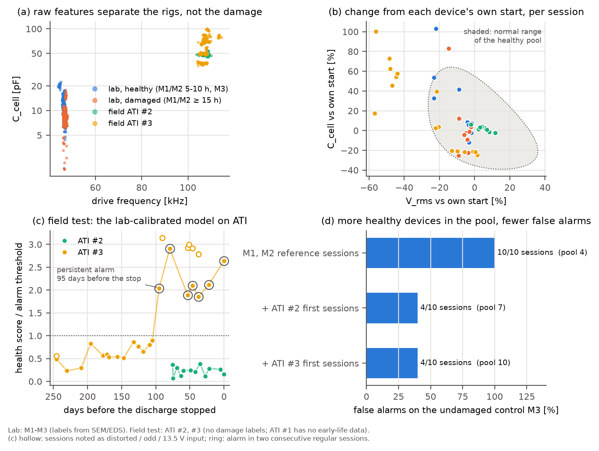

# 같은 셀 구조의 손상 판정 모델: 실험실에서 만들고 ATI로 필드 테스트하기

**한국어**

> **이 문서는 시험 기록입니다.** 손상 라벨은 실험실 장치(M1–M3)에서만 가져왔습니다. ATI #1–3은 **필드 테스트**로만 썼습니다. 즉 모델을 실제 사용 조건의 다른 장치에 적용해 보는 용도입니다. ATI 결과로 학위논문의 결론이나 실험실 라벨을 바꾸지 않습니다.

ATI 장치와 그 노화 기록은 [ati-aging-test.ko.md](ati-aging-test.ko.md)에, 특성의 물리적 의미는 [dbd-physics-primer.ko.md](dbd-physics-primer.ko.md)에 정리했습니다.

## 요약

**질문**

- 학위논문 장치와 셀 구조가 같은 소자에서, 전류·전압 파형만으로 손상 여부를 판정하는 모델을 만들 수 있는가?
- 데이터를 많이 모으면 모델이 나아지는가?

**세 가지 모델의 결과**

| 모델 | 실험실 (장치 하나를 빼고 평가) | 필드 테스트 (ATI) | 판정 |
|---|---|---|---|
| **A** 원래 특성으로 분류 (논문 방식) | — | ATI 캡처의 49–100 %를 "손상"으로 판정. 장치마다 처음 세 세션도 68–100 % | **쓸 수 없음.** 손상이 아니라 장비 차이를 배웁니다 |
| **B** 자기 기준 변화로 분류 (지도학습) | 손상된 M1·M2는 0 %, 손상 없는 M3는 92 %를 "손상"으로 판정 | — | **쓸 수 없음.** 실험실 라벨이 세션 효과와 섞여 있습니다 |
| **C** 자기 기준 건강 모델 (정상 변동만 학습) | 손상 없는 M3: 오경보 4/10 세션(지속 2/10). 손상 세션: 1/9 경보 | **ATI #3:** 방전이 멈추기 **95일 전부터** 지속 경보. **ATI #2:** 경보 없음 | **조건부로 쓸 수 있음.** 소자 전체 규모의 변화는 잡습니다. 국소 손상과 전조 없는 고장은 못 잡습니다 |

**데이터가 많을수록 좋은가?** 무엇을 합치느냐에 따라 다릅니다.

1. **원래 측정값을 그대로 합치면 나빠집니다.** 실험실과 필드는 원래 특성만으로 완벽히 구분됩니다(AUC 1.000). 합친 데이터로 학습한 모델은 손상이 아니라 "어느 장비인가"를 배웁니다.
2. **정상 변동을 합치면 좋아집니다.** 건강 모델의 정상 범위를 실험실 장치로만 정하면 M3 오경보가 10/10이었습니다. ATI의 처음 세 세션을 더하자 4/10으로 줄었습니다. 필드 장치는 손상 라벨이 없어도 "정상일 때 얼마나 흔들리는가"를 알려 줍니다.
3. **라벨 없는 데이터에는 규칙이 필요합니다.** 운전 초기가 아닌 ATI #1의 첫 세션까지 정상으로 넣으면 M3 오경보는 0/10이 됩니다. 그러나 ATI #3의 경보는 95일 전에서 23일 전으로 늦어집니다. 정상 범위에 이상 상태가 섞였기 때문입니다.



## 1. 데이터

| 구분 | 장치 | 캡처 | 세션 | 손상 라벨 |
|---|---|---|---|---|
| 실험실 | M1 | 99 | 5 (5–25 h) | 15 h부터 손상 (SEM/EDS로 확인) |
| | M2 | 160 | 8 (5–40 h) | 15 h부터 손상 |
| | M3 | 239 | 12 (5–60 h) | 손상 없음 (대조 장치) |
| 필드 테스트 | ATI #1 | 64 | 6 | 없음. 방전이 멈추기 전 마지막 6일만 남아 있습니다 |
| | ATI #2 | 169 | 12 | 없음. 481 h 운전 후 방전이 멈췄습니다 |
| | ATI #3 | 379 | 27 | 없음. 2020-11-13에 방전이 멈췄습니다 |

모두 1,110개 캡처, 70개 세션입니다.

**두 데이터의 공통점과 차이**

- 셀 하나의 정전용량 구조가 같습니다. ATI는 면적만 더 큽니다(셀 쌍 약 450개분).
- 전원이 다릅니다.
  - 실험실: 약 47 kHz, 공기.
  - ATI: 약 107 kHz, 질소, 전류원에 가까운 전원.
- 그래서 C_cell, I_rms, 주파수 같은 원래 값의 범위가 전혀 겹치지 않습니다(그림 a).

**처리**

- 상세 캡처(샘플 간격 ≤ 50 ns)만 썼습니다.
- 등가회로 맞춤 R² > 0.9인 캡처만 남겼습니다.
- 주파수 범위는 실험실 42–50 kHz, ATI 100–115 kHz로 제한했습니다.
- ATI 일부 캡처는 시간 열이 유효숫자 부족으로 같은 값이 반복됩니다. 이런 캡처는 헤더의 샘플 간격으로 시간축을 다시 만들었습니다.
- 분석 단위는 세션입니다. 세션 값은 캡처들의 중앙값입니다.

## 2. 모델 A: 원래 특성을 그대로 쓰면 장비를 배운다

**특성**: 주파수, V_rms, I_rms, 주기당 에너지, C_cell(등가회로), ζ(리사주 방전 기울기). 학위논문 분류기와 같은 종류입니다.

**결과**

- 실험실과 필드를 구분하는 5겹 교차검증 AUC는 **1.000**입니다.
- 중앙값 비교:

  | 특성 | 실험실 | ATI |
  |---|---|---|
  | 주파수 | 46.5 kHz | 107.5 kHz |
  | C_cell | 9.8 pF | 48.5 pF |
  | I_rms | 20 mA | 49 mA |

- 실험실 데이터로 학습한 분류기를 ATI에 적용했을 때 "손상"으로 판정한 캡처의 비율:

  | 분류기 | ATI #1 | ATI #2 | ATI #3 | 각 장치의 처음 세 세션 |
  |---|---|---|---|---|
  | 랜덤포레스트 | 50 % | 49 % | 97 % | 68–77 % |
  | 로지스틱 회귀 | 100 % | 100 % | 100 % | 100 % |

**해석**

- ATI는 실험실 분류기가 본 적 없는 범위에 있습니다. 판정은 손상과 무관하게 임의로 정해집니다.
- 새 장치의 처음 세션까지 "손상"으로 판정하므로 현장에서 쓸 수 없습니다.
- 원래 값을 그대로 섞어 데이터 양을 늘리면, 모델은 장비 차이(주파수, 면적, 전원)를 먼저 배웁니다.

## 3. 모델 B: 자기 기준으로 바꿔도 실험실 라벨은 배울 수 없다

**자기 기준 특성**

- 각 장치의 값을 그 장치 자신의 운전 초기 값으로 나눈 로그 비를 씁니다: $r = \ln(x / x_{\mathrm{ref}})$.
  - 실험실: $x_{\mathrm{ref}}$는 5 h와 10 h 세션의 중앙값입니다.
  - ATI: 메모가 없는 처음 세 세션의 중앙값입니다.
  - 기준 세션 자신은 나머지 기준 세션과 비교합니다.
- 이렇게 하면 면적과 전원의 차이가 지워지고, 두 장비의 값을 같은 척도로 볼 수 있습니다(그림 b).
- 특성은 **C_cell(등가회로), V_rms, 주파수** 세 가지만 썼습니다. 두 장비에서 모두 믿을 수 있게 측정되는 것들입니다.
  - 등가회로의 C_d, U_b, 문턱 산포는 ATI에서 맞춤 범위의 경계에 걸려 쓸 수 없었습니다. ATI의 리사주 고리가 얇아 이 값들이 정해지지 않습니다.
  - I_rms와 에너지는 샘플링 간격에 따라 달라집니다([물리 기초 문서](dbd-physics-primer.ko.md) 3단계).

**결과** (로지스틱 회귀, 실험실 장치 하나를 빼고 학습)

| 시험 장치 | "손상"으로 판정한 세션 | 실제 손상 세션 |
|---|---|---|
| M1 | 0 % | 60 % |
| M2 | 0 % | 75 % |
| M3 (손상 없음) | 92 % | 0 % |

**해석**

- 판정이 실제와 반대입니다.
- 실험실에서 가장 큰 변화는 세 장치에 함께 나타난 세션 효과입니다. 손상 없는 M3도 15, 45, 50, 60 h 세션에서 V_rms가 9–23 % 떨어지고 C_cell이 33–103 % 올랐습니다.
- "손상" 라벨은 뒤쪽 세션에 붙어 있으므로, 모델은 손상이 아니라 특정 세션의 전원 상태를 배웁니다([원본 데이터 검증](raw-data-verification.ko.md) 3–4절과 같은 문제).

## 4. 모델 C: 자기 기준 건강 모델

**구조**

1. **기준**: 장치마다 운전 초기 세션(3절과 같음).
2. **특성**: C_cell, V_rms, 주파수의 로그 비. "변화 없음"이 원점입니다.
3. **정상 변동**: 건강한 세션들의 공분산을 Ledoit-Wolf 수축 추정으로 구합니다. 건강한 세션은 다음과 같습니다.
   - M3의 모든 세션, M1·M2의 5–10 h 세션
   - ATI #2·#3의 처음 세 세션. ATI #1은 운전 초기 데이터가 없어 넣지 않았습니다.
4. **건강 점수**: 원점에서의 마할라노비스 거리입니다. 점수가 정상 풀 점수의 95번째 백분위수를 넘으면 경보입니다.
5. **손상 의심**: 메모 없는 세션 두 개가 연속으로 경보일 때입니다. ATI 노화 시험에서 본 일시적 상태(몇 시간–몇 주 안에 사라짐)를 거르기 위한 규칙입니다.
6. **평가**: 시험하는 장치는 정상 풀에서 빼고, 나머지 장치로 정상 변동을 학습합니다.

이 모델은 손상 라벨을 쓰지 않습니다. 실험실 라벨은 평가에만 씁니다.

**실험실 결과**

| 장치 | 경보 세션 | 내용 |
|---|---|---|
| M1 (손상) | 1/3 | 15 h. 같은 세션에 M3도 경보였으므로 세션 효과입니다 |
| M2 (손상) | 0/6 | 가장 높은 점수도 임계값의 88 % |
| M3 (손상 없음) | 4/10 | 15, 45, 50, 60 h. 모두 V_rms가 9–23 % 떨어진 세션입니다. 45–50 h는 연속이라 "손상 의심"까지 갑니다 |

- 국소 손상(126쌍 중 몇 쌍의 침식)은 잡지 못했습니다. 장치 전체 신호에서 약 1/126로 희석됩니다.
- 전원 상태가 바뀐 세션은 대조 채널 없이는 손상과 구분할 수 없습니다.

**필드 테스트 결과**

| 장치 | 경보 | 첫 "손상 의심" | 그 전에 있었던 일 |
|---|---|---|---|
| ATI #3 | 정규 세션 18개 중 7개, **모두 2020-08-10 이후** | **방전이 멈추기 95일 전**(8/10). 이후 마지막 측정까지 계속됩니다 | 3/13 오전·5/02의 일시 상태, 5/20–7/18의 프로브 단차(C_cell −25 %)는 모두 정상 범위 안이었습니다 |
| ATI #2 | 0/9 | 없음 | 가장 높은 점수도 임계값의 37 %. 고장 당일 측정도 정상이었습니다 |
| ATI #1 | 판정 불가 | — | 남은 데이터가 마지막 6일뿐이라 자기 기준을 세울 수 없습니다 |

- ATI #3의 경보 세션에서는 자기 기준보다 V_rms가 44–57 % 낮고 C_cell이 18–100 % 높았습니다. 정상 풀에서 V_rms 감소는 가장 커도 23 %였습니다.
- ATI 노화 시험의 규칙(C_cell ≥ 기준의 1.25배, 프로브 단차 뒤 기준 재설정)은 109일 전(7/27)부터 잡았습니다. 이 모델은 기준을 다시 잡지 않습니다. 프로브 단차가 기록이 아니라 데이터에서 추론한 사건이기 때문입니다. 그래서 2주 늦은 95일 전부터 잡습니다.
- ATI #2에 경보가 없는 것은 ATI 노화 시험의 결론(전기적 전조 없음)과 같습니다.

## 5. 데이터가 많을수록 좋은가

같은 모델 C에서 정상 풀만 바꿔 비교했습니다. 풀 크기는 M3를 시험할 때 기준입니다.

| 정상 풀 | 풀 크기 | M3 오경보 | M3 손상 의심 | 손상 세션 경보 | ATI #3 첫 손상 의심 | ATI #2 경보 |
|---|---|---|---|---|---|---|
| 실험실만 (M1·M2 기준 세션) | 4 | 10/10 | 10/10 | 1/9 | 95일 전 | 0/9 |
| + ATI #2 처음 세 세션 | 7 | 4/10 | — | — | — | — |
| **+ ATI #3 처음 세 세션 (모델 C)** | **10** | **4/10** | **2/10** | **1/9** | **95일 전** | **0/9** |
| + ATI #1 첫 세 세션도 정상으로 | 13 | 0/10 | 0/10 | 0/9 | 23일 전 | 0/9 |

**해석**

- **정상 변동을 합치는 것은 도움이 됩니다.**
  - 실험실 장치 둘의 기준 세션 4개만으로는 정상 변동 폭을 너무 좁게 잡습니다.
  - 필드 장치의 초기 세션을 더하자 대조 장치의 오경보가 절반 아래로 줄었습니다.
  - 장치마다 초기 세션 몇 개만 있어도 도움이 된다는 뜻입니다. 손상 라벨은 필요 없습니다.
- **라벨 없는 데이터를 "정상"으로 넣으려면 규칙이 필요합니다.**
  - ATI #1의 첫 세션은 운전 초기가 아니라 방전이 멈추기 6일 전이고, 그중 하나(12/03)는 C_cell이 2.9배인 일시 상태입니다.
  - 이것을 정상으로 넣으면 정상 범위가 넓어집니다. 그 결과 대조 장치 오경보는 사라지지만, ATI #3의 경보는 72일 늦어집니다.
  - **주의**: "운전 초기 데이터가 없는 장치는 정상 풀에서 뺀다"는 규칙은 이 결과를 본 뒤에 정했습니다. 근거는 기록(ATI #1은 마지막 6일만 남음)이지만, 사전에 정한 규칙이 아니므로 새 장치로 다시 확인해야 합니다.
- **원래 값을 합치는 것은 도움이 되지 않습니다**(2절).

## 6. 이 결과로 할 수 있는 말과 없는 말

**할 수 있는 말**

- 같은 셀 구조의 소자에서, 자기 기준 건강 모델은 소자 전체 규모의 변화를 잡습니다. ATI #3에서는 C_cell 증가와 V_rms 감소를 방전이 멈추기 95일 전부터 계속 경보했습니다.
- 정상 범위는 실험실과 필드의 건강한 세션으로 정했습니다. 필드 장치의 초기 데이터가 오경보를 줄였습니다.

**할 수 없는 말**

- **"손상 판정 정확도"는 말할 수 없습니다.** 필드에는 손상 라벨이 없고 방전이 멈춘 날짜만 있습니다. ATI #3의 변화가 유전체 손상인지 표면 막인지도 모릅니다([ATI 노화 시험](ati-aging-test.ko.md) 5절).
- **국소 손상은 잡지 못합니다.** SEM으로 확인된 M1·M2의 손상 세션 9개 중 1개만 경보였고, 그것도 세션 효과였습니다.
- **전조 없는 고장은 잡을 수 없습니다.** ATI #2가 그 예입니다.
- **대조 장치에도 오경보가 남습니다**(4/10). 전원 상태가 바뀐 세션은 장치 하나의 신호만으로는 손상과 구분되지 않습니다.
- **장치 수가 적습니다.** 평가에 쓴 장치는 실험실 3대와 필드 2대입니다.
- **연속 세 세션 규칙은 시험하지 않았습니다.** 연속 세 세션으로 바꾸면 M3의 손상 의심은 0이 되고 ATI #3은 여전히 95일 전부터 잡힙니다. 그러나 결과를 보고 떠올린 규칙이므로 주장하지 않습니다.

## 7. 다음 실험에서 필요한 것

| 필요한 것 | 이유 |
|---|---|
| 같은 전원에 더미 커패시터를 연결한 대조 채널 | 남은 오경보(전원 상태가 바뀐 세션)를 빼려면 세션 효과를 따로 재야 합니다 |
| 모든 필드 장치의 운전 초기 측정(세 세션 이상)과 개입 기록 | 자기 기준과 정상 풀의 재료입니다. ATI #1은 이것이 없어 판정할 수 없었습니다 |
| 방전이 멈춘 장치의 분해 검사(SEM/EDS) | 필드에 손상 라벨이 생깁니다. 지금은 "방전 정지"만 압니다 |
| 500 MS/s 이상, 고정된 측정 설정 | 국소 손상의 신호(개별 방전 펄스)를 보려면 필요합니다 |
| 판정 규칙의 사전 등록 | 지속 세션 수, 임계 백분위수, 정상 풀 규칙을 미리 정하고 새 장치에서 시험합니다 |

## 재현

```bash
python examples/field_test_ml.py "<아카이브>/M!M2M3실험데이터종합" "<노화 아카이브>/μ-DBD (large) Aging 데이터 모음" docs/img
```

- 위의 모든 표와 그림 `docs/img/field_test_ml.png`를 다시 만듭니다. 10코어에서 약 2분 걸립니다.
- 원본 캡처는 저장소에 포함하지 않았습니다. 아카이브는 저자가 보관합니다.
