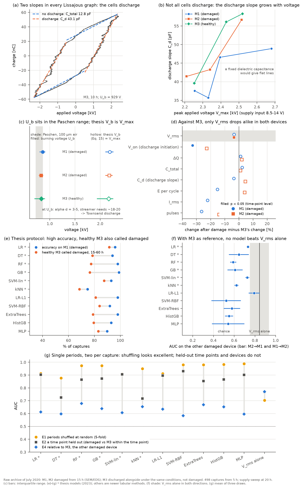
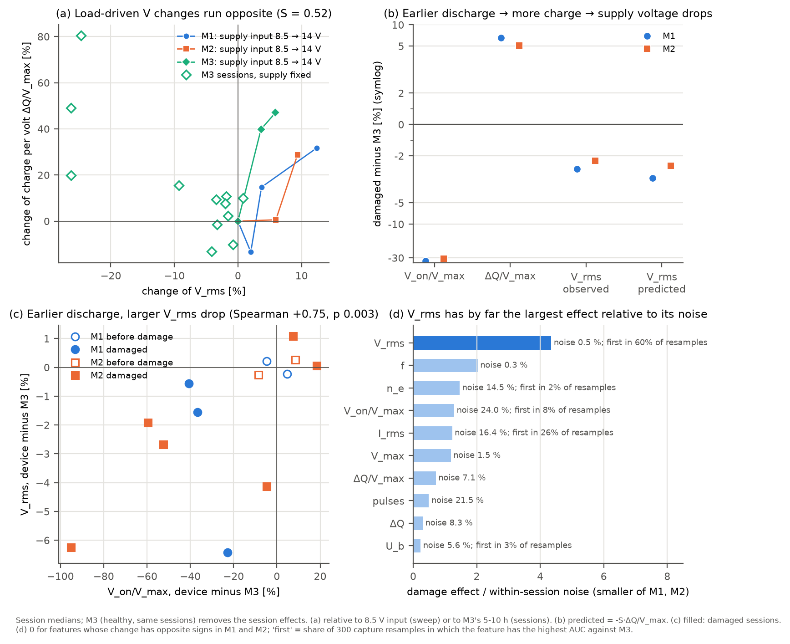
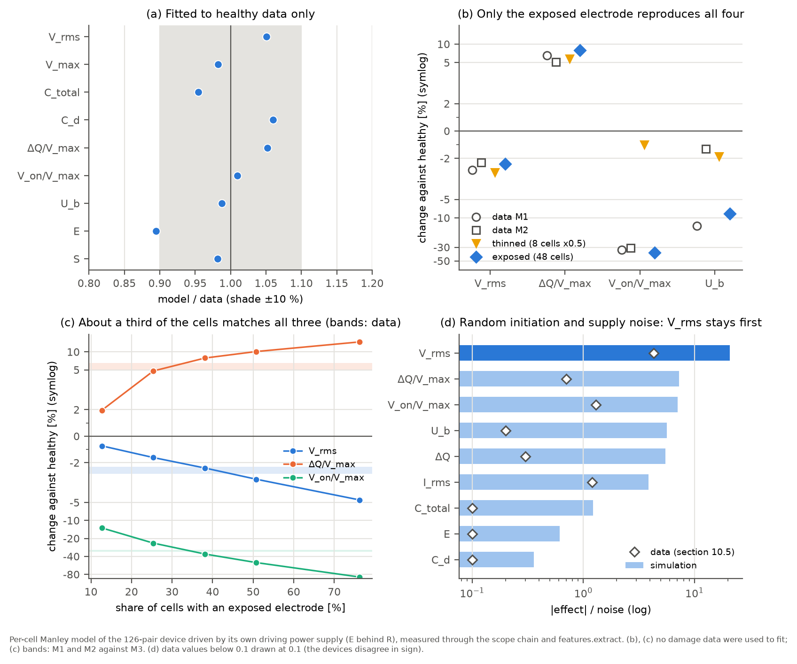
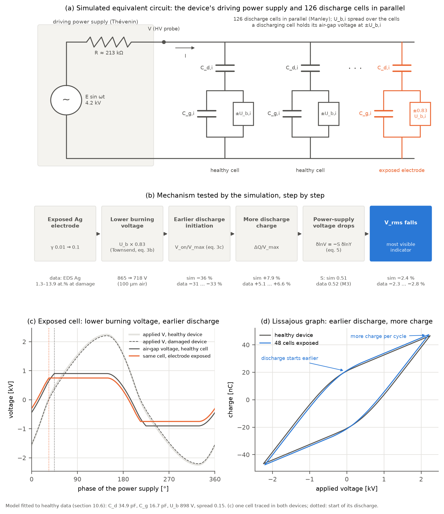

# 원본 실험 데이터 아카이브 기반 논문 검증 (M1·M2·M3)

[English](raw-data-verification.md) | **한국어**

**대상.** 김민준, 「저온 대기압 방전 플라즈마의 유전 장벽 표면 손상에 대한 전기적 측정과 머신러닝 분석 기반 손상 예측」, 광운대학교 석사학위논문, 2023.

**데이터.** 2020년 7월 실험의 원본 아카이브 전체(`M!M2M3실험데이터종합`, 약 5.3 GB). 이 저장소에는 포함되지 않습니다.

| 폴더 | 내용 |
|---|---|
| `전류전압 측정/1·2·3번소스` | M1 0–25 h, M2 0–40 h, M3 0–60 h 내구 세션. 세션마다 상세 캡처 20개(10 ns 간격 10개 + 20 ns 간격 10개)와 개요 캡처 1개 |
| `전류전압 측정/4번소스` | 120셀 방전, 단일 셀 방전, 클립 접촉 방전(별도 소스) |
| `전압에 따른 QV 변화` | 20 h 시점의 공급 입력전압 스윕(8.5 / 9 / 10 / 14 V) |
| `현미경사진`, `표면사진` | 세션마다 찍은 광학 현미경 사진과 전체 소스 사진 |
| `SEM, EDS 데이터` | M1·M2·M3·Ref의 SEM 메타데이터와 Bruker EDS 보고서(이미지) |
| `*.xlsx` | 2020년 MATLAB 코드로 계산한 세션별 요약 |

**방법.**
1. 이 패키지(`dbd_diagnostics`)로 내구 세션 상세 캡처 600개(분석에는 5 h 이후 500개)와 공급전압 스윕 캡처 70개를 재분석했습니다.
2. 현미경 사진 전부(242장)의 촬영 시각과 어두운 소손 영역을 정량화했습니다.
3. EDS 보고서의 조성표를 모두 확인해 표 3과 대조했습니다.
4. 논문에 쓰이지 않은 **M3**를 손상되지 않은 **대조 소스**로 사용했습니다. M3는 매 세션 M1·M2와 같은 날, 10–33분 안에 측정되었습니다.

재현: `python examples/verify_raw_archive.py "<아카이브>/전류전압 측정" "<아카이브>/전압에 따른 QV 변화/I 기준으로 계산"`. 1–5절의 수치를 출력합니다. 10절의 수치와 그림은 `python examples/consistency_check.py "<아카이브>/전류전압 측정" "<아카이브>/전압에 따른 QV 변화/I 기준으로 계산" docs/img`로 재현합니다(약 8분). 10.5절의 그림 `docs/img/vrms_mechanism.png`도 함께 만듭니다. 10.6절의 등가회로 시뮬레이션은 `python examples/vrms_simulation.py docs/img`로 재현합니다(원본 데이터 불필요, 약 11분). 사진·EDS 판독 결과는 이 문서의 표에 직접 기록했습니다.

중요도 표기는 [검증 보고서](thesis-review.ko.md)와 같습니다: **[중대]** 결론·대표 수치에 영향, **[보통]** 방법·표현 수정 필요, **[경미]** 표기·서술.

---

## 0. 요약

| # | 결과 | 판정 |
|---|---|---|
| 1 | 아카이브가 논문 데이터 그 자체입니다. 기존 보고서 H절의 재분석 수치가 소수점까지 재현되고, 2020년 MATLAB 요약표와도 일치합니다(26개 중 23개 세션이 V_rms 1 %, 에너지 5 % 이내). 2020년 요약표는 에너지를 **"Energy per period"**로 적고 있어 "초당 방전 에너지"가 표기 오류임(검증 보고서 C1)을 원 기록이 직접 확인해 줍니다. | 확인 |
| 2 | 15 h 라벨 경계는 M2 현미경 사진과 일치합니다. 하지만 M1의 "5h" 사진(2020-07-20 10:30 촬영, 10 h 측정 이전)에 **전극 끝의 큰 용융·기포 손상**이 있습니다. 검증 데이터셋의 "정상(0)" 구간에 이미 손상 셀이 있었을 수 있습니다. | 보통 |
| 3 | ★ 15 h 세션(7/20 저녁)의 V_rms 하락은 **손상되지 않은 M3에도 똑같이** 나타납니다(10 h 대비 −133 V). 같은 세션 안에서 V_rms가 몇 초 간격으로 ≈1150/1270, 1360, 1460 V 사이를 오가므로, 서서히 진행되는 손상이 아니라 **전원 동작 모드 전환**입니다. M3를 대조로 한 이중차분(DiD)에서 손상 고유의 V_rms 변화는 M1·M2 모두 **≈ −48 V**로, 단순 비교(−107 / −92 V)의 약 절반입니다. | 중대 |
| 4 | ★ M2로 학습한 논문 분류기를 손상 없는 M3에 적용하면 15·25·40 h 세션 캡처의 **95–100 %**, 45–60 h의 **100 %**를 "손상"으로 판정합니다(15–40 h 평균 오탐률 57–86 %). 분류기는 표면 손상보다 **인가전압 수준**에 반응합니다. 특성값을 같은 세션의 M3 값으로 나누면 교차 소스 정확도가 94–99 %에서 **65–78 %(DT·RF·GB; 6개 모델 전체 64–89 %)**로 떨어집니다. | 중대 |
| 5 | 같은 세션·같은 소스 안에서도 오실로스코프 설정에 따라 값이 바뀝니다. 전류 A/div를 2배로 하면 I_rms가 **+3.5 mA**(p = 10⁻¹⁷), 샘플링을 10 → 20 ns로 바꾸면 I_rms **+4.3 mA**, 펄스 수 **−6.6개**, C_d **+3.0 pF**, U_b **+35 V**입니다. M2 손상 그룹은 0.04 A/div 캡처 비중이 더 큽니다(42 % 대 20 %). 따라서 "I_rms 감소, 방전 횟수·n_e 증가" 주장은 측정 설정과 교란되어 있습니다. | 중대 |
| 6 | 공급 입력전압 스윕에서 논문의 V_b(식 15)는 V_max를 기울기 **0.87–1.08**로 따라가고, 연소 전압 U_b는 0.23–0.33으로 약하게만 변합니다. 검증 보고서 C5(V_b ≡ V_max)의 독립적인 **실험적 확인**입니다. | 확인 |
| 7 | 표 3(EDS)의 출처를 찾았습니다. "Normal" 열은 **Ref 시료** `0-X10000-2` 맵, "Degradation" 열은 **M2 손상부** `2-1-1X10000-1` 맵이며, 두 열 모두 **원자 %(at.%)** 값입니다. 손상부 맵 12개의 Ag는 1.3–13.9 at.%, 온전한 유전체 맵 41개는 0.0–0.7 at.%(1개만 1.44)로 뚜렷이 갈립니다. 결론은 견고하며, 단위와 맵 선택 기준만 밝히면 됩니다. | 경미 |
| 8 | 그림 7의 "방전전류 ~100 mA → ~250 mA"는 같은 전류 스케일(0.1 A/div)에서 비교하면 재현되지 않습니다. M2는 251 → 272 mA(p = 0.25), M1은 252 → 213 mA(감소)입니다. | 보통 |
| 9 | 기존 검증 보고서의 일부 진술을 수정해야 합니다. U_b 감소(p = 2×10⁻⁴)와 방전 횟수 증가(p = 6×10⁻⁴)는 M3에서도 같은 방향으로 나타나므로(−38 V, p = 0.05; +2.7개, p = 4×10⁻⁶) 손상 지표로 볼 근거가 부족합니다. 9절을 보세요. | 보고서 수정 |
| 10 | 물리 가정(Manley 등가회로, 파센·타운젠트 방전)은 데이터와 맞습니다. 리사주 그래프의 방전 구간 기울기 C_d는 공급전압에 따라 커지므로 유전체 고유의 커패시턴스가 아니라 방전 면적에 따른 유효 커패시턴스입니다. 손상과 연결되는 독립 신호는 M3 대비 V_rms 감소 하나이고, 새 모델 5개를 더한 11개 모델도 V_rms 단일 특성을 넘지 못합니다. 주기 단위로 모든 캡처의 영향력을 같게 맞춰도 같습니다. V_rms 감소는 '방전개시 앞당김 → 방전 전하량 증가 → 구동전원 전압 강하'로 크기까지 설명되고, 효과/잡음 비가 다른 특성의 두 배 이상입니다(10.5). 정상 데이터로 보정한 등가회로 시뮬레이션은 전극 노출로 방전 유지 전압이 낮아진 경우를 지지합니다(10.6). 10절을 보세요. | 확인 |

**유지되는 것.**
- 표면 손상 자체는 사실입니다. M1·M2 현미경 사진의 소손 흔적과 EDS의 Ag 증가가 일관됩니다.
- 손상된 두 소스 모두 대조 소스보다 V_rms가 약 48 V(≈ 3 %) 더 떨어집니다. M3 기준으로 보정한 V_rms만으로도 M1은 AUC 0.99, M2는 0.83입니다. 손상 고유의 신호는 존재합니다.
- 다만 그 크기는 세션 간 전원 변동(M3 혼자서도 세션 평균 1155–1502 V)보다 훨씬 작습니다. 대조 소스 없이 측정한 V_rms 변화를 손상으로 해석하면 오탐이 많습니다.

---

## 1. 아카이브 구성과 재현성

### 1.1 세션 구성

- 각 세션은 상세 캡처 20개로 이루어집니다. `ALL0001–0010`은 10 ns 간격(약 2주기), `ALL0011–0020`은 20 ns 간격(약 4주기)이고, `ALL0021`은 0.2–0.4 ms 간격의 개요 캡처입니다.
- 전압 채널은 모든 내구 세션에서 1000 V/div입니다. M3 45·50 h만 500 V/div라 피크 샘플 일부(0.3 %)가 ADC 상한(1940 V)에 닿지만, 이 샘플을 빼고 사인을 맞춘 V_rms(1122 V)가 원래 값(1126 V)과 같아 영향은 없습니다. 이 두 세션의 전압 하락은 실제입니다.
- 전류 채널은 세션마다 0.04 / 0.1 / 0.2 / 0.4 A/div로 바뀌며, 같은 세션 안에서도 블록마다 바뀌기도 합니다(5절).
- 0 h 세션이 두 번(7/17, 7/18) 있지만 논문은 5 h부터 사용했습니다. M3 7/18 0 h는 폴더 이름대로 데이터가 깨져 있습니다(Δt = 0).
- 측정 순서는 매 세션 M1 → M2 → M3이고, 세 소스를 10–33분 안에 모두 측정했습니다(15 h 세션은 14분).

### 1.2 기존 재분석의 재현 (M2, 정상 5·10 h n = 40, 손상 15–40 h n = 120)

| 항목 | 기존 보고서 H절 | 이번 아카이브 재분석 |
|---|---|---|
| 주기당 에너지 | 0.131 / 0.132 mJ | 0.1308 / 0.1321 mJ |
| V_rms | 1489 / 1396 V | 1489 / 1396 V |
| C_dielectric | 34.5 / 37.2 pF | 34.45 / 37.18 pF |
| V_max | 2284 / 2155 V | 2284 / 2155 V |
| U_b | 860 / 811 V | 860.1 / 810.5 V |
| T_e (U_b 기반) | 6.2 / 6.0 eV | 6.22 / 5.97 eV |

모든 값이 일치하므로, 기존 검증에 쓰인 원격 저장소 데이터와 이 아카이브는 같은 데이터입니다.

**표 1 확인.** 논문 표 1은 방전 시작 시 46.5 kHz, 1.5 kV, 19.8 mA입니다. 재분석 결과는 M2 5 h 46.9 kHz, 1481 V, 20.3 mA, M1 5 h 46.95 kHz, 1484 V, 20.1 mA로 일치합니다.

### 1.3 2020년 MATLAB 요약표와의 비교

세션별 `*종합데이터.xlsx` 26개(각각 상세 캡처 10개의 평균)를 같은 캡처의 재분석값과 비교했습니다.

| | 중앙값 차이 | 일치하는 세션 |
|---|---|---|
| V_rms | +0.11 % | 23/26이 1 % 이내 |
| 주기당 에너지 | +0.25 % | 23/26이 5 % 이내 |
| I_rms | +0.9 % | 21/26이 4 % 이내 |

- 어긋나는 세 세션(M1 10 h, M2 15 h, M3 60 h 중 한 파일)은 요약표가 다른 캡처 블록을 평균한 경우입니다. 예를 들어 M2 15 h 요약값 1375.6 V는 `ALL0011–0020` 블록 평균(1378.6 V)과 맞습니다.
- 2020년 요약표의 행 이름은 `Energy per period`입니다. 논문 식 (11)의 "초당 방전 에너지 0.13 mJ"가 주기당 에너지라는 검증 보고서 C1을 원 계산 기록이 확인해 줍니다.
- M2 폴더의 `20200724_M4_40h 종합데이터.xlsx`는 파일명 오타(M2 40 h)입니다.

---

## 2. 라벨 검증: 현미경·표면 사진

### 2.1 촬영 시각

파일 수정 시각(카메라·현미경 PC 저장 시각)과 CSV 헤더의 측정 시각입니다.

| 날짜 | 전기 측정 | 현미경 사진 |
|---|---|---|
| 7/18 | 5 h: M1 14:22, M2 14:31, M3 14:40 | – |
| 7/20 | – | "5h": M1 10:30, M2 10:37, M3 10:53 |
| 7/20 | 10 h: M1 15:11, M2 15:20, M3 15:26 | 10 h: M1 16:45, M2 16:50, M3 16:58 |
| 7/20 | 15 h: M1 19:58, M2 20:04, M3 20:10 | 15 h: M1 21:13, M2 21:17, M3 21:19 |
| 7/21 | 20 h: M1 14:48, M2 15:07, M3 15:18 / 25 h: M1 20:26, M2 20:36, M3 20:42 | 20 h 16:40–16:55, 25 h 21:44–21:52 |

"5h" 현미경 사진은 10 h 방전을 시작하기 전인 7/20 오전에 찍혔습니다.

### 2.2 소손 영역 정량화

현미경 사진 전부(640×480)에서 휘도 < 90인 연결 영역의 최대 면적을 구해, 150 px 이상이면 "소손 있음"으로 셌습니다.

| 시간 | M1 | M2 | M3 |
|---|---|---|---|
| 5 h | **4/9** (최대 1521 px) | 0/5 | 0/8 |
| 10 h | 0/5 | 0/5 | 0/4 |
| 15 h | 2/5 | 2/5 | 0/4 |
| 20 h | 3/6 | 2/5 | 0/6 |
| 25 h | 3/9 | 2/6 | 0/4 |
| 30 h | – | 3/9 | 0/11 |
| 35 h | – | 2/10 | 0/15 |
| 40 h | – | 2/13 | 0/16 |
| 45–60 h | – | – | 1/82 (55 h, 159 px의 작은 점 하나) |

- **M2** [확인]: 5·10 h에는 소손이 없고, 15 h부터 모든 세션에 검은 침식 흔적이 있습니다. 논문의 라벨 경계(≤ 10 h 정상, ≥ 15 h 손상)와 일치합니다.
- **M1** [보통]: 15 h부터 검은 침식 흔적이 보이는 것은 같습니다. 그런데 "5h" 사진 중 `Snapshot000008`, `Snapshot000010`에 전극 끝을 덮은 **큰 용융·기포 손상**이 있습니다. 20 h `Snapshot000004`에도 비슷한 용융부가 있고, 25 h 사진에는 실험자가 `오른쪽 끝 결국 터짐`이라는 이름을 붙였습니다. 같은 부위를 추적했을 가능성이 높습니다. 이 사진은 10 h 측정 전에 찍혔으므로, 논문이 정상(0)으로 라벨링한 M1 5·10 h(검증 데이터셋의 정상 80행)에 이미 손상된 셀이 있었을 수 있습니다. 그림 27과 5.3절에서 이 점을 밝히거나, 손상 유형(침식 대 용융·기포)을 구분해 라벨링 기준을 명시하는 것이 좋습니다.
- **M3**: 50 h까지 소손 흔적이 없습니다. 논문 4.2절의 "2개 샘플에서 표면 손상이 관측되었다"와 일치합니다. M3는 M1·M2와 같은 조건에서 함께 방전한 정상 비교군이며, 실험자가 손상 없음을 확인했습니다.

---

## 3. ★ M3 대조군: 세션 공통 효과 [중대]

### 3.1 세션 평균 V_rms [V]

| 시간 | M1 | M2 | M3 |
|---|---|---|---|
| 5 | 1484 | 1481 | 1484 |
| 10 | 1501 | 1496 | 1502 |
| **15** | **1273** | **1312** | **1369** |
| 20 | 1460 | 1432 | 1478 |
| 25 | 1423 | 1355 | 1454 |
| 30 | – | 1436 | 1475 |
| 35 | – | 1399 | 1473 |
| 40 | – | 1445 | 1443 |
| 45 / 50 / 55 / 60 | – | – | 1155 / 1156 / 1454 / 1176 |

- 손상 전(5·10 h)에는 세 소스의 V_rms가 몇 V 이내로 같습니다.
- 15 h에는 세 소스가 **동시에** 떨어집니다. 손상이 없는 M3도 −133 V입니다.
- M3는 손상 흔적 없이 45·50 h에 1155 V로 떨어졌다가 55 h에 1454 V로 돌아옵니다.

### 3.2 세션 안의 전압 점프

15 h 세션에서 캡처 순서대로 본 V_rms [V]입니다(약 4분 동안 20개).

```
M2 15h  1457 1456 1149 1135 1459 1166 1147 1168 1153 1160 1359 1358 1469 1351 1358 1481 1364 1356 1340 1349
M3 15h  1464 1447 1264 1282 1453 1282 1294 1471 1481 1468 1464 1464 1461 1272 1281 1445 1276 1274 1274 1271
M1 15h  1274 1289 1273 1270 1277 1272 1274 1264 1272 1270 1275 1273 1280 1267 1270 1271 1273 1278 1272 1266
```

- 인가전압이 몇 초 간격으로 이산적인 수준 사이를 오갑니다. 공진형 전원의 동작 모드 전환으로 보이며, 서서히 진행되는 표면 손상으로는 설명되지 않습니다.
- M3(손상 없음)도 같은 시각에 같은 방식으로 점프합니다. 7/20 저녁에 전원(또는 전원 공급 환경) 쪽에 세 소스 공통의 변동이 있었습니다.

### 3.3 이중차분 (M3 대조)

"전(5·10 h)"과 "후(15 h–마지막)"의 변화에서 같은 세션들의 M3 변화를 뺐습니다. p(M3)는 M3 자체 변화의 Welch 검정, p(DiD)는 세션 평균 차이(전 2개, 후 3–6개)에 대한 검정입니다.

| 소스 | 특성 | 단순 변화 | M3 변화 | p (M3) | DiD | p (DiD) |
|---|---|---|---|---|---|---|
| M1 | V_rms | −107 V | −59 V | 7×10⁻⁷ | **−48 V** | 0.18 |
| M2 | V_rms | −92 V | −44 V | 2×10⁻⁷ | **−48 V** | 0.018 |
| M1 | V_max | −156 V | −103 V | 2×10⁻⁶ | −54 V | 0.34 |
| M2 | V_max | −129 V | −65 V | 7×10⁻⁵ | −63 V | 0.16 |
| M1 | U_b | −148 V | −48 V | 0.024 | −100 V | 0.14 |
| M2 | U_b | −50 V | −38 V | 0.049 | −12 V | 0.80 |
| M1 | C_d | +1.5 pF | +1.3 pF | 0.43 | +0.2 pF | 0.98 |
| M2 | C_d | +2.7 pF | +0.1 pF | 0.93 | +2.6 pF | 0.56 |
| M2 | C_total | +0.66 pF | +0.27 pF | 0.45 | +0.40 pF | 0.50 |
| M2 | Q_max | +3.2 nC | −0.4 nC | 0.85 | +3.6 nC | 0.36 |
| M1 | 방전 횟수 | +0.5 | **+2.6** | 4×10⁻⁴ | −2.1 | 0.43 |
| M2 | 방전 횟수 | +3.7 | **+2.7** | 4×10⁻⁶ | +1.0 | 0.59 |

- **V_rms**는 손상된 두 소스 모두 대조보다 약 48 V 더 떨어집니다. 방향과 크기가 두 소스에서 같아 손상 고유 효과로 볼 만하지만, 단순 비교 크기의 절반 정도입니다.
- **방전 횟수**와 **U_b**는 손상되지 않은 M3에서도 같은 방향으로 유의하게 변합니다. 손상 지표라는 근거가 없습니다.
- C_d, C_total, Q_max의 증가는 대조 대비 방향은 맞지만, 세션 수준에서는 유의하지 않습니다(검정력이 낮습니다).

---

## 4. ★ 분류기가 대조 소스를 "손상"으로 판정 [중대]

### 4.1 M3 오탐률

논문의 14개 특성과 하이퍼파라미터로 M2(5·10 h = 0, 15–40 h = 1)에 학습한 모델이 M3 캡처를 "손상"으로 판정한 비율 [%]입니다.

| 모델 | 5 | 10 | 15 | 20 | 25 | 30 | 35 | 40 | 45 | 50 | 55 | 60 |
|---|---|---|---|---|---|---|---|---|---|---|---|---|
| LR | 5 | 25 | 100 | 80 | 100 | 80 | 55 | 100 | 100 | 100 | 100 | 100 |
| DT | 5 | 20 | 95 | 20 | 100 | 25 | 35 | 95 | 100 | 100 | 95 | 100 |
| **RF** | 5 | 20 | **95** | 20 | **100** | 30 | 35 | **95** | 100 | 100 | 100 | 100 |
| GB | 35 | 25 | 95 | 25 | 100 | 25 | 40 | 100 | 100 | 100 | 100 | 100 |
| SVM | 5 | 20 | 100 | 40 | 100 | 60 | 70 | 100 | 100 | 100 | 100 | 100 |
| kNN | 10 | 80 | 95 | 30 | 50 | 40 | 30 | 95 | 100 | 100 | 45 | 100 |

- 손상 흔적이 없는 M3의 15–40 h 캡처 가운데 57–86 %(RF 62.5 %)가 "손상"으로 분류됩니다. 오탐은 V_rms가 낮았던 세션(15, 25, 40, 45–60 h)에 몰려 있습니다.
- 손상 없는 M3에서도 V_rms 하나로 "≤ 10 h 대 ≥ 15 h 세션"을 AUC 0.90으로 구분할 수 있습니다. 논문 분류기의 높은 성능(V_rms 단독 AUC 0.996)은 상당 부분 이 세션 공통 효과에서 나옵니다.
- M1·M2 학습 데이터를 합쳐 학습해도 결과는 거의 같습니다.

### 4.2 대조 소스 기준 보정

각 특성을 같은 세션 M3 평균으로 나눠 세션 공통 효과를 근사적으로 제거한 뒤 교차 소스 정확도를 다시 계산했습니다.

| 설정 | DT | RF | GB | LR | SVM | kNN |
|---|---|---|---|---|---|---|
| 원시 특성, M2 → M1 | 99.0 % | 99.0 % | 94.0 % | 95.0 % | 92.0 % | 74.0 % |
| M3 기준 보정, M2 → M1 | 65.0 % | 75.0 % | 65.0 % | 89.0 % | 84.0 % | 85.0 % |
| 원시 특성, M1 → M2 | 98.8 % | 96.2 % | 98.8 % | 79.4 % | 86.9 % | 66.9 % |
| M3 기준 보정, M1 → M2 | 78.1 % | 68.8 % | 78.1 % | 71.9 % | 71.9 % | 63.8 % |

- 보정 후에도 신호는 남습니다. 보정된 V_rms 단독 AUC는 M1 0.99, M2 0.83입니다.
- M3 세션 평균 자체에 모드 점프가 섞여 있으므로(3.2절) 이 보정은 거친 근사입니다. 그래도 "손상 신호"의 상당 부분이 세션 효과였다는 결론은 바뀌지 않습니다.

---

## 5. 측정 설정 의존성 [중대: I_rms, 방전 횟수, n_e]

### 5.1 같은 세션 안의 비교

세션 고정효과 회귀(500개 캡처)로 오실로스코프 설정의 효과를 추정했습니다.

| 특성 | A/div 2배당 | p | 20 ns 대 10 ns | p |
|---|---|---|---|---|
| I_rms | **+3.5 mA** | 10⁻¹⁷ | **+4.3 mA** | 5×10⁻⁵³ |
| 피크 전류 | +59 mA | 4×10⁻¹⁰ | +37 mA | 9×10⁻¹⁰ |
| 방전 횟수 | +1.1 | 0.11 | **−6.6** | 3×10⁻⁴⁵ |
| n_e (논문 방식) | +2.7×10¹² cm⁻³ | 2×10⁻⁸ | +5×10¹¹ | 0.07 |
| C_d | +0.3 pF | 0.54 | **+3.0 pF** | 2×10⁻²⁰ |
| U_b | +45 V | 3×10⁻⁹ | +35 V | 3×10⁻¹³ |
| V_rms | +19 V | 5×10⁻⁴ | −5 V | 0.13 |

예: M2 10 h 같은 세션에서 0.04 A/div는 I_rms 16.1 mA, 0.1 A/div는 22.9 mA입니다. M2 40 h는 0.1 A/div 24.3 mA, 0.2 A/div 36.4 mA입니다.

### 5.2 원인

- 전류 채널 포화는 없습니다. 최댓값·최솟값이 3회 이상 반복된 캡처는 0–1 %입니다.
- 노이즈 바닥이 A/div에 비례합니다. 0.04 / 0.1 / 0.2 A/div에서 각각 2.4 / 5.9 / 11.9 mA(1 LSB = 1.6 / 4 / 8 mA)입니다.
- 펄스 검출은 시간 분해능에 직접 좌우됩니다(검증 보고서 B2).

### 5.3 논문 결론에 미치는 영향

M2 그룹별 설정 구성은 다음과 같습니다.

| 그룹 | 0.04 A/div | 0.1 A/div | 0.2 A/div |
|---|---|---|---|
| 정상 (5·10 h) | 8 | 32 | 0 |
| 손상 (15–40 h) | 50 | 60 | 10 |

- 손상 그룹에 저감도 설정(0.04 A/div)이 더 많습니다. "I_rms 감소"(20.8 → 18.6 mA)는 이 구성 차이로 일부 설명됩니다.
- 방전 횟수와 전자밀도는 설정에 따라 바뀌는 양입니다. 설정을 고정하거나 공변량으로 넣지 않은 비교는 손상 효과로 해석하기 어렵습니다.
- 세션마다 설정이 다르므로 이 특성들은 **세션 식별자** 역할도 합니다(검증 보고서 D5-3의 정량적 확인).

---

## 6. 공급전압 스윕: V_b ≡ V_max의 실험적 확인

20 h 시점에 공급 입력전압을 바꿔 가며 측정한 데이터입니다(8.5 V = 20 h 내구 세션).

| 소스 | 공급 [V] | V_rms | V_max | 논문 V_b (식 15) | U_b | 논문 T_e [eV] |
|---|---|---|---|---|---|---|
| M1 | 8.5 / 9 / 10 / 14 | 1460 → 1654 | 2259 → 2681 | 2193 → 2642 | 857 → 956 | 12.1 → 14.0 |
| M2 | 8.5 / 10 / 14 | 1432 → 1562 | 2222 → 2530 | 2175 → 2447 | 849 → 966 | 12.0 → 13.1 |
| M3 | 8.5 / 10 / 14 | 1478 → 1577 | 2250 → 2525 | 2171 → 2428 | 870 → 935 | 12.0 → 13.1 |

| 소스 | dV_b/dV_max | r | dU_b/dV_max |
|---|---|---|---|
| M1 | 1.08 | 0.93 | 0.23 |
| M2 | 0.87 | 0.86 | 0.33 |
| M3 | 0.95 | 0.86 | 0.29 |

- 논문의 "방전전압" V_b는 인가 피크전압을 거의 1 : 1로 따라갑니다(평균 V_b − V_max = −57 ~ −94 V).
- 기체 간극의 연소 전압 U_b는 그 1/3 정도만 변합니다.
- 논문의 T_e는 V_b의 함수이므로 V_max와 함께 움직입니다.
- 검증 보고서 C5(식 15는 항등적으로 V_max)와 C6(T_e는 V_b를 다시 쓴 것)을 다른 실험 조건에서 확인한 결과입니다.

---

## 7. 표 3 (EDS)의 출처 [경미]

### 7.1 출처

| 표 3 열 | 원본 보고서 | 시료 | 일치하는 열 |
|---|---|---|---|
| Normal | `Ref SEM, EDS/Ref EDS/0-X10000-2` (2020-07-27) | Ref 시료, 10,000배 맵 | **Atom [%]**, 10개 원소 모두 일치 (C 7.70, O 30.27, Na 9.19, Mg 2.48, Al 20.04, Si 13.60, Ca 2.41, Zn 7.09, Ag 0.57, Pb 6.65) |
| Degradation | `M2 SEM, EDS/20200727 M2 EDS/2-1/2-1-1X10000-1` | M2 손상부, 10,000배 맵 | **Atom [%]**, 10개 원소 모두 일치 (C 7.22, O 27.69, Na 6.49, Mg 2.52, Al 15.54, Si 9.88, Ca 2.03, Zn 8.87, Ag 13.86, Pb 5.90) |

- 표 3은 원소 조성을 "[%]"로만 적었습니다. **원자 %(at.%)**라고 명시해야 합니다. 같은 Ag 13.86 at.%는 질량 기준으로 31.05 wt.%입니다.
- Pt(코팅)는 0으로 처리되어 있습니다.

### 7.2 전체 맵 분포 (Ag, at.%)

| 부위 | 맵 수 | Ag [at.%] |
|---|---|---|
| Ref 시료 | 6 | 0.00, 0.00, 0.02, 0.05, 0.38, **0.57** |
| M3, 60 h 방전 후 (7/31) | 13 | 12개 0.00–0.25, 1개 1.44 |
| M2 온전한 부위 2-2·2-3·2-4 (7/27) | 10 | 0.00–0.56 |
| M1 전극 위·전극 사이·전극에서 먼 유전체 (7/23) | 12 | 0.01–0.68 |
| M1 노출 전극 중 탄 부분 1-1 (7/23) | 4 | 5.08, 7.21, 8.70, 11.94 |
| M1 노출 전극 중 터진 부분 1-2 (7/23) | 4 | 1.28, 1.43, 2.87, 3.22 |
| M2 손상부 2-1 (7/27) | 4 | 3.78, 4.28, 11.59, **13.86** |

- 손상 부위(12개 맵, 1.3–13.9 at.%)와 온전한 유전체(41개 맵, 대부분 ≤ 0.7 at.%)가 뚜렷이 구분됩니다. "유전체 손상으로 전극이 노출되었다"는 결론은 견고합니다.
- 표 3의 두 값은 각각 해당 부위 맵들 중 최댓값입니다(Normal 0.57은 Ref 맵 중 최대, Degradation 13.86은 2-1 맵 중 최대). 대표값보다는 범위나 평균 ± 표준편차를 보고하는 편이 좋습니다.
- 4.3절 본문과 그림 23–24의 "(a) 정상 방전 전극"은 실제로는 **Ref 시료**입니다. Ref가 방전 이력이 있는 전극인지 미사용 전극인지 밝혀야 합니다.

---

## 8. 그림 7의 예시 [보통]

논문은 "표면 손상 후 방전전류 크기가 약 100 mA에서 250 mA로 크게 증가"하고 "방전개시 전압이 약 500 V에서 400 V로 감소"했다고 씁니다. 같은 전류 스케일(0.1 A/div) 캡처끼리 비교한 결과입니다.

| 소스 | 피크 전류 정상 → 손상 | p | V_min 정상 → 손상 | p |
|---|---|---|---|---|
| M2 | 251 ± 68 → 272 ± 97 mA | 0.25 | 675 → 607 V | 0.09 |
| M1 | 252 ± 62 → 213 ± 39 mA | 0.002 (감소) | 821 → 556 V | 4×10⁻⁵ |

- 정상 상태의 피크 전류는 이미 약 250 mA입니다. 2.5배 증가는 재현되지 않으며, 그림 7은 대표성이 없는 단일 예시입니다(0.04 A/div 캡처의 피크는 ~150 mA로 낮게 나옵니다).
- 방전개시 전압의 감소는 M1에서만 유의합니다.

---

## 9. 기존 검증 보고서(thesis-review.ko.md)에 대한 수정

아래 수정은 [검증 보고서](thesis-review.ko.md)(J절과 아래 위치), README, [정오표](erratum.ko.md)(59–65번 항목, 고친 2·4·47번 항목)에 반영했습니다.

| 위치 | 기존 진술 | 수정 |
|---|---|---|
| C5 결과 | "손상에 따른 U_b 감소(p = 2×10⁻⁴)는 그 자체로 의미 있는 새 지표" | M3에서도 U_b가 −38 V(p = 0.05) 감소합니다. M2의 DiD는 −12 V(p = 0.80)로, 손상 지표라는 근거가 없습니다. U_b는 샘플링 설정에도 +35 V 의존합니다. |
| D1, H | "방전 횟수(MAD 5σ) 증가, p = 6×10⁻⁴" | M3에서도 +2.7개(p = 4×10⁻⁶) 증가하고, 샘플링 간격에 따라 −6.6개 바뀝니다. 손상 효과로 볼 수 없습니다. |
| D6, README | "V_rms 단독 AUC ≈ 1.0. 손상 → 부하 변화 → 전원 출력 처짐" | 하락의 약 절반은 손상 없는 M3에도 있는 세션 공통 효과입니다. D6이 요구한 "대조 실험"은 사실 아카이브에 이미 있습니다(M3). 손상 고유분은 ≈ −48 V입니다. |
| D5-3 | "세션마다 전류 스케일이 달라 분해능과 노이즈 바닥이 세션을 식별" (가설) | 정량적으로 확인했습니다(5절). |
| H, README | 교차 소스 정확도 DT/RF/GB 95–99 % | 세션 공통 효과를 보정하면 65–78 %(DT·RF·GB; 6개 모델 전체 64–89 %)입니다. 손상 없는 M3에 대한 오탐률은 57–86 %입니다(15–40 h). |
| README 요약 | "V_rms 감소와 C_total 증가는 유의" | V_rms는 대조 대비로도 감소(≈ −48 V)합니다. C_total 증가는 대조 대비 세션 수준에서 유의하지 않습니다. |

---

## 10. 물리 가정·통계·ML의 일관성 [확인]

추가 실험 없이 이 아카이브만으로, 논문의 물리 가정과 측정 결과와 머신러닝 결과가 같은 곳을 가리키는지 확인했습니다. 126쌍 중 몇 쌍이 방전하는지는 알 수 없으므로, 모든 비교는 여러 캡처와 세션에 대한 통계적 비교입니다. 주기 검출에 실패한 캡처 2개(M1 10 h, M3 10 h; 주기를 절반이나 두 배로 셈)는 뺐습니다.

- 모든 특성은 캡처의 완전한 주기마다 따로 계산해 평균했습니다. 10 ns 캡처에는 2주기, 20 ns 캡처에는 4주기가 들어 있어, 내구 세션 캡처 498개에서 1,493주기를 계산했습니다.
- 세 소스는 같은 한전 전원에서 멀티탭을 나누어, 소스마다 DC 파워서플라이를 거친 각자의 구동전원으로 운전했습니다(실험자 확인). 따라서 각 소스의 전압은 각자의 부하에 따라 움직이고, 세 소스에 공통인 세션 효과는 공유한 전원선이나 실내 환경에서 옵니다.



*(a) 리사주 그래프의 두 기울기 (b) 공급전압에 따른 방전 구간 기울기 (c) U_b와 파센 범위, 논문 V_b (d) M3 대비 손상 효과 (e) 논문 방식의 정확도와 M3 오탐 (f) M3 기준 특성의 소스 간 AUC (g) 주기 단위: 무작위 혼합, 세션 제외, M3 대비 다른 소스*

### 10.1 물리 가정과 데이터

| 가정 | 데이터 | 판정 |
|---|---|---|
| 방전 중 공기갭 전압이 방전 유지 전압 U_b로 유지된다(Manley 등가회로) | 5 h 이후 캡처 498개 모두 방전 구간 기울기가 비방전 구간 기울기보다 큽니다(그림 a). 서로 독립인 U_b 추정 두 가지가 3 % 안에서 맞습니다(방전개시점 기준 828–860 V, 기하 관계 기준 842–882 V). 실제 주기당 에너지는 이상적인 Manley 값의 1.17배입니다 | 일치 |
| 방전은 파센 법칙을 따른다 | 100 µm 공기의 파센 방전전압은 718–865 V(γ = 0.1–0.01)이고, 측정 U_b의 사분위 범위는 773–888 V입니다(그림 c) | 일치 |
| 방전 기구: 타운젠트 대 스트리머 | 측정 U_b에서 αd = 3.2–5.0으로, 스트리머 조건(Meek, αd ≈ 18–20)에 크게 못 미칩니다. 타운젠트 조건 γ(e^{αd} − 1) = 1을 맞추는 γ는 0.007–0.045로 유전체 표면의 전형적인 값입니다 | 타운젠트로 충분 |
| 126개 셀 쌍이 모두 방전하지는 않는다 | 20 h 공급전압 스윕에서 방전 구간 기울기가 입력 8.5 V → 14 V에 따라 M1 37.6 → 48.9, M2 41.4 → 56.7, M3 39.6 → 58.3 pF로 커집니다(그림 b). 고정된 유전체 커패시턴스라면 변하지 않아야 합니다. 방전에 참여하는 면적이 전압과 함께 늘어난다는 뜻입니다(부분 면적 방전, Peeters & van de Sanden, *Plasma Sources Sci. Technol.* 24, 015016, 2015) | 일치 |
| 논문의 V_b, T_e | V_b/V_max = 0.984 ± 0.033이고, T_e와 V_b의 상관은 0.9999입니다 | 독립된 물리량이 아님 |
| 방전 횟수 | 같은 세션에서 샘플링을 10 ns → 20 ns로 바꾸면 M1 12.9 → 6.0, M2 15.4 → 6.6, M3 12.8 → 9.6개입니다 | 장비 분해능에 묶임 |

- 논문의 C_dielectric(유전체 커패시턴스)는 유전체 고유의 값이 아니라 **방전에 참여한 면적에 따른 유효 커패시턴스**입니다.
- 따라서 인가전압이 함께 변하는 비교에서는 C_dielectric, ΔQ, 에너지의 변화를 손상 탓으로 돌릴 수 없습니다.

### 10.2 손상과 전기 지표 (M3 대비, 세션 단위)

전(5–10 h)에서 후(15 h–마지막)로의 변화에서 같은 세션 M3의 변화를 뺐습니다. 값은 로그의 세션 평균 차이(%)이고, p는 세션 평균(전 2개, 후 3–6개)에 대한 Welch 검정입니다.

| 특성 | M1 | M2 | 판정 |
|---|---|---|---|
| V_rms | −3.5 % (p 0.19) | −3.5 % (p 0.017) | 두 소스에서 크기까지 같음 |
| 방전개시전압 V_on (논문의 V_min) | −33 % (p 0.020) | −23 % (p 0.38) | 방향 같음 |
| ΔQ | +1.2 % (p 0.95) | +2.0 % (p 0.75) | 방향만 같음 |
| C_total | +2.3 % (p 0.83) | +1.0 % (p 0.66) | 방향만 같음 |
| C_d (방전 구간 기울기) | −3.6 % (p 0.87) | +4.6 % (p 0.54) | 방향 반대 |
| 주기당 에너지 | −15.2 % (p 0.56) | +4.0 % (p 0.52) | 방향 반대 |
| I_rms | −22.2 % (p 0.16) | −12.4 % (p 0.30) | 측정 설정의 영향(10.3절) |
| 방전 횟수 | −26.4 % (p 0.42) | −14.0 % (p 0.37) | 측정 설정의 영향 |

- 건강한 캡처(M3 전체, M1·M2의 5–10 h)에서 구한 V_max 의존성을 빼면 유의한 특성이 남지 않습니다(모두 p ≥ 0.14).
- 손상과 연결되는 독립 신호는 사실상 인가전압 하나입니다.
- 방전개시전압의 감소는 손상된 셀이 먼저 방전을 시작한다는 해석과 방향이 맞습니다. 그러나 인가전압 의존성을 빼면 유의하지 않습니다.

### 10.3 ML 재검증: 논문 모델 6개와 새 모델 5개

- **논문 모델**: LR, DT, RF, GB, 선형 SVM, kNN(k = 3).
- **새 모델**: L1 정규화 LR, RBF-SVM, ExtraTrees, HistGradientBoosting(LightGBM 계열), MLP.
  - XGBoost와 LightGBM은 이 환경에 OpenMP 라이브러리가 없어 실행하지 못했습니다. 같은 계열인 HistGradientBoosting으로 대신했습니다.
- **특성**: 논문의 14개.

| 평가 방식 | 결과 |
|---|---|
| (a) 논문 방식: 원래 특성, M2로 학습해 M1에 적용 | M1 정확도 0.90–0.99(kNN 0.75), AUC 0.93–1.00(kNN 0.78). 같은 모델이 정상인 M3의 15–60 h 캡처를 68–92 % "손상"으로 판정합니다(그림 e) |
| (b) 소스마다 각자의 5–10 h 기준에 대한 로그 비, M3를 정상으로 학습에 포함, 세션 하나씩 빼고 평가 | 같은 세션 안에서 손상 소스와 M3를 구분하는 AUC는 0.73–0.89입니다(최고 GB 0.89, HistGB 0.88). 그러나 손상 전 기준 세션(5·10 h)의 M1·M2도 39–97 % "손상"으로 판정합니다 |
| (b′) 같은 방식, 측정 설정에 민감하지 않은 특성 9개만 | 같은 세션 AUC 0.64–0.81, 기준 세션 오경보 40–98 % |
| (c) 같은 세션 M3 대비 특성, 한 손상 소스로 학습해 다른 소스에 적용 | 11개 모델의 AUC는 0.38–0.84(M2 → M1), 0.59–0.74(M1 → M2)입니다. **V_rms 하나만 쓴 로지스틱 회귀가 0.94 / 0.75**로 모든 모델과 같거나 낫습니다(그림 f) |

- **(b)의 중요 특성은 측정 설정의 흔적입니다.**
  - 순열 중요도 상위 특성은 RF에서 V_rms, I_rms, 방전 횟수, HistGB에서 I_rms, V_rms, 방전 횟수입니다.
  - I_rms와 방전 횟수는 측정 설정에 따라 바뀌는 값입니다(5절).
  - I_rms를 크게 만드는 0.04 A/div 캡처의 비율이 손상 구간에서 늘었습니다(M1 10 → 33 %, M2 20 → 42 %, M3 0 → 15 %).
- **(b)의 기준 세션 오경보는 모델이 "M1·M2인가 M3인가"를 일부 배웠다는 뜻입니다.** 정상 소스가 M3 한 대뿐이라 손상과 소스 차이(측정 순서 포함)를 완전히 떼어낼 수 없습니다.
- **(c)에서는 복잡한 모델일수록 학습 소스에 과적합됩니다**(RF, 부스팅, MLP, RBF-SVM).
- **새 모델로도 결론은 같습니다.** 최근 ML이 바꾼 것은 모델보다 평가 방법입니다(그룹 단위 검증, 정상 대조군, 교란 요인 점검, 순열 중요도). 이 방법을 쓰면 논문의 높은 정확도가 세션 효과와 측정 설정에서 나왔음이 드러납니다.

#### 주기 단위 검증: 모든 캡처의 영향력을 같게

- 위의 검증은 캡처마다 완전한 주기를 각각 계산한 뒤 평균한 값을 썼습니다.
- 여기서는 **주기 하나를 한 행**으로 쓰고, **모든 캡처에서 주기를 2개씩** 뽑았습니다(캡처 498개, 996주기).
  - 그래서 캡처, 세션, 샘플링 설정(10/20 ns)마다 영향력이 같습니다.
  - 클래스 크기의 차이는 균형 정확도와 AUC로 처리했습니다.
  - 무작위 추출을 3번 반복했고, 결과의 표준편차는 0.09 이하입니다.
- 소스마다 구동전원이 따로였으므로 구동 주파수도 소스마다 다릅니다(M1 46.99, M2 46.54, M3 46.30 kHz).

| 시험 방식 | 막는 것 | 11개 모델 | V_rms 하나 |
|---|---|---|---|
| E1. 주기를 무작위로 섞어 5겹 교차검증 | 없음 | 균형 정확도 0.83–0.95, AUC 0.88–0.99. M3 오경보 3–10 %, 기준 세션 오경보 1–17 % | AUC 0.70 |
| E2. 세션 하나를 통째로 빼고 시험 | 같은 세션 정보의 누출 | 같은 세션 AUC 0.72–0.93. 기준 세션 오경보 5–43 %(RF 5 %, GB 6 %) | 같은 세션 AUC 0.77 |
| E4. 같은 세션 M3 대비 특성, 한 손상 소스로 학습해 다른 소스에 적용 | 세션 효과와 소스 차이 | AUC 0.49–0.70(M1), 0.57–0.72(M2) | **AUC 0.80(M1), 0.74(M2)** |

- **E1의 높은 점수는 누출 때문입니다.** 같은 캡처의 다른 주기와 같은 세션의 주기 약 32개가 학습에 들어가 있어, 모델은 시험 세션의 상태를 이미 봅니다. 논문의 분할(반주기를 별도 행으로 넣고 무작위로 나눔, 검증 보고서 D5)과 같은 구조입니다(그림 g).
- **E2에서 모델이 쓴 것은 V_rms와 구동 주파수입니다.**
  - 순열 중요도 상위는 RF에서 V_rms 0.175, 주파수 0.045, GB에서 V_rms 0.191, 주파수 0.074입니다.
  - V_rms와 주파수 두 특성만으로도 같은 세션 AUC가 0.59–0.83입니다(RBF-SVM 0.83, 기준 세션 오경보 4 %).
  - 주파수는 소스마다 다른 구동전원의 지문이므로, 모델은 "V_rms 감소 + M3인가 아닌가"를 배운 것입니다.
- **E4에서는 V_rms 하나가 가장 좋습니다.** 두 방향의 평균 AUC가 0.77로, 11개 모델의 0.58–0.68보다 높습니다.
- **주기 하나는 캡처 평균보다 잡음이 큽니다.** V_rms 하나의 AUC가 캡처 단위(0.94 / 0.75)보다 낮습니다. 주기를 평균할수록 손상 신호가 잘 보입니다.
- **결론은 같습니다.** 영향력을 고르게 맞춘 주기 단위 데이터로도, 일반화되는 손상 정보는 같은 세션의 정상 소스 대비 V_rms 감소 하나입니다.

### 10.4 세 갈래가 같은 곳을 보는가

| | 물리 | 통계 (M3 대비) | ML (교란 통제) |
|---|---|---|---|
| 방전 존재, 파센·타운젠트 방전 | 일치 | — | — |
| 부분 면적 방전 (C_d는 유효 커패시턴스) | 일치 (스윕) | — | — |
| **V_rms 감소 약 3.5 %** | 손상으로 부하가 커지면 구동전원의 출력 전압이 떨어진다는 해석과 맞음 | 두 소스에서 같은 크기 (M2 p = 0.017) | 다른 소스로 일반화되는 유일한 정보 |
| 방전개시전압 감소 | 손상된 셀이 먼저 방전을 시작한다는 해석과 맞음 | 방향만 같음 | 기여 작음 |
| I_rms, 방전 횟수, n_e, T_e, V_b | 측정 설정·분해능·정의의 문제 | 유의하지 않음 | 교란 요인으로 쓰임 |

- 물리, 통계, ML이 함께 가리키는 손상 지표는 **같은 세션의 정상 소스 대비 V_rms 감소** 하나입니다.
- 손상 소스가 2대이고 M1은 기준 구간에 이미 손상 셀이 있었을 수 있으므로(2.2절), 이것도 확정이 아니라 가장 일관된 단서입니다.
- 이 절의 한계: 정상 소스가 한 대뿐이고, 같은 세션에서도 M1 → M2 → M3 순서로 10–33분 간격을 두고 측정했습니다.

### 10.5 전압 실효값(V_rms) 감소의 물리적 해석과 강건성

> **결론.** 손상이 일어나면 가장 뚜렷하게 나타나는 전기적 지표는 **전압 실효값(V_rms)의 감소**입니다. 같은 세션의 정상 소스 M3보다 2.3–3.5 % 더 떨어집니다.
> - 이 크기는 아래 가정에서 유도한 "방전개시 앞당김 → 방전 전하량 증가 → 구동전원 전압 강하" 메커니즘의 예측과 17 % 안에서 맞습니다.
> - 정상 데이터만으로 보정한 등가회로 시뮬레이션(10.6)은 전극 노출로 방전 유지 전압이 낮아진 경우, V_rms, ΔQ/V, 방전개시전압, U_b의 변화를 부호와 크기에서 함께 재현합니다.
> - 무작위 요소(어느 세션이 손상 전인지, 캡처 표본, 주기 추출, 모델 선택)를 바꿔도 V_rms가 가장 앞에 남습니다.
> - 손상 소스가 2개이므로, 이것은 이 데이터에서 가장 일관된 지표라는 뜻입니다. 일반화된 진단 기준은 아닙니다.



*(a) 구동전원이 전압을 바꿀 때와 부하가 전압을 바꿀 때 전압당 방전 전하량의 방향 (b) 방전개시 앞당김 → 방전 전하량 증가 → V_rms 감소, 예측과 관측 (c) 세션별 방전개시전압과 V_rms (d) 특성별 효과/잡음 비*

#### 용어

| 기호 | 이 절의 용어 | 논문과의 관계 |
|---|---|---|
| C_d, C_g | 유전체 커패시턴스, 공기갭 커패시턴스 | 3.2.2절 "유전체 커패시터", "공기갭 커패시터" |
| U_b | 방전 유지 전압: 방전하는 동안 공기갭에 걸리는 전압. 공기갭 전압이 이 값에 이르면 방전이 시작됩니다 | 정오표의 용어. 논문 식 (15)의 방전전압 V_b는 V_max와 같으므로 쓰지 않습니다 |
| V_on | 방전개시전압: 방전이 시작될 때의 인가전압 | 논문의 V_min (3.1.1절, 300–500 V) |
| ΔQ | 방전 전하량: 방전 구간에 흐른 전하 | 논문의 Q_max |
| E, R | 구동전원의 무부하 출력전압과 출력 임피던스 | 각 소스는 DC 파워서플라이를 거친 각자의 구동전원으로 운전 |

#### 가정

| | 가정 | 근거 |
|---|---|---|
| A1 | 각 방전 셀은 유전체 커패시턴스 C_d,i와 공기갭 커패시턴스 C_g,i의 직렬 연결입니다(논문 그림 17–18). 공기갭 전압이 방전 유지 전압 U_b에 이르면 방전이 시작되고, 방전하는 동안 공기갭 전압은 ±U_b로 유지됩니다(Manley) | 10.1: 리사주 그래프의 두 기울기, 서로 독립인 U_b 추정 두 가지의 일치 |
| A2 | U_b는 공기갭(100 µm 공기)이 정합니다(타운젠트 방전) | 10.1: 파센 범위, αd = 3–5 |
| A3 | 126개 셀 쌍은 병렬이고 각자 방전을 시작하며, 소스의 값은 셀 값의 합입니다. 모든 셀이 방전하지는 않습니다 | 논문 2.1.1절, 10.1: 스윕에서 방전 구간 기울기 증가 |
| A4 | 각 소스는 각자의 구동전원으로 운전됩니다. 구동 주파수에서 구동전원은 무부하 출력전압 E와 출력 임피던스 Z_s를 가진 테브난 등가회로로 볼 수 있고, 공급 입력(8.5 V)이 고정이면 E도 고정입니다 | 실험자 확인: 한전 → 소스별 멀티탭 → DC 파워서플라이 → 소스 |
| A5 | 손상은 일부 셀의 유전체 두께 t_i를 줄이거나(침식) 없앱니다(전극 노출). 노출된 Ag 표면은 이차전자 발생 계수 γ를 바꿉니다. 공기갭은 그대로입니다 | 논문 2.2절, 2절(현미경), 7절(EDS: 손상부 Ag 1.3–13.9 at.%) |
| A6 | 세션 공통 효과(전원선, 실내 환경)는 같은 세션의 M3로 빠집니다. 손상에 의한 변화는 몇 % 수준이라 선형 근사가 성립합니다 | 3절, 10.2 |

#### 유도

**1단계. 방전 셀 하나의 방전개시전압과 방전 전하량 (A1, A2).** 인가전압은 유전체와 공기갭에 나뉩니다.

$$v = \frac{Q}{C_d} + u_g \quad\Rightarrow\quad u_g = v - \frac{Q}{C_d}$$

- 방전이 없는 동안 리사주 그래프의 기울기는 $dQ/dv = C_t = C_dC_g/(C_d + C_g)$입니다.
- 방전 중에는 $u_g = \pm U_b$이므로 $Q = C_d(v \mp U_b)$, 기울기는 $C_d$입니다.
- 인가전압이 최댓값일 때 $Q_{max} = C_d(V_{max} - U_b)$입니다. 그 뒤 방전 없이 $Q = Q_{max} - C_t(V_{max} - v)$로 내려오다가, 공기갭 전압이 $u_g = -U_b$가 되는 곳에서 다음 방전이 시작됩니다.
- 이를 풀면 $V_{max} - v = 2U_bC_d/(C_d - C_t) = 2U_{min}$이고, 반주기 대칭으로 다음을 얻습니다.

$$V_{on} = 2U_{min} - V_{max}, \qquad U_{min} = U_b\left(1 + \frac{C_g}{C_d}\right) \qquad (1)$$

$$\Delta Q = C_d\,(V_{max} - V_{on}) = 2C_d\,(V_{max} - U_{min}), \qquad E_{cycle} = 2U_b\,\Delta Q = 4C_dU_b\,(V_{max} - U_{min}) \qquad (2)$$

- $V_{on}$이 논문의 방전개시전압 $V_{min}$이고, (2)는 Manley 식입니다.
- 측정값으로 확인하면 $U_{min}$ = 1257–1289 V, $V_{max}$ ≈ 2.2 kV이므로 $V_{on}$ ≈ 0.3 kV입니다. 리사주 그래프에서 잰 방전개시전압 0.37–0.45 kV(논문 300–500 V)와 같은 크기입니다.

**2단계. 손상된 셀은 방전을 일찍 시작하고 방전 전하량이 늘어납니다 (A3, A5).** 손상이 셀의 $U_{min,i} = U_{b,i}(1 + C_{g,i}/C_{d,i})$를 낮추는 경로는 두 가지입니다.

*(가) 유전체가 얇아짐.*
- $C_{d,i} = \varepsilon_0\varepsilon_rA_i/t_i$이므로, 침식으로 $t_i$가 줄면 $C_{d,i}$가 커집니다.
- (1), (2)를 $\ln C_{d,i}$로 미분하면 다음과 같습니다.

$$\frac{\partial V_{on,i}}{\partial \ln C_{d,i}} = -2U_b\,\frac{C_{g,i}}{C_{d,i}} < 0, \qquad \frac{\partial\,\Delta Q_i}{\partial \ln C_{d,i}} = 2C_{d,i}\,(V_{max} - U_b) > 0 \qquad (3)$$

- 유전체가 완전히 없어진 셀($t_i \to 0$)에서는 $U_{min,i} \to U_b$가 되어, 방전개시가 가장 이릅니다.

*(나) 전극 노출.* 노출된 Ag 전극에서는 이차전자 발생 계수(2차 타운젠트 방전계수) γ가 커집니다. 타운젠트 조건 $\gamma(e^{\alpha d} - 1) = 1$과 $\alpha = Ap\,e^{-Bp/E}$에서 공기갭의 방전전압은 다음과 같습니다(논문 1장의 파센 법칙; 10.1절에서 측정 U_b와 맞춘 식).

$$U_b = \frac{B\,pd}{\ln\!\left(A\,pd\,/\,\ln(1 + 1/\gamma)\right)} \qquad (3b)$$

- 100 µm 공기($pd$ = 7.6 Torr·cm)에서 γ가 0.01 → 0.1이면 $U_b$는 865 → 718 V, 즉 0.83배가 됩니다.
- (1), (2)를 $\ln U_{b,i}$로 미분하면 다음과 같습니다.

$$\frac{\partial V_{on,i}}{\partial \ln U_{b,i}} = 2U_{min,i} > 0, \qquad \frac{\partial\,\Delta Q_i}{\partial \ln U_{b,i}} = -2C_{d,i}\,U_{min,i} < 0 \qquad (3c)$$

- 방전 유지 전압이 낮아진 셀은 방전을 일찍 시작하고, 방전 전하량이 늘어납니다.

*두 경로의 공통점과 차이.*
- 소스 전체(A3)에서는 $\Delta Q = \sum_i \Delta Q_i$가 커지고 방전개시가 앞당겨집니다.
- 차이는 측정되는 $U_b$입니다. (가)에서는 그대로이고, (나)에서는 낮아집니다.
- 10.6절의 시뮬레이션에서 리사주 그래프의 방전개시점($V_{on}/V_{max}$)을 데이터만큼 크게 앞당기는 것은 (나)입니다. (가)는 몇 개 셀의 변화라, 대다수 셀이 정하는 방전개시점을 거의 움직이지 못합니다.
- **예측:** $V_{on}/V_{max}$는 감소, $\Delta Q/V_{max}$는 증가, $U_b$는 그대로(가) 또는 감소(나)입니다.

**3단계. 부하가 커지면 구동전원의 출력 전압이 떨어집니다 (A4).** 구동 주파수 성분에서 소스에 걸리는 전압은 다음과 같습니다.

$$V = \frac{E}{1 + Z_sY_L} \qquad (4)$$

$Y_L$은 소스의 어드미턴스, 즉 전압당 전류이며 구동 주파수에서 전압당 방전 전하량에 비례합니다. 작은 변화(A6)에서는 다음과 같습니다.

$$\delta\ln V = -S\,\delta\ln Y_L, \qquad S = \mathrm{Re}\frac{Z_sY_L}{1 + Z_sY_L} \approx -\frac{d\ln V}{d\ln(\Delta Q/V_{max})} \qquad (5)$$

이상적인 전압원이면 $S = 0$(전압이 부하와 무관), 전류원에 가까울수록 $S \to 1$입니다.

**4단계. S를 정상 소스에서 잽니다 (A6).**
- 공급 입력을 바꾼 스윕(구동전원이 전압을 바꿈): $d\ln(\Delta Q/V_{max})/d\ln V$ = +2.7 ~ +8.2입니다. 부분 면적 방전 때문에 같은 방향입니다.
- 공급 입력이 고정된 M3의 세션 간 변동(부하가 전압을 바꿈): −1.92로, 반대 방향입니다(그림 a).
- 이 방향 차이가 (4)의 부하 경로가 실제로 작동한다는 증거입니다. 여기서 $S = 1/1.92 = 0.52$입니다.
- 이 값은 부분 면적 방전의 되먹임까지 포함한 실측 응답이므로, 손상에도 같은 경로로 적용됩니다.

**5단계. 크기 예측과 관측 (M3 대비, 세션 중앙값).**

| | 방전개시전압 $V_{on}/V_{max}$ | 방전 전하량 $\Delta Q/V_{max}$ | V_rms 예측 $-S\,\delta\ln(\Delta Q/V_{max})$ | V_rms 관측 |
|---|---|---|---|---|
| M1 | −33.3 % | +6.6 % | −3.4 % | −2.9 % |
| M2 | −31.0 % | +5.1 % | −2.6 % | −2.3 % |

- 세 단계 모두 두 소스에서 부호가 같습니다. V_rms의 예측과 관측은 17 % 안에서 맞습니다(그림 b).
- $U_b$는 M1에서 −13.6 %(p 0.10), M2에서 −1.3 %입니다. 전극 노출 경로의 시뮬레이션 값(−8.5 %, 10.6절)이 그 사이에 있습니다.

**6단계. 세션별로도 이어집니다.**
- 손상 소스와 M3의 차이를 세션마다 보면, 방전개시가 M3보다 이른 세션일수록 V_rms가 더 떨어졌습니다(13개 세션, Spearman +0.75, p = 0.003; 그림 c).
- 손상 세션 9개 중 7개에서 방전개시가 M3보다 빨랐습니다.

#### 왜 V_rms가 가장 뚜렷한가

- **원인은 국소적이고 잡음이 큽니다.** 방전개시전압과 방전 전하량이 원인이지만, 세션 안 잡음이 각각 24 %(V_on/V_max)와 7.1 %(ΔQ/V_max)입니다.
- **결과는 전체적이고 정밀합니다.** 구동전원은 126개 셀 쌍 전체의 부하 변화를 하나의 전압으로 바꿔 보여 주고, 전압 채널의 세션 안 잡음은 0.5 %입니다.
- **그래서 효과/잡음 비가 V_rms에서 4.3–5.4입니다.** 다른 모든 특성의 두 배가 넘습니다. 그다음이 구동 주파수 2.0–2.2입니다(그림 d).
- 구동 주파수도 두 소스에서 −0.6 %로 같은 방향입니다. 커진 용량성 부하가 구동전원의 동작점을 끌어내린다는 해석과 방향이 맞습니다.

#### 다른 시나리오의 배제

| 시나리오 | 예측 | 데이터 | 판정 |
|---|---|---|---|
| 구동전원 쪽 변화 | 전압이 내려가면 ΔQ/V도 내려감(스윕과 같은 방향) | 손상 소스는 전압 하강, ΔQ/V 상승 | 기각 |
| 측정 순서·시간차 | 전압 차이가 측정 간격과 상관 | Spearman +0.50(p 0.39), +0.12(p 0.78) | 기각 |
| 방전 전력(가열)의 증가 | E/V², P 증가 | 두 소스에서 방향 반대 | 지지 안 됨 |
| 유전체만 얇아짐 | 방전개시 앞당김, U_b 그대로 | 10.6절 시뮬레이션: V_rms와 ΔQ/V는 맞지만 리사주 그래프의 방전개시점은 움직이지 않음 | 단독으로는 부족 |
| 전극 노출(γ 증가)에 의한 방전 유지 전압 하강 | 방전개시 앞당김, U_b 하강 | U_b M1 −13.6 %, M2 −1.3 %. 10.6절 시뮬레이션이 V_rms, ΔQ/V, V_on/V_max, U_b를 함께 재현 | 지지(시뮬레이션) |

#### 무작위 요소를 감안한 강건성

| 무작위 요소 | 검증 | V_rms | 비교 |
|---|---|---|---|
| 어느 세션이 손상 전인가(라벨 배치) | 정확 순열 검정, 두 소스의 배치 280가지 | p = 0.039 | V_on/V_max 0.029, ΔQ/V 0.26, C_total 0.56, E 0.56 |
| 캡처 표본 | 부트스트랩 300회, M3 대비 단변량 AUC의 순위 | 1위 60 %(AUC 0.84) | I_rms 26 %(측정 설정 교란, 10.3), V_on/V_max 8 % |
| 세션 안 잡음 | 효과/잡음 비 | 4.3–5.4 | 다음은 구동 주파수 2.0–2.2 |
| 모델 선택(11개) | M3 대비 특성, 다른 손상 소스에 적용 | V_rms 하나 AUC 0.94 / 0.75 | 11개 모델 0.38–0.84 |
| 주기 추출(3번) | 주기 단위, 같은 방식 | V_rms 하나 AUC 0.80 / 0.74 | 11개 모델 평균 0.58–0.68, 표준편차 ≤ 0.09 |
| 모델 안의 중요도 | 순열 중요도 | RF(캡처), RF·GB(주기)에서 1위 | 캡처 단위 HistGB에서는 2위(1위 I_rms) |

#### 한계와 반증 조건

- **소스 수가 적습니다.** 손상 소스 2개, 정상 소스 1개입니다. 소스별 순열 검정은 가능한 배치 수가 적어(M1 10가지, M2 28가지) 따로는 유의하지 않습니다(M1 p 0.10, M2 p 0.18).
- **S는 M3 하나의 세션 변동으로 정했습니다.**
- **이 메커니즘은 다음 중 하나가 나오면 틀린 것입니다.**
  - 손상 세션에서 전압 하강과 함께 ΔQ/V 하강이 나온다(구동전원 쪽 원인).
  - 방전개시전압(V_on/V_max) 변화 없이 전압만 떨어진다(방전개시 앞당김 경로 기각).
  - 정상 소스 둘 사이에서도 같은 크기의 차이가 난다(손상 신호가 아님).

### 10.6 등가회로 시뮬레이션: 가설이 값과 경향을 재현하는가

재현: `python examples/vrms_simulation.py docs/img` (원본 데이터 불필요, 약 11분)



*(a) 정상 데이터에 맞춘 모델 (b) 손상 경로별 예측과 데이터 (c) 전극이 노출된 셀의 비율에 따른 변화 (d) 무작위 방전개시와 구동전원 요동에서의 효과/잡음 비*



*(a) 시뮬레이션 등가회로 (b) 시뮬레이션이 검증하는 메커니즘 (c) 한 셀의 공기갭 전압, 정상일 때와 전극이 노출됐을 때 (d) 정상 소스와 손상 소스의 리사주 그래프*

**도식 읽는 법**
- **(a) 등가회로.** 왼쪽은 소스 하나에 딸린 구동전원입니다. 무부하 출력전압 $E\sin\omega t$(≈ 4.2 kV)가 출력 임피던스 R(≈ 213 kΩ)을 거쳐 소스에 걸리고, 측정점은 소스 단자의 전압 V(고전압 프로브)와 전류 I(전류 프로브)입니다. 오른쪽은 병렬로 연결된 126개 방전 셀입니다. 각 셀은 유전체 커패시턴스 C_d,i와 공기갭 커패시턴스 C_g,i의 직렬이고(논문 그림 18), 공기갭에는 "±U_b,i" 상자(방전하는 동안 공기갭 전압을 방전 유지 전압 ±U_b,i로 유지하는 원소)가 나란히 붙어 있습니다. 주황색 셀은 전극이 노출되어 방전 유지 전압이 0.83배로 낮아진 셀입니다.
- **(b) 메커니즘.** 시뮬레이션이 확인하는 인과 사슬입니다. 칸마다 아래에 근거를 적었습니다: 전극 노출의 근거(EDS), 방전 유지 전압 하강의 크기(타운젠트 식), 그리고 방전개시전압·방전 전하량·구동전원 감도·V_rms의 시뮬레이션 값과 데이터 값.
- **(c) 한 셀의 공기갭 전압.** 같은 셀을 정상 소스와 손상 소스에서 추적했습니다. 공기갭 전압이 오르다가 방전 유지 전압에 닿는 순간(점선, 방전개시 시점)부터 방전하며 그 값에 유지됩니다. 전극이 노출된 셀(주황)은 더 낮은 전압에서 유지되고, 방전개시 시점이 더 이릅니다. 회색 굵은 선과 점선은 소스에 걸린 인가전압으로, 손상 소스에서 조금 낮아집니다.
- **(d) 리사주 그래프.** 그래프가 꺾이는 곳이 방전개시점입니다. 손상 소스(파랑)는 그 지점이 앞당겨지고, 꼭짓점의 전하가 커집니다. 즉 주기마다 방전 전하량이 늘어납니다.

**모델.** 10.5절의 가정 A1–A4를 그대로 구현했습니다.
- 126개 방전 셀은 각각 Manley 등가회로입니다. C_d,i와 C_g,i가 직렬이고, 방전하는 동안 공기갭 전압은 그 셀의 방전 유지 전압 U_b,i로 유지됩니다. U_b,i는 셀마다 로그정규 분포로 퍼져 있습니다.
- 각 소스는 각자의 구동전원으로 운전됩니다. 무부하 출력전압 $E\sin\omega t$가 출력 임피던스 R을 거쳐 걸리고, 방전 순간에는 소스 단자의 전하가 보존되므로 방전이 전압을 끌어내립니다.
- 시뮬레이션 파형은 측정 데이터와 같은 경로(60 MHz 프로브, 10 ns 샘플링, 8비트 ADC, `features.extract`)로 분석합니다.

**1. 정상 데이터만으로 보정했습니다.**
- 맞춘 값은 정상 캡처(5–10 h)의 중앙값 8개와, 정상 소스 M3에서 잰 S = 0.52입니다.
- 에너지를 뺀 8개는 6 % 안에서 맞고, 에너지는 11 % 낮습니다(결과 그림 a).
- 보정된 등가회로 값은 C_d 34.9 pF, C_g 16.7 pF, U_b 898 V로, 논문 표 2의 평균값에서 구한 등가회로 값(34.2 pF, 16.9 pF, 0.92 kV)과 거의 같습니다. 구동전원은 E ≈ 4.2 kV, R ≈ 213 kΩ입니다.
- 이상적인 전압원이면 V_rms/V_max = 0.707입니다. 측정값은 0.655, 모델은 0.70으로, 방전이 인가전압 파형을 일그러뜨리는 효과는 일부만 재현됩니다.

**2. 손상을 예측했습니다.** 손상 데이터는 보정에 쓰지 않았습니다. 모델은 정상 모델 대비, 데이터는 M3 대비 변화(%)입니다.

| 경우 | V_rms | ΔQ/V_max | V_on/V_max | U_b | C_total | C_d | E |
|---|---|---|---|---|---|---|---|
| 유전체 얇아짐, 8셀을 절반 두께로 | −3.0 | +5.8 | −1.0 | −1.9 | +2.3 | +5.5 | +1.5 |
| 유전체 얇아짐, 모든 셀 −5 % | −2.3 | +4.3 | +1.8 | −0.2 | +1.7 | +5.2 | +1.4 |
| 전극 노출(U_b × 0.83), 16셀 | −0.7 | +2.0 | −13.4 | −3.6 | +0.9 | −0.2 | −0.6 |
| 전극 노출, 32셀 | −1.6 | +4.9 | −24.0 | −6.4 | +1.3 | −0.5 | −1.4 |
| **전극 노출, 48셀(38 %)** | **−2.4** | **+7.9** | **−36.5** | **−8.5** | **+1.3** | **+0.2** | **−1.8** |
| 전극 노출, 64셀 | −3.2 | +10.1 | −50.8 | −9.4 | +1.0 | +1.2 | −1.7 |
| 데이터 M1 | −2.8 | +6.6 | −33.3 | −13.6 | +2.4 | −4.0 | −15.6 |
| 데이터 M2 | −2.3 | +5.1 | −31.0 | −1.3 | −1.4 | +2.6 | +7.4 |

- **유전체가 얇아지는 것만으로는 부족합니다.** V_rms와 ΔQ/V는 맞지만, 리사주 그래프의 방전개시점(V_on/V_max)이 거의 움직이지 않습니다.
- **전극 노출이 네 지표를 함께 재현합니다.** 방전 유지 전압을 타운젠트 식 (3b)의 0.83배(γ 0.01 → 0.1)로 낮춘 셀이 약 1/3(48셀)일 때입니다.
  - V_rms −2.4 %, ΔQ/V +7.9 %, 방전개시전압 −36.5 %, U_b −8.5 %로, 데이터(M1·M2)와 부호와 크기가 맞습니다.
  - 두 소스에서 방향이 엇갈린 C_total, C_d, E는 모델에서도 거의 0입니다.
  - 32–64셀(25–51 %)에서 V_rms는 −1.6…−3.2 %로, 데이터의 범위가 그 안에 있습니다(결과 그림 c).
- **해석:** 전극이 노출되면 손상 셀의 방전 유지 전압이 낮아져 방전이 일찍 시작되고, 주기마다 방전 전하량이 늘어 구동전원의 출력 전압이 떨어집니다. 이 해석이 값과 경향을 함께 재현합니다.

**3. 무작위 요소를 넣어도 V_rms가 1위입니다.**
- 방전마다 방전 유지 전압을 5 % 흔들고(무작위 방전개시), 실행마다 구동전원의 출력전압을 0.5 % 흔들었습니다.
- 효과/잡음 비는 V_rms 20.8, ΔQ/V 7.3, V_on/V_max 7.1, U_b 5.6, ΔQ 5.5, I_rms 3.9 순입니다(결과 그림 d).
- 데이터에서도 V_rms가 1위(4.3)입니다. 데이터의 절대값이 작은 것은 실제 측정의 전류 쪽 잡음(측정 설정, 프로브)과 구동전원 요동이 더 크기 때문입니다.

**4. 공급전압 스윕은 일부만 재현됩니다.**
- 전압을 올리면 ΔQ/V가 함께 오르는 방향(+1.48, 데이터 +2.7…+8.2)과 V_on/V_max가 줄어드는 방향(0.201 → 0.039, 데이터 0.165 → 0.130)은 맞습니다.
- 리사주 그래프의 방전 구간 기울기 C_d가 전압과 함께 커지는 현상(데이터 +2.5)은 재현되지 않습니다(−0.10). 셀 안에서 방전 면적이 넓어지는 효과가 모델에 없기 때문입니다.

**한계**
- 전극이 노출된 셀의 비율(약 1/3)과 γ 값은 모델 안에서의 해석이며, 직접 측정한 값이 아닙니다. 현미경 사진과 EDS(손상부 Ag 1.3–13.9 at.%)와 모순되지 않는 정도입니다.
- 구동전원은 출력 임피던스를 저항 하나로 단순화했고, 구동 주파수의 변화(−0.6 %)는 모델에 없습니다.
- 손상 소스가 2개이고, U_b 변화가 M1(−13.6 %)과 M2(−1.3 %)에서 달라 노출 정도가 소스마다 다를 수 있습니다.
- 논문 외 추가 실험으로 4번 소스에서 126셀 중 하나만 방전시켜 부하 경로를 조작 실험으로 점검했습니다. 방향은 맞지만, 이 회로는 측정한 V_rms 상승의 약 3배를 예측합니다. 측정에 맞는 S는 0.16–0.18입니다([cell-count-check.ko.md](cell-count-check.ko.md)).

---

## 11. 권고

**논문·정오표.**
1. V_rms 변화의 절반가량이 세 소스 공통의 전원 변동임을 밝히고, M3 대조 기준의 DiD를 보고합니다.
2. 분류 성능과 함께 **손상 없는 M3에 대한 오탐률**을 보고합니다. M3를 "손상 없는 소스"로 학습·평가에 넣거나, 같은 세션의 대조 소스로 정규화한 특성을 씁니다.
3. I_rms, 피크 전류, 방전 횟수, n_e는 같은 설정(예: 0.1 A/div, 10 ns) 캡처끼리만 비교하거나 설정을 공변량으로 넣습니다.
4. 표 3을 at.%로 명시하고, 맵별 범위와 Ref 시료의 정체를 적습니다.
5. M1 5 h 사진의 용융·기포 손상을 검토해 M1 라벨(검증 데이터셋)을 다시 정의하거나, 정의를 명시합니다.
6. 그림 7을 대표값(같은 스케일의 평균 ± 표준편차)으로 바꾸거나 "단일 예시"임을 밝힙니다.
7. C_dielectric를 "방전 중 기울기(방전 면적에 따른 유효 용량)"로 설명하고, 인가전압이 같은 캡처끼리 비교합니다(10.1절).

**후속 실험.**
1. 오실로스코프 설정(V/div, A/div, 샘플링)을 모든 세션에서 고정합니다.
2. 전원 입력 전압·전류와 실내 온습도를 함께 기록합니다.
3. 대조 소스를 항상 병렬로 운전하고 같은 시각에 측정합니다(이번 M3처럼). 측정 순서는 무작위로 바꿉니다.
4. 세션 안에서 전압 모드가 바뀌는지 확인할 수 있도록 캡처 시각과 함께 V_rms를 실시간으로 기록합니다.

---

## 12. 한계

- **정상 비교군은 한 대.** M3는 같은 조건에서 함께 방전한 손상 없는 소스입니다(실험자 확인, 현미경 사진·EDS 13개 맵 중 12개 ≤ 0.25 at.%와 일치). 따라서 45–60 h의 V_rms 하락을 포함한 M3의 변화는 모두 전원·환경 쪽 변화입니다. 다만 정상 소스가 한 대뿐이라 정상 소스끼리 같은 세션에서 얼마나 달라지는지는 알 수 없습니다.
- **검정력.** DiD는 세션 수준(전 2개, 후 3–6개)이라 검정력이 낮습니다. "유의하지 않음"은 "효과 없음"이 아닙니다.
- **EDS 값.** Bruker 보고서 이미지의 표를 직접 읽었습니다(원 스펙트럼 파일은 없음). 7/31의 일부 M1·M2 맵(1-2, 1-3, 1-4, 1-s, 2-s)은 측정 부위 이름이 없어 7.2절 분류에서 뺐습니다. 이들의 Ag는 0.3–3.0 at.%입니다.
- **M1 용융부의 동일성.** 5 h와 25 h 사진이 같은 부위라는 판단은 사진 형태와 파일 이름에 근거한 추정입니다.
- **사진 시각.** 파일 수정 시각을 촬영 시각으로 사용했습니다.
