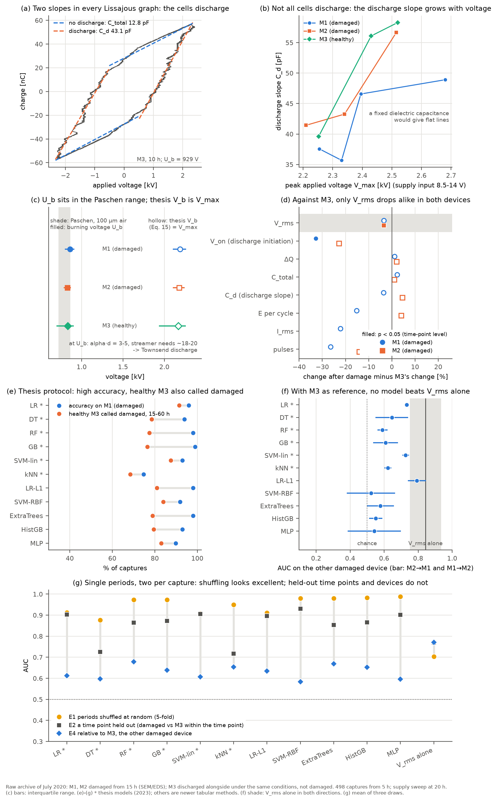
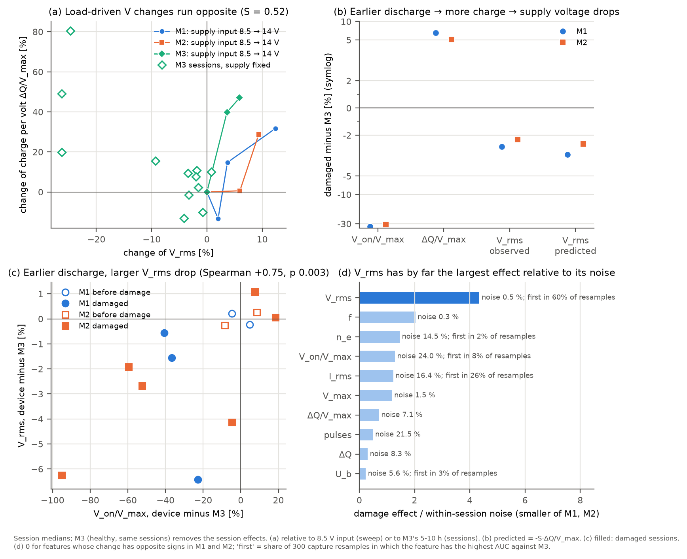
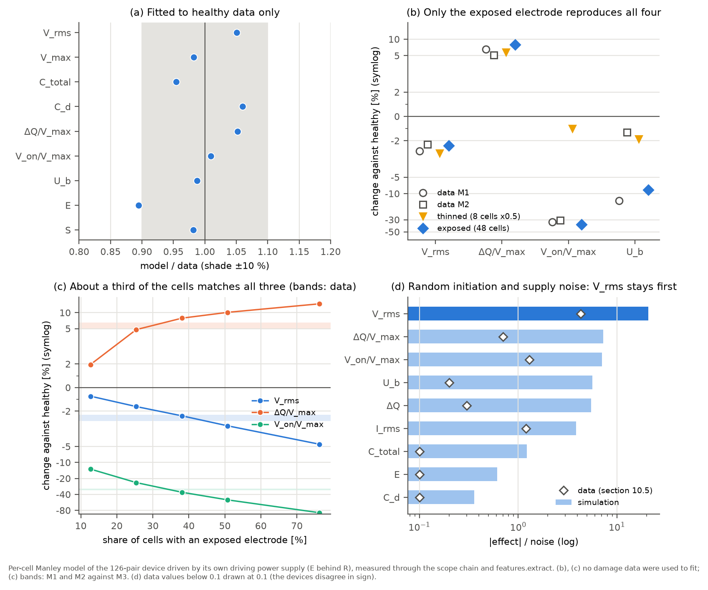
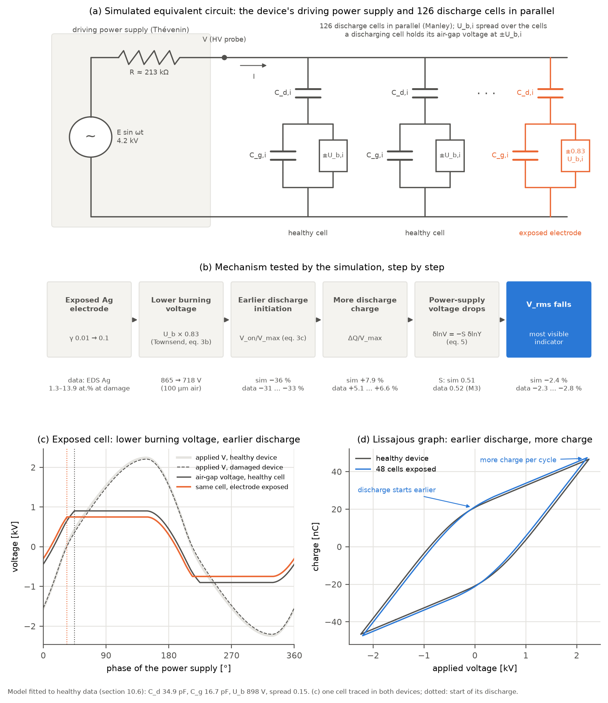

# Verification against the complete raw-data archive (M1, M2, M3)

**English** | [한국어](raw-data-verification.ko.md)

**Subject.** Minjun Kim, *Electrical measurements and prediction of dielectric barrier surface damage in nonthermal atmospheric pressure dielectric barrier discharge plasma based on machine learning*, M.S. thesis, Kwangwoon University, 2023.

**Data.** The complete archive of the July 2020 experiment (`M!M2M3실험데이터종합`, about 5.3 GB). It is not included in this repository.

| Folder | Content |
|---|---|
| `전류전압 측정/1·2·3번소스` | Endurance sessions of M1 (0–25 h), M2 (0–40 h) and M3 (0–60 h). Each session has 20 detail captures (10 at 10 ns and 10 at 20 ns sampling) and one overview capture. |
| `전류전압 측정/4번소스` | 120-cell discharge, single-cell discharge, discharge with a clip contact (a separate device) |
| `전압에 따른 QV 변화` | Supply-input voltage sweep at 20 h (8.5 / 9 / 10 / 14 V) |
| `현미경사진`, `표면사진` | Optical micrographs and whole-device photographs taken at every session |
| `SEM, EDS 데이터` | SEM metadata and Bruker EDS reports (images) for M1, M2, M3 and Ref |
| `*.xlsx` | Per-session summaries computed in 2020 with the MATLAB code |

**Methods.**
1. Re-analysis with this package (`dbd_diagnostics`) of 600 endurance detail captures (500 from 5 h onward are analysed) and 70 sweep captures.
2. Timestamps and dark-burn areas of all 242 micrographs.
3. Every composition table in the EDS reports, compared with Table 3.
4. **M3**, which the thesis did not use, serves as an **undamaged control device**. In every session it was measured on the same day as M1 and M2, 10–33 min after M1.

Reproduce with `python examples/verify_raw_archive.py "<archive>/전류전압 측정" "<archive>/전압에 따른 QV 변화/I 기준으로 계산"`, which prints the numbers of sections 1–6. The numbers and the figure of section 10 are reproduced by `python examples/consistency_check.py "<archive>/전류전압 측정" "<archive>/전압에 따른 QV 변화/I 기준으로 계산" docs/img` (about 8 min), which also writes the figure of section 10.5, `docs/img/vrms_mechanism.png`. The equivalent-circuit simulation of section 10.6 is reproduced by `python examples/vrms_simulation.py docs/img` (no raw data needed, about 11 min). Values read from photographs and EDS reports are recorded in the tables of this document.

Severity levels follow the [verification report](thesis-review.md): **[Major]** affects a conclusion or a headline number; **[Moderate]** the method or wording must change; **[Minor]** notation or wording.

---

## 0. Summary

| # | Finding | Verdict |
|---|---|---|
| 1 | The archive is the thesis dataset. The re-analysis numbers of section H of the verification report are reproduced to the last digit, and the 2020 MATLAB summaries agree (23 of 26 sessions within 1 % for V_rms and 5 % for energy). The 2020 summaries label the energy **"Energy per period"**, which confirms from the original records that "discharge energy per second" is a labelling error (review C1). | Confirmed |
| 2 | The 15 h label boundary matches the M2 micrographs. But the M1 "5h" micrographs (taken 2020-07-20 10:30, before the 10 h measurement) show a **large melted blister at an electrode end**. The "normal (0)" part of the validation set may already contain a damaged cell. | Moderate |
| 3 | ★ The V_rms drop of the 15 h session (evening of 20 July) appears **equally in the undamaged M3** (−133 V against 10 h). Within that session V_rms jumps between ≈1150/1270, 1360 and 1460 V from one capture to the next, seconds apart. This is **switching of the supply's operating mode**, not gradual damage. A difference-in-differences against M3 gives a damage-specific V_rms change of **≈ −48 V** for both M1 and M2, about half of the naive change (−107 / −92 V). | Major |
| 4 | ★ The thesis classifiers trained on M2 call **95–100 %** of the captures of the undamaged M3 at 15, 25 and 40 h, and **100 %** at 45–60 h, "degraded" (mean false-positive rate over 15–40 h: 57–86 %). The classifiers respond to the **applied-voltage level** more than to surface damage. After dividing each feature by the same-session M3 value, cross-device accuracy falls from 94–99 % to **65–78 % (DT/RF/GB; 64–89 % over all six models)**. | Major |
| 5 | Within one session and one device, the oscilloscope settings change the values. Doubling the current A/div raises I_rms by **+3.5 mA** (p = 10⁻¹⁷). Going from 10 to 20 ns sampling raises I_rms by **+4.3 mA**, lowers the pulse count by **6.6**, and raises C_d by **3.0 pF** and U_b by **35 V**. The M2 degraded group has more 0.04 A/div captures (42 % vs 20 %). The claims "I_rms decreases, number of discharges and n_e increase" are confounded with the settings. | Major |
| 6 | In the supply-voltage sweep, the thesis V_b (Eq. 15) follows V_max with slope **0.87–1.08**, while the burning voltage U_b moves with slope 0.23–0.33 only. This is an independent **experimental confirmation** of review C5 (V_b ≡ V_max). | Confirmed |
| 7 | Table 3 (EDS) is traced. The "Normal" column is the `0-X10000-2` map of the **Ref sample**; the "Degradation" column is the `2-1-1X10000-1` map of the **M2 damaged site**. Both columns are **atomic %**. The 12 damaged-site maps give Ag 1.3–13.9 at.%; the 41 intact-dielectric maps give 0.0–0.7 at.% (one map 1.44). The conclusion is robust; the unit and the choice of map should be stated. | Minor |
| 8 | Fig. 7, "discharge current from ~100 mA to ~250 mA", is not reproduced when captures at the same current scale (0.1 A/div) are compared: M2 251 → 272 mA (p = 0.25), M1 252 → 213 mA (a decrease). | Moderate |
| 9 | Some statements of the earlier verification report must be revised. The U_b decrease (p = 2×10⁻⁴) and the increase in the number of discharges (p = 6×10⁻⁴) also occur in M3, in the same direction (−38 V, p = 0.05; +2.7, p = 4×10⁻⁶), so they are not supported as damage indicators. See section 9. | Report revision |
| 10 | The physics assumptions (Manley equivalent circuit, Paschen/Townsend breakdown) agree with the data. The discharge-phase slope C_d grows with the supply voltage, so it is an effective capacitance set by the discharging area, not the dielectric capacitance. The only independent damage signal is the V_rms drop against M3; eleven models, five of them newer than the thesis, do not beat V_rms alone, also with single periods and every capture weighted equally. The V_rms drop is explained, including its size, by 'earlier discharge initiation → more discharge charge → the power-supply voltage drops', and its effect-to-noise ratio is more than twice that of any other feature (10.5). An equivalent-circuit simulation calibrated on healthy data supports an exposed electrode lowering the burning voltage (10.6). See section 10. | Confirmed |

**What holds.**
- The surface damage itself is real. The burn marks in the M1 and M2 micrographs and the Ag increase in EDS agree.
- Both damaged devices lose about 48 V (≈ 3 %) more V_rms than the control. With V_rms referenced to M3, a single feature still gives AUC 0.99 (M1) and 0.83 (M2). A damage-specific signal exists.
- Its size is, however, much smaller than the session-to-session supply variation (M3 alone ranges from 1155 to 1502 V between sessions). Interpreting V_rms changes measured without a control device as damage produces many false alarms.

---

## 1. Archive and reproducibility

### 1.1 Session layout

- Each session has 20 detail captures. `ALL0001–0010` are sampled every 10 ns (about 2 periods), `ALL0011–0020` every 20 ns (about 4 periods). `ALL0021` is an overview capture at 0.2–0.4 ms per sample.
- The voltage channel is at 1000 V/div in every endurance session. Only M3 45 and 50 h used 500 V/div; there a few peak samples (0.3 %) touch the ADC rail (1940 V), but a sine fit without those samples gives the same V_rms (1122 V vs 1126 V). The voltage drop of those two sessions is real.
- The current channel changes between 0.04, 0.1, 0.2 and 0.4 A/div from session to session, and sometimes between the two blocks of one session (section 5).
- There are two 0 h sessions (17 and 18 July), but the thesis starts at 5 h. The M3 0 h session of 18 July is corrupt (Δt = 0), as its folder name says.
- In every session the order is M1 → M2 → M3, and all three devices were measured within 10–33 min (14 min at 15 h).

### 1.2 Reproduction of the earlier re-analysis (M2, normal 5–10 h n = 40, degraded 15–40 h n = 120)

| Quantity | Verification report, section H | This archive |
|---|---|---|
| Energy per cycle | 0.131 / 0.132 mJ | 0.1308 / 0.1321 mJ |
| V_rms | 1489 / 1396 V | 1489 / 1396 V |
| C_dielectric | 34.5 / 37.2 pF | 34.45 / 37.18 pF |
| V_max | 2284 / 2155 V | 2284 / 2155 V |
| U_b | 860 / 811 V | 860.1 / 810.5 V |
| T_e (from U_b) | 6.2 / 6.0 eV | 6.22 / 5.97 eV |

All values agree, so the data used in the earlier review (remote repository) and this archive are the same data.

**Table 1.** The thesis gives 46.5 kHz, 1.5 kV and 19.8 mA at discharge start. The re-analysis gives 46.9 kHz, 1481 V, 20.3 mA (M2, 5 h) and 46.95 kHz, 1484 V, 20.1 mA (M1, 5 h), in agreement.

### 1.3 Comparison with the 2020 MATLAB summaries

The 26 per-session `*종합데이터.xlsx` workbooks (each the mean of 10 detail captures) were compared with the re-analysis of the same captures.

| | Median difference | Sessions in agreement |
|---|---|---|
| V_rms | +0.11 % | 23/26 within 1 % |
| Energy per cycle | +0.25 % | 23/26 within 5 % |
| I_rms | +0.9 % | 21/26 within 4 % |

- The three mismatching sessions (M1 10 h, M2 15 h, one of two M3 60 h files) average a different block of captures. For example, the M2 15 h workbook value of 1375.6 V matches the `ALL0011–0020` block (1378.6 V).
- The 2020 workbooks name the energy row `Energy per period`. The original computation thus confirms review C1: the "discharge energy per second, 0.13 mJ" of Eq. (11) is an energy per cycle.
- `20200724_M4_40h 종합데이터.xlsx` in the M2 folder is a file-name typo (M2, 40 h).

---

## 2. Labels: micrographs and photographs

### 2.1 Timeline

File modification times (when the camera or microscope PC saved the file) and the measurement times in the CSV headers:

| Date | Electrical measurement | Micrographs |
|---|---|---|
| 18 July | 5 h: M1 14:22, M2 14:31, M3 14:40 | – |
| 20 July | – | "5h": M1 10:30, M2 10:37, M3 10:53 |
| 20 July | 10 h: M1 15:11, M2 15:20, M3 15:26 | 10 h: M1 16:45, M2 16:50, M3 16:58 |
| 20 July | 15 h: M1 19:58, M2 20:04, M3 20:10 | 15 h: M1 21:13, M2 21:17, M3 21:19 |
| 21 July | 20 h: M1 14:48, M2 15:07, M3 15:18 / 25 h: M1 20:26, M2 20:36, M3 20:42 | 20 h 16:40–16:55, 25 h 21:44–21:52 |

The "5h" micrographs were taken on the morning of 20 July, before the 5 → 10 h run.

### 2.2 Quantified burn marks

For every micrograph (640×480), the largest connected region with luminance < 90 was found; a region ≥ 150 px counts as a burn mark.

| Hours | M1 | M2 | M3 |
|---|---|---|---|
| 5 | **4/9** (max 1521 px) | 0/5 | 0/8 |
| 10 | 0/5 | 0/5 | 0/4 |
| 15 | 2/5 | 2/5 | 0/4 |
| 20 | 3/6 | 2/5 | 0/6 |
| 25 | 3/9 | 2/6 | 0/4 |
| 30 | – | 3/9 | 0/11 |
| 35 | – | 2/10 | 0/15 |
| 40 | – | 2/13 | 0/16 |
| 45–60 | – | – | 1/82 (one 159 px speck at 55 h) |

- **M2** [OK]: no burn marks at 5 and 10 h; dark erosion marks in every session from 15 h on. This matches the thesis label boundary (≤ 10 h normal, ≥ 15 h degraded).
- **M1** [Moderate]: dark erosion marks also start at 15 h. But `Snapshot000008` and `Snapshot000010` of the "5h" set show a **large melted blister** covering an electrode end. A similar melted region appears in 20 h `Snapshot000004`, and at 25 h the experimenter named a photograph `오른쪽 끝 결국 터짐` ("right end finally burst"), which suggests the same site was being tracked. Since these photographs predate the 10 h measurement, the M1 5 h and 10 h sessions that the thesis labels normal (0) — the 80 normal rows of the validation set — may already contain a damaged cell. Fig. 27 and Sec. 5.3 should say so, or the labelling rule should distinguish damage types (erosion vs melting/blistering).
- **M3**: no burn marks up to 50 h. This matches Sec. 4.2 of the thesis ("surface damage was observed in two samples"). M3 is the healthy comparison device, discharged alongside M1 and M2 under the same conditions; the experimenter confirmed that it was not damaged.

---

## 3. ★ M3 as a control: common-mode session effects [Major]

### 3.1 Session means of V_rms [V]

| Hours | M1 | M2 | M3 |
|---|---|---|---|
| 5 | 1484 | 1481 | 1484 |
| 10 | 1501 | 1496 | 1502 |
| **15** | **1273** | **1312** | **1369** |
| 20 | 1460 | 1432 | 1478 |
| 25 | 1423 | 1355 | 1454 |
| 30 | – | 1436 | 1475 |
| 35 | – | 1399 | 1473 |
| 40 | – | 1445 | 1443 |
| 45 / 50 / 55 / 60 | – | – | 1155 / 1156 / 1454 / 1176 |

- Before damage (5 and 10 h) the three devices agree to within a few volts.
- At 15 h all three drop **together**; the undamaged M3 drops by 133 V.
- M3 falls to 1155 V at 45 and 50 h and recovers to 1454 V at 55 h, although it is not damaged.

### 3.2 Voltage jumps within a session

V_rms [V] of the 15 h session in capture order (20 captures in about 4 min):

```
M2 15h  1457 1456 1149 1135 1459 1166 1147 1168 1153 1160 1359 1358 1469 1351 1358 1481 1364 1356 1340 1349
M3 15h  1464 1447 1264 1282 1453 1282 1294 1471 1481 1468 1464 1464 1461 1272 1281 1445 1276 1274 1274 1271
M1 15h  1274 1289 1273 1270 1277 1272 1274 1264 1272 1270 1275 1273 1280 1267 1270 1271 1273 1278 1272 1266
```

- The applied voltage jumps between discrete levels within seconds. This looks like mode switching of the resonant supply; gradual surface damage cannot explain it.
- The undamaged M3 jumps in the same way at the same time. On the evening of 20 July the supply (or its environment) varied in a way common to all three devices.

### 3.3 Difference-in-differences against M3

The change from "before" (5–10 h) to "after" (15 h to the last session), minus the M3 change over the same sessions. p (M3) is a Welch test of the M3 change itself; p (DiD) tests the session-mean differences (2 sessions before, 3–6 after).

| Device | Feature | Naive change | M3 change | p (M3) | DiD | p (DiD) |
|---|---|---|---|---|---|---|
| M1 | V_rms | −107 V | −59 V | 7×10⁻⁷ | **−48 V** | 0.18 |
| M2 | V_rms | −92 V | −44 V | 2×10⁻⁷ | **−48 V** | 0.018 |
| M1 | V_max | −156 V | −103 V | 2×10⁻⁶ | −54 V | 0.34 |
| M2 | V_max | −129 V | −65 V | 7×10⁻⁵ | −63 V | 0.16 |
| M1 | U_b | −148 V | −48 V | 0.024 | −100 V | 0.14 |
| M2 | U_b | −50 V | −38 V | 0.049 | −12 V | 0.80 |
| M1 | C_d | +1.5 pF | +1.3 pF | 0.43 | +0.2 pF | 0.98 |
| M2 | C_d | +2.7 pF | +0.1 pF | 0.93 | +2.6 pF | 0.56 |
| M2 | C_total | +0.66 pF | +0.27 pF | 0.45 | +0.40 pF | 0.50 |
| M2 | Q_max | +3.2 nC | −0.4 nC | 0.85 | +3.6 nC | 0.36 |
| M1 | Number of discharges | +0.5 | **+2.6** | 4×10⁻⁴ | −2.1 | 0.43 |
| M2 | Number of discharges | +3.7 | **+2.7** | 4×10⁻⁶ | +1.0 | 0.59 |

- **V_rms**: both damaged devices drop about 48 V more than the control. The same sign and size in both devices make a damage-specific effect plausible, but it is about half of the naive comparison.
- **Number of discharges** and **U_b** change significantly, in the same direction, in the undamaged M3. There is no evidence that they indicate damage.
- The increases of C_d, C_total and Q_max point the right way relative to the control but are not significant at the session level (low power).

---

## 4. ★ The classifiers call the control device "degraded" [Major]

### 4.1 False positives on M3

Share [%] of M3 captures classified "degraded" by models trained on M2 (5–10 h = 0, 15–40 h = 1) with the thesis' 14 features and hyper-parameters:

| Model | 5 | 10 | 15 | 20 | 25 | 30 | 35 | 40 | 45 | 50 | 55 | 60 |
|---|---|---|---|---|---|---|---|---|---|---|---|---|
| LR | 5 | 25 | 100 | 80 | 100 | 80 | 55 | 100 | 100 | 100 | 100 | 100 |
| DT | 5 | 20 | 95 | 20 | 100 | 25 | 35 | 95 | 100 | 100 | 95 | 100 |
| **RF** | 5 | 20 | **95** | 20 | **100** | 30 | 35 | **95** | 100 | 100 | 100 | 100 |
| GB | 35 | 25 | 95 | 25 | 100 | 25 | 40 | 100 | 100 | 100 | 100 | 100 |
| SVM | 5 | 20 | 100 | 40 | 100 | 60 | 70 | 100 | 100 | 100 | 100 | 100 |
| kNN | 10 | 80 | 95 | 30 | 50 | 40 | 30 | 95 | 100 | 100 | 45 | 100 |

- Of the 15–40 h captures of M3, which show no burn marks, 57–86 % (RF 62.5 %) are classified "degraded". The false positives concentrate in sessions with low V_rms (15, 25, 40, 45–60 h).
- Even in the undamaged M3, V_rms alone separates the "≤ 10 h" and "≥ 15 h" sessions with AUC 0.90. Much of the classifiers' performance (V_rms alone: AUC 0.996) comes from this common-mode session effect.
- Training on M1 and M2 together gives nearly the same result.

### 4.2 Referencing to the control device

Each feature was divided by the same-session M3 mean, which roughly removes the common-mode session effect, and the cross-device accuracy was recomputed:

| Setting | DT | RF | GB | LR | SVM | kNN |
|---|---|---|---|---|---|---|
| Raw features, M2 → M1 | 99.0 % | 99.0 % | 94.0 % | 95.0 % | 92.0 % | 74.0 % |
| Referenced to M3, M2 → M1 | 65.0 % | 75.0 % | 65.0 % | 89.0 % | 84.0 % | 85.0 % |
| Raw features, M1 → M2 | 98.8 % | 96.2 % | 98.8 % | 79.4 % | 86.9 % | 66.9 % |
| Referenced to M3, M1 → M2 | 78.1 % | 68.8 % | 78.1 % | 71.9 % | 71.9 % | 63.8 % |

- A signal survives the referencing: referenced V_rms alone gives AUC 0.99 (M1) and 0.83 (M2).
- The M3 session means themselves contain mode jumps (section 3.2), so the referencing is a rough approximation. It does not change the conclusion that much of the "damage signal" was a session effect.

---

## 5. Dependence on measurement settings [Major for I_rms, number of discharges, n_e]

### 5.1 Comparisons within a session

Effect of the oscilloscope settings, from a regression with session fixed effects (500 captures):

| Feature | Per doubling of A/div | p | 20 ns vs 10 ns | p |
|---|---|---|---|---|
| I_rms | **+3.5 mA** | 10⁻¹⁷ | **+4.3 mA** | 5×10⁻⁵³ |
| Peak current | +59 mA | 4×10⁻¹⁰ | +37 mA | 9×10⁻¹⁰ |
| Number of discharges | +1.1 | 0.11 | **−6.6** | 3×10⁻⁴⁵ |
| n_e (thesis method) | +2.7×10¹² cm⁻³ | 2×10⁻⁸ | +5×10¹¹ | 0.07 |
| C_d | +0.3 pF | 0.54 | **+3.0 pF** | 2×10⁻²⁰ |
| U_b | +45 V | 3×10⁻⁹ | +35 V | 3×10⁻¹³ |
| V_rms | +19 V | 5×10⁻⁴ | −5 V | 0.13 |

Examples: in the M2 10 h session, I_rms is 16.1 mA at 0.04 A/div and 22.9 mA at 0.1 A/div. At M2 40 h it is 24.3 mA at 0.1 A/div and 36.4 mA at 0.2 A/div.

### 5.2 Causes

- The current channel does not clip: 0–1 % of captures repeat their extreme value three or more times.
- The noise floor scales with A/div: 2.4 / 5.9 / 11.9 mA at 0.04 / 0.1 / 0.2 A/div (1 LSB = 1.6 / 4 / 8 mA).
- Pulse detection depends directly on the time resolution (review B2).

### 5.3 Consequences for the thesis

Settings in the two M2 groups:

| Group | 0.04 A/div | 0.1 A/div | 0.2 A/div |
|---|---|---|---|
| Normal (5–10 h) | 8 | 32 | 0 |
| Degraded (15–40 h) | 50 | 60 | 10 |

- The degraded group has more low-sensitivity captures (0.04 A/div). This composition partly explains the "I_rms decrease" (20.8 → 18.6 mA).
- The number of discharges and the electron density change with the settings. Comparisons that do not fix the settings or include them as covariates cannot be read as damage effects.
- Because the settings differ between sessions, these features also act as **session identifiers** (quantitative confirmation of review D5-3).

---

## 6. Supply-voltage sweep: experimental confirmation of V_b ≡ V_max

Measured at 20 h with different supply-input voltages (8.5 V = the 20 h endurance session):

| Device | Supply [V] | V_rms | V_max | Thesis V_b (Eq. 15) | U_b | Thesis T_e [eV] |
|---|---|---|---|---|---|---|
| M1 | 8.5 / 9 / 10 / 14 | 1460 → 1654 | 2259 → 2681 | 2193 → 2642 | 857 → 956 | 12.1 → 14.0 |
| M2 | 8.5 / 10 / 14 | 1432 → 1562 | 2222 → 2530 | 2175 → 2447 | 849 → 966 | 12.0 → 13.1 |
| M3 | 8.5 / 10 / 14 | 1478 → 1577 | 2250 → 2525 | 2171 → 2428 | 870 → 935 | 12.0 → 13.1 |

| Device | dV_b/dV_max | r | dU_b/dV_max |
|---|---|---|---|
| M1 | 1.08 | 0.93 | 0.23 |
| M2 | 0.87 | 0.86 | 0.33 |
| M3 | 0.95 | 0.86 | 0.29 |

- The thesis "discharge voltage" V_b follows the applied peak voltage almost 1 : 1 (mean V_b − V_max = −57 to −94 V).
- The gas burning voltage U_b changes by only about a third as much.
- The thesis T_e is a function of V_b, so it moves with V_max.
- This confirms review C5 (Eq. 15 is identically V_max) and C6 (T_e restates V_b) under a different experimental condition.

---

## 7. Source of Table 3 (EDS) [Minor]

### 7.1 Source

| Table 3 column | Original report | Sample | Matching column |
|---|---|---|---|
| Normal | `Ref SEM, EDS/Ref EDS/0-X10000-2` (2020-07-27) | Ref sample, 10,000× map | **Atom [%]**, all 10 elements (C 7.70, O 30.27, Na 9.19, Mg 2.48, Al 20.04, Si 13.60, Ca 2.41, Zn 7.09, Ag 0.57, Pb 6.65) |
| Degradation | `M2 SEM, EDS/20200727 M2 EDS/2-1/2-1-1X10000-1` | M2 damaged site, 10,000× map | **Atom [%]**, all 10 elements (C 7.22, O 27.69, Na 6.49, Mg 2.52, Al 15.54, Si 9.88, Ca 2.03, Zn 8.87, Ag 13.86, Pb 5.90) |

- Table 3 gives the composition only as "[%]". It should say **atomic % (at.%)**. The same Ag 13.86 at.% is 31.05 wt.%.
- Pt (coating) is set to zero.

### 7.2 Distribution over all maps (Ag, at.%)

| Site | Maps | Ag [at.%] |
|---|---|---|
| Ref sample | 6 | 0.00, 0.00, 0.02, 0.05, 0.38, **0.57** |
| M3 after 60 h (31 July) | 13 | 12 maps 0.00–0.25, one map 1.44 |
| M2 intact sites 2-2, 2-3, 2-4 (27 July) | 10 | 0.00–0.56 |
| M1 dielectric over, between and away from the electrodes (23 July) | 12 | 0.01–0.68 |
| M1 exposed electrode, burnt part 1-1 (23 July) | 4 | 5.08, 7.21, 8.70, 11.94 |
| M1 exposed electrode, burst part 1-2 (23 July) | 4 | 1.28, 1.43, 2.87, 3.22 |
| M2 damaged site 2-1 (27 July) | 4 | 3.78, 4.28, 11.59, **13.86** |

- Damaged sites (12 maps, 1.3–13.9 at.%) and intact dielectric (41 maps, mostly ≤ 0.7 at.%) separate clearly. The conclusion that the damaged dielectric exposes the electrode is robust.
- Each Table 3 value is the maximum among the maps of its site (Normal 0.57 is the highest Ref map; Degradation 13.86 the highest 2-1 map). Ranges, or mean ± SD, would be more representative.
- The "(a) normal discharge electrode" of Sec. 4.3 and Figs. 23–24 is in fact the **Ref sample**. The thesis should state whether Ref is a discharged or an unused electrode.

---

## 8. The example of Fig. 7 [Moderate]

The thesis states that after surface damage "the discharge current rose sharply from about 100 mA to about 250 mA" and "the discharge initiation voltage fell from about 500 V to 400 V". Comparing captures at the same current scale (0.1 A/div):

| Device | Peak current, normal → degraded | p | V_min, normal → degraded | p |
|---|---|---|---|---|
| M2 | 251 ± 68 → 272 ± 97 mA | 0.25 | 675 → 607 V | 0.09 |
| M1 | 252 ± 62 → 213 ± 39 mA | 0.002 (decrease) | 821 → 556 V | 4×10⁻⁵ |

- The normal peak current is already about 250 mA. The 2.5-fold increase is not reproduced; Fig. 7 is an unrepresentative single example (0.04 A/div captures give low peaks of about 150 mA).
- The decrease of the discharge initiation voltage is significant for M1 only.

---

## 9. Revisions to the earlier verification report (thesis-review.md)

These revisions have been applied to the [verification report](thesis-review.md) (section J and the locations below), the README and the [erratum](erratum.md) (items 59–65; revised items 2, 4 and 47).

| Location | Earlier statement | Revision |
|---|---|---|
| C5, consequences | "The decrease of U_b with damage (p = 2×10⁻⁴) is itself a meaningful new indicator." | U_b also falls in M3, by 38 V (p = 0.05). The M2 DiD is −12 V (p = 0.80), so there is no evidence that U_b indicates damage. U_b also depends on the sampling setting (+35 V). |
| D1, H | "Number of discharges (MAD 5σ) up, p = 6×10⁻⁴" | It also rises in M3 (+2.7, p = 4×10⁻⁶) and changes by 6.6 with the sampling interval. It cannot be read as a damage effect. |
| D6, README | "V_rms alone gives AUC ≈ 1.0; damage → load change → sag of the supply output" | About half of the drop is a common-mode session effect that the undamaged M3 also shows. The "control experiment" requested in D6 already exists in the archive (M3). The damage-specific part is ≈ −48 V. |
| D5-3 | "The current-probe scale changed between sessions, so resolution and noise floor encode session identity" (hypothesis) | Confirmed quantitatively (section 5). |
| H, README | Cross-device accuracy DT/RF/GB 95–99 % | 65–78 % (DT/RF/GB; 64–89 % over all six models) after correcting for the common-mode session effect. False-positive rate on the undamaged M3: 57–86 % (15–40 h). |
| README summary | "The V_rms decrease and C_total increase are significant." | V_rms still decreases relative to the control (≈ −48 V). The C_total increase is not significant against the control at the session level. |

---

## 10. Do the physics, the statistics and the ML agree? [Confirmed]

Without new experiments, this archive alone was used to check whether the physical assumptions, the measured results and the machine-learning results of the thesis point the same way. How many of the 126 pairs discharge is unknown, so every comparison is a statistical comparison over many captures and sessions. Two captures whose period detection failed (M1 10 h, M3 10 h; half or double the period) are left out.

- Every feature is computed for each full period of a capture and then averaged. A 10 ns capture holds 2 periods and a 20 ns capture 4, so the 498 endurance captures give 1,493 periods.
- The three devices ran from the same mains (KEPCO) on separate power strips, each on its own driving power supply behind a DC power supply (confirmed by the experimenter). Each device's voltage therefore follows its own load, and the session effects common to all three come from the shared mains or the room environment.



*(a) The two slopes of a Lissajous graph (b) Discharge-phase slope against supply voltage (c) U_b against the Paschen range, and the thesis V_b (d) Damage effect against M3 (e) Thesis protocol: accuracy and false alarms on M3 (f) Cross-device AUC with features referenced to M3 (g) Single periods: shuffled, a session held out, relative to M3 on the other device*

### 10.1 Physical assumptions and the data

| Assumption | Data | Verdict |
|---|---|---|
| During the discharge the air-gap voltage stays at the burning voltage U_b (Manley equivalent circuit) | In all 498 captures from 5 h on, the discharge-phase slope exceeds the no-discharge slope (Fig. a). Two independent U_b estimates agree within 3 % (discharge initiation point 828–860 V, geometry 842–882 V). The measured energy per cycle is 1.17 times the ideal Manley value | Agrees |
| Breakdown follows Paschen's law | The Paschen voltage of a 100 µm air gap is 718–865 V (γ = 0.1–0.01); the interquartile range of the measured U_b is 773–888 V (Fig. c) | Agrees |
| Mechanism: Townsend or streamer | At the measured U_b, αd = 3.2–5.0, far below the streamer (Meek) criterion αd ≈ 18–20. The Townsend condition γ(e^{αd} − 1) = 1 then needs γ = 0.007–0.045, typical of dielectric surfaces | Townsend suffices |
| Not all 126 pairs discharge | In the 20 h supply sweep the discharge-phase slope rises from 8.5 V to 14 V input: M1 37.6 → 48.9, M2 41.4 → 56.7, M3 39.6 → 58.3 pF (Fig. b). A fixed dielectric capacitance would not change. The discharging area grows with voltage (partial surface discharging; Peeters & van de Sanden, *Plasma Sources Sci. Technol.* 24, 015016, 2015) | Agrees |
| Thesis V_b and T_e | V_b/V_max = 0.984 ± 0.033; the correlation of T_e with V_b is 0.9999 | Not independent quantities |
| Number of discharges | Within the same sessions, 10 ns → 20 ns sampling gives M1 12.9 → 6.0, M2 15.4 → 6.6, M3 12.8 → 9.6 | Set by the instrument's resolution |

- The thesis' C_dielectric is not the dielectric's own capacitance but an **effective capacitance set by the discharging area**.
- Where the applied voltage changes at the same time, changes in C_dielectric, ΔQ and energy cannot be attributed to damage.

### 10.2 Damage and the electrical features (against M3, per session)

The change from before (5–10 h) to after (15 h to the end) minus M3's change over the same sessions. Values are differences of session means of the logarithm (%); p is a Welch test on the session means (2 before, 3–6 after).

| Feature | M1 | M2 | Verdict |
|---|---|---|---|
| V_rms | −3.5 % (p 0.19) | −3.5 % (p 0.017) | Same size in both devices |
| Discharge initiation voltage V_on (thesis V_min) | −33 % (p 0.020) | −23 % (p 0.38) | Same direction |
| ΔQ | +1.2 % (p 0.95) | +2.0 % (p 0.75) | Direction only |
| C_total | +2.3 % (p 0.83) | +1.0 % (p 0.66) | Direction only |
| C_d (discharge-phase slope) | −3.6 % (p 0.87) | +4.6 % (p 0.54) | Opposite directions |
| Energy per cycle | −15.2 % (p 0.56) | +4.0 % (p 0.52) | Opposite directions |
| I_rms | −22.2 % (p 0.16) | −12.4 % (p 0.30) | Affected by scope settings (10.3) |
| Number of discharges | −26.4 % (p 0.42) | −14.0 % (p 0.37) | Affected by scope settings |

- After removing the dependence on V_max found in the healthy captures (all of M3, and M1 and M2 at 5–10 h), no feature remains significant (all p ≥ 0.14).
- The only independent electrical signal of damage is, in effect, the applied voltage.
- The decrease of the discharge initiation voltage V_on (the thesis' V_min) points the way expected if damaged cells start discharging first, but it is not significant once its voltage dependence is removed.

### 10.3 ML re-check: the six thesis models and five newer ones

- **Thesis models**: LR, DT, RF, GB, linear SVM, kNN (k = 3).
- **Newer models**: L1-regularised LR, RBF-SVM, ExtraTrees, HistGradientBoosting (the LightGBM family), MLP.
  - XGBoost and LightGBM could not run here because the OpenMP library was missing; HistGradientBoosting, from the same family, stands in for them.
- **Features**: the 14 of the thesis.

| Protocol | Result |
|---|---|
| (a) Thesis protocol: raw features, train on M2, test on M1 | Accuracy on M1 0.90–0.99 (kNN 0.75), AUC 0.93–1.00 (kNN 0.78). The same models call 68–92 % of the healthy M3's captures at 15–60 h "degraded" (Fig. e) |
| (b) Log ratios to each device's own 5–10 h, M3 in training as healthy, leave one session out | Within a session, damaged devices and M3 are separated with AUC 0.73–0.89 (best GB 0.89, HistGB 0.88). But the models also call 39–97 % of M1 and M2 in the pre-damage sessions (5 and 10 h) "degraded" |
| (b′) Same, with the 9 features that do not depend on scope settings | Within-session AUC 0.64–0.81; false alarms in the pre-damage sessions 40–98 % |
| (c) Features relative to M3 in the same session, train on one damaged device, test on the other | AUC of the 11 models: 0.38–0.84 (M2 → M1) and 0.59–0.74 (M1 → M2). **Logistic regression on V_rms alone gives 0.94 / 0.75**, equal to or better than every model (Fig. f) |

- **The important features in (b) are traces of the scope settings.**
  - The top permutation importances are V_rms, I_rms and the number of discharges for RF, and I_rms, V_rms and the number of discharges for HistGB.
  - I_rms and the number of discharges change with the scope settings (section 5).
  - The share of 0.04 A/div captures, which raise I_rms, grows in the damaged period (M1 10 → 33 %, M2 20 → 42 %, M3 0 → 15 %).
- **The false alarms in the pre-damage sessions of (b) mean that the models partly learned "M1 or M2 versus M3".** With M3 as the only healthy device, damage cannot be fully separated from device differences, including the measurement order.
- **In (c), the more flexible the model, the more it overfits the training device** (RF, boosting, MLP, RBF-SVM).
- **The newer models do not change the conclusion.** What recent ML practice changes is the evaluation rather than the model: grouped validation, a healthy control, checks for confounders and permutation importance. With these, the high thesis accuracy is seen to come from session effects and scope settings.

#### Single periods, every capture weighted equally

- The checks above use, for each capture, the mean of its full periods computed one by one.
- Here **one period is one row**, and **two periods are drawn from every capture** (498 captures, 996 periods).
  - Every capture, session and sampling setting (10/20 ns) therefore weighs the same.
  - Class sizes are handled by balanced accuracy and AUC.
  - The draw was repeated three times; the standard deviation of the results is at most 0.09.
- Each device had its own driving power supply, so the drive frequency differs between devices (M1 46.99, M2 46.54, M3 46.30 kHz).

| Protocol | Guards against | 11 models | V_rms alone |
|---|---|---|---|
| E1. Periods shuffled at random, 5-fold cross-validation | Nothing | Balanced accuracy 0.83–0.95, AUC 0.88–0.99. False alarms 3–10 % on M3, 1–17 % in the pre-damage sessions | AUC 0.70 |
| E2. A whole session held out | Leakage of the session's state | Within-session AUC 0.72–0.93. False alarms in the pre-damage sessions 5–43 % (RF 5 %, GB 6 %) | Within-session AUC 0.77 |
| E4. Features relative to M3 in the same session, train on one damaged device, test on the other | Session effects and device differences | AUC 0.49–0.70 (M1), 0.57–0.72 (M2) | **AUC 0.80 (M1), 0.74 (M2)** |

- **The high E1 scores come from leakage.** The other periods of the same capture, and about 32 periods of the same session, are in the training set, so the model has already seen the state of the test session. This is the structure of the thesis split (half periods as separate rows, split at random; verification report D5) (Fig. g).
- **In E2 the models use V_rms and the drive frequency.**
  - The top permutation importances are V_rms 0.175 and frequency 0.045 for RF, and V_rms 0.191 and frequency 0.074 for GB.
  - V_rms and frequency alone give a within-session AUC of 0.59–0.83 (RBF-SVM 0.83, with 4 % false alarms in the pre-damage sessions).
  - The frequency is a fingerprint of each device's own driving power supply, so the models learn "V_rms drop, and not M3".
- **In E4, V_rms alone is the best.** Its AUC averaged over both directions is 0.77, above the 0.58–0.68 of the 11 models.
- **A single period is noisier than a capture mean.** The AUC of V_rms alone is lower than at the capture level (0.94 / 0.75); averaging periods makes the damage signal clearer.
- **The conclusion does not change.** With single periods and every capture weighted equally, the only damage information that generalises is the V_rms drop relative to a healthy device in the same session.

### 10.4 Do the three lines of evidence agree?

| | Physics | Statistics (against M3) | ML (confounders controlled) |
|---|---|---|---|
| Discharge present, Paschen/Townsend breakdown | Agrees | — | — |
| Partial surface discharging (C_d is effective) | Agrees (sweep) | — | — |
| **V_rms drop of about 3.5 %** | Consistent with a heavier load lowering the output voltage of the driving power supply | Same size in both devices (M2 p = 0.017) | The only information that carries over to another device |
| Lower discharge initiation voltage | Consistent with damaged cells starting to discharge first | Direction only | Small contribution |
| I_rms, number of discharges, n_e, T_e, V_b | Problems of settings, resolution or definition | Not significant | Used as confounders |

- The one damage indicator that physics, statistics and ML point to together is the **V_rms drop relative to a healthy device in the same session**.
- With two damaged devices, and with possibly damaged cells already in M1's pre-damage period (section 2.2), this is the most consistent clue, not an established result.
- Limitations of this section: there is only one healthy device, and within a session the devices were measured in the order M1 → M2 → M3, 10–33 min apart.

### 10.5 Physical interpretation and robustness of the V_rms drop

> **Conclusion.** When damage occurs, the clearest electrical indicator is the **drop of the effective voltage V_rms**: 2.3–3.5 % more than the healthy device M3 in the same sessions.
> - Its size matches, within 17 %, the prediction of the mechanism "earlier discharge initiation → more discharge charge → the voltage of the driving power supply drops", derived below from stated assumptions.
> - An equivalent-circuit simulation calibrated on healthy data only (10.6) reproduces the changes of V_rms, ΔQ/V, the discharge initiation voltage and U_b together, in sign and size, when an exposed electrode lowers the burning voltage.
> - V_rms stays in front when the random elements change: which sessions are pre-damage, the capture sample, the period draw and the choice of model.
> - With two damaged devices this makes V_rms the most consistent indicator in these data, not a general diagnostic threshold.



*(a) Discharge charge per volt when the power supply changes the voltage and when the load does (b) Earlier discharge initiation → more discharge charge → V_rms drop, predicted and observed (c) Discharge initiation voltage and V_rms per session (d) Effect-to-noise ratio per feature*

#### Terms

| Symbol | Term in this section | Relation to the thesis |
|---|---|---|
| C_d, C_g | Dielectric capacitance, air-gap capacitance | "dielectric capacitor", "air gap capacitor" of thesis Sec. 3.2.2 |
| U_b | Burning voltage: the air-gap voltage while a cell discharges; a discharge starts when the air-gap voltage reaches it | Term of the erratum. The discharge voltage V_b of thesis Eq. (15) equals V_max and is not used |
| V_on | Discharge initiation voltage: the applied voltage at which the discharge starts | The thesis' V_min (Sec. 3.1.1, 300–500 V) |
| ΔQ | Discharge charge: the charge that flows during the discharge phase | The thesis' Q_max |
| E, R | Open-circuit voltage and output impedance of the driving power supply | Each device runs on its own driving power supply behind a DC power supply |

#### Assumptions

| | Assumption | Basis |
|---|---|---|
| A1 | Each discharge cell is a dielectric capacitance C_d,i in series with an air-gap capacitance C_g,i (thesis Figs. 17–18). A discharge starts when the air-gap voltage reaches the burning voltage U_b, and the air-gap voltage stays at ±U_b while the cell discharges (Manley) | 10.1: two slopes in every Lissajous graph; two independent U_b estimates agree |
| A2 | U_b is set by the air gap (100 µm of air; Townsend discharge) | 10.1: Paschen range, αd = 3–5 |
| A3 | The 126 cell pairs are in parallel and start discharging independently; device quantities are sums over cells; not all cells discharge | Thesis Sec. 2.1.1; 10.1: discharge-phase slope rises in the sweep |
| A4 | Each device runs on its own driving power supply. At the drive frequency the power supply is a Thévenin equivalent, open-circuit voltage E behind output impedance Z_s; with the supply input fixed (8.5 V), E is fixed | Confirmed by the experimenter: mains → a power strip per device → DC power supply → device |
| A5 | Damage thins (erosion) or removes (exposed electrode) the dielectric of some cells, thickness t_i. An exposed Ag surface changes the secondary electron emission coefficient γ. The air gap is unchanged | Thesis Sec. 2.2; sections 2 (micrographs) and 7 (EDS: Ag 1.3–13.9 at.% at damaged sites) |
| A6 | Session effects common to all devices (mains, room environment) cancel against M3 in the same session; damage changes are a few per cent, so linearisation holds | Section 3, 10.2 |

#### Derivation

**Step 1. Discharge initiation voltage and discharge charge of one cell (A1, A2).** The applied voltage divides between the dielectric and the air gap:

$$v = \frac{Q}{C_d} + u_g \quad\Rightarrow\quad u_g = v - \frac{Q}{C_d}$$

- Without discharge the slope of the Lissajous graph is $dQ/dv = C_t = C_dC_g/(C_d + C_g)$.
- During the discharge $u_g = \pm U_b$, so $Q = C_d(v \mp U_b)$ and the slope is $C_d$.
- At the peak applied voltage $Q_{max} = C_d(V_{max} - U_b)$. Then Q falls without discharge, $Q = Q_{max} - C_t(V_{max} - v)$, until the air-gap voltage reaches $u_g = -U_b$ and the next discharge starts.
- Solving gives $V_{max} - v = 2U_bC_d/(C_d - C_t) = 2U_{min}$, and by symmetry of the half periods:

$$V_{on} = 2U_{min} - V_{max}, \qquad U_{min} = U_b\left(1 + \frac{C_g}{C_d}\right) \qquad (1)$$

$$\Delta Q = C_d\,(V_{max} - V_{on}) = 2C_d\,(V_{max} - U_{min}), \qquad E_{cycle} = 2U_b\,\Delta Q = 4C_dU_b\,(V_{max} - U_{min}) \qquad (2)$$

- $V_{on}$ is the thesis' discharge initiation voltage $V_{min}$, and (2) is Manley's equation.
- Check with the measured values: $U_{min}$ = 1257–1289 V and $V_{max}$ ≈ 2.2 kV give $V_{on}$ ≈ 0.3 kV, the same size as the discharge initiation voltage measured on the Lissajous graphs (0.37–0.45 kV; thesis 300–500 V).

**Step 2. Damaged cells start discharging earlier and carry more discharge charge (A3, A5).** Damage can lower $U_{min,i} = U_{b,i}(1 + C_{g,i}/C_{d,i})$ of a cell in two ways.

*(a) Thinner dielectric.*
- $C_{d,i} = \varepsilon_0\varepsilon_rA_i/t_i$, so erosion (smaller $t_i$) raises $C_{d,i}$.
- Differentiating (1) and (2) with respect to $\ln C_{d,i}$:

$$\frac{\partial V_{on,i}}{\partial \ln C_{d,i}} = -2U_b\,\frac{C_{g,i}}{C_{d,i}} < 0, \qquad \frac{\partial\,\Delta Q_i}{\partial \ln C_{d,i}} = 2C_{d,i}\,(V_{max} - U_b) > 0 \qquad (3)$$

- In a cell whose dielectric is gone ($t_i \to 0$), $U_{min,i} \to U_b$: the earliest possible discharge initiation.

*(b) Exposed electrode.* An exposed Ag electrode raises the secondary electron emission coefficient (Townsend's second coefficient) γ. From the Townsend condition $\gamma(e^{\alpha d} - 1) = 1$ with $\alpha = Ap\,e^{-Bp/E}$, the breakdown voltage of the air gap is (Paschen's law of thesis Ch. 1; the expression matched to the measured U_b in 10.1)

$$U_b = \frac{B\,pd}{\ln\!\left(A\,pd\,/\,\ln(1 + 1/\gamma)\right)} \qquad (3b)$$

- For 100 µm of air ($pd$ = 7.6 Torr·cm), γ from 0.01 to 0.1 lowers $U_b$ from 865 to 718 V, a factor of 0.83.
- Differentiating (1) and (2) with respect to $\ln U_{b,i}$:

$$\frac{\partial V_{on,i}}{\partial \ln U_{b,i}} = 2U_{min,i} > 0, \qquad \frac{\partial\,\Delta Q_i}{\partial \ln U_{b,i}} = -2C_{d,i}\,U_{min,i} < 0 \qquad (3c)$$

- A cell with a lower burning voltage starts discharging earlier and carries more discharge charge.

*What the two paths share and where they differ.*
- For the whole device (A3), $\Delta Q = \sum_i \Delta Q_i$ grows and discharge initiation moves earlier.
- They differ in the measured $U_b$: unchanged for (a), lower for (b).
- In the simulation of 10.6, only (b) moves the discharge initiation point of the Lissajous graph ($V_{on}/V_{max}$) as far as in the data. Path (a) changes a few cells and hardly moves an initiation point set by the majority of cells.
- **Predictions:** $V_{on}/V_{max}$ falls, $\Delta Q/V_{max}$ rises, and $U_b$ stays (a) or falls (b).

**Step 3. A heavier load lowers the output voltage of the driving power supply (A4).** At the drive frequency the voltage across the device is

$$V = \frac{E}{1 + Z_sY_L} \qquad (4)$$

where $Y_L$ is the device admittance, the current per volt, proportional at the drive frequency to the discharge charge per volt. For small changes (A6):

$$\delta\ln V = -S\,\delta\ln Y_L, \qquad S = \mathrm{Re}\frac{Z_sY_L}{1 + Z_sY_L} \approx -\frac{d\ln V}{d\ln(\Delta Q/V_{max})} \qquad (5)$$

An ideal voltage source has $S = 0$ (the voltage ignores the load); the closer to a current source, the closer $S$ is to 1.

**Step 4. S is measured on the healthy device (A6).**
- When the supply input is changed in the sweep (the power supply changes the voltage), $d\ln(\Delta Q/V_{max})/d\ln V$ = +2.7 to +8.2. Partial surface discharging makes charge per volt follow V.
- When M3's sessions vary with the supply input fixed (the load changes the voltage), the value is −1.92: the opposite direction (Fig. a).
- This sign difference is the evidence that the load path of (4) is real. It gives $S = 1/1.92 = 0.52$.
- The value is a measured closed-loop response that already includes the feedback of partial discharging, so it applies to damage through the same path.

**Step 5. Predicted and observed size (against M3, session medians).**

| | Discharge initiation voltage $V_{on}/V_{max}$ | Discharge charge $\Delta Q/V_{max}$ | V_rms predicted $-S\,\delta\ln(\Delta Q/V_{max})$ | V_rms observed |
|---|---|---|---|---|
| M1 | −33.3 % | +6.6 % | −3.4 % | −2.9 % |
| M2 | −31.0 % | +5.1 % | −2.6 % | −2.3 % |

- All three steps have the same sign in both devices; predicted and observed V_rms agree within 17 % (Fig. b).
- $U_b$ falls 13.6 % in M1 (p 0.10) and 1.3 % in M2. The simulated value of the exposed-electrode path (−8.5 %, 10.6) lies between them.

**Step 6. The link holds session by session.**
- In the device-minus-M3 differences, the sessions whose discharge starts earlier than in M3 are the sessions whose V_rms drops more (13 sessions, Spearman +0.75, p = 0.003; Fig. c).
- In 7 of the 9 damaged sessions the discharge starts earlier than in M3.

#### Why V_rms is the clearest indicator

- **The cause is local and noisy.** The discharge initiation voltage and the discharge charge are the cause, but their within-session noise is 24 % (V_on/V_max) and 7.1 % (ΔQ/V_max).
- **The consequence is global and precise.** The driving power supply turns the load change of all 126 cell pairs into one voltage, and the voltage channel's within-session noise is 0.5 %.
- **The effect-to-noise ratio of V_rms is therefore 4.3–5.4**, more than twice that of every other feature; the next is the drive frequency at 2.0–2.2 (Fig. d).
- The drive frequency also falls by 0.6 % in both devices, the direction expected when a heavier capacitive load pulls the operating point of the power supply down.

#### Other scenarios

| Scenario | Prediction | Data | Verdict |
|---|---|---|---|
| A change on the power-supply side | V and ΔQ/V fall together (as in the sweep) | Damaged devices: V falls, ΔQ/V rises | Rejected |
| Measurement order and time gap | V difference correlates with the time gap | Spearman +0.50 (p 0.39), +0.12 (p 0.78) | Rejected |
| More discharge power (heating) | E/V² and P rise | Opposite directions in the two devices | Not supported |
| Dielectric thinning alone | Earlier discharge initiation, U_b unchanged | 10.6 simulation: V_rms and ΔQ/V match, but the initiation point of the Lissajous graph does not move | Not enough on its own |
| Exposed electrode (higher γ) lowering the burning voltage | Earlier discharge initiation, U_b falls | U_b M1 −13.6 %, M2 −1.3 %. The 10.6 simulation reproduces V_rms, ΔQ/V, V_on/V_max and U_b together | Supported (simulation) |

#### Robustness to random elements

| Random element | Check | V_rms | For comparison |
|---|---|---|---|
| Which sessions are pre-damage (label placement) | Exact permutation test, 280 placements over both devices | p = 0.039 | V_on/V_max 0.029, ΔQ/V 0.26, C_total 0.56, E 0.56 |
| Capture sample | 300 bootstrap resamples, rank of the univariate AUC against M3 | First in 60 % (AUC 0.84) | I_rms 26 % (confounded by scope settings, 10.3), V_on/V_max 8 % |
| Within-session noise | Effect-to-noise ratio | 4.3–5.4 | Next: drive frequency 2.0–2.2 |
| Choice of model (11) | Features relative to M3, other damaged device | V_rms alone AUC 0.94 / 0.75 | 11 models 0.38–0.84 |
| Period draw (3 draws) | Same test on single periods | V_rms alone AUC 0.80 / 0.74 | 11 models 0.58–0.68 on average; SD ≤ 0.09 |
| Importance inside the models | Permutation importance | First for RF (captures) and for RF and GB (periods) | Second for HistGB on captures (I_rms first) |

#### Limitations and falsification

- **Few devices.** There are two damaged devices and one healthy device. With only 10 (M1) and 28 (M2) possible placements, the per-device permutation tests are not significant on their own (M1 p 0.10, M2 p 0.18).
- **S comes from the session variation of one healthy device.**
- **The mechanism is wrong if any of these appears:**
  - V falls together with ΔQ/V in damaged sessions (a cause on the power-supply side).
  - V falls without any change in the discharge initiation voltage (V_on/V_max) (no earlier-initiation path).
  - Two healthy devices differ by the same amount (not a damage signal).

### 10.6 Equivalent-circuit simulation: does the hypothesis reproduce the values and trends?

Reproduce with `python examples/vrms_simulation.py docs/img` (no raw data needed, about 11 min).



*(a) Model fitted to healthy data (b) Predictions of each damage path against the data (c) Changes against the share of cells with an exposed electrode (d) Effect-to-noise ratio under random discharge initiation and power-supply fluctuation*



*(a) Simulated equivalent circuit (b) Mechanism tested by the simulation (c) Air-gap voltage of one cell, healthy and with an exposed electrode (d) Lissajous graphs of the healthy and the damaged device*

**How to read the schematic**
- **(a) Equivalent circuit.** On the left is the device's own driving power supply: an open-circuit voltage $E\sin\omega t$ (≈ 4.2 kV) behind an output impedance R (≈ 213 kΩ). The measurement points are the voltage V (high-voltage probe) and the current I (current probe) at the device terminals. On the right are the 126 discharge cells in parallel. Each cell is a dielectric capacitance C_d,i in series with an air-gap capacitance C_g,i (thesis Fig. 18), and the air gap has a "±U_b,i" element alongside it that holds the air-gap voltage at the burning voltage ±U_b,i while the cell discharges. The orange cell has an exposed electrode, so its burning voltage is lower by the factor 0.83.
- **(b) Mechanism.** The causal chain the simulation tests. Under each step is its support: the evidence for exposure (EDS), the size of the lower burning voltage (Townsend equation), and the simulated and measured values of the discharge initiation voltage, the discharge charge, the power-supply sensitivity and V_rms.
- **(c) Air-gap voltage of one cell.** The same cell is traced in the healthy and the damaged device. Its air-gap voltage rises until it reaches the burning voltage (dotted line, the moment of discharge initiation); from then on the cell discharges and the voltage stays there. With an exposed electrode (orange) it stays at a lower voltage and the discharge starts earlier. The thick grey and the dashed lines are the applied voltage, slightly lower in the damaged device.
- **(d) Lissajous graphs.** The corner of the graph is where the discharge starts. In the damaged device (blue) the corner comes earlier and the charge at the tip is larger: the discharge charge per cycle grows.

**Model.** It implements assumptions A1–A4 of 10.5 as stated.
- Each of the 126 discharge cells is a Manley equivalent circuit: C_d,i in series with C_g,i; while a cell discharges, its air-gap voltage stays at its burning voltage U_b,i. U_b,i is spread over the cells (log-normal).
- Each device runs on its own driving power supply: an open-circuit voltage $E\sin\omega t$ behind an output impedance R. The charge at the device terminals is conserved through each discharge, so discharges pull the voltage down.
- The simulated waveforms go through the same chain as the measured data (60 MHz probe, 10 ns sampling, 8-bit ADC, `features.extract`).

**1. Fitted to healthy data only.**
- The targets are eight medians of the healthy captures (5–10 h) and S = 0.52 measured on the healthy M3.
- All but the energy match within 6 %; the energy is 11 % low (results figure, a).
- The fitted equivalent circuit is C_d 34.9 pF, C_g 16.7 pF and U_b 898 V, close to the equivalent circuit from the means of thesis Table 2 (34.2 pF, 16.9 pF, 0.92 kV). The driving power supply is E ≈ 4.2 kV behind R ≈ 213 kΩ.
- An ideal voltage source gives V_rms/V_max = 0.707. The data give 0.655 and the model 0.70, so the distortion of the applied voltage by the discharges is only partly reproduced.

**2. Damage predicted.** No damage data were used to fit. Model: change against the healthy model; data: against M3 (%).

| Case | V_rms | ΔQ/V_max | V_on/V_max | U_b | C_total | C_d | E |
|---|---|---|---|---|---|---|---|
| Thinner dielectric, 8 cells at half thickness | −3.0 | +5.8 | −1.0 | −1.9 | +2.3 | +5.5 | +1.5 |
| Thinner dielectric, all cells −5 % | −2.3 | +4.3 | +1.8 | −0.2 | +1.7 | +5.2 | +1.4 |
| Exposed electrode (U_b × 0.83), 16 cells | −0.7 | +2.0 | −13.4 | −3.6 | +0.9 | −0.2 | −0.6 |
| Exposed electrode, 32 cells | −1.6 | +4.9 | −24.0 | −6.4 | +1.3 | −0.5 | −1.4 |
| **Exposed electrode, 48 cells (38 %)** | **−2.4** | **+7.9** | **−36.5** | **−8.5** | **+1.3** | **+0.2** | **−1.8** |
| Exposed electrode, 64 cells | −3.2 | +10.1 | −50.8 | −9.4 | +1.0 | +1.2 | −1.7 |
| Data M1 | −2.8 | +6.6 | −33.3 | −13.6 | +2.4 | −4.0 | −15.6 |
| Data M2 | −2.3 | +5.1 | −31.0 | −1.3 | −1.4 | +2.6 | +7.4 |

- **A thinner dielectric alone is not enough.** V_rms and ΔQ/V match, but the discharge initiation point of the Lissajous graph (V_on/V_max) hardly moves.
- **An exposed electrode reproduces the four indicators together.** This holds when about a third of the cells (48) have their burning voltage lowered by the Townsend factor of (3b), 0.83 (γ 0.01 → 0.1).
  - V_rms −2.4 %, ΔQ/V +7.9 %, discharge initiation voltage −36.5 % and U_b −8.5 % match the data (M1, M2) in sign and size.
  - C_total, C_d and E, whose changes have opposite signs in the two devices, are close to zero in the model as well.
  - With 32–64 cells (25–51 %), V_rms falls by 1.6–3.2 %, a range that contains the data (results figure, c).
- **Interpretation:** an exposed electrode lowers the burning voltage of the damaged cells, so their discharge starts earlier and the discharge charge per cycle grows, and the output voltage of the driving power supply drops. This reproduces the values and the trends together.

**3. V_rms stays first with random elements.**
- The burning voltage was jittered by 5 % at every discharge (random discharge initiation) and the open-circuit voltage of the power supply by 0.5 % from run to run.
- The effect-to-noise ratios are V_rms 20.8, ΔQ/V 7.3, V_on/V_max 7.1, U_b 5.6, ΔQ 5.5 and I_rms 3.9 (results figure, d).
- V_rms is also first in the data (4.3). The data's ratios are smaller because the real current measurement (settings, probe) and the power supply fluctuate more.

**4. The supply sweep is reproduced only in part.**
- The directions are right: ΔQ/V rises with the voltage (+1.48; data +2.7 to +8.2) and V_on/V_max falls (0.201 → 0.039; data 0.165 → 0.130).
- The rise of the discharge-phase slope C_d of the Lissajous graph with the voltage (data +2.5) is not reproduced (−0.10). The model lacks the growth of the discharging area within a cell.

**Limitations**
- The share of cells with an exposed electrode (about a third) and the value of γ are an interpretation inside the model, not measurements. They do not contradict the micrographs and EDS (Ag 1.3–13.9 at.% at damaged sites).
- The output impedance of the power supply is simplified to one resistance, and the change of the drive frequency (−0.6 %) is not modelled.
- There are two damaged devices, and their U_b changes differ (M1 −13.6 %, M2 −1.3 %), so the degree of exposure may differ between them.

---

## 11. Recommendations

**Thesis and erratum.**
1. State that about half of the V_rms change is a supply variation common to all three devices, and report the DiD against M3.
2. Report the **false-positive rate on the undamaged M3** alongside the classification scores. Include M3 as an undamaged device in training and evaluation, or use features normalised by a same-session control device.
3. Compare I_rms, peak current, number of discharges and n_e only between captures with the same settings (e.g. 0.1 A/div, 10 ns), or include the settings as covariates.
4. Give Table 3 in at.%, with per-map ranges, and identify the Ref sample.
5. Review the melted blister in the M1 5 h micrographs, and redefine or state the M1 labels of the validation set.
6. Replace Fig. 7 with representative values (mean ± SD at one scale), or mark it as a single example.
7. Describe C_dielectric as the discharge-phase slope, an effective capacitance set by the discharging area, and compare it only between captures at the same applied voltage (section 10.1).

**Future experiments.**
1. Fix the oscilloscope settings (V/div, A/div, sampling) for all sessions.
2. Log the supply input voltage and current and the room temperature and humidity.
3. Always run a control device in parallel and measure it at the same time (as M3 was). Randomise the measurement order.
4. Log V_rms continuously with timestamps, so that mode changes within a session become visible.

---

## 12. Limitations

- **One healthy comparison device.** M3 was discharged alongside M1 and M2 under the same conditions and was not damaged (confirmed by the experimenter; consistent with the micrographs and with 12 of 13 EDS maps ≤ 0.25 at.%). Every change of M3, including the V_rms drop at 45–60 h, is therefore a supply or environmental change. With only one healthy device, however, the spread between two healthy devices in the same session is unknown.
- **Power.** The DiD works at the session level (2 sessions before, 3–6 after), so its power is low. "Not significant" does not mean "no effect".
- **EDS values.** Read directly from the tables in the Bruker report images (no raw spectra are available). Some M1 and M2 maps of 31 July (1-2, 1-3, 1-4, 1-s, 2-s) have no site name and are left out of section 7.2; their Ag is 0.3–3.0 at.%.
- **Identity of the M1 melted site.** That the 5 h and 25 h photographs show the same site is inferred from their appearance and file names.
- **Photograph times.** File modification times are used as capture times.
