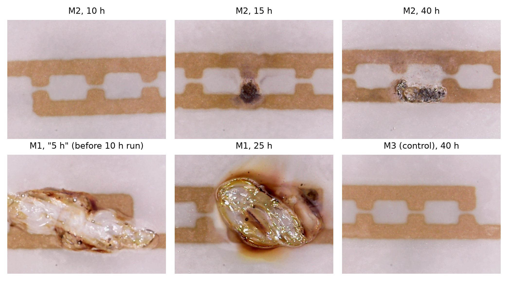
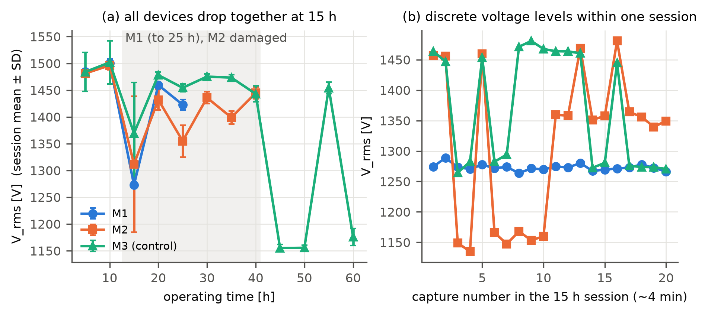
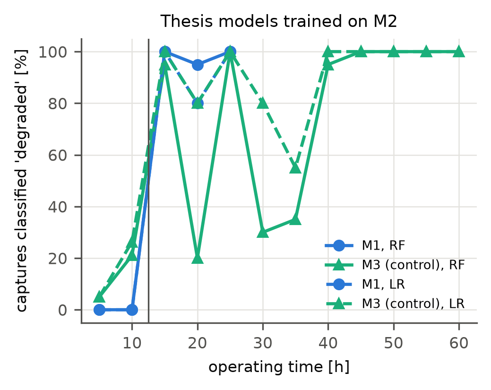
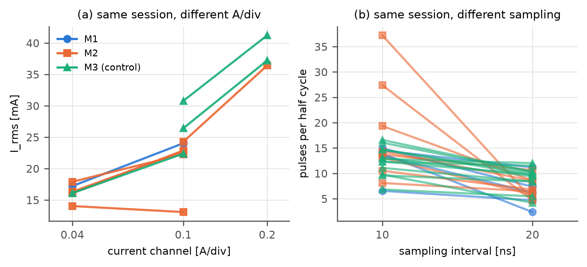
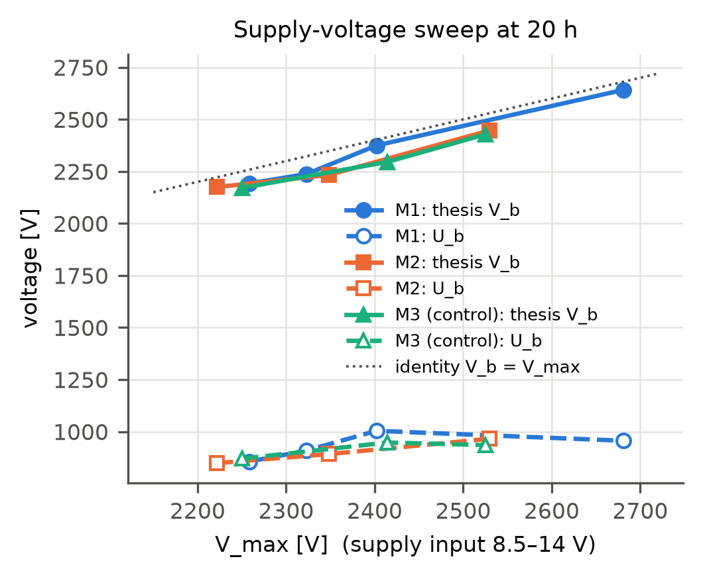
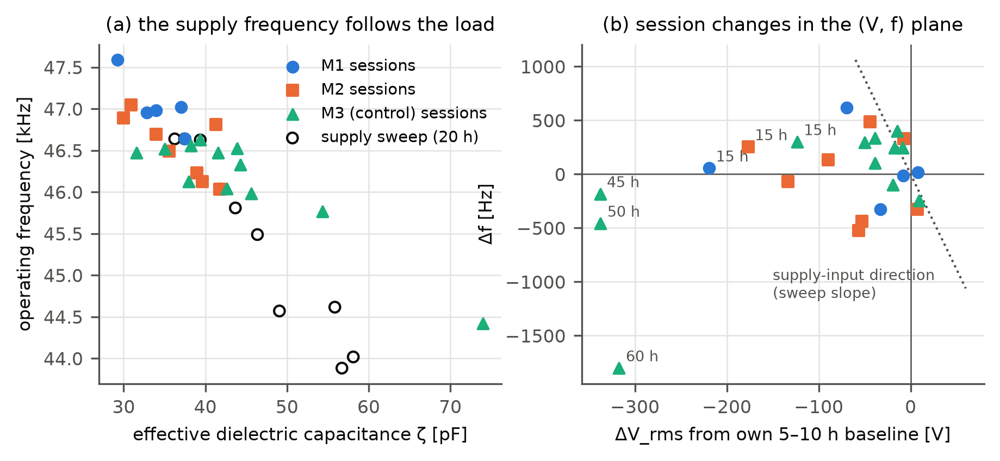

# Electrical diagnosis of dielectric degradation in micro-gap surface DBDs: what a parallel control device reveals about session, supply and measurement confounding

**Draft v0.1 — 2026-11-01.** Authors and affiliations: *to be completed* (Minjun Kim, …).

---

## Abstract

Electrical waveforms are the cheapest permanent sensor of a dielectric barrier discharge (DBD) source, and machine-learning (ML) classifiers trained on voltage–current features have been proposed to detect dielectric damage. We test this idea on a 60 h endurance experiment with three identical micro-gap surface DBD sources (126 cells each) operated in ambient air at 46 kHz. Two sources (M1, M2) eroded within 15 h, as confirmed by optical microscopy and by EDS, which shows Ag from the buried electrodes at 1.3–13.9 at.% on damaged sites against ≤ 0.7 at.% on intact dielectric. The third source (M3) showed no erosion and was measured within 10–33 min of the others in every session, so it serves as a control. Classifiers trained on the damaged sources with fourteen electrical features reach 94–99 % cross-device accuracy, but they also label 95–100 % of the control's captures as "degraded" in sessions where its applied voltage was low. The dominant feature, the RMS voltage, fell in all three sources at the same time, jumping between discrete levels within a single 4-min session — a supply-mode change, not damage. Against the control, the damage-specific change is about −48 V (≈ 3 %) in both damaged sources. RMS current, pulse counts and electron-density estimates change with the oscilloscope's current scale and sampling interval within one session by amounts comparable to the reported damage effects. A supply-voltage sweep shows that a widely used "breakdown voltage" V_min + Q_max/C_d tracks the peak applied voltage (slope 0.87–1.08), whereas the Lissajous burning voltage moves with slope 0.23–0.33. The operating frequency of the self-resonant supply follows the effective load capacitance (Spearman ρ = −0.78) independently of the oscilloscope settings and distinguishes supply-side from load-side changes. We conclude that electrical condition monitoring of DBD sources is feasible only with a same-session control or reference, fixed acquisition settings and indicators that resolve localized discharges, and we give a protocol for such studies.

**Keywords**: dielectric barrier discharge; electrical diagnostics; Lissajous figure; dielectric degradation; condition monitoring; machine learning; confounding

---

## 1. Introduction

Atmospheric-pressure DBDs are used for ozone generation, surface treatment, flow control and plasma medicine [1]. Their lifetime is limited by the dielectric barrier: under continuous operation the barrier erodes, the electrode is exposed, and the discharge contracts into hot spots or arcs [2–5]. Detecting this degradation in operation, without dismantling the source, is a practical need, and the discharge's own voltage and current are the obvious sensor: they are measured anyway, they are fast, and they carry the equivalent-circuit quantities — cell and dielectric capacitances, burning voltage, transferred charge and energy — that the Lissajous (Q–V) method extracts [6–9].

Electrical tracking of DBD ageing is established for aerodynamic plasma actuators. The effective capacitance and the consumed power rise as a Kapton barrier thins [4], and durable barrier materials keep both constant over hours [5]. Even without damage, the gas-gap voltage and the deposited charge drift during the first hour of operation [10]. In parallel, ML has entered low-temperature plasma science, mostly for modelling and control [11, 12] and for optical-emission diagnostics [13, 14]; electrical-signal-based ML diagnostics remain rare [15]. Industrial practice is ahead: atmospheric plasma jets are monitored through the supply's U/I curve for nozzle wear [16], plasma-etch tools use V–I probes for fault detection and chamber-condition monitoring [17], and partial-discharge diagnostics of insulation is a mature ML field whose main obstacle is the transfer from laboratory to field equipment [18].

The author's M.S. thesis [19] trained six classifiers on fourteen electrical features from two DBD sources run to failure and reported 96.9 % accuracy on the held-out source. A subsequent audit [20] reproduced the measured quantities but found that the thesis "breakdown voltage" equals the peak applied voltage, that the reported electron temperature came from an extrapolated E/N table, and that random splits were optimistic. The audit could not answer the central question: **does the classifier detect dielectric damage, or something that merely co-varies with it?**

Here we answer it with data the thesis did not use: a third source of the same batch, run in parallel without erosion and measured in every session, plus a supply-voltage sweep and the complete micrograph and EDS record. Our contributions are:

1. A difference-in-differences comparison against a same-session control, which separates damage-specific from session-wide changes in the electrical features.
2. A direct test of the thesis classifiers on the undamaged control.
3. A within-session quantification of how oscilloscope settings bias the features.
4. An experimental check of the V_b ≡ V_max identity and of the Lissajous burning voltage under a supply sweep.
5. Evidence that the supply frequency is a setting-independent probe of the load, and a search for voltage-robust damage indicators.
6. A protocol for electrical condition-monitoring studies of DBD sources, with open analysis code.

## 2. Experiment

### 2.1 Sources

Each source is a coplanar micro-gap surface DBD: 126 pairs of 150 µm × 300 µm Ag pads facing each other across a 100 µm gap, about 10 µm thick, under a screen-printed glass-frit dielectric about 40 µm thick [19]. Three sources from one batch (M1, M2, M3) were each driven by their own resonant inverter at a supply input of 8.5 V, giving about 1.5 kV_rms at 46–47 kHz in ambient air.

### 2.2 Endurance protocol

The sources were run in parallel from 17 to 30 July 2020 until the discharge stopped (M1 after 25 h, M2 after 40 h) or the test ended (M3 at 60 h). Electrical measurements were taken at nominal 5 h intervals (Table 1), always in the order M1, M2, M3 and within 10–33 min of each other (14 min at 15 h). Optical micrographs and photographs of the whole source were taken after each measurement; their file times fix the timeline. SEM and EDS (JEOL 7001F, Bruker XFlash 6) were done on M1 (22–31 July), M2 (27 and 31 July), M3 (31 July) and on a reference sample (Ref, 27 July; its operating history is to be confirmed).

**Table 1.** Measurement sessions (operating hours). Each session has 20 detail captures.

| Date (2020) | M1 | M2 | M3 |
|---|---|---|---|
| 18 Jul | 5 | 5 | 5 |
| 20 Jul (afternoon / evening) | 10 / 15 | 10 / 15 | 10 / 15 |
| 21 Jul | 20 / 25 | 20 / 25 | 20 / 25 |
| 22 Jul | – | 30 | 30 |
| 24 Jul | – | 35 / 40 | 35 / 40 |
| 27–30 Jul | – | – | 45, 50, 55, 60 |

### 2.3 Electrical measurement

The applied voltage was measured with a Tektronix P6015A (1000×) high-voltage probe and the total current with a Tektronix P6021A current probe, recorded on a GW Instek GDS-2102A oscilloscope (8 bit, 5000 points per capture). Each session has 10 captures at 10 ns sampling (≈ 2.3 periods) and 10 at 20 ns (≈ 4.6 periods). The voltage scale was 1000 V/div. The current scale was 0.04, 0.1, 0.2 or 0.4 A/div, chosen per session and sometimes changed between the two blocks of a session. At 20 h, each source was additionally measured at supply inputs of 10 and 14 V (M1 also 9 V), ten captures each.

### 2.4 Data

The analysis uses 500 detail captures from 5 h onward (M1 100, M2 160, M3 240), 70 sweep captures, 242 micrographs and 53 EDS maps with identified sites. The 0 h captures were excluded: the sources were still conditioning, and one M3 session is corrupt.

## 3. Analysis

### 3.1 Features

Every full period of a capture is analysed separately and the results are averaged [20]. The voltage offset is removed, the current is offset-corrected so that the charge Q(t) = ∫ i dt closes over a period, and the Q–V figure is fitted on each branch by two straight lines. Their slopes give the cell capacitance C_cell (non-discharge phase) and the effective dielectric capacitance ζ (discharge phase; ζ ≤ C_d when the discharge covers only part of the barrier [7]). The burning voltage is U_b = V_on − Q_on/ζ, with V_on and Q_on at the discharge onset [8, 9]. Energy per cycle E is the loop area. Pulses are counted in the displacement-free discharge current with a 5σ (MAD) threshold. The fourteen thesis features [19] are recomputed with the thesis definitions, including V_b = V_min + Q_max/C_d.

### 3.2 Difference-in-differences against the control

For each feature x, device d and session s we form the session-mean difference D_d(s) = x̄_d(s) − x̄_M3(s). The damage-specific change is DiD = ⟨D_d⟩_post − ⟨D_d⟩_pre, with pre = 5–10 h and post = 15 h onward. Its significance is assessed with a Welch test on the session-level differences (two pre and three or six post sessions), so the test is conservative. We also report the naive change of device d and the change of M3 over the same sessions.

### 3.3 Classifiers

Logistic regression (LR), decision tree, random forest (RF, 1000 trees), gradient boosting, linear SVM and 3-NN are used with the thesis hyper-parameters [19], each inside a pipeline with standardisation. Labels follow the thesis: 5–10 h normal, ≥ 15 h degraded. Models are trained on one damaged source and tested on the other; in addition, the share of M3 captures labelled "degraded" is reported per session. M3 has no label other than "normal".

### 3.4 Acquisition-setting effects

Within-session effects of the oscilloscope settings are estimated by ordinary least squares with session fixed effects, x = α_s + β log₂(A/div) + γ·1[20 ns] + ε, over the 500 captures. Sessions in which only one setting was used contribute to α_s only.

### 3.5 Voltage-robust indicators

Twenty-six candidate features designed to be insensitive to the applied voltage were screened. They comprise voltage-normalised quantities (U_b/V_max, E/V_max², Q/V_max, apparent capacitance I_rms/(ωV_rms), power factor), half-cycle asymmetries (rising vs falling branch of ζ, C_cell, peak voltage, pulse count, pulse current), period-to-period coefficients of variation, and residuals of ζ, C_cell, U_b, power, Q and frequency after removing their dependence on V_max learned from M3. A useful indicator should separate pre- from post-damage in both M1 and M2 (AUC → 1) and should not separate M3's pre- from post-15 h sessions (AUC → 0.5).

## 4. Results

### 4.1 Ground truth: erosion confirmed, onset at or before 15 h

M2 shows no burn marks at 5 and 10 h and dark erosion craters in every session from 15 h on (Fig. 1). M1 shows craters from 15 h. However, its micrographs filed as "5 h" — taken on the morning of 20 July, before the 10 h measurement — already show a large molten blister at an electrode end, which grows and bursts by 25 h. M1's "normal" sessions may therefore contain a damaged cell. M3 shows no burn marks in 106 micrographs up to 50 h and one 159-pixel speck at 55 h.

EDS confirms electrode exposure (Table 2). Damaged sites on M1 and M2 give 1.3–13.9 at.% Ag, while the dielectric of the reference sample, of M3 after 60 h, and of intact sites on M1 and M2 gives ≤ 0.7 at.% (one M3 map 1.44 at.%). The thesis' Table 3 used one 10,000× map per class (Ref 0.57 at.%, M2 13.86 at.%), each the highest of its site.

**Table 2.** Ag content of the EDS maps (at.%).

| Site | Maps | Ag [at.%] |
|---|---|---|
| Reference sample (Ref) | 6 | 0.00–0.57 |
| M3 after 60 h | 13 | 0.00–0.25 (12 maps), 1.44 (1 map) |
| M2 intact sites | 10 | 0.00–0.56 |
| M1 dielectric over, between and away from electrodes | 12 | 0.01–0.68 |
| M1 exposed electrode, burnt | 4 | 5.08–11.94 |
| M1 exposed electrode, burst | 4 | 1.28–3.22 |
| M2 damaged site | 4 | 3.78–13.86 |

**Fig. 1.** Micrographs. Top: M2 before (10 h) and after (15 h, 40 h) erosion. Bottom: M1 molten blister already present before the 10 h run, M1 at 25 h, and the control M3 at 40 h.

### 4.2 The applied voltage changes in all sources at once

Before damage the three sources run at the same voltage: session means at 5 and 10 h agree within 6 V (Fig. 2a). At 15 h all three drop together, including the undamaged M3 (−133 V). Within that 4-min session the RMS voltage of M2 and M3 jumps between discrete levels — about 1150/1270, 1360 and 1460 V — from one capture to the next (Fig. 2b). This cannot be gradual surface damage; it is a change of the supplies' operating state that affects all sources. Because each source had its own inverter, the common change points to a shared upstream cause (DC supply, mains or room conditions). M3 later falls to 1155 V at 45 and 50 h, returns to 1454 V at 55 h, and falls again at 60 h, all without visible damage.

**Fig. 2.** (a) Session-mean RMS voltage (± SD over 20 captures). (b) RMS voltage of each capture in the 15 h session.

Table 3 separates the damage-specific part. Both damaged sources lose about 48 V of RMS voltage relative to the control — about half of the naive drop — with the same sign and size in both. The number of discharges and the burning voltage change significantly in the undamaged M3 in the same direction as in the damaged sources, so neither is a damage indicator in these data. The increases of ζ, C_cell and Q point in the expected direction (thinner or locally missing barrier) but are not significant at the session level.

**Table 3.** Change from 5–10 h to ≥ 15 h: naive, in the control, and difference-in-differences (DiD). p (M3): Welch test on M3 captures. p (DiD): Welch test on session-level differences.

| Source | Feature | Naive | M3 change | p (M3) | DiD | p (DiD) |
|---|---|---|---|---|---|---|
| M1 | V_rms | −107 V | −59 V | 7×10⁻⁷ | **−48 V** | 0.18 |
| M2 | V_rms | −92 V | −44 V | 2×10⁻⁷ | **−48 V** | 0.018 |
| M1 | U_b | −148 V | −48 V | 0.024 | −100 V | 0.14 |
| M2 | U_b | −50 V | −38 V | 0.049 | −12 V | 0.80 |
| M2 | ζ | +2.7 pF | +0.1 pF | 0.93 | +2.6 pF | 0.56 |
| M2 | C_cell | +0.66 pF | +0.27 pF | 0.45 | +0.40 pF | 0.50 |
| M2 | Q_max | +3.2 nC | −0.4 nC | 0.85 | +3.6 nC | 0.36 |
| M1 | pulses / half cycle | +0.5 | +2.6 | 4×10⁻⁴ | −2.1 | 0.43 |
| M2 | pulses / half cycle | +3.7 | +2.7 | 4×10⁻⁶ | +1.0 | 0.59 |

### 4.3 The classifiers flag the control as degraded

Trained on M2, the thesis models classify M1 with 92–99 % accuracy (kNN 74 %). Applied to M3, they label 95–100 % of its captures at 15, 25 and 40 h and 100 % at 45–60 h as degraded (Fig. 3); averaged over 15–40 h the false-positive rate is 57–86 % (RF 62.5 %). The false positives follow the control's low-voltage sessions. Within M3 alone, V_rms separates the ≤ 10 h from the ≥ 15 h sessions with AUC 0.90. When every feature is divided by the same-session M3 mean, the cross-device accuracy of DT, RF and GB falls from 94–99 % to 65–78 % (best referenced model: LR, 89 %). The referenced V_rms keeps AUC 0.99 (M1) and 0.83 (M2), consistent with the −48 V DiD.

**Fig. 3.** Share of captures classified "degraded" by RF (solid) and LR (dashed) trained on M2, for the damaged M1 (degraded from ≥ 15 h; vertical line) and for the undamaged control M3.

### 4.4 Acquisition settings bias current-derived features

Within a session, doubling the current scale raises I_rms by 3.5 mA (p = 10⁻¹⁷) and the peak current of a capture by 59 mA. Sampling at 20 ns instead of 10 ns raises I_rms by 4.3 mA and lowers the pulse count by 6.6 per half cycle (p = 3×10⁻⁴⁵), and also raises ζ by 3.0 pF and U_b by 35 V (Fig. 4, Table 4). The current channel is not clipped; its noise floor scales with the scale setting (2.4, 5.9 and 11.9 mA at 0.04, 0.1 and 0.2 A/div). Because the scale was chosen per session, the settings differ between the labelled groups: 20 % of M2's normal captures but 42 % of its degraded captures were taken at 0.04 A/div. The thesis' "I_rms decreases with damage" (20.8 → 18.6 mA) is partly this composition effect.

**Table 4.** Within-session effect of the acquisition settings (session fixed effects, 500 captures).

| Feature | per doubling of A/div | p | 20 ns vs 10 ns | p |
|---|---|---|---|---|
| I_rms | +3.5 mA | 10⁻¹⁷ | +4.3 mA | 5×10⁻⁵³ |
| Peak current (max \|i\|) | +59 mA | 4×10⁻¹⁰ | +37 mA | 9×10⁻¹⁰ |
| Pulses / half cycle | +1.1 | 0.11 | −6.6 | 3×10⁻⁴⁵ |
| ζ | +0.3 pF | 0.54 | +3.0 pF | 2×10⁻²⁰ |
| U_b | +45 V | 3×10⁻⁹ | +35 V | 3×10⁻¹³ |
| V_rms | +19 V | 5×10⁻⁴ | −5 V | 0.13 |
| Frequency | −97 Hz | 2×10⁻⁴ | −20 Hz | 0.23 |

**Fig. 4.** Same session, same source, minutes apart: (a) I_rms against the current scale; (b) pulses per half cycle at 10 and 20 ns sampling. Each line is one session.

### 4.5 The thesis "breakdown voltage" is the peak applied voltage

Under the thesis' equivalent circuit, Q_max = C_d (V_max − V_min), so V_min + Q_max/C_d ≡ V_max [20]. The supply sweep tests this directly (Fig. 5). As V_max rises from 2.22 to 2.68 kV, the thesis V_b follows it with slope 1.08, 0.87 and 0.95 (r = 0.86–0.93) and stays 57–94 V below it. The Lissajous burning voltage U_b moves with slope 0.23–0.33, from about 850 to 1000 V, consistent with Paschen's law for a 100 µm air gap (0.72–0.87 kV). E/N, electron temperature and electron density derived from V_b inherit the identity.

**Fig. 5.** Supply sweep at 20 h: thesis V_b (filled) and Lissajous burning voltage U_b (open) against the peak applied voltage.

### 4.6 The supply frequency is a probe of the load

The inverters are self-resonant: the operating frequency drops when the effective load capacitance rises. Across sessions, frequency and ζ have a Spearman correlation of −0.78 (Fig. 6a). In the sweep, raising the supply input from 8.5 to 14 V increases ζ by 12–19 pF (the discharge covers more of the barrier [7]) and lowers the frequency by 2.1–2.6 kHz. Unlike the current-derived features, the frequency barely depends on the acquisition settings (−20 Hz at 20 ns sampling, not significant; −97 Hz per doubling of A/div; Table 4), because it is measured from voltage zero crossings with a 10 ns time base.

The (ΔV, Δf) plane distinguishes the two kinds of change (Fig. 6b). A supply-side change moves V and f in opposite directions: in the sweep, raising the drive raises V and lowers f. The common drop at 15 h is of this kind (ΔV < 0, Δf = +55 to +300 Hz), and within the 15 h session the low-voltage state of M2 runs at 46.9–47.4 kHz against 46.2–46.6 kHz in the high state. A load-side increase of capacitance lowers both. The damage-specific changes of M1 and M2 relative to the control point this way (DiD of frequency −230 and −272 Hz), but with three sources the shift is not significant (p = 0.60, 0.25). Late in the test, M3 moves along the same load-side direction (45–60 h: f down to 44.4 kHz, ζ up to 74 pF) without visible erosion, which shows that the load also changes for reasons other than barrier damage — for example surface charging, humidity or conditioning.

**Fig. 6.** (a) Session-mean operating frequency against ζ for the three sources and the supply sweep. (b) Session changes relative to each source's own 5–10 h baseline; the dotted line is the mean sweep direction.

### 4.7 No voltage-robust indicator in these data

None of the 26 candidates of Section 3.5 separates damage in both sources while staying neutral on the control. The best are the power factor (AUC 0.67 and 0.77 in M2 and M1; 0.46 on M3's sessions) and the apparent capacitance (0.56, 0.81; 0.44). Voltage-conditioned residuals reach AUC 0.52–0.80 with no significant DiD. Classifiers trained on the voltage-normalised and asymmetry features reach only 54–74 % cross-device accuracy and still label 53–93 % of M3's captures as degraded. The burning voltage looks strong in M1 (AUC 0.91) but varies with V_max (Spearman ρ = 0.69 on M3) and across M3's sessions.

## 5. Discussion

**Why the bulk signal is small.** The damage seen in Fig. 1 affects a few of 126 cells. The measured current and charge are sums over all cells, so a damaged cell changes the bulk Q–V figure by roughly 1/126 of its own change, which is comparable to session-to-session variation. The one consistent bulk effect, a 3 % drop in RMS voltage relative to the control, is in line with an increased load capacitance at a resonant supply (Section 4.6). The direct signature of localized damage is more likely in the statistics of strong micro-discharges and arcs: the "bright spots" noted during the experiment, and the high-amplitude current spikes that mark failure in other DBD sources [3]. An 8-bit, 10–20 ns acquisition of 2–5 periods every 5 h cannot capture that statistics.

**What the classifiers learned.** The thesis classifiers did detect a change after damage, but mostly the session-wide state of the supply and, through the current-derived features, the oscilloscope settings of each session. Both are constant within a session and differ between sessions, so any split that keeps sessions intact — even across devices — rewards them. A same-session control exposes this at once; without it, high cross-device accuracy is not evidence of damage detection. The same lesson is familiar from partial-discharge diagnostics, where models trained on laboratory defects transfer poorly to field equipment [18].

**What remains valid.** The damage is real and is visible electrically: both damaged sources lose about 48 V relative to the control, and the referenced V_rms still separates the states. Lissajous analysis with a burning voltage, rather than V_min + Q/C_d, gives physically consistent gap voltages (Section 4.5). The supply frequency adds an inexpensive, setting-independent channel that separates supply-side from load-side changes.

**Protocol for electrical condition monitoring of DBD sources.**
1. Run at least one undamaged control source in parallel and measure it in the same sessions; report differences to the control and the false-alarm rate on it.
2. Fix the acquisition: voltage and current scales, sampling interval and record length must not change during the study. Use ≥ 500 MS/s with a wide-band current sensor (shunt or Rogowski) to resolve micro-discharges, and a monitor capacitor for Q–V.
3. Log the supply input (voltage, current), the operating frequency, and room temperature and humidity.
4. Record frequently (minutes, not hours) and continuously until failure, with time-lapse imaging to fix the damage onset.
5. Evaluate per device (leave-one-device-out) and report lead time before visible damage and false alarms per hour, not accuracy on pooled captures.
6. Prefer interpretable indicators (ζ, C_cell, U_b, frequency, pulse-height distribution tails, fluctuation levels) referenced to the control or to the source's own baseline.

**Limitations.** Three sources limit statistical power; session-level DiD tests have two pre-damage points. M3's "no damage" status rests on micrographs covering part of the array, on 13 EDS maps, and on the absence of discharge failure. The micrograph timeline uses file modification times. EDS values were read from report images.

## 6. Conclusions

On a three-source endurance test with a parallel control, ML classifiers trained on electrical features of DBD sources detected session-wide supply changes and acquisition settings as readily as dielectric damage. They labelled up to 100 % of the control's captures as degraded. The damage-specific electrical change was a 3 % drop of RMS voltage. A widely used breakdown-voltage formula reproduces the peak applied voltage, while the Lissajous burning voltage behaves physically. The supply frequency is a setting-independent probe of the load. Electrical condition monitoring of DBD sources remains a sound goal, but it needs controls, fixed acquisition, frequent run-to-failure recording and indicators that resolve localized discharges. The protocol above is designed to make the next such study conclusive.

---

## Data and code availability

Analysis code: `dbd_diagnostics` and `examples/verify_raw_archive.py` in https://github.com/MJ-best/ms-thesis-dbd-plasma-diagnostics. Figures are reproduced by `paper/make_figures.py`. The raw archive (≈ 5.3 GB) is available from the author on request; *a public deposit (e.g. Zenodo) is planned.*

## References

1. U. Kogelschatz, Dielectric-barrier discharges: their history, discharge physics, and industrial applications, *Plasma Chem. Plasma Process.* **23**, 1 (2003).
2. F. Warlitz *et al.*, On durable materials for dielectric-barrier discharge plasma actuators, *Sens. Actuators A* (2024).
3. M. Vasile, O. Gazeli, R. Laurita, M. Gherardi, Designing and plasma characterization of monolithic additively manufactured dielectric barrier discharge plasma sources, *Eng. Res. Express* **8**, 065330 (2026).
4. R. E. Hanson, N. M. Houser, P. Lavoie, Dielectric material degradation monitoring of dielectric barrier discharge plasma actuators, *J. Appl. Phys.* **115**, 043301 (2014).
5. *(reserved: additional actuator-durability reference)*
6. T. C. Manley, The electric characteristics of the ozonator discharge, *Trans. Electrochem. Soc.* **84**, 83 (1943).
7. F. J. J. Peeters, M. C. M. van de Sanden, The influence of partial surface discharging on the electrical characterization of DBDs, *Plasma Sources Sci. Technol.* **24**, 015016 (2015).
8. A. V. Pipa, R. Brandenburg, The equivalent circuit approach for the electrical diagnostics of dielectric barrier discharges: the classical theory and recent developments, *Atoms* **7**, 14 (2019).
9. J. Kriegseis, B. Möller, S. Grundmann, C. Tropea, Capacitance and power consumption quantification of dielectric barrier discharge (DBD) plasma actuators, *J. Electrostat.* **69**, 302 (2011).
10. M. Destrieux *et al.*, Evolution of the electrical characteristics of an atmospheric pressure dielectric barrier discharge system over one hour operation, *J. Phys. D: Appl. Phys.* **57**, 055201 (2024).
11. A. Mesbah, D. B. Graves, Machine learning for modeling, diagnostics, and control of non-equilibrium plasmas, *J. Phys. D: Appl. Phys.* **52**, 30LT02 (2019).
12. J. Trieschmann, L. Vialetto, T. Gergs, Review: machine learning for advancing low-temperature plasma modeling and simulation, *J. Micro/Nanopattern. Mater. Metrol.* **22**, 041504 (2023).
13. D. Stefas *et al.*, Machine learning assisted optical diagnostics on a cylindrical atmospheric pressure surface dielectric barrier discharge, arXiv:2404.06817 (2024).
14. AI-powered precursor quantification in atmospheric pressure plasma jet thin film deposition via optical emission spectroscopy, *Plasma Sources Sci. Technol.* (2024), doi:10.1088/1361-6595/ad80c6.
15. D. Gidon, X. Pei, A. D. Bonzanini, D. B. Graves, A. Mesbah, Machine learning for real-time diagnostics of cold atmospheric plasma sources, *IEEE Trans. Radiat. Plasma Med. Sci.* (2019).
16. Relyon Plasma GmbH, Real-time analysis of atmospheric plasma processes, technical note (2016).
17. *(to be selected: plasma-etch FDC / V–I probe chamber-monitoring reference)*
18. *(to be selected: partial-discharge ML review, e.g. Applied Sciences 2024 systematic review)*
19. M. Kim, Electrical measurements and prediction of dielectric barrier surface damage in nonthermal atmospheric pressure dielectric barrier discharge plasma based on machine learning, M.S. thesis, Kwangwoon University (2023).
20. M. Kim, Thesis verification report and re-implementation, https://github.com/MJ-best/ms-thesis-dbd-plasma-diagnostics (2026).

---

### Notes for revision (remove before submission)

- Check bibliographic details of refs 2, 14, 15 against the publishers; choose refs 5, 17, 18.
- Decide the target journal (IEEE Trans. Plasma Sci., Plasma Processes and Polymers, AIP Advances, or Sensors) and convert to its template.
- Consider adding the supply schematic (inverter type, transformer) to support Section 4.6; the self-resonance is inferred from the data, not from the circuit.
- Fig. 1 uses raw micrographs; add scale bars from the microscope calibration.
- A Korean summary for co-authors can be prepared from `docs/raw-data-verification.ko.md`.
