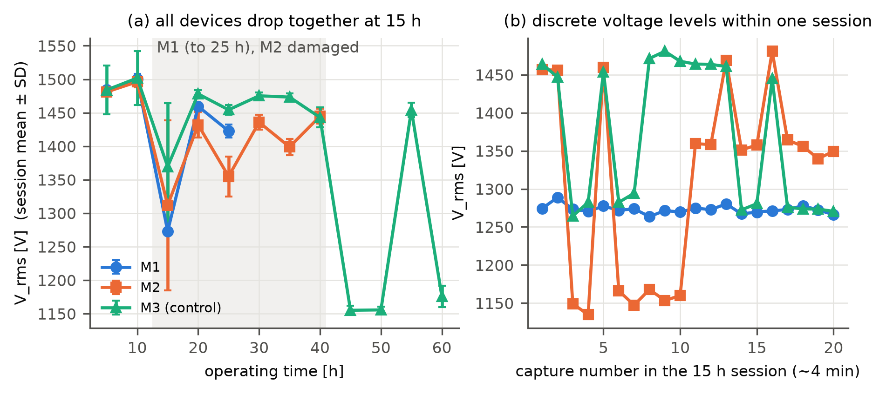
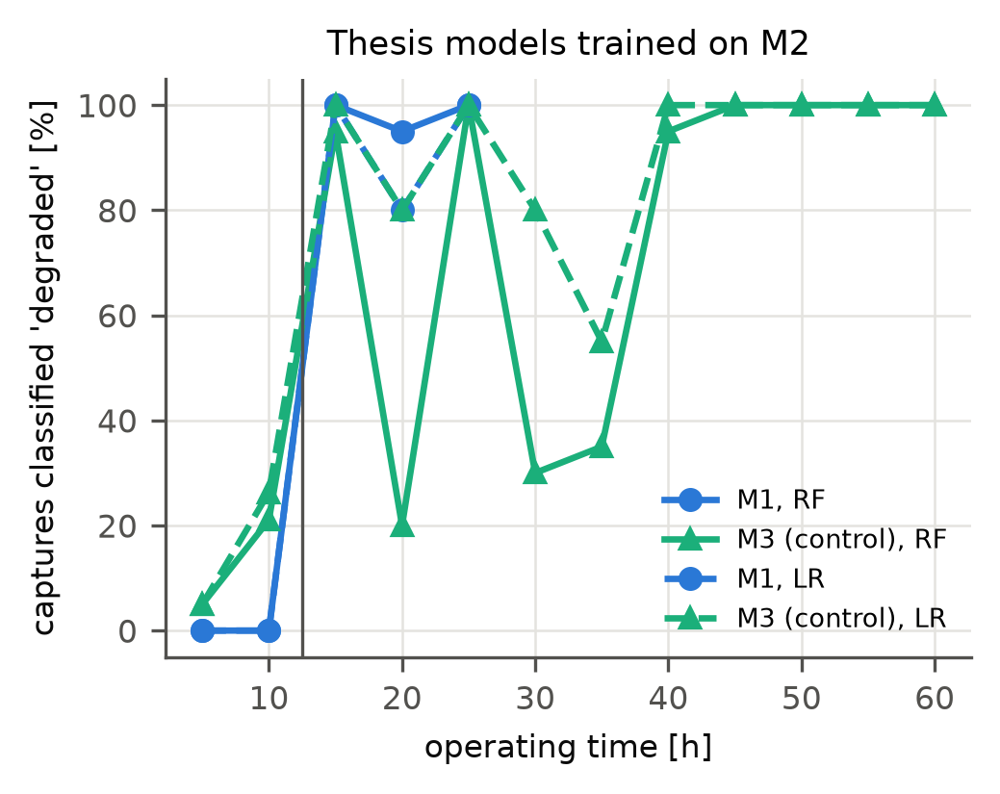
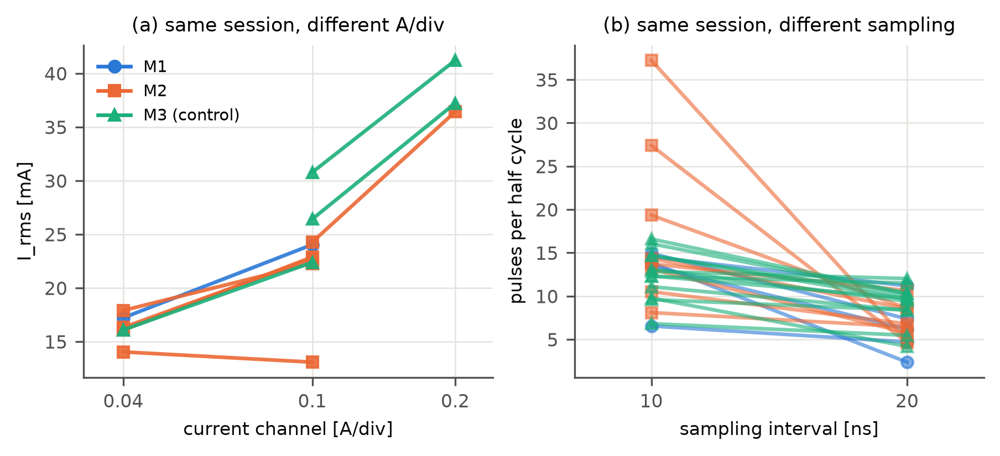
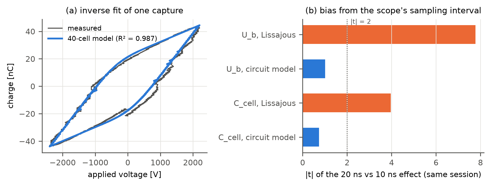
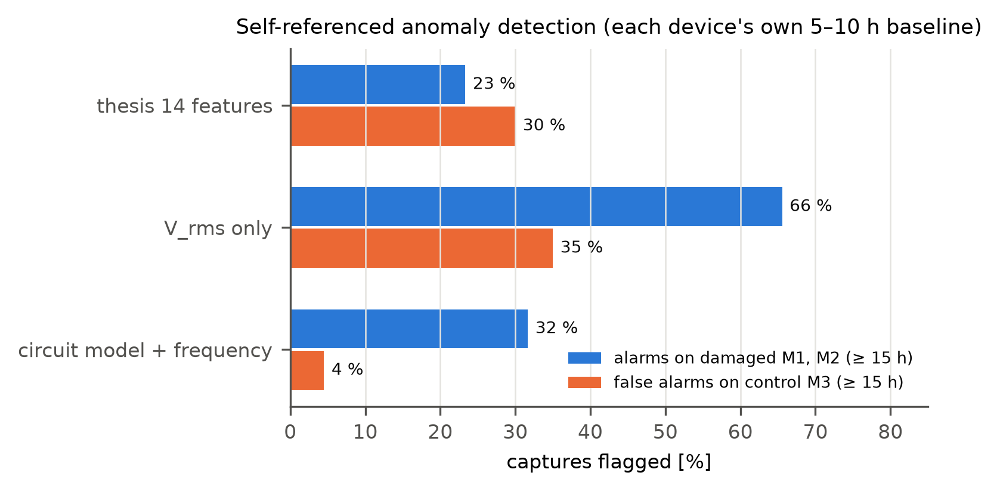

# 97 % 정확도 모델은 무엇을 학습했나

**음성 대조군으로 찾은 교란, 그리고 물리 기반 모델로 다시 만든 이상 탐지**

김민준 · 데이터과학 포트폴리오 · 2026-11 · 코드와 전체 기록: [github.com/MJ-best/ms-thesis-dbd-plasma-diagnostics](https://github.com/MJ-best/ms-thesis-dbd-plasma-diagnostics)

---

## 요약

- 석사논문에서 플라즈마 소자의 표면 손상을 전류·전압 신호로 판별하는 분류기를 만들었고, 다른 소자에서 **96.9 %** 정확도를 보고했습니다.
- 3년 뒤 원본 데이터 5.3 GB를 전수 재분석하면서, 논문에 쓰지 않았던 **손상 없는 세 번째 소자를 음성 대조군**으로 넣었습니다. 모델은 이 정상 소자의 캡처를 **최대 100 % "손상"으로 판정**했습니다.
- 모델이 학습한 것은 손상이 아니라 **측정 세션마다 달라진 전원 상태와 오실로스코프 설정**이었습니다. 이중차분으로 분리한 실제 손상 효과는 전압 **−3 %** 수준이었습니다.
- 물리 기반 **등가회로 역추정 모델**로 특성을 다시 만들고 **자기 기준 이상 탐지**로 바꾸자, 정상 소자에 대한 오경보율이 **30–35 %에서 4.5 %**로 줄었습니다. 대신 손상 소자 두 개 중 하나만 잡아냈고, 그 한계도 그대로 보고합니다.

---

## 1. 문제

대기압 DBD(유전체 장벽 방전) 플라즈마 소자는 전극을 덮은 얇은 유전체가 방전에 깎이면서 수명이 끝납니다. 장비를 분해하지 않고, 이미 측정하고 있는 **전류·전압 파형만으로** 손상을 알아낼 수 있다면 추가 센서 없는 상태 감시가 됩니다.

석사논문(2023)에서 한 일은 다음과 같습니다.
- 소자 두 개(M1, M2)를 고장까지 운전하며 5시간마다 파형을 측정했습니다.
- 파형에서 물리 특성 14개(전압·전류 실효값, 리사주 커패시턴스, 방전 전하, 방전 횟수 등)를 계산했습니다.
- 6개 분류기(LR, DT, RF, GB, SVM, kNN)로 "정상 / 손상"을 판별했습니다.
- M2로 학습하고 M1으로 검증해 랜덤포레스트 **96.9 %**를 보고했습니다.

## 2. 의심의 출발: 결과가 너무 좋았다

다시 계산해 보니 **전압 실효값(V_rms) 하나만으로 AUC 0.996 / 1.000**이었습니다. 14개 특성을 썼지만 사실상 한 특성이 모든 것을 설명하고 있었습니다.

지름길 학습(shortcut learning)의 전형적인 신호입니다. 흉부 X선으로 코로나를 판별하던 딥러닝 모델들이 병변이 아니라 **데이터 출처(병원)마다 다른 표식과 촬영 자세**를 학습했던 사례[4]와 같은 구조일 수 있습니다. 여기서는 "손상 후" 데이터가 모두 나중 날짜의 측정 세션에서 나왔다는 점이 의심스러웠습니다.

## 3. 데이터 감사: 원본 전수 재분석

| 대상 | 규모 | 확인한 것 |
|---|---|---|
| 오실로스코프 캡처 | 600개 (+ 공급전압 스윕 70개) | 공개 패키지로 재계산 → 2020년 MATLAB 요약표와 26개 세션 중 23개가 1 % 이내로 일치 |
| 현미경 사진 | 242장 | 파일 시각으로 타임라인 복원, 어두운 소손 영역 자동 정량화 |
| SEM·EDS 보고서 | 53개 맵 | 손상부 Ag 1.3–13.9 at.% vs 온전한 유전체 ≤ 0.7 at.% → 손상 자체는 실제 |

**라벨 검증에서 첫 번째 문제가 나왔습니다.** 검증 소자 M1의 "5시간" 현미경 사진은 10시간 측정 전에 찍혔는데, 여기에 이미 큰 용융 손상이 있었습니다. 즉 "정상"으로 라벨링한 구간에 손상 셀이 섞여 있었을 수 있습니다.

## 4. 음성 대조군: 손상 없는 세 번째 소자

원본 아카이브에는 논문에 쓰지 않은 **M3**가 있었습니다.
- M1, M2와 같은 배치이고, 60시간 동안 병렬로 운전했습니다.
- **매 세션 10–33분 안에** 함께 측정했습니다.
- 현미경 사진과 EDS 어디에도 침식 흔적이 없었습니다.

교란 요인을 찾는 표준 도구인 음성 대조군[5]이 우연히 준비되어 있었던 셈입니다.

*(a) 15시간 측정에서 세 소자의 전압이 함께 떨어집니다. 손상 없는 M3도 −133 V입니다. (b) 그 세션 4분 동안 전압이 캡처마다 이산적인 수준 사이를 오갑니다. 서서히 진행되는 손상이 아니라 전원의 동작 모드 전환입니다.*

그다음, 논문의 모델을 손상 없는 M3에 그대로 적용했습니다.

*M2로 학습한 RF·LR은 손상 없는 M3의 15·25·40시간 캡처를 95–100 %, 45–60시간 캡처를 100 % "손상"으로 판정합니다. 오탐은 M3의 전압이 낮았던 세션에 정확히 몰려 있습니다.*

## 5. 숨은 변수: 측정 설정

오실로스코프의 전류 스케일(A/div)과 샘플링 간격은 세션마다, 때로는 세션 안에서도 바뀌었습니다. 같은 소자를 몇 분 간격으로 잰 캡처끼리 비교했습니다(세션 고정효과 회귀).

| 특성 | A/div 2배 | 샘플링 10 → 20 ns |
|---|---|---|
| 전류 실효값 | **+3.5 mA** (p = 10⁻¹⁷) | +4.3 mA |
| 방전 횟수 | +1.1 | **−6.6개** (p = 10⁻⁴⁵) |

그리고 그룹마다 설정 구성이 달랐습니다. 정상 그룹은 20 %, 손상 그룹은 42 %가 저감도 설정(0.04 A/div)이었습니다. 논문의 "손상 후 전류 실효값 감소"는 일부가 이 구성 차이였습니다. **측정 설정이 라벨과 상관된 숨은 변수**였던 것입니다.

## 6. 진짜 효과는 얼마인가: 이중차분

손상 소자의 변화에서 같은 세션 대조 소자의 변화를 빼면 세션 공통 효과가 상쇄됩니다.

| 소자 | 단순 비교 | 대조 소자(M3) 변화 | **이중차분** |
|---|---|---|---|
| M1 | −107 V | −59 V | **−48 V** (≈ 3 %) |
| M2 | −92 V | −44 V | **−48 V** (≈ 3 %) |

손상 고유의 전압 감소는 두 소자에서 크기와 방향이 같았습니다. **신호는 있지만 논문이 본 것의 절반**입니다. 방전 횟수와 연소 전압의 변화는 손상 없는 M3에서도 같은 방향으로 나타나, 손상 지표가 아니었습니다.

## 7. 다시 만들기

### 7.1 물리 기반 등가회로 역추정 모델

기존 특성 계산(리사주 그래프에 직선 맞춤)은 측정 설정에 흔들렸습니다. 그래서 **측정된 전압 파형을 입력으로 넣고, 측정된 전하를 가장 잘 재현하는 물리 파라미터를 찾는 모델**을 새로 만들었습니다.

- **구조:** 셀 40개를 병렬로 둔 회로입니다. 각 셀은 유전체 용량과 기체 갭 용량이 직렬로 연결되어 있고, 기체 전압이 자기 문턱값에 닿으면 그 값에 고정됩니다. 문턱값은 셀마다 정규분포로 퍼져 있습니다.
- **추정 파라미터 4개:**
  - 유전체 용량 C_d, 기체 갭 용량 C_g
  - 평균 문턱 전압(연소 전압) U_b
  - 셀 간 문턱 산포 s (새 파라미터: 방전의 불균일성)
- **추정 방법:** `scipy.optimize.least_squares`로 파형 전체(약 1,000점)를 맞춥니다.
- **검증:**
  - 정답을 아는 합성 파형에서 C_d·C_g·U_b를 1 % 이내로, 산포 0.1을 0.097로 되찾습니다. 이 검증은 단위 테스트로 넣었습니다.
  - 실측 570개 캡처에 대해 R² 평균 0.990이고, 8코어로 28초에 끝납니다.

| 지표 | 기존(리사주 직선 맞춤) | 새 모델 |
|---|---|---|
| 샘플링 간격에 따른 연소 전압 편향 | +35 V (t = 7.5) | **+12 V (유의하지 않음)** |
| 샘플링 간격에 따른 셀 용량 편향 | +0.43 pF (t = 4.2) | **−0.06 pF (유의하지 않음)** |
| 공급전압 100 V당 연소 전압 변화 | +28.5 V | **+6.4 V** (물리적으로 거의 일정해야 정상) |
| 셀 간 문턱 산포 | (없음) | 측정 설정 의존성 없음 |

물리 법칙을 모델에 넣자 **측정 아티팩트에 덜 흔들리고 물리적으로 해석되는 특성**이 나왔습니다.

### 7.2 자기 기준 이상 탐지 (예지보전 방식)

손상 데이터는 장비마다 몇 번 없으므로, 실제 현장에서는 지도학습 분류보다 **정상 상태로부터 벗어남을 감지**하는 방식을 씁니다.
- 각 소자의 첫 두 세션(5–10 h)만으로 기준 분포를 만듭니다. 중앙값·MAD로 표준화하고, Ledoit-Wolf 공분산으로 마할라노비스 거리를 계산합니다.
- 경보 임계값은 기준 세션 하나를 빼고 학습해 남은 세션으로 만든 영분포의 95번째 백분위수로 정했습니다. 세션 간 변동을 반영한 정직한 임계값입니다.
- **손상 없는 M3의 경보율 = 오경보율**로 평가합니다.

| 특성 세트 | M1 (손상) | M2 (손상) | **M3 (정상) 오경보** |
|---|---|---|---|
| 논문 14개 특성 | 52 % | 9 % | 30 % |
| V_rms 하나 | 63 % | 67 % | 35 % |
| **등가회로 모델 + 전원 주파수** | **92 %** | 2 % | **4.5 %** |

(≥ 15 h 세션의 평균 경보율)

- 물리 기반 특성은 **오경보를 30–35 %에서 4.5 %로** 줄였습니다. 예지보전에서는 오경보가 잦으면 현장이 경보를 무시하게 되므로 이것이 가장 중요한 지표입니다.
- 전원 주파수는 보조 채널로 넣었습니다. 공진형 전원의 동작 주파수는 부하 용량을 따라가고(순위상관 −0.78), 오실로스코프 설정에 거의 영향을 받지 않습니다.
- **한계:** M2의 손상은 거의 잡지 못했습니다. 손상이 126셀 중 몇 셀의 국소 현상이라, 장치 전체 신호에서는 약 1/126로 희석되기 때문입니다. 더 높은 시간 분해능(≥ 500 MS/s)과 고정된 측정 설정이 있어야 국소 방전을 볼 수 있습니다. 이 한계와 실험 프로토콜은 논문 초안에 정리했습니다.

## 8. 일반화된 교훈

이 프로젝트에서 부딪힌 문제는 플라즈마에만 있는 것이 아닙니다.

| 이 프로젝트 | 일반 원리 | 참고 |
|---|---|---|
| 같은 세션의 캡처가 학습과 평가에 섞임 | **데이터 누수**. 17개 분야 294편 이상의 논문에서 보고됨 | Kapoor & Narayanan 2023 [1], REFORMS 체크리스트 2024 [2] |
| V_rms 하나로 AUC 1.0 | **지름길 학습**: 과제와 무관한 단서로 정답을 맞힘 | Geirhos 외 2020 [3], DeGrave 외 2021 [4] |
| 손상 없는 M3에 모델 적용 | **음성 대조군**: 효과가 없어야 할 곳에서 효과가 나오면 교란 | Lipsitch 외 2010 [5] |
| 소자·세션 단위 분할 | **그룹·시간 구조를 고려한 교차검증** | Roberts 외 2017 [6] |
| 측정 설정이 라벨과 상관 | **배치 효과·측정 편향** | 유전체학의 배치 효과 문제와 같은 구조 |
| 절대값 대신 자기 기준 변화와 변동성 | 산업 현장의 조건 감시 관행 | 플라즈마 장비 업체의 전원 U/I 기반 예지보전 [7], 반도체 공정의 고장 탐지·분류 |

**제가 얻은 원칙:**
1. 결과가 너무 좋으면 먼저 의심합니다. 단일 특성의 성능부터 봅니다.
2. 효과가 없어야 할 데이터(음성 대조군)에 모델을 돌려 봅니다.
3. 분할은 데이터가 생긴 단위(장치, 세션, 환자, 고객)로 합니다.
4. 측정 과정 자체를 데이터로 기록하고 변수로 다룹니다.
5. 도메인 지식(물리)을 모델 구조에 넣으면 아티팩트에 강해집니다.
6. 음성 결과와 한계도 숫자로 보고합니다.

## 9. 결과물

| 결과물 | 내용 |
|---|---|
| Python 패키지 `dbd_diagnostics` | 파형 → 물리량 → 특성 → ML. 테스트 26개(정답을 아는 합성 파형), GitHub Actions CI |
| 등가회로 역추정 모듈 `circuit_fit` | 40셀 히스테리시스 모델, 최소제곱 역추정 |
| 검증 보고서와 정오표 (한·영) | 학위논문의 수식·수치·통계를 전수 검증하고 공개 정정 |
| 원본 아카이브 검증 보고서 | 대조군, 이중차분, 측정 설정 분석 |
| 논문 초안 | 방법론 논문 v0.1 (영문, 그림 6개) |
| 웹 데모 | Streamlit 앱(파형 업로드 → 물리량 → 판정) |

**기술 스택:** Python, NumPy, SciPy(최적화, 통계), pandas, scikit-learn(파이프라인, Ledoit-Wolf, 그룹 평가), matplotlib, pytest, GitHub Actions, Streamlit

## 10. 이력서용 요약

- 석사논문의 ML 분류기(검증 정확도 96.9 %)를 원본 데이터 600개 캡처로 전수 재분석하고, 손상 없는 소자를 음성 대조군으로 투입해 모델이 측정 세션과 장비 설정을 학습한 지름길을 발견
- 이중차분으로 실제 손상 효과(전압 −3 %)를 세션 공통 효과로부터 분리하고, 세션 고정효과 회귀로 측정 설정 편향을 정량화
- 물리 기반 40셀 등가회로 역추정 모델(SciPy 최소제곱, 570개 캡처 R² 0.99)을 설계해 측정 아티팩트에 강건한 특성을 만들고, 자기 기준 이상 탐지로 정상 장비 오경보율을 30–35 %에서 4.5 %로 감소
- 재현 가능한 오픈소스 패키지(테스트 26개, CI)와 한·영 검증 보고서·정오표·논문 초안으로 공개

---

## 참고문헌

1. S. Kapoor, A. Narayanan, Leakage and the reproducibility crisis in machine-learning-based science, *Patterns* **4**, 100804 (2023). [PMC](https://pmc.ncbi.nlm.nih.gov/articles/PMC10499856)
2. S. Kapoor 외, REFORMS: Consensus-based recommendations for machine-learning-based science, *Science Advances* (2024), doi:10.1126/sciadv.adk3452. [프로젝트](https://reforms.cs.princeton.edu/)
3. R. Geirhos 외, Shortcut learning in deep neural networks, *Nature Machine Intelligence* **2**, 665 (2020).
4. A. J. DeGrave, J. D. Janizek, S.-I. Lee, AI for radiographic COVID-19 detection selects shortcuts over signal, *Nature Machine Intelligence* **3**, 610 (2021). [요약](https://psnet.ahrq.gov/issue/ai-radiographic-covid-19-detection-selects-shortcuts-over-signal)
5. M. Lipsitch, E. Tchetgen Tchetgen, T. Cohen, Negative controls: a tool for detecting confounding and bias in observational studies, *Epidemiology* **21**, 383 (2010). [PMC](https://pmc.ncbi.nlm.nih.gov/articles/PMC3053408/)
6. D. R. Roberts 외, Cross-validation strategies for data with temporal, spatial, hierarchical, or phylogenetic structure, *Ecography* **40**, 913 (2017).
7. Relyon Plasma, Real-time analysis of atmospheric plasma processes. [웹](https://www.relyon-plasma.com/real-time-analysis-of-atmospheric-plasma-processes/?lang=en)
